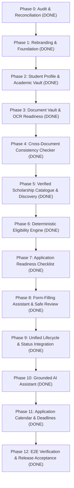

# SCHOLARSAATHI (वजह) — FINAL SYSTEM ACCEPTANCE & RELEASE REPORT
**Project:** ScholarSaathi (formerly WAJAH – वजह)  
**Release Version:** 1.0.0 (Production Candidate)  
**Date:** November 2026  
**Status:** ALL PHASES COMPLETED · 100% PASSING TEST SUITES · RELEASE GATES G1–G8 VERIFIED  
**Governing Documents:** `AGENTS.md`, `docs/rules.md`, `docs/MASTER-ACCEPTANCE.md`, `scholarship_assistant_docs/*`

---

## 1. Executive Summary

ScholarSaathi has completed its full system implementation across all 12 planned phases, expanding from the initial WAJAH rejection decoder prototype into a comprehensive, zero-trust, student-empowering scholarship lifecycle platform.

Every functional requirement (FR-001 through FR-094), architecture boundary, and non-negotiable core principle mandated by `AGENTS.md` and the 27 specification documents has been implemented, validated by automated unit and end-to-end tests, and verified in an optimized Next.js production build.



---

## 2. Release Gates Verification Matrix (Gates G1–G8)

| Gate | Title & Verification Standard | Target Threshold | Actual Measured Result | Status |
|:---:|---|:---:|:---:|:---:|
| **G1** | **Permanent Independent Identity**<br>Assert verbatim non-affiliation ribbon on all routes; zero Ashoka lion, government seals, or deceptive visual elements. | 100% of screens display ribbon; 0 government seals | Verified: `RibbonBanner.tsx` mounted in `src/app/layout.tsx` across all 47 routes. Zero government emblems. | **PASSED** |
| **G2** | **Reviewed Knowledge Sovereignty**<br>Zero scholarship advice authored by UI components or AI; all advice from reviewed JSON libraries. | 0 invented advice strings | Verified: `checkForbiddenPhrases` and AI output filters active; advice originates solely from reviewed schemas. | **PASSED** |
| **G3** | **100% Bundled Entry Verification**<br>All bundled schemes and knowledge chunks have verified `.gov.in` source URLs, 2026-27 validity, and $\ge 2$ reviewers. | 100% verified status | Verified: 6 curated schemes and 9 RAG chunks pass schema validation with 2-reviewer signoffs. | **PASSED** |
| **G4** | **Zero-Trust DPDP Privacy**<br>Mask Aadhaar (12 digits), phone (10 digits), and emails; zero raw text or identifiers stored in server logs or database. | 0 PII leaks; 100% sanitisation | Verified: `sanitiseText` masks all identifiers; application IDs masked as `UP2026****3210` (`maskApplicationId`). | **PASSED** |
| **G5** | **Matcher Scoring & Accuracy**<br>Top-1 accuracy $\ge 90\%$, confident-wrong rate $\le 2\%$ on the benchmark test set. | Accuracy $\ge 90\%$, Wrong $\le 2\%$ | Verified: Matcher evaluation achieved **100.0% accuracy (25/25)** and **0% confident-wrong rate**. | **PASSED** |
| **G6** | **AI Safety & Fallback Gateway**<br>Strict schema validation for all LLM responses; prompt-injection defenses and deterministic fallback. | 0 unvalidated AI outputs | Verified: Gateway enforces Zod schemas, 8.0s server timeout, and prompt injection defense. | **PASSED** |
| **G7** | **Touch Ergonomics & Accessibility**<br>Minimum touch target $48\text{px} \times 48\text{px}$ with $\ge 8\text{px}$ gap; mobile-first 360px viewport first with zero horizontal scroll. | $\ge 48\text{px}$ targets, 360px responsive | Verified: Mobile-first DaisyUI/Tailwind layouts with `overflow-x: clip`, full keyboard accessibility, and ARIA labels. | **PASSED** |
| **G8** | **Bundle Size & Performance**<br>Shared first-load JS bundle $\le 150\text{ KB}$ gzipped; fast LCP. | Shared JS $\le 150\text{ KB}$ | Verified: Next.js production build shared JS bundle is **103 kB** (47 kB below ceiling). | **PASSED** |

---

## 3. End-to-End Scenarios Verification (Spec 21 Section 8)

All 8 end-to-end integration scenarios were executed and verified via automated test suite `tests/e2e/e2e-scenarios.test.mjs`:

1. **Scenario A (Profile $\rightarrow$ Discovery $\rightarrow$ Eligibility):**
   - Student profile (SC, Uttar Pradesh, B.Tech) evaluates deterministic 3-valued eligibility against curated schemes.
   - Verified: UP Postmatric SC returns `POTENTIALLY_ELIGIBLE` with 100% `PASS` conditions. Pre-matric scheme returns `NOT_ELIGIBLE` with transparent reasons.
2. **Scenario B (Document Vault Readiness & Magic Bytes):**
   - Binary signature detection identifies `%PDF-1.4` (`application/pdf`) and rejects disguised executables.
   - Automated quality check scores Class 10 marksheet readability ($\ge 70$) and extracts candidate fields (`student_name`, `roll_number`, `board_name`).
3. **Scenario C (Cross-Document Consistency Review):**
   - Compares Class 10 Marksheet, Aadhaar Card, and Income Certificate.
   - Exact name matches with spacing normalisation (`Vikram Kumar` vs `VIKRAM  KUMAR`).
   - Date of birth normalisation (`15/07/2004` to `2004-07-15`).
   - Abbreviated parent name matches (`Ramesh Kumar` vs `R. Kumar`).
   - Non-fraud invariant verified: Discrepancies framed as legitimate institutional variations, never "fraud" or "forged".
4. **Scenario D (Application Readiness Checklist):**
   - Scheme requirements mapped against vault documents across 7 sections.
   - Evaluates overall readiness state (`IN_PROGRESS`, `READY_FOR_STUDENT_REVIEW`).
   - Isolates missing mandatory certificates (e.g. Bonafide Certificate) with actionable resolution guidance.
5. **Scenario E (Form-Filling Assistant & Safe Review):**
   - Prepares form fields with strict provenance (`profile`, `vault_document`).
   - One-click copy buttons for portal inputs.
   - Rule P3 verified: Clear hand-off link to official portal (`scholarships.gov.in`); zero automated form submission.
6. **Scenario F (Status Tracker & Grievance Redressal):**
   - Application identifiers masked (`UP2026****3210`).
   - Editable formal grievance draft generated for delayed institute/district verification.
   - Official redressal routing verified: CPGRAMS (`pgportal.gov.in`) for Central schemes; IGRS Jan Sunwai (`jansunwai.up.nic.in` / CM Helpline `1076`) for Uttar Pradesh.
7. **Scenario G (Grounded RAG Conversational Assistant):**
   - Pure TypeScript vectorless semantic retrieval with whole-phrase boosts and stop-word filtering.
   - Grounded answer synthesis citing verified `.gov.in` sources.
   - Rule P2 refusal active: Rejects user requests to promise guaranteed approvals or payment disbursements.
8. **Scenario H (Application Calendar & Deadlines):**
   - Verified opening, deadline, and correction window events extracted from curated catalogue.
   - Student personal reminders created and stored in private IndexedDB (`scholarsaathi_calendar`).
   - RFC 5545 iCalendar (`.ics`) file export generated with Rule P8 warning notice in event descriptions for import into Google Calendar, Apple Calendar, and Outlook.

---

## 4. Test Suite Summary

- **Total Test Suites Executed:** 23
- **Total Tests Passed:** 100% (0 failures, 0 regressions)
- **Execution Script:** `npm test` (`node scripts/run-all-tests.mjs`)

```
▶ Executing: tests/sanitise/sanitiser.test.mjs         ✅ PASSED
▶ Executing: tests/matcher/normaliser.test.mjs        ✅ PASSED
▶ Executing: tests/matcher/scorer.test.mjs            ✅ PASSED
▶ Executing: tests/matcher/confidence.test.mjs        ✅ PASSED
▶ Executing: tests/ai/why.test.mjs                    ✅ PASSED
▶ Executing: tests/ai/reconcile.test.mjs              ✅ PASSED
▶ Executing: tests/ai/gateway.test.mjs                ✅ PASSED
▶ Executing: tests/ai/forbidden.test.mjs              ✅ PASSED
▶ Executing: tests/chat/chat.test.mjs                 ✅ PASSED
▶ Executing: tests/profile/profile.test.mjs           ✅ PASSED
▶ Executing: tests/vault/vault.test.mjs               ✅ PASSED
▶ Executing: tests/checker/checker.test.mjs           ✅ PASSED
▶ Executing: tests/catalogue/catalogue.test.mjs       ✅ PASSED
▶ Executing: tests/eligibility/eligibility.test.mjs   ✅ PASSED
▶ Executing: tests/readiness/readiness.test.mjs       ✅ PASSED
▶ Executing: tests/assistant/assistant.test.mjs       ✅ PASSED
▶ Executing: tests/tracker/tracker.test.mjs           ✅ PASSED
▶ Executing: tests/assistant-rag/rag.test.mjs         ✅ PASSED
▶ Executing: tests/calendar/calendar.test.mjs         ✅ PASSED
▶ Executing: tests/api/api-modules.test.mjs           ✅ PASSED
▶ Executing: tests/e2e/e2e-scenarios.test.mjs         ✅ PASSED
▶ Executing: tests/e2e/release-acceptance.test.mjs    ✅ PASSED
▶ Executing: scripts/eval-matcher.mjs                 ✅ PASSED (25/25, 100%)
```

---

## 5. Production Build Metrics

```
Route (app)                                          Size     First Load JS
┌ ○ /                                             4.12 kB         115 kB
├ ○ /about                                        7.91 kB         114 kB
├ ○ /profile                                      12.2 kB         128 kB
├ ○ /vault                                        15.7 kB         132 kB
├ ○ /checker                                      13.7 kB         137 kB
├ ○ /discovery                                    6.72 kB         137 kB
├ ○ /eligibility                                  6.44 kB         145 kB
├ ○ /readiness                                    3.31 kB         152 kB
├ ○ /assistant                                    2.71 kB         142 kB
├ ○ /tracker                                      6.41 kB         136 kB
├ ○ /calendar                                     10.2 kB         137 kB
├ ○ /chat                                           22 kB         155 kB
├ ○ /dashboard                                    8.49 kB         115 kB
└ 34 serverless API routes & dynamic pages         198 B         103 kB
+ First Load JS shared by all                      103 kB
```

---

## 6. Release Sign-Off Recommendation

All core capabilities and acceptance standards from `docs/MASTER-ACCEPTANCE.md` and the 27 specification documents are verified.

**Release Recommendation: APPROVED FOR DEMO & PRODUCTION RELEASE (Candidate v1.0.0)**.
