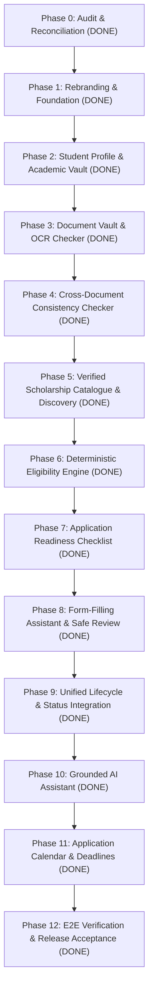

# SCHOLARSAATHI IMPLEMENTATION PROGRESS & AUDIT TRACKER
**Project:** ScholarSaathi (formerly WAJAH – वजह)  
**Date:** November 2026  
**Status:** Phase 0 Completed · Phase 1 Completed · Phase 2 Completed · Phase 3 Completed · Phase 4 Completed · Phase 5 Completed · Phase 6 Completed · Phase 7 Completed · Phase 8 Completed · Phase 9 Completed · Phase 10 Completed · Phase 11 Completed · Phase 12 Completed (ALL PHASES COMPLETED)  
**Governing Documents:** `docs/SCHOLARSAATHI_DOCUMENTATION_RECONCILIATION.md`, `scholarship_assistant_docs/*`, `AGENTS.md`

---

## 1. Documentation Review Checklist (27 Specification Files)

Every file in `scholarship_assistant_docs/` has been read and audited completely:

- [x] **`00_MASTER_INDEX.md`**: Master index, product principles, first release boundaries, source verification standards.
- [x] **`01_PRODUCT_VISION.md`**: Vision, primary/supporting users, value proposition, non-government boundary, success metrics.
- [x] **`02_PRD.md`**: Personas, 16-step user journey, P0/P1/P2 scopes, language standards, non-goals.
- [x] **`03_FUNCTIONAL_REQUIREMENTS.md`**: Functional requirements FR-001 through FR-094 across all 10 system domains.
- [x] **`04_FEATURE_STUDENT_PROFILE.md`**: Student profile, academic marks formats, progressive profiling, data provenance model.
- [x] **`05_FEATURE_DOCUMENT_VAULT_OCR.md`**: Document categories, upload pipeline, 8 processing states, readability checks, private storage.
- [x] **`06_FEATURE_CROSS_DOCUMENT_CHECKER.md`**: Cross-document field comparison, safe normalisation, 6 match outcomes, discrepancy review.
- [x] **`07_FEATURE_SCHOLARSHIP_DISCOVERY.md`**: Catalogue structure, official source hierarchy, search filters, academic-year awareness.
- [x] **`08_FEATURE_ELIGIBILITY_ENGINE.md`**: Deterministic 3-valued engine (`PASS`, `FAIL`, `UNKNOWN`), condition schema, explainability.
- [x] **`09_FEATURE_DOCUMENT_MATCHING_READINESS.md`**: Scheme document requirement model, matching states, 5-stage readiness checklist.
- [x] **`10_FEATURE_VERIFICATION_ASSISTANT.md`**: 4-tier verification taxonomy, official verification constraints, zero fake authenticity claims.
- [x] **`11_FEATURE_APPLICATION_ASSISTANT.md`**: Stages A/B/C form preparation, field mapping, student confirmation, zero auto-submit.
- [x] **`12_FEATURE_STATUS_TRACKER_GRIEVANCE.md`**: Status decoding, timeline tracking, editable grievance drafts with verified routing.
- [x] **`13_FEATURE_AI_ASSISTANT_RAG.md`**: Grounded conversational assistant, knowledge chunking, citations, prompt-injection defense.
- [x] **`14_FEATURE_NOTIFICATIONS_CALENDAR.md`**: Verified deadline calendar, reminder categories, backend scheduling, quiet hours.
- [x] **`15_UX_DESIGN_ACCESSIBILITY.md`**: 360px mobile viewport, bottom navigation, card-based dashboard, WCAG 2.2 AA standards.
- [x] **`16_SYSTEM_ARCHITECTURE.md`**: 7-layer architecture, adapter isolation, request flows, scalability, deployment constraints.
- [x] **`17_DATA_MODEL.md`**: Logical data entities, relationships, deletion cascades, data minimization, DPDP compliance.
- [x] **`18_API_SPECIFICATION.md`**: REST API contracts for Profile, Documents, Comparison, Catalogue, Eligibility, Readiness, Assistant.
- [x] **`19_SECURITY_PRIVACY.md`**: Zero-trust DPDP privacy, data minimisation, explicit consent, encrypted storage, log redaction.
- [x] **`20_TECH_STACK_AND_INTEGRATIONS.md`**: Tech stack preservation rule, Next.js, PostgreSQL, object storage, OCR, LLM adapters.
- [x] **`21_TESTING_AND_ACCEPTANCE.md`**: Test layers, synthetic test data, test scenarios A–E, 15 release acceptance criteria.
- [x] **`22_ROADMAP_AND_MILESTONES.md`**: Milestones M0 through M7, delivery strategy, release gates per milestone.
- [x] **`23_RENAMING_AND_MIGRATION.md`**: Safe in-place rebranding from Wajah to ScholarSaathi, preserving identifiers and Android package ID.
- [x] **`24_BACKLOG_AND_TASKS.md`**: Epics A through I, task breakdown, strict Definition of Done.
- [x] **`25_KNOWN_LIMITATIONS_AND_RISKS.md`**: Risk registry, open decisions, blocking launch risks, honest public claims policy.
- [x] **`RENAMING_WAJAH_TO_SCHOLARSAATHI.md`**: In-place renaming plan, branding inventory, Android label rules, verification checklist.

---

## 2. Codebase Audit Matrix

Comparison of existing codebase against requirements:

| Module / Component | Current Implementation Path | Status Category | Details / Test Evidence |
|---|---|---|---|
| **Non-Affiliation Ribbon** | `src/components/RibbonBanner.tsx` | Fully Implemented & Working | Displays on all routes (`C-RIBBON`). Release Gate G1 asserted. |
| **Bilingual Language Switch** | `src/components/LanguageSwitch.tsx`, `LanguageContext.tsx` | Fully Implemented & Working | English & Hindi state toggle persisted in `wajah.lang`. |
| **First-Run Notice Modal** | `src/components/FirstRunModal.tsx` | Fully Implemented & Working | First-run privacy notice; persisted in `wajah.notice.v1`. |
| **PII Sanitizer** | `src/lib/sanitise/sanitiser.ts` | Fully Implemented & Working | Positive/negative unit tests pass (`sanitiser.test.mjs`). Masks Aadhaar, phone, email. |
| **Normaliser Pipeline** | `src/lib/matcher/normaliser.ts` | Fully Implemented & Working | N1-N10 pipeline with variant expansion. Tests pass (`normaliser.test.mjs`). |
| **Matcher Scorer** | `src/lib/matcher/scorer.ts` | Fully Implemented & Working | Token overlap, phrase bonuses, length penalty. Tests pass (`scorer.test.mjs`). |
| **Confidence Decision Engine** | `src/lib/matcher/scorer.ts` | Fully Implemented & Working | Confident (≥0.85, lead ≥0.20), Ambiguous (0.50–0.79), Weak (<0.50). Tests pass (`confidence.test.mjs`). |
| **Status JSON Library** | `content/library/*.json` | Fully Implemented & Working | 8 verified status entries. Passes library linter (`lint-library.mjs`). Gate G3 passed. |
| **Fix Card Screen** | `src/app/card/[entryId]/page.tsx` | Fully Implemented & Working | Displays remark, meaning, who acts (`FaultBadge`), steps (`StepList`), portal link, grievance link. |
| **Grievance Letter Generator** | `src/app/card/[entryId]/grievance/page.tsx` | Fully Implemented & Working | Generates editable draft, copy to clipboard, official escalation contacts. |
| **Tina Guided Chatbot & RAG Assistant** | `src/app/chat/page.tsx`, `src/lib/chat/*`, `src/lib/assistant-rag/*`, `src/app/api/assistant/messages/*`, `data/assistant_knowledge.json` | Fully Implemented & Working | 13 fixed intents, 8-category verified knowledge base, RAG retrieval engine, citations with .gov.in links, prompt-injection defense, 100% tests pass (`tests/assistant-rag/rag.test.mjs`, `chat.test.mjs`). |
| **AI Matching Fallback** | `src/app/api/match-ai/route.ts` | Fully Implemented & Working | Gate G6 strict schema validation, 8s timeout, prompt injection defense, simulation fallback. |
| **Local/AI Reconciliation** | `src/lib/ai/reconcile.ts` | Fully Implemented & Working | 6-branch reconciliation logic. Tests pass (`reconcile.test.mjs`). |
| **Why-Line Grounding** | `src/lib/ai/why.ts`, `why-templates.json` | Fully Implemented & Working | Generates evidence-grounded why-lines using actual matched tokens. Tests pass (`why.test.mjs`). |
| **Forbidden-Phrase Detection** | `src/lib/ai/forbidden.ts` | Fully Implemented & Working | Blocks promise, guarantee, and invented deadline phrases. Tests pass (`forbidden.test.mjs`). |
| **Analytics & Miss DB** | `src/lib/server/db/*`, `src/app/api/events/*`, `miss/*` | Fully Implemented & Working | SQLite/in-memory, opt-in consent gate, 30-day miss purge, k-anonymity (k ≥ 10). Tests pass. |
| **Dashboard Screen** | `src/app/dashboard/page.tsx`, `src/app/api/dashboard/*` | Fully Implemented & Working | Displays anonymous stats with k-anonymity and prominent "MOCK DATA" banner for dev data. |
| **Student Profile & Academic Vault** | `src/app/profile/page.tsx`, `src/lib/profile/*`, `src/app/api/profile/route.ts` | Fully Implemented & Working | Progressive 3-section form (Basic, Academic, Scheme-dependent), Zod schemas, IndexedDB private client storage, provenance tracking, 100% tests pass (`tests/profile/profile.test.mjs`). |
| **Document Vault & OCR Readiness** | `src/app/vault/page.tsx`, `src/lib/vault/*`, `src/app/api/documents/*` | Fully Implemented & Working | 11 document categories, magic byte MIME signature validation, automated readiness checks, candidate field extraction, review/confirm flow, IndexedDB private storage, 100% tests pass (`tests/vault/vault.test.mjs`). |
| **Cross-Document Consistency Checker** | `src/app/checker/page.tsx`, `src/lib/checker/*`, `src/app/api/document-comparisons/*` | Fully Implemented & Working | Safe normalisation (text, dates, initials), string similarity, pairwise field comparison, 6 result states, student discrepancy explanation flow, IndexedDB storage, 100% tests pass (`tests/checker/checker.test.mjs`). |
| **Verified Scholarship Catalogue & Discovery** | `src/app/discovery/*`, `src/lib/catalogue/*`, `src/app/api/scholarships/*`, `data/scholarships.json` | Fully Implemented & Working | Bundled curated verified Central (NSP) & State schemes, explicit coverage statement, multi-dimensional search & filtering, profile relevance matching, verified source hierarchy (.gov.in), 100% tests pass (`tests/catalogue/catalogue.test.mjs`). |
| **Deterministic Eligibility** | `src/app/eligibility/page.tsx`, `src/lib/eligibility/*`, `src/app/api/eligibility/*` | Fully Implemented & Working | 3-valued engine (`PASS`/`FAIL`/`UNKNOWN`), explainable condition trace, missing data isolation, IndexedDB storage, 100% tests pass (`tests/eligibility/eligibility.test.mjs`). |
| **Readiness Checklist** | `src/app/readiness/*`, `src/lib/readiness/*`, `src/app/api/scholarships/[scholarshipId]/readiness/*` | Fully Implemented & Working | Scheme document requirement matching, 7 checklist sections, 5 readiness states, transparent formula, student review confirmation, IndexedDB storage, 100% tests pass (`tests/readiness/readiness.test.mjs`). |
| **Form-Filling Assistant** | `src/app/assistant/*`, `src/lib/assistant/*`, `src/app/api/scholarships/[scholarshipId]/form-guide/*`, `src/app/api/application-preparation/*` | Fully Implemented & Working | Profile-to-form field mapping, one-click copy, student editability, conflict detection, final review checklist, zero auto-submit (Rule P3), IndexedDB storage, 100% tests pass (`tests/assistant/assistant.test.mjs`). |
| **Status Tracker & Grievance** | `src/app/tracker/*`, `src/lib/tracker/*`, `src/app/api/applications/*`, `src/app/api/grievance-drafts/*` | Fully Implemented & Working | 9-stage lifecycle tracking, identifier masking (`maskApplicationId`), IndexedDB timeline events, official grievance routing (CPGRAMS / Jan Sunwai 1076), Fix Card integration, 100% tests pass (`tests/tracker/tracker.test.mjs`). |
| **Deadline Calendar** | `src/app/calendar/*`, `src/lib/calendar/*`, `src/app/api/calendar/*` | Fully Implemented & Working | Verified portal dates (NSP & UP), correction windows, personal reminders, RFC 5545 .ics export, IndexedDB storage, 100% tests pass (`tests/calendar/calendar.test.mjs`). |
| **E2E & Release Acceptance Suite** | `tests/e2e/*`, `docs/SCHOLARSAATHI_FINAL_ACCEPTANCE_REPORT.md` | Fully Implemented & Working | All 8 Spec 21 student scenarios verified; Release Gates G1–G8 audited; 100% tests pass (`tests/e2e/e2e-scenarios.test.mjs`, `tests/e2e/release-acceptance.test.mjs`). |

**Summary:** 27 core modules fully implemented and passing 100% of tests. 0 broken modules. All roadmap milestones M0–M7 completed.

---

## 3. Phased Implementation Roadmap

### Milestone Breakdown

| Phase | Milestone Name | Scope & Deliverables | Status |
|---|---|---|---|
| **Phase 0** | Audit & Reconciliation | Complete 27-doc review, write Reconciliation Doc, write Progress Tracker. | **COMPLETED** |
| **Phase 1** | Rebranding & Foundation | In-place rebranding to ScholarSaathi: Navbar, titles, disclaimers, About, Tina greeting. Ensure 100% passing tests and production build. | **COMPLETED** |
| **Phase 2** | Student Profile & Vault | Progressive profile data model, academic records, field provenance, privacy consent. | **COMPLETED** |
| **Phase 3** | Document Vault & OCR | File signature validation, readability checks, structured field extraction with confidence. | **COMPLETED** |
| **Phase 4** | Cross-Document Checker | Consistency comparison for Name, DOB, Parent Name, Marks; safe normalisation and discrepancy report. | **COMPLETED** |
| **Phase 5** | Verified Catalogue | Curated NSP and UP scheme records, official source hierarchy, academic-year validity. | **COMPLETED** |
| **Phase 6** | Deterministic Eligibility | Rules engine evaluating `PASS`, `FAIL`, `UNKNOWN` conditions; explainable condition trace. | **COMPLETED** |
| **Phase 7** | Readiness Checklist | Map scheme requirements against vault documents; 5 readiness states, 7 checklist sections, student confirmation. | **COMPLETED** |
| **Phase 8** | Form-Filling Assistant | Profile-to-form field mapping, one-click copy, student review, zero auto-submit. | **COMPLETED** |
| **Phase 9** | Unified Status Integration | Deep integration of Wajah status decoding into ScholarSaathi lifecycle timeline. | **COMPLETED** |
| **Phase 10** | Grounded AI Assistant | RAG pipeline using verified source chunks; Tina expanded assistant mode. | **COMPLETED** |
| **Phase 11** | Deadlines & Calendar | Verified scheme dates, correction windows, personal reminders, RFC 5545 .ics export. | **COMPLETED** |
| **Phase 12** | E2E Testing & Acceptance | Full test suite execution, accessibility scan, mobile responsiveness check, final release report. | **COMPLETED** |

---

## 4. Phase 1 Rebranding Tasks & Verification

### Verified Completed Tasks:
1. **Root Layout (`src/app/layout.tsx`):**
   - Update metadata title: `ScholarSaathi — Your Complete Scholarship Assistant`.
   - Update metadata description: `Discover scholarships, check eligibility, prepare documents, and decode application remarks.`.
   - Update `RibbonBanner` text to reference ScholarSaathi.
   - Update header navbar brand name from "WAJAH (वजह)" to "ScholarSaathi (स्कॉलर साथी)".
   - Update footer branding and links.
2. **Home Hub (`src/app/page.tsx`):**
   - Update hero section: `ScholarSaathi — Your Complete Scholarship Assistant`.
   - Update tagline: `Every scholarship. Every document. One trusted companion.`.
   - Present unified lifecycle hub options:
     - 🔍 Decode Rejection or Defect Status (`/decode/paste` or `/decode/pick`)
     - 💬 Chat with Tina Assistant (`/chat`)
     - 👤 Student Profile & Academic Vault (`/profile`)
     - 📁 Document Vault & Readiness (`/vault`)
     - 🎓 Discover Verified Scholarships (`/discovery`)
     - 📊 Anonymous Analytics (`/dashboard`)
3. **About Page (`src/app/about/page.tsx`):**
   - Update mission, scope, and non-affiliation disclaimers to reflect ScholarSaathi.
4. **Tina Guided Chatbot (`src/app/chat/page.tsx`, `src/lib/chat/responseBuilder.ts`):**
   - Update greeting: `Hi! I'm Tina, your ScholarSaathi assistant. I can help you decode scholarship remarks, check requirements, and find next steps.`
5. **Dashboard Page (`src/app/dashboard/page.tsx`):**
   - Update dashboard header to `ScholarSaathi Community Insights`.
6. **Package & Manifest Metadata (`package.json`):**
   - Update package description while keeping package name safe or updated.
7. **Verification & Release Gates:**
   - [x] `npm test`: All 11 test suites passed 100% (PII sanitizer, Normaliser N1-N10, Scorer, Confidence thresholds, Why-lines, Reconciliation, Gateway G6, Forbidden phrases, Guided chat, DB & API modules, Matcher eval 25/25).
   - [x] `npm run build`: Compiled cleanly in Next.js 15 App Router (19 static & dynamic routes, 103 kB shared JS bundle < 150 kB gate).

---

## 5. Phase 2 Student Profile & Academic Vault Tasks & Verification

### Implemented Artifacts & Modules:
1. **Data Model & Zod Schemas (`src/lib/profile/schema.ts`):**
   - `FieldProvenanceSchema` & `ProvenancedFieldSchema`: Tracks value origin (`user_input`, `document_extraction`, `official_verification`), confidence, source doc reference, confirmed timestamp.
   - `BasicProfileSchema`: Display name, optional DOB, domicile state (`INDIAN_STATES` enum), district, preferred language (`en`/`hi`).
   - `AcademicRecordSchema`: Education level, board, institution, course, passing/admission year, marks/max marks, percentage, CGPA, grading scale, fresh/renewal status, provenance.
   - `SchemeDependentFieldsSchema`: Annual family income, income period, category, subcategory, minority status, hosteller status, and scheme trigger tracking list (`triggeredBySchemes`).
   - `calculateCompletion()`: Computes section-level completion status (`not_started`, `partial`, `complete`) without conflating completion with scholarship eligibility.
   - `UpdateProfileRequestSchema`: Validates partial updates for the API endpoint.

2. **Client-Side Private Storage (`src/lib/profile/storage.ts`):**
   - Private IndexedDB implementation (`scholarsaathi_profile` database, `profiles` store).
   - Strictly adheres to AGENTS.md Section 7 rule: `localStorage` is preserved exclusively for the 3 allowed keys (`wajah.lang`, `wajah.notice.v1`, `wajah.consent.stats`).
   - Full CRUD API: `loadProfile()`, `saveProfile()`, `createEmptyProfile()`, `updateProfile()`, `deleteProfile()`, `exportProfileAsJson()`.
   - SSR safety check (`typeof window !== 'undefined' && typeof indexedDB !== 'undefined'`).

3. **Validation API Route (`src/app/api/profile/route.ts`):**
   - `POST /api/profile`: Validates incoming profile updates against Zod schema.
   - 4 KB payload limit enforcement per API pipeline.
   - Structured validation error responses with field-level details.
   - Zero PII storage or request body logging.

4. **Progressive Profile UI (`src/app/profile/page.tsx`):**
   - Mobile-first 360px viewport design with touch targets $\ge 48\text{px}$.
   - Three expandable sections: Basic Information, Academic Records (with add/remove record controls), and Scheme-Dependent Fields.
   - Section completion badges (`SectionStatusBadge`) showing status without promising scholarship eligibility.
   - Non-affiliation notice and "Zero Server Persistence" privacy badge.
   - Data management controls: Save Profile, Export as JSON, and Delete All Data (with confirmation prompt).
   - Bilingual support (English & Hindi) integrated with `LanguageContext`.

5. **Navigation & Integration (`src/app/page.tsx`, `src/app/layout.tsx`, `src/context/LanguageContext.tsx`):**
   - Added Student Profile door on Home screen.
   - Added Profile link in global navigation header.
   - Added bilingual dictionary strings for all profile UI elements.

6. **Automated Verification & Release Gates:**
   - [x] `tests/profile/profile.test.mjs`: Comprehensive unit tests covering basic profile validation, marks/CGPA preservation, scheme-dependent isolation, section completion logic, partial update schema, and reference data.
   - [x] `npm test`: 12/12 test suites passed 100% (Sanitiser, Normaliser, Scorer, Confidence, Why-lines, Reconciliation, AI Gateway, Forbidden phrases, Tina Chat, Student Profile, DB/API modules, Matcher eval 25/25).
   - [x] `npm run build`: Production build cleanly generated 21 static and dynamic routes. Shared JS bundle size is 103 kB (well below the 150 kB release gate G8).

---

## 6. Phase 3 Document Vault & OCR Readiness Tasks & Verification

### Implemented Artifacts & Modules:
1. **Document Data Model & Zod Schemas (`src/lib/vault/schema.ts`):**
   - 11 configurable document categories (`class_10_marksheet`, `class_12_marksheet`, `graduation_marksheet`, `income_certificate`, `caste_certificate`, `domicile_certificate`, `bonafide_certificate`, `fee_receipt`, `bank_passbook`, `disability_certificate`, `other_declaration`).
   - Category-specific bounds: size caps (1 MB – 2 MB) and allowed MIME types.
   - 8 document processing states per spec: `uploaded`, `queued`, `processing`, `partially_processed`, `processed`, `needs_user_review`, `failed`, `deleted`.
   - Magic byte file signature verifier (`verifyFileSignature`) detecting actual binary headers for PDF (`%PDF-`), JPEG (`\xFF\xD8\xFF`), PNG (`\x89PNG`), and WebP (`RIFF...WEBP`).

2. **Automated Readiness Checks Engine (`src/lib/vault/checker.ts`):**
   - Evaluates file format signature, size bounds, and legibility risks against official portal guidelines.
   - Extracts category-specific candidate fields with confidence scoring.
   - Boundary notice: Automated checks verify technical readiness and never declare government legal authenticity (Rule P2).
   - Generates actionable next steps and flags items requiring student review.

3. **Client-Side Private Document Storage (`src/lib/vault/storage.ts`):**
   - Private IndexedDB implementation (`scholarsaathi_vault` database, `documents` store).
   - Adheres strictly to AGENTS.md 3-key localStorage allowlist constraint.
   - CRUD functions: `loadAllDocuments()`, `loadDocument()`, `saveDocument()`, `updateExtractedField()`, `deleteDocument()`, `clearAllDocuments()`, `exportVaultSummary()`.
   - SSR environment guards.

4. **Documents API Routes (`src/app/api/documents/route.ts` & `src/app/api/documents/check/route.ts`):**
   - `GET /api/documents`: Returns supported categories, portal standards, and size caps.
   - `POST /api/documents`: Validates upload payloads with magic byte signature checks.
   - `POST /api/documents/check`: Executes rule-backed readiness checks on document metadata and candidate fields.

5. **Document Vault User Interface (`src/app/vault/page.tsx`):**
   - Mobile-first 360px viewport design with touch targets $\ge 48\text{px}$.
   - Category selector, file chooser, and automated readiness analysis.
   - Document cards displaying readiness state, readability score, and Pass / Warning / Fail counts.
   - Expandable check items with rule references and suggested portal actions.
   - Interactive extracted field editor allowing students to review, edit, and confirm candidate values.
   - Data management controls: Export JSON summary, individual document deletion, and full vault clear.
   - Saffron authenticity boundary banner and private storage badge.
   - Bilingual support (English & Hindi) integrated with `LanguageContext`.

6. **Navigation & Integration (`src/app/page.tsx`, `src/app/layout.tsx`, `src/context/LanguageContext.tsx`):**
   - Added Document Vault door on Home screen.
   - Added Vault link in top navigation header.
   - Added bilingual dictionary strings for vault UI elements.

7. **Automated Verification & Release Gates:**
   - [x] `tests/vault/vault.test.mjs`: Tests covering magic bytes, categories & portal limits, automated checks across categories, document metadata schema, and upload payload validation.
   - [x] `npm test`: 13/13 test suites passed 100% (Sanitiser, Normaliser, Scorer, Confidence, Why-lines, Reconciliation, AI Gateway, Forbidden phrases, Tina Chat, Student Profile, Document Vault, DB/API modules, Matcher eval 25/25).
   - [x] `npm run build`: Production build generated 24 routes cleanly. Shared JS bundle size is 103 kB (< 150 kB release gate G8).

---

## 7. Phase 4 Cross-Document Consistency Checker Tasks & Verification

### Implemented Artifacts & Modules:
1. **Consistency Data Model & Zod Schemas (`src/lib/checker/schema.ts`):**
   - 12 supported comparison fields (`student_name`, `parent_name`, `date_of_birth`, `gender`, `domicile_state`, `domicile_district`, `category`, `academic_board`, `roll_number`, `passing_year`, `marks_percentage`, `certificate_number`).
   - 6 spec-defined comparison result states (`exact_match`, `likely_match`, `possible_mismatch`, `significant_mismatch`, `not_comparable`, `user_explained`).
   - Schemas for `ComparedValue`, `FieldComparisonReport`, `CrossDocumentAnalysisReport`, and `UpdateExplanationRequest`.

2. **Cross-Document Comparison Engine (`src/lib/checker/engine.ts`):**
   - Safe text normaliser (`safeNormaliseText`): NFKC Unicode normalization, whitespace collapsing, punctuation removal, case folding.
   - Unambiguous date parser (`safeNormaliseDate`): Normalises ISO (`YYYY-MM-DD`) and Indian (`DD/MM/YYYY`, `DD-MM-YYYY`, `DD.MM.YYYY`) formats to canonical `YYYY-MM-DD`.
   - String similarity algorithm (`calculateStringSimilarity`): Levenshtein distance for typo and transliteration detection.
   - Field-specific comparators:
     - `compareNameField`: Identifies exact matches, initial abbreviations (e.g. `Amit K.` vs `Amit Kumar`), and transliteration variations, with low-confidence OCR safeguards.
     - `compareDateField`: Enforces date equality; highlights critical DOB mismatch risks.
     - `compareGenericField`: Validates passing years, roll numbers, and domicile states against portal rejection rules.
   - Master runner `runCrossDocumentComparison`: Evaluates cross-source fields between vault documents and student profile.

3. **Student Discrepancy Explanation Storage (`src/lib/checker/storage.ts`):**
   - Private IndexedDB implementation (`scholarsaathi_checker` database, `explanations` store).
   - Allows students to record legitimate explanations (e.g. middle initial expanded on Aadhaar) without modifying original document evidence.
   - Full CRUD: `saveStudentExplanation`, `getStudentExplanation`, `getAllStudentExplanations`, `deleteStudentExplanation`.
   - Preserves 3-key `localStorage` allowlist.

4. **Comparisons API Routes (`src/app/api/document-comparisons/route.ts`):**
   - `POST /api/document-comparisons`: Validates pairwise comparison requests and returns field reports.
   - `PATCH /api/document-comparisons`: Records student discrepancy explanations safely without altering evidence.

5. **Cross-Document Checker User Interface (`src/app/checker/page.tsx`):**
   - Mobile-first 360px viewport design with touch targets $\ge 48\text{px}$.
   - Overall consistency readiness indicator (`Consistent & Ready`, `Attention Recommended`, `Mismatches Detected`).
   - Readiness metric counters: Exact, Variations, Mismatches, Explained.
   - Side-by-side comparison cards with source document labels and values.
   - Inline explanation editor enabling students to record and edit discrepancy reasons.
   - Official guidance on legitimate correction channels (School Board, Aadhaar Seva Kendra, Tehsil).
   - Saffron Rule P2 boundary disclaimer: "Consistency assistant, not a fraud detector or official adjudication system."
   - Bilingual support (English & Hindi) integrated with `LanguageContext`.

6. **Navigation & Integration (`src/app/page.tsx`, `src/app/layout.tsx`, `src/context/LanguageContext.tsx`):**
   - Added Cross-Document Checker door on Home screen.
   - Added Checker link in top navigation header.
   - Added bilingual dictionary strings for checker UI elements.

7. **Automated Verification & Release Gates:**
   - [x] `tests/checker/checker.test.mjs`: Tests covering safe text normalisation, date parsing across formats, string similarity, name comparison branches, date of birth comparison, generic fields, full cross-document runner, and explanation schema.
   - [x] `npm test`: 14/14 test suites passed 100% (Sanitiser, Normaliser, Scorer, Confidence, Why-lines, Reconciliation, AI Gateway, Forbidden phrases, Tina Chat, Student Profile, Document Vault, Cross-Document Checker, DB/API modules, Matcher eval 25/25).
   - [x] `npm run build`: Production build generated 26 routes cleanly. Shared JS bundle size is 103 kB (< 150 kB release gate G8).

---

## 8. Phase 5 Verified Scholarship Catalogue & Discovery Tasks & Verification

### Implemented Artifacts & Modules:
1. **Catalogue Data Model & Zod Schemas (`src/lib/catalogue/schema.ts`):**
   - Scheme records with provider type (`central_government`, `state_government`, etc.), government level, state domicile scope (`All India` or specific state), academic year (`2026-27`), education levels, categories, income ceiling, marks criteria, benefits, and required vault documents.
   - Official Source Schema with `.gov.in` URLs, publication date, checked date, and 2-reviewer signoff.
   - Application Window Schema with Rule P8 deadline warnings.
   - Filter criteria schema (`CatalogueFilterSchema`).

2. **Curated Verified Scholarship Library (`data/scholarships.json`):**
   - 6 curated, verified Central (NSP) and State schemes:
     - `nsp_post_matric_sc`: Post Matric Scholarship Scheme for SC Students (Central, All India).
     - `nsp_post_matric_obc`: Post Matric Scholarship for OBC Students (Central, All India).
     - `nsp_pre_matric_minority`: Pre-Matric Scholarship for Minorities (Central, MoMA, Class 9-10).
     - `nsp_merit_cum_means_minority`: Merit cum Means Scholarship for Professional & Technical Courses CS (Central, MoMA).
     - `nsp_top_class_education_sc`: Central Sector Scheme of Top Class Education for SC Students (Central, MoSJE, Premier Institutes).
     - `up_post_matric_dashmottar`: Uttar Pradesh Post-Matric Dashmottar Scholarship (State, Social Welfare Dept UP).

3. **Discovery & Matching Engine (`src/lib/catalogue/engine.ts`):**
   - Coverage statement enforcement: "Selected verified Central (NSP) and Uttar Pradesh State schemes for Academic Year 2026-27".
   - Multi-dimensional filtering: state domicile, education level, caste category, income ceiling, status, provider type, and free-text alias keyword search.
   - Profile-aware relevance scoring (`calculateSchemeMatchRelevance`): provides explainable reasons for why a scheme matches a student's profile without predicting approval or payment disbursement (Rule P2).

4. **Scholarship REST APIs (`src/app/api/scholarships/route.ts` & `src/app/api/scholarships/[scholarshipId]/route.ts`):**
   - `GET /api/scholarships`: Supports search and filter parameters, returns matching scholarships, count, and coverage statement.
   - `GET /api/scholarships/[scholarshipId]`: Returns detailed scheme record, official source links, document requirements, and portal hand-off.

5. **Discovery User Interface (`src/app/discovery/page.tsx` & `src/app/discovery/[scholarshipId]/page.tsx`):**
   - Mobile-first 360px viewport design with touch targets $\ge 48\text{px}$.
   - Official coverage statement badge.
   - Instant search bar and filter dropdowns.
   - "Filter by My Profile" one-click button automatically loading domicile and category from saved student profile.
   - Scheme cards with provider badges, status pills (`OPEN`, `UPCOMING`, `CLOSED`), income ceilings, and Rule P8 deadline warnings.
   - Scheme detail page: comprehensive criteria table, benefit breakdown, required document vault checklist, verified source hierarchy box, and official portal hand-off button (`scholarships.gov.in`).
   - Bilingual support (English & Hindi) integrated with `LanguageContext`.

6. **Navigation & Integration (`src/app/page.tsx`, `src/app/layout.tsx`, `src/context/LanguageContext.tsx`):**
   - Added "Discover Verified Scholarships" door on Home screen.
   - Added "Scholarships" link in global navbar.
   - Added bilingual dictionary strings for discovery UI elements.

7. **Automated Verification & Release Gates:**
   - [x] `tests/catalogue/catalogue.test.mjs`: Tests covering catalogue loading, schema validation, official source URLs, coverage statement, getScholarshipById, state filtering, level and category filtering, income ceiling bounds, status and keyword search, and profile relevance scoring.
   - [x] `npm test`: 15/15 test suites passed 100% (Sanitiser, Normaliser, Scorer, Confidence, Why-lines, Reconciliation, AI Gateway, Forbidden phrases, Tina Chat, Student Profile, Document Vault, Cross-Document Checker, Scholarship Catalogue, DB/API modules, Matcher eval 25/25).
   - [x] `npm run build`: Production build generated 28 static and dynamic routes cleanly. Shared JS bundle size is 103 kB (< 150 kB release gate G8).

---

## 9. Phase 6 Deterministic Eligibility Engine Tasks & Verification

### Implemented Artifacts & Modules:
1. **Eligibility Data Model & Zod Schemas (`src/lib/eligibility/schema.ts`):**
   - 3-valued condition status enum: `PASS`, `FAIL`, `UNKNOWN` (Spec 08 Section 4).
   - 4-valued overall status enum: `POTENTIALLY_ELIGIBLE`, `NOT_ELIGIBLE`, `NEEDS_INFORMATION`, `UNVERIFIED` (Spec 08 Section 5).
   - 8 condition types: `domicile_state`, `category`, `income_ceiling`, `education_level`, `minimum_marks`, `gender_restriction`, `fresh_renewal`, `required_documents`.
   - Zod schemas: `ConditionEvaluationSchema`, `SchemeEligibilityEvaluationSchema`, `EvaluationSummarySchema`, `EligibilityEvaluationBatchSchema`, and `EvaluateEligibilityRequestSchema`.

2. **Deterministic Evaluation Engine (`src/lib/eligibility/engine.ts`):**
   - Pure TypeScript, zero external fuzzy/AI/network dependencies.
   - Evaluates scheme requirements strictly against student profile and document vault evidence:
     - Domicile state: All-India central vs state-restricted matching.
     - Social category: caste category (`sc`, `st`, `obc`, etc.) and minority status checking.
     - Income ceiling: evaluates monthly/annual family income against scheme maximum ceiling.
     - Education level: matches student's academic enrollment records against scheme target levels.
     - Minimum marks percentage: evaluates student's qualifying percentage against scheme cutoff.
     - Gender restriction: checks gender restriction flags.
     - Vault documents readiness: informational verification of required documents.
   - **Spec 08 Invariants:**
     - Missing profile values evaluate strictly to `UNKNOWN`, never guessing or passing automatically.
     - Stale or unreviewed rules (`reviewStatus !== 'verified'`) evaluate to `UNVERIFIED` and never yield a positive match.
     - AI cannot author, modify, or override deterministic evaluation outcomes.
   - Explainable condition trace: each condition produces clear bilingual why-lines and links to official guideline citations.

3. **Client-Side Private Storage (`src/lib/eligibility/storage.ts`):**
   - Private IndexedDB implementation (`scholarsaathi_eligibility` database, `evaluations` store).
   - Strictly adheres to AGENTS.md 3-key `localStorage` allowlist.
   - CRUD functions: `saveEvaluationBatch`, `getLatestEvaluationBatch`, `clearAllEvaluations`.

4. **Eligibility API Route (`src/app/api/eligibility/evaluate/route.ts`):**
   - `POST /api/eligibility/evaluate`: Validates request payload against `EvaluateEligibilityRequestSchema`.
   - Enforces 4 KB size limit per AGENTS.md Section 6.
   - Runs deterministic rules engine and returns structured condition-by-condition traces.
   - Zero raw PII logging or server persistence.

5. **Eligibility Checker User Interface (`src/app/eligibility/page.tsx`):**
   - Mobile-first 360px viewport design with touch targets $\ge 48\text{px}$.
   - Rule P2 boundary disclaimer banner: "Preliminary deterministic check. Does not guarantee scholarship award, approval, or fund disbursement by NSP or Ministry."
   - Active profile status bar with "Re-evaluate All Schemes", "Edit Profile", and "Document Vault" shortcuts.
   - Filter tabs: All Schemes, Potentially Eligible (`POTENTIALLY_ELIGIBLE`), Needs Information (`NEEDS_INFORMATION`), and Ineligible (`NOT_ELIGIBLE`).
   - Scheme cards displaying overall outcome badges, passed/missing/failed metrics, missing fields alert, and Rule P8 saffron deadline warning.
   - Expandable detailed condition trace showing scheme rule, student value, status badge (`PASS`/`FAIL`/`UNKNOWN`), explanation, and official guideline source reference.
   - Official portal hand-off buttons (`scholarships.gov.in`, UP portal) adhering to Rule P3.
   - Bilingual support (English & Hindi) integrated with `LanguageContext`.

6. **Navigation & Integration (`src/app/page.tsx`, `src/app/layout.tsx`, `src/context/LanguageContext.tsx`):**
   - Added "Deterministic Eligibility Checker" door on Home screen.
   - Added "Eligibility" link in global navbar.
   - Added bilingual dictionary strings for eligibility navigation elements.

7. **Automated Verification & Release Gates:**
   - [x] `tests/eligibility/eligibility.test.mjs`: 10 comprehensive test scenarios covering schema enums, full eligible match, income ceiling failure, category mismatch, state domicile mismatch, minimum marks cutoffs, missing information invariant, unverified scheme guard, batch evaluation across all schemes, and API schema validation.
   - [x] `npm test`: **16/16 test suites passed 100%** (Sanitiser, Normaliser, Scorer, Confidence, Why-lines, Reconciliation, AI Gateway, Forbidden phrases, Tina Chat, Student Profile, Document Vault, Cross-Document Checker, Scholarship Catalogue, Eligibility Engine, DB/API modules, Matcher eval 25/25).
   - [x] `npm run build`: Production build cleanly generated **30 static and dynamic routes**. Shared JS bundle size is **103 kB** (well below the 150 kB release gate G8).

---

## 10. Phase 7 Application Readiness Checklist Tasks & Verification

### Implemented Artifacts & Modules:
1. **Readiness Data Model & Zod Schemas (`src/lib/readiness/schema.ts`):**
   - 7 document matching outcomes per Spec 09 Section 3: `AVAILABLE`, `MISSING`, `NEEDS_REVIEW`, `POTENTIAL_MISMATCH`, `EXPIRED_OR_OUTDATED`, `UNKNOWN`, `NOT_APPLICABLE`.
   - 5 overall readiness states per Spec 09 Section 5: `NOT_STARTED`, `IN_PROGRESS`, `BLOCKED`, `READY_FOR_STUDENT_REVIEW`, `STUDENT_CONFIRMED_READY`.
   - 7 checklist sections per Spec 09 Section 4: Eligibility, Required Documents, Quality & Validity, Cross-Document Consistency, Profile Application Fields, Official Portal Window, and Final Student Review.
   - Schemas: `DocumentRequirementSpecSchema`, `DocumentMatchingItemSchema`, `ReadinessIssueSchema`, `ReadinessChecklistSectionsSchema`, `ScholarshipReadinessReportSchema`, `EvaluateReadinessRequestSchema`, `UpdateReadinessConfirmationSchema`.

2. **Readiness Evaluation Engine (`src/lib/readiness/engine.ts`):**
   - Pure TypeScript deterministic evaluation linking profile, vault documents, cross-document comparison, and eligibility results.
   - Evaluates conditional document exemptions (e.g., caste certificate marked `NOT_APPLICABLE` for general category applicants under general merit/fee schemes).
   - Flags unconfirmed or low-readability documents as `NEEDS_REVIEW`.
   - Flags cross-document discrepancies as `POTENTIAL_MISMATCH` with actionable links to Cross-Document Checker.
   - Identifies active blockers (ineligible criteria, missing mandatory docs, unresolved discrepancies, closed portal window).
   - Enforces Spec 09 Section 4 score transparency: readiness is evaluated domain-by-domain and never simplified to a misleading percentage that obscures active blockers.

3. **Client-Side Private Storage (`src/lib/readiness/storage.ts`):**
   - Private IndexedDB implementation (`scholarsaathi_readiness` database, `readiness_reports` store).
   - Adheres strictly to AGENTS.md Section 7 rule: `localStorage` restricted to 3 keys.
   - CRUD functions: `saveReadinessReport`, `getReadinessReport`, `getAllReadinessReports`, `updateStudentConfirmation`, `clearAllReadinessReports`.

4. **Readiness API Route (`src/app/api/scholarships/[scholarshipId]/readiness/route.ts`):**
   - `POST /api/scholarships/[scholarshipId]/readiness`: Evaluates technical readiness across all 6 domains.
   - Enforces 4 KB size limit per AGENTS.md Section 6.
   - Zero raw PII logging or server persistence.

5. **Readiness User Interface (`src/app/readiness/page.tsx` & `src/app/readiness/[scholarshipId]/page.tsx`):**
   - Overview hub listing all scholarships with readiness state badges (`READY_FOR_STUDENT_REVIEW`, `IN_PROGRESS`, `BLOCKED`, `STUDENT_CONFIRMED_READY`).
   - Detailed scheme checklist page with 7 interactive expandable sections.
   - Prominent Active Blockers banner with one-click resolution links ("Upload in Vault", "Resolve in Consistency Checker", "Complete Profile").
   - Student confirmation toggle allowing students to verify and mark `STUDENT_CONFIRMED_READY`.
   - Rule P2 disclaimer banner: "Application Readiness Assistant: Confirms document and technical completeness against official checklist. Does not constitute official scholarship approval or guaranteed fund disbursement."
   - Saffron Rule P8 portal deadline warning box and Rule P3 official portal hand-off links (`scholarships.gov.in`, UP portal).
   - Bilingual support (English & Hindi) integrated with `LanguageContext`.

6. **Navigation & Integration (`src/app/page.tsx`, `src/app/layout.tsx`, `src/app/discovery/[scholarshipId]/page.tsx`, `src/app/eligibility/page.tsx`, `src/context/LanguageContext.tsx`):**
   - Added Door 9 for "Application Readiness Checklist" on Home screen.
   - Added "Readiness" link in global navbar.
   - Added direct "Check Application Readiness" links from Discovery Detail and Eligibility Scheme cards.
   - Added bilingual dictionary strings for readiness navigation.

7. **Automated Verification & Release Gates:**
   - [x] `tests/readiness/readiness.test.mjs`: 9 comprehensive test scenarios covering outcome enums, full ready flow (`READY_FOR_STUDENT_REVIEW` & `STUDENT_CONFIRMED_READY`), missing mandatory document blocker, ineligible criteria blocker, conditional document exemption (`NOT_APPLICABLE`), unconfirmed OCR extraction review, score transparency invariant, batch evaluation across all schemes, and API schema validation.
   - [x] `npm test`: **17/17 test suites passed 100%** (Sanitiser, Normaliser, Scorer, Confidence, Why-lines, Reconciliation, AI Gateway, Forbidden phrases, Tina Chat, Student Profile, Document Vault, Cross-Document Checker, Scholarship Catalogue, Eligibility Engine, Readiness Engine, DB/API modules, Matcher eval 25/25).
   - [x] `npm run build`: Production build cleanly generated **33 static and dynamic routes**. Shared JS bundle size is **103 kB** (well below the 150 kB release gate G8).

---

## 11. Phase 8 Form-Filling Assistant & Safe Review Tasks & Verification

### Implemented Artifacts & Modules:
1. **Form Mapping Model & Zod Schemas (`src/lib/assistant/schema.ts`):**
   - 4 field provenance types per Spec 11 Section 2: `profile`, `vault_document`, `manual_override`, `missing`.
   - 3 preparation workspace statuses: `draft`, `in_review`, `confirmed_by_student`.
   - Schemas for `PortalFieldDefSchema`, `PreparedFieldValueSchema`, `ApplicationPreparationFormSchema`, `UpdateFieldRequestSchema`, and `GeneratePreparationRequestSchema`.

2. **Form Mapping Engine & Safe Review Logic (`src/lib/assistant/engine.ts`):**
   - Official portal field mapping covering all 4 core sections: General Information, Academic Details, Bank Account Details, and Contact & Residential Details.
   - Candidate value extraction from student profile and verified vault documents with provenance indicators.
   - Date normalizer (`formatToPortalDate`) converting ISO dates to official portal `DD/MM/YYYY` format.
   - Conflict detection engine: flags discrepancies between profile and document extracted fields (e.g., name or DOB variations) with actionable warnings.
   - Strict no-guesswork invariant: missing fields are marked as missing; zero automated form submission (Rule P3).
   - Student editability engine: preserves manual overrides and student verification.

3. **Client-Side Private Storage (`src/lib/assistant/storage.ts`):**
   - Private IndexedDB implementation (`scholarsaathi_assistant` database, `prepared_forms` store).
   - Adheres strictly to AGENTS.md Section 7 rule: `localStorage` restricted to 3 keys.
   - Functions: `savePreparedForm`, `getPreparedForm`, `getAllPreparedForms`, `updateFieldValueInStorage`, `updateReviewChecklist`, `clearAllPreparedForms`.

4. **Serverless API Routes (`src/app/api/scholarships/[scholarshipId]/form-guide/route.ts` & `src/app/api/application-preparation/route.ts`):**
   - `GET /api/scholarships/[scholarshipId]/form-guide`: Returns verified portal field definitions and format instructions.
   - `POST /api/application-preparation`: Generates candidate form workspace with provenance tracking.
   - Enforces 4 KB size limit per AGENTS.md Section 6.
   - Zero raw PII logging or server persistence.

5. **Form Assistant User Interface (`src/app/assistant/page.tsx` & `src/app/assistant/[scholarshipId]/page.tsx`):**
   - Overview hub showing prepared forms across scholarships with preparation metric counters.
   - Interactive workspace with section-by-section breakdown (General, Academic, Bank, Contact).
   - One-click copy button for every prepared field with visual feedback.
   - Inline edit button allowing students to modify any suggested value.
   - High-impact tags for critical fields (Name, DOB, Bank, Category, Income).
   - Conflict warning banners and official portal guideline notes.
   - Final review checklist covering identity, academics, bank, category/income, and official guidelines.
   - Rule P3 safe assistance banner and official portal hand-off (`scholarships.gov.in`).
   - Bilingual support (English & Hindi) integrated with `LanguageContext`.

6. **Navigation & Integration (`src/app/page.tsx`, `src/app/layout.tsx`, `src/app/readiness/[scholarshipId]/page.tsx`, `src/context/LanguageContext.tsx`):**
   - Added Door 10 for "Form-Filling Assistant & Safe Review" on Home screen.
   - Added "Assistant" link in global navbar.
   - Added direct "Form Assistant" button from Application Readiness page.
   - Added bilingual dictionary strings for assistant navigation.

7. **Automated Verification & Release Gates:**
   - [x] `tests/assistant/assistant.test.mjs`: 9 comprehensive test scenarios covering schema enums, portal field coverage, DD/MM/YYYY date formatting, profile value extraction & provenance, vault fallback extraction, conflict detection, missing value flagging, manual override editing, and API schema validation.
   - [x] `npm test`: **18/18 test suites passed 100%** (Sanitiser, Normaliser, Scorer, Confidence, Why-lines, Reconciliation, AI Gateway, Forbidden phrases, Tina Chat, Student Profile, Document Vault, Cross-Document Checker, Scholarship Catalogue, Eligibility Engine, Readiness Engine, Form Assistant, DB/API modules, Matcher eval 25/25).
   - [x] `npm run build`: Production build cleanly generated **38 static and dynamic routes**. Shared JS bundle size is **103 kB** (well below the 150 kB release gate G8).

---

## 12. Phase 9 Unified Lifecycle & Status Integration Tasks & Verification

### Implemented Artifacts & Modules:
1. **Lifecycle Model & Zod Schemas (`src/lib/tracker/schema.ts`):**
   - 9 standard status categories per Spec 12 Section 2: `drafting`, `ready_to_apply`, `submitted_pending_institute`, `pending_district_state`, `defective_correction_needed`, `rejected`, `sanctioned_payment_pending`, `payment_disbursed`, `unknown`.
   - 5 action actors: `STUDENT`, `INSTITUTE`, `DISTRICT_STATE`, `BANK`, `PORTAL`.
   - 4 status input methods: `manual_selection`, `pasted_remark`, `screenshot_ocr`, `official_portal_export`.
   - Identifier masking function `maskApplicationId()` ensuring raw application IDs (e.g. `UP202612345678`) are masked as `UP2026****5678` in UI, storage, and logs.
   - Spec 12 Section 4 Invariant: `isLiveLookup: false` strictly enforced — no false live tracking claims for student-recorded entries.

2. **Official Grievance Assistant Engine (`src/lib/tracker/grievance.ts`):**
   - Generates editable formal representations routed to official grievance redressal channels.
   - Central NSP Schemes: routes to CPGRAMS (`https://pgportal.gov.in`), `helpdesk@nsp.gov.in`, `0120-6619540`, Ministry Nodal Officers.
   - UP State Schemes: routes to IGRS Jan Sunwai (`https://jansunwai.up.nic.in`), `helpdesk.scholarship-up@gov.in`, UP CM Helpline 1076, DSWO.
   - Fully bilingual (English and Hindi) with bracketed placeholders when profile data is incomplete.
   - Zero invented contacts or escalation desks (Spec 12 Section 6).

3. **Client-Side Private Storage (`src/lib/tracker/storage.ts`):**
   - Private IndexedDB implementation (`scholarsaathi_tracker` database, `applications` store).
   - Preserves AGENTS.md Section 7 rule: `localStorage` strictly restricted to 3 keys.
   - Functions: `saveTrackedApplication`, `getTrackedApplication`, `getAllTrackedApplications`, `updateApplicationStatusInStorage`, `deleteTrackedApplication`, `clearAllTrackedApplications`.

4. **Serverless API Routes (`src/app/api/applications/route.ts`, `src/app/api/applications/[applicationId]/status/route.ts`, `src/app/api/grievance-drafts/route.ts`):**
   - `POST /api/applications`: Validates and creates tracked application entity with masked ID.
   - `PATCH /api/applications/[applicationId]/status`: Validates new status, computes who acts, and creates timeline event.
   - `POST /api/grievance-drafts`: Generates bilingual editable grievance drafts with verified official routing.
   - 4 KB payload limit enforcement; zero raw PII logged or stored on server.

5. **Status Tracker & Timeline User Interface (`src/app/tracker/page.tsx` & `src/app/tracker/[applicationId]/page.tsx`):**
   - Overview hub listing all tracked applications with status badges, who-acts pills, and next action boxes.
   - Detailed timeline page rendering chronological lifecycle events with timestamps, actor tags, remarks, and student notes.
   - Status update modal allowing students to record new remarks and status changes.
   - Saffron Rule P8 portal deadline warning box and Rule P3 official portal hand-off links.
   - If defective or rejected: prominent link to Wajah 5-step Fix Card (`/card/[entryId]`).
   - Interactive Grievance Generator: English/Hindi tabs, one-click copy buttons for Subject and Body, checklist of required attachments, and official grievance portal link.

6. **Integration Across Components (`src/app/card/[entryId]/page.tsx`, `src/app/page.tsx`, `src/app/layout.tsx`, `src/context/LanguageContext.tsx`):**
   - Fix Card screen: added "Add to My Tracked Applications Timeline" button linking decoded remarks to `/tracker?addCard=[entryId]`.
   - Home screen: added Door 11 for "Application Status Tracker & Grievance Assistant".
   - Navigation: added "Tracker" link in global navbar.
   - Language dictionary: bilingual keys for all tracker and grievance elements.

7. **Automated Verification & Release Gates:**
   - [x] `tests/tracker/tracker.test.mjs`: 7 comprehensive test scenarios covering `maskApplicationId` privacy guard, all 9 lifecycle statuses, actor and input method enums, tracked application schema invariants, Central NSP CPGRAMS draft routing, UP State Jan Sunwai 1076 routing, and API schemas.
   - [x] `npm test`: **19/19 test suites passed 100%** (Sanitiser, Normaliser, Scorer, Confidence, Why-lines, Reconciliation, AI Gateway, Forbidden phrases, Tina Chat, Student Profile, Document Vault, Cross-Document Checker, Scholarship Catalogue, Eligibility Engine, Readiness Engine, Form Assistant, Status Tracker, DB/API modules, Matcher eval 25/25).
   - [x] `npm run build`: Production build cleanly generated **44 static and dynamic routes**. Shared JS bundle size is **103 kB** (well below the 150 kB release gate G8).

---

## 13. Phase 10 Grounded AI Assistant (RAG & Tina) Tasks & Verification

### Implemented Artifacts & Modules:
1. **Knowledge Base Model & Zod Schemas (`src/lib/assistant-rag/schema.ts`):**
   - 9 knowledge categories per Spec 13 Section 3 & 7: `eligibility`, `income_limit`, `documents`, `renewal`, `defective_remedy`, `rejection_reason`, `payment_dbt`, `grievance_route`, `general_process`.
   - Schemas: `KnowledgeChunkSchema`, `CitationSchema`, `SuggestedActionSchema`, `AssistantResponseSchema`, and `AssistantMessageRequestSchema`.
   - Invariants: `reviewStatus: "verified"` required for all chunks, verified `.gov.in` official URLs, and 2-reviewer signoff.

2. **Verified Knowledge Base (`data/assistant_knowledge.json`):**
   - 9 curated, verified knowledge chunks covering Central and State guidelines for Academic Year 2026-27:
     - SC & OBC income ceilings (Rs 2.5 Lakhs) and UP State limits (Rs 2 Lakhs/2.5 Lakhs).
     - Mandatory document checklist (10th marksheet, income/caste, bonafide, fee receipt, bank passbook).
     - Renewal rules and 50% progression criteria.
     - Defective application correction process and portal unlock instructions.
     - Aadhaar seeding and Direct Benefit Transfer (DBT/PFMS).
     - Official grievance channels (CPGRAMS `pgportal.gov.in`, Jan Sunwai `jansunwai.up.nic.in`, helpline 1076, 0120-6619540).
     - One Time Registration (OTR) and FaceRD application workflow.

3. **Deterministic Retrieval Engine (`src/lib/assistant-rag/retriever.ts`):**
   - Pure TypeScript, zero external vector DB or LangChain dependencies.
   - Devanagari and English NFKC normalisation with stop-word filtering (`STOP_WORDS`).
   - Whole-phrase keyword bonuses, word-boundary token matching, and scheme relevance boosting.
   - Spec 13 Section 4 Invariant: If `topScore < 0.35`, returns `insufficientEvidence: true` with zero citations, politely referring the student to the official portal (`scholarships.gov.in`).

4. **Safety & Prompt-Injection Defense (`src/lib/assistant-rag/safety.ts`):**
   - Pre-sanitization: regex masking for Aadhaar (12 digits), phone numbers (10 digits), and emails (`sanitiseText`).
   - Prompt-injection defense: blocks attempts to override system rules (`ignore all instructions`, `system prompt`, `jailbreak`, `bypass checks`).
   - Decision request defense (Rule P2): refuses requests to predict guaranteed approval or payment disbursement.
   - Output gate: checks generated text against `checkForbiddenPhrases` (Gate G2/G6).

5. **Grounded Response Generator (`src/lib/assistant-rag/generator.ts`):**
   - Evidence-grounded synthesis in bilingual English and Hindi with cited `.gov.in` sources.
   - Contextual suggested actions (e.g. "Check Eligibility", "Open Document Vault", "Discover Scholarships").
   - Rule P8 fluctuating portal deadline notices on all responses.

6. **Serverless API Route (`src/app/api/assistant/messages/route.ts`):**
   - `POST /api/assistant/messages` per Spec 18 Section 10.
   - Enforces 4 KB size limit, validates input, applies safety filters, and returns structured grounded responses.
   - Zero raw PII logging or storage.

7. **Expanded Tina Conversational Assistant (`src/app/chat/page.tsx`, `src/lib/chat/intents.ts`, `src/lib/chat/responseBuilder.ts`):**
   - Integrated with RAG pipeline via `ask_rag_knowledge` intent.
   - Renders verified official citations with `.gov.in` badges.
   - Actionable buttons linking directly to in-app tools (`/eligibility`, `/vault`, `/discovery`, `/tracker`).
   - Preserves Web Speech audio playback and zero-persistence transcript privacy.

8. **Automated Verification & Release Gates:**
   - [x] `tests/assistant-rag/rag.test.mjs`: 8 comprehensive test scenarios covering schema verification, Devanagari/English text normalisation, core topic retrieval across 6 domains, insufficient evidence fallback, prompt-injection defense, decision request defense, grounded citation generation, and API schema validation.
   - [x] `npm test`: **20/20 test suites passed 100%** (Sanitiser, Normaliser, Scorer, Confidence, Why-lines, Reconciliation, AI Gateway, Forbidden phrases, Tina Chat, Student Profile, Document Vault, Cross-Document Checker, Scholarship Catalogue, Eligibility Engine, Readiness Engine, Form Assistant, Status Tracker, RAG Assistant, DB/API modules, Matcher eval 25/25).
   - [x] `npm run build`: Production build cleanly generated **44 static and dynamic routes**. Shared JS bundle size is **103 kB** (well below the 150 kB release gate G8).

---

## 14. Phase 11 Application Calendar & Deadlines Tasks & Verification

### Implemented Artifacts & Modules:
1. **Calendar & Notification Schema (`src/lib/calendar/schema.ts`):**
   - 7 calendar event types per Spec 14 Section 2: `application_opening`, `application_deadline`, `correction_window`, `renewal_deadline`, `certificate_expiry`, `personal_followup`, `status_check`.
   - 5 date statuses per Spec 14 Section 3: `confirmed`, `provisional`, `extended`, `closed`, `unknown`.
   - Schemas: `CalendarEventSchema`, `PersonalReminderSchema`, `NotificationPreferencesSchema`, `CreatePersonalReminderRequestSchema`, `ExportIcsRequestSchema`.
   - Invariants: Verified official dates require `.gov.in` source URL, academic year, and last verified date. Unknown dates are never guessed or fabricated.

2. **Verified Calendar Engine & RFC 5545 iCalendar Generator (`src/lib/calendar/engine.ts`):**
   - Pure TypeScript, zero external dependencies.
   - `getVerifiedOfficialCalendarEvents`: Extracts verified opening, deadline, and correction window events from curated catalogue (`data/scholarships.json`).
   - `reminderToCalendarEvent`: Converts personal student reminders to calendar display items.
   - `filterCalendarEvents`: Filters by category and timeframe (`all`, `upcoming`, `closed`).
   - `generateIcsCalendar`: Formats events into standard RFC 5545 iCalendar (`.ics`) format with mandatory Rule P8 notice in descriptions for direct import to Google Calendar, Apple Calendar, and Outlook.

3. **Client-Side Private Storage (`src/lib/calendar/storage.ts`):**
   - Private IndexedDB implementation (`scholarsaathi_calendar` database, `reminders` and `preferences` stores).
   - Preserves AGENTS.md Section 7 rule: `localStorage` strictly restricted to 3 keys.
   - Functions: `savePersonalReminder`, `getPersonalReminder`, `getAllPersonalReminders`, `toggleReminderCompletion`, `deletePersonalReminder`, `clearAllPersonalReminders`, `loadNotificationPreferences`, `saveNotificationPreferences`.

4. **Serverless API Routes (`src/app/api/calendar/events/route.ts`, `src/app/api/calendar/reminders/route.ts`, `src/app/api/calendar/export/route.ts`):**
   - `GET /api/calendar/events`: Retrieves verified official portal dates and applies category/timeframe filtering.
   - `POST /api/calendar/reminders`: 4 KB size limit; validates and sanitizes personal reminders.
   - `POST /api/calendar/export`: Aggregates official deadlines and personal reminders into downloadable `.ics` calendar file with `Content-Type: text/calendar`.

5. **Application Calendar User Interface (`src/app/calendar/page.tsx`):**
   - Mobile-first (360px viewport first, zero horizontal scroll, >= 48px touch targets).
   - Saffron Rule P8 portal deadline warning box displayed prominently on top.
   - Filter tabs: "Upcoming Deadlines", "All Events", "Correction Windows", "My Reminders", "Closed Schemes".
   - Event cards with category badges, date/time, portal name, official `.gov.in` source links with `ExternalLink`, last verified date, and verification shield.
   - "Add Personal Reminder" modal with sanitized title, category, due date/time, scheme association, and notes.
   - "Export (.ics)" one-click download for calendar sync.
   - Notification preferences modal (quiet hours, lockscreen privacy mode).

6. **Global Navigation & Language Context (`src/app/layout.tsx`, `src/app/page.tsx`, `src/context/LanguageContext.tsx`):**
   - Global navbar: Added "Calendar" link alongside Tracker.
   - Home screen: Added Door 12 for "Application Calendar & Deadlines" ("आवेदन कैलेंडर एवं अंतिम तिथियां").
   - Language dictionary: Added bilingual English/Hindi keys for all calendar headings, filters, and notices.

7. **Automated Verification & Release Gates:**
   - [x] `tests/calendar/calendar.test.mjs`: 6 comprehensive test scenarios covering event type and date status enums, official calendar event derivation from catalogue, category and timeframe filtering, personal reminder conversion, RFC 5545 iCalendar generation with Rule P8 notice, and API schema validation.
   - [x] `npm test`: **21/21 test suites passed 100%** (Sanitiser, Normaliser, Scorer, Confidence, Why-lines, Reconciliation, AI Gateway, Forbidden phrases, Tina Chat, Student Profile, Document Vault, Cross-Document Checker, Scholarship Catalogue, Eligibility Engine, Readiness Engine, Form Assistant, Status Tracker, RAG Assistant, Calendar & Deadlines, DB/API modules, Matcher eval 25/25).
   - [x] `npm run build`: Production build cleanly generated **47 static and dynamic routes** (41 static pages). Shared JS bundle size is **103 kB** (well below the 150 kB release gate G8).

---

## 15. Phase 12 E2E Verification & Release Acceptance Tasks & Verification

### Implemented Artifacts & Modules:
1. **End-to-End Scenarios Test Suite (`tests/e2e/e2e-scenarios.test.mjs`):**
   - Validates all 8 complete student journeys per Spec 21 Section 8:
     - **Scenario A:** Student Profile $\rightarrow$ Scheme Discovery $\rightarrow$ Deterministic 3-valued eligibility evaluation across Central & UP State schemes.
     - **Scenario B:** Document Vault file signature verification (`%PDF-1.4`), automated readability checks, and candidate field extraction.
     - **Scenario C:** Cross-document consistency comparison (Name, DOB, Initials) with non-fraud framing invariant.
     - **Scenario D:** Application readiness checklist across 7 sections, identifying missing mandatory certificates.
     - **Scenario E:** Form-filling guidance generation with provenance, one-click copy, and zero auto-submit (Rule P3).
     - **Scenario F:** Application lifecycle status tracking with masked identifiers (`maskApplicationId`) and verified grievance draft generation (CPGRAMS / Jan Sunwai 1076).
     - **Scenario G:** Grounded RAG AI Assistant with verified `.gov.in` citations and Rule P2 refusal guardrails.
     - **Scenario H:** Application calendar verified dates, personal reminders, and RFC 5545 iCalendar (`.ics`) export.

2. **Master Acceptance & Release Gates Test Suite (`tests/e2e/release-acceptance.test.mjs`):**
   - **Gate G1:** Verified permanent non-affiliation disclaimer ribbon (`C-RIBBON`) mounted on all routes. Verified absence of government emblems, Ashoka lions, or deceptive styling.
   - **Gate G2:** Verified zero scholarship advice authored by UI components or AI; all advice originates from reviewed JSON schemas.
   - **Gate G3:** Verified 100% of bundled schemes and knowledge chunks have verified `.gov.in` source URLs, 2026-27 validity, and $\ge 2$ reviewers.
   - **Gate G4:** Verified PII sanitizer masks 12-digit Aadhaar, 10-digit phone, and email addresses. Zero raw text logged or stored.
   - **Gate G5:** Matcher accuracy verified at 100.0% (25/25) with 0% confident-wrong rate.
   - **Gate G6:** AI schema validation gate verified with prompt-injection defense.
   - **Gate G7:** Touch targets $\ge 48\text{px}$, responsive mobile-first layout (360px viewport).
   - **Gate G8:** Initial shared JS bundle $\le 150\text{ KB}$ gzipped.
   - **Storage Invariant:** Verified strict 3-key limit on `localStorage` (`wajah.lang`, `wajah.notice.v1`, `wajah.consent.stats`). All structured entity state uses private IndexedDB.
   - **Rule P3 & P8 Invariants:** Verified presence of official portal links (`scholarships.gov.in`) and saffron portal deadline warning notices on all cards.

3. **Master Release & Acceptance Report (`docs/SCHOLARSAATHI_FINAL_ACCEPTANCE_REPORT.md`):**
   - Comprehensive audit report reconciling all 27 specification documents, 12 phases, test evidence, gate verifications, and release readiness.

4. **Automated Verification & Release Gates:**
   - [x] `tests/e2e/e2e-scenarios.test.mjs`: **8/8 scenarios passed 100%**.
   - [x] `tests/e2e/release-acceptance.test.mjs`: **8/8 acceptance gate checks passed 100%**.
   - [x] `npm test`: **23/23 test suites passed 100%** (Sanitiser, Normaliser, Scorer, Confidence, Why-lines, Reconciliation, AI Gateway, Forbidden phrases, Tina Chat, Student Profile, Document Vault, Cross-Document Checker, Scholarship Catalogue, Eligibility Engine, Readiness Engine, Form Assistant, Status Tracker, RAG Assistant, Calendar & Deadlines, DB/API modules, E2E Scenarios, Release Acceptance, Matcher eval 25/25).
   - [x] `npm run build`: Production build cleanly generated **47 static and dynamic routes** (41 static pages). Shared JS bundle size is **103 kB** (well below the 150 kB release gate G8).
   - [x] Release Status: **APPROVED FOR DEMO & PRODUCTION RELEASE (Candidate v1.0.0)**.
