# Wajah — Architecture (Consolidated)

> Consolidated from the architecture files supplied for Wajah — Rejection Decoder. Source content is reproduced verbatim; only heading levels were deepened so each source section nests under the part and source label shown below.

## Source key

| Source file | Contents |
|---|---|
| `architecture.md` | Reproduced under “Source: `architecture.md`” in each part |
| `architecture__1_.md` | Reproduced under “Source: `architecture__1_.md`” in each part |
| `WAJAH_MASTER_SOFTWARE_ARCHITECTURE_SPECIFICATION__1_.md` | Reproduced under “Source: `WAJAH_MASTER_SOFTWARE_ARCHITECTURE_SPECIFICATION__1_.md`” in each part |

Section numbers, section references (e.g. “§17”) and table-of-contents links inside each reproduced source refer to that source file's own numbering. Where the sources differ on a point, each version is kept under its own source label and none has been resolved.

## Parts

1. Document Overview, Scope and Goals
2. System Context and High-Level Architecture
3. Technology Stack
4. Layers, Components, Repository and Module Layout
5. Client / Frontend Architecture
6. Decode Pipeline, Matching and Core Engine
7. Content Pipeline and Reviewed Library
8. Server, API and AI Integration
9. OCR, Voice, Audio and Share
10. Key Runtime Flows
11. Data Architecture
12. Offline, PWA and Performance
13. Security and Privacy
14. Feature Flags, Deployment, Observability and Failure Handling
15. Testing Architecture
16. Architecture Decision Records
17. Build Sequencing, Risks, Open Decisions, Invariants and Document Notes

---

## Part 1 — Document Overview, Scope and Goals

### Source: `architecture.md`

#### Wajah --- System Architecture

**Product:** Wajah --- Rejection Decoder\
**Document version:** 1.0\
**Aligned PRD:** v1.1 · 1 November 2026\
**Source specification:** *Wajah App Build Specification with Chat v1.1
AI layer*\
**Status:** Proposed implementation architecture\
**Classification:** Independent prototype; not a government service

> **Trust boundary:** Wajah explains messages using a reviewed,
> source-linked library. It does not determine eligibility,
> approve/reject applications, track payments, access student accounts,
> or submit applications or grievances. The student always performs the
> final action on the official portal.

------------------------------------------------------------------------

##### 1. Architecture goals

The architecture is designed to:

1.  Deliver a fast, mobile-first PWA that works on low-bandwidth
    connections.
2.  Keep the reviewed scholarship library and core matching logic in the
    browser.
3.  Make tap-list decoding and pre-bundled fix cards available offline
    after the first successful load.
4.  Use AI only to interpret free-text input and return structured
    candidate IDs and signals.
5.  Ensure all user-facing scholarship explanations and next steps are
    rendered from reviewed library content---not generated by AI.
6.  Sanitise all text before any AI request and avoid storing raw
    messages, transcripts, images, or drafts.
7.  Degrade safely when AI, network, browser APIs, or optional features
    are unavailable.
8.  Keep content maintenance separate from application code.
9.  Support English and Hindi with reviewable translations.
10. Make uncertainty explicit rather than forcing a match.

### Source: `architecture__1_.md`

#### Wajah — Architecture

> Independent prototype. Not a government service. Not affiliated with NSP or any ministry.

| | |
|---|---|
| **Document** | System architecture for Wajah (Rejection Decoder) |
| **Version** | 1.0 (draft for build) |
| **Date** | 1 November 2026 |
| **Inputs** | *Wajah App Build Specification v1.1 (with Chat and AI layer)* and `PRD.md` |
| **Audience** | Frontend, backend/AI, content and QA engineers |

**Conventions.** Thresholds, sizes and timings are **design choices** to tune, not facts about NSP. Where the source spec contradicts itself (PRD §29), this document states the **architectural decision taken** (see §17, ADRs) so engineers are not left guessing; the team lead may overrule any ADR.

---

##### Table of contents

1. [Architectural drivers](#1-architectural-drivers)
2. [System context](#2-system-context)
3. [High-level architecture](#3-high-level-architecture)
4. [Technology stack](#4-technology-stack)
5. [Repository and module layout](#5-repository-and-module-layout)
6. [Client architecture](#6-client-architecture)
7. [Core engine (browser-side)](#7-core-engine-browser-side)
8. [Content pipeline and library](#8-content-pipeline-and-library)
9. [Server architecture](#9-server-architecture)
10. [AI integration architecture](#10-ai-integration-architecture)
11. [Key runtime flows](#11-key-runtime-flows)
12. [Data architecture](#12-data-architecture)
13. [Offline, PWA and performance](#13-offline-pwa-and-performance)
14. [Security and privacy architecture](#14-security-and-privacy-architecture)
15. [Deployment, environments and CI/CD](#15-deployment-environments-and-cicd)
16. [Observability and operations](#16-observability-and-operations)
17. [Architecture decision records](#17-architecture-decision-records)
18. [Failure modes and degradation](#18-failure-modes-and-degradation)
19. [Testing architecture](#19-testing-architecture)
20. [Build sequencing and risks](#20-build-sequencing-and-risks)

---

##### 1. Architectural drivers

These drivers come from the ten product principles (P1–P10) and the target users (low-end Android, patchy data, Hindi-first).

| # | Driver | Architectural consequence |
|---|---|---|
| D1 | **Library is the only source of advice** (P5) | Advice text exists only in reviewed JSON. UI components contain no advice strings. AI outputs are IDs/enums/numbers only. |
| D2 | **Honest uncertainty** (P7) | Deterministic local matcher with conservative thresholds; explicit `choose` and `none` outcomes; AI can never silently overrule a confident local result. |
| D3 | **Privacy by default** (P10) | No accounts, no persistence of user text, no request-body logging, DB with no user/device identifiers, consent-gated events. |
| D4 | **Works offline, low bandwidth** (P9) | Browser does matching, rendering, print, share-image and Listen. Server is optional and non-blocking. Strict byte budgets. |
| D5 | **AI is an optional accelerator, never a dependency** | Every AI call is wrapped by a timeout and a local fallback; the app is fully functional with AI off. |
| D6 | **Content changes without code changes** | Library, variants, intents, templates, lint lists are data files validated by CI. |
| D7 | **Independent, not official** (P1) | Ribbon baked into the root layout; allowed-domain lint; forbidden-phrase lint on all strings. |
| D8 | **Safety enforced mechanically** | Build-time linters, schema validation, test gates (confident-and-wrong rate) rather than reviewer vigilance alone. |

**Quality-attribute priorities (highest first):** Safety/trustworthiness → Privacy → Availability (offline) → Performance on low-end devices → Maintainability of content → Cost control of AI.

---

### Source: `WAJAH_MASTER_SOFTWARE_ARCHITECTURE_SPECIFICATION__1_.md`

#### WAJAH — MASTER SOFTWARE ARCHITECTURE SPECIFICATION

**Project:** Wajah — Rejection Decoder  
**Document type:** Consolidated master architecture specification  
**Source version:** Six uploaded architecture documents, each marked Version 1.0 and updated 1 November 2026  
**Consolidated on:** 2 November 2026  
**Status:** Engineering draft  
**Purpose:** Single reference for Wajah's system design, architecture decisions, frontend and backend responsibilities, project structure, and scalability/performance targets.

> **Source scope:** This file consolidates the six uploaded architecture documents. Requirements, terminology, routes, endpoints, decisions, and targets are retained from those sources. Unresolved choices remain unresolved; no provider, database requirement, benchmark, or deployment decision has been invented.

##### Document map

1. System Architecture
2. Architecture Decision Records
3. Frontend Engineering Specification
4. Backend Engineering Specification
5. Project Structure
6. Scalability and Performance

##### Architecture at a glance

- **Overall pattern:** Client-first, local-first Progressive Web App (PWA) with a small stateless API.
- **Core journey:** Sanitise input, normalise it, run local matching, reconcile results, and render a fix card from the reviewed library.
- **Advice authority:** The reviewed content library is the sole source of advice. AI may classify/select identifiers but must not author policy or advice.
- **Privacy:** No accounts, student sessions, application history, or persistent raw decode input. User text remains in memory only.
- **AI:** Optional and provider-neutral; provider selection remains unresolved. AI failure falls back to the local route.
- **Data store:** PostgreSQL is optional and proposed only for anonymous aggregate events, feedback, and short-lived consented miss data.
- **OCR:** On-device OCR is the accepted direction. Remote vision requires a separate flag and explicit notice.
- **Eligibility:** Eligibility rulings are explicitly outside the current product scope.
- **Resilience:** The core experience must work when the backend, AI provider, or optional database is unavailable.

---

---

## Part 2 — System Context and High-Level Architecture

### Source: `architecture.md`

##### 2. High-level system context

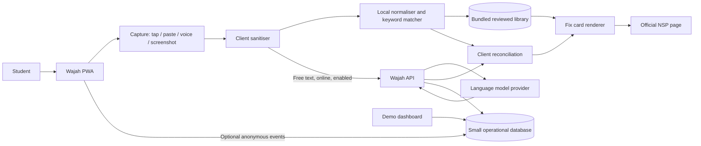

The diagram represents logical responsibilities. The official NSP page
is an external hand-off, not an integrated backend. Wajah must not
scrape or automate the portal.

###### 2.1 Trust boundaries

  -----------------------------------------------------------------------
  Boundary                Data crossing it        Controls
  ----------------------- ----------------------- -----------------------
  Student → browser       Typed/pasted text,      Length validation,
                          transcript, selected    client-side
                          screenshot              sanitisation, explicit
                                                  review/confirmation

  Browser → Wajah API     Sanitised free-text and HTTPS, schema
                          minimal request         validation, rate
                          metadata                limits, no request-body
                                                  logging

  Wajah API → AI provider Sanitised text and      Server-held key,
                          allowed library         prompt-injection
                          IDs/schema              defence, strict JSON
                                                  schema, timeout and
                                                  spend cap

  Browser/API → database  Anonymous event         No raw message text or
                          counters, feedback      direct identifiers;
                          category, operational   retention limits
                          metadata                

  Browser → official NSP  User-initiated          Clear external-link
                          navigation only         label; no login
                                                  automation or form
                                                  submission
  -----------------------------------------------------------------------

### Source: `architecture__1_.md`

##### 2. System context

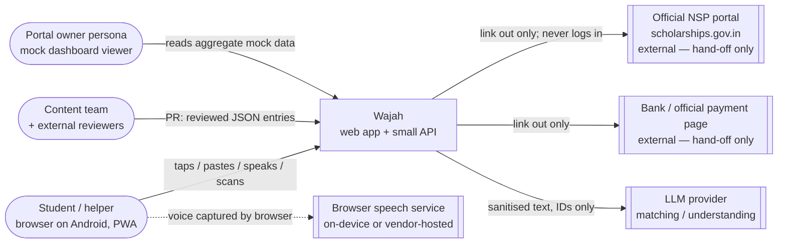

**Boundaries that must never be crossed**
- Wajah → NSP: **navigation only** (outbound link, new tab, `rel="noopener noreferrer"`). No API calls, scraping, credentials, or form submission.
- Wajah → LLM: **only sanitised, normalised text ≤ 500 chars** plus a server-owned entry list. No identifiers, IP forwarding, or session data.
- Wajah → third-party analytics: **none.**

---

##### 3. High-level architecture

Wajah is a **client-heavy, content-first PWA** with a **thin stateless API**. Most of the product runs in the browser from a static, versioned library bundle.

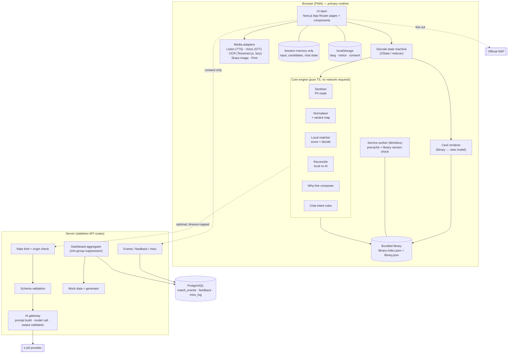

###### 3.1 Design stance in one paragraph
The **browser owns the decision loop** (sanitise → normalise → match → decide → render). The **server is an optional second opinion and a sink for anonymous counters**; if it disappears, the product continues. The **library JSON is the single source of truth for every sentence of advice**, and CI enforces that with linters. The **AI gateway is a validator-wrapped function** whose only legal outputs are whitelisted IDs, enumerations and numbers.

###### 3.2 Layering rules (enforced by lint / import boundaries)

| Layer | May import | Must not import |
|---|---|---|
| `components/` (UI) | `lib/*` view-model helpers, `state/` | `lib/ai` network client directly (go through state machine); advice literals |
| `state/` (machine) | `lib/matcher`, `lib/sanitise`, `lib/ai` client | React / DOM |
| `lib/matcher`, `lib/sanitise` | pure utils only | Network, DOM, localStorage |
| `lib/library` | JSON data, types | UI |
| `app/api/*` (server) | `lib/server/*`, validators | Client-only modules; raw logging libs that log bodies |

---

### Source: `WAJAH_MASTER_SOFTWARE_ARCHITECTURE_SPECIFICATION__1_.md`

##### 1. System Architecture

#### System Architecture

##### Decision
Client-first, local-first PWA with a small stateless API. This supports fast matching, offline cards, minimal data retention and no AI dependency for the core journey.

```mermaid
flowchart TD
 U[Student browser] --> UI[Next.js PWA]
 UI --> SAN[Sanitiser]
 SAN --> N[Normaliser]
 N --> LM[Local matcher]
 LM --> R[Reconciliation]
 UI --> LIB[Bundled reviewed library]
 LM --> LIB
 R -->|Optional free-text AI| API[/api/understand]
 API --> ORCH[Provider adapter]
 ORCH --> MODEL[Configured model]
 API --> VAL[Schema validator]
 VAL --> R
 R --> CARD[Library-rendered fix card]
 CARD --> NSP[Official NSP destination]
 UI --> DB[(Optional anonymous data)]
```

##### Frontend
Next.js App Router, TypeScript, responsive routes and typed library schema. Decode reducer states: IDLE, PICKING, PASTING, SANITISING, MATCHING_LOCAL, MATCHING_AI, DISAMBIGUATING, RESULT, NO_MATCH, GRIEVANCE, SHARE, REPORT. User text remains in memory only.

##### Backend
Small API surface: `/api/match-ai`, `/api/understand`, `/api/grievance-draft`, `/api/events`, `/api/feedback`, `/api/miss`, `/api/dashboard`. The server owns the candidate allowlist and library version; client must not submit arbitrary prompt context. No request-body logging.

##### AI
AI returns fixed situation fields, entry ID, confidence and alternatives. Server validates schema/enums/IDs/ranges. Advice comes only from library. Local/AI disagreement leads to student choice.

##### Data
Static library JSON; optional PostgreSQL for anonymous events, feedback and short-lived consented miss data. No user ID, IP, device ID, cookie ID or exact timestamp. Dashboard reads aggregate-only through server with suppression.

##### Failure behaviour
AI down/timeout/cap → local route. DB down → core remains unaffected. No match → S09. Unknown entry → S03. OCR fail → paste/tap. Invalid input → inline correction, never echo unsafe input.

##### Trust boundaries
Browser input, OCR, transcript, model response and external links are untrusted. Library is trusted only after review. Use schema validation, escaping, official-domain allowlist and explicit user action. No government API is confirmed.

---

---

## Part 3 — Technology Stack

### Source: `architecture.md`

##### 3. Recommended technology stack

The source build specification recommends the following stack. These are
implementation choices, not a claim that the app has already been built.

  -----------------------------------------------------------------------
  Layer                   Recommended choice      Responsibility
  ----------------------- ----------------------- -----------------------
  Web application         Next.js App Router +    Routing, rendering, API
                          TypeScript              routes, PWA shell

  Styling                 Tailwind CSS            Responsive, accessible
                                                  UI

  Decode state            XState or a small typed Explicit decode and
                          reducer                 failure states

  Internationalisation    next-intl or equivalent English/Hindi locale
                                                  files and fallback

  Local matching          Plain TypeScript module Deterministic keyword
                                                  matching

  Content library         Versioned               Reviewed explanations,
                          JSON/TypeScript data    actions, sources,
                          bundled with app        translations

  AI integration          Next.js server route +  Structured
                          language-model API      understanding and
                                                  constrained draft-slot
                                                  filling

  OCR                     Tesseract.js,           On-device OCR; no image
                          lazy-loaded with        upload by default
                          English/Hindi language  
                          data                    

  Voice                   Browser Web Speech API  Speech-to-text;
                                                  transcript reviewed
                                                  before decode

  Audio playback          Browser speech          Read card content aloud
                          synthesis; reviewed     
                          audio fallback if       
                          needed                  

  PWA/offline             Service worker using    Cache app shell,
                          Workbox or              library, and static
                          Next.js-compatible PWA  assets
                          tooling                 

  Database                PostgreSQL through      Optional anonymous
                          Supabase or Neon;       events, feedback, and
                          SQLite acceptable for a operational records
                          local demo              

  Hosting                 Vercel, Netlify, or     Static assets and
                          another HTTPS Node host server routes

  Unit tests              Vitest                  Matcher, sanitiser,
                                                  reconciliation, library
                                                  validation

  E2E tests               Playwright              User journeys, offline
                                                  behaviour, error states

  Accessibility tests     axe                     Automated accessibility
                                                  checks

  Charts                  Recharts or lightweight Demo dashboard only
                          SVG                     

  Share/print             html-to-image or        Client-side card image
                          Canvas; browser print   and A4 output
                          CSS                     

  Third-party analytics   None                    Privacy by default
  -----------------------------------------------------------------------

###### 3.1 Stack decisions

-   Use TypeScript end-to-end to share types for library entries,
    matcher output, and API schemas.
-   Keep matching and card rendering independent of the AI provider.
-   Keep OCR language packs out of the initial JavaScript bundle; load
    them only after the user selects Scan.
-   Do not add a database dependency to the offline decode path.
-   Do not place AI provider credentials in browser code or public
    environment variables.
-   Select and document the exact AI provider/model before
    implementation; provider choice remains an open project decision.

### Source: `architecture__1_.md`

##### 4. Technology stack

| Concern | Choice | Rationale / notes |
|---|---|---|
| Framework | **Next.js (App Router), TypeScript** | SSG for cards and static pages gives first paint without JS; API routes cover the thin server. |
| Styling | **Tailwind CSS** | Small CSS output; design tokens for fault-label colours, 18 px base type. |
| State | **XState** (or a typed reducer) | Every failure state explicit (PRD §8.3). |
| i18n | **next-intl** | `en.json`, `hi.json`; per-string English fallback; `lang` attributes. |
| Matching | Plain TS module | Deterministic, ≤ 50 ms, unit-testable, tiny bundle. |
| AI | Server route → LLM provider via `MATCH_MODEL` (starting suggestion `claude-haiku-5-5`; any provider) | Key server-side only; cheapest model that passes the match test set. |
| OCR | **Tesseract.js** (EN + HI), lazy-loaded, on-device | Images never leave device by default; optional `FEATURE_OCR_SERVER`. |
| Voice in | **Web Speech API** (SpeechRecognition) | Hidden if unsupported; transcript reviewed before decode. |
| Voice out | **speechSynthesis**, fallback to pre-generated audio from reviewed text | Hindi voices vary per device. |
| Share/print | `html-to-image` or canvas; dedicated print CSS | 1080×1350 PNG; A4 B/W-safe. |
| Charts | Recharts or small SVG components | Always paired with table alternative. |
| PWA | **Workbox** service worker | Offline tap list, cards, About, print. |
| DB | **PostgreSQL** (Supabase/Neon); SQLite acceptable for demo | Three tiny tables; insert-only from public. |
| Hosting | Vercel / Netlify / any Node host over HTTPS | Static shell + serverless API routes. |
| Testing | **Vitest** (unit/matcher eval), **Testing Library**, **Playwright** (e2e/offline), **axe** (a11y) | Mirrors PRD §26. |
| Lint/validation | Custom scripts + **Zod** (or Ajv) schemas | `lint:library`, forbidden phrases, domain allow-list. |
| Analytics | **None (third-party)** | Own consented events only. |

**Dependency policy:** lockfile committed; automated vulnerability scanning; no third-party scripts at runtime; every new dependency justified against the 150 KB first-load JS budget.

---

---

## Part 4 — Layers, Components, Repository and Module Layout

### Source: `architecture.md`

##### 4. Logical architecture layers

###### 4.1 Presentation layer

Owns screens, navigation, language selection, user input, result cards,
accessibility and visible status.

Main areas:

-   App shell and permanent independence ribbon.
-   Home/capture doors.
-   Tap-list status categories.
-   Paste, voice and screenshot capture.
-   Sanitisation review.
-   Reading/loading and cancel states.
-   "What we understood" chips and "Why this match".
-   Candidate selection and no-match states.
-   Fix card and official source panel.
-   Grievance draft review.
-   Share/print view.
-   Error reporting.
-   Demo dashboard with mock-data banner.

###### 4.2 Client domain layer

Owns deterministic business rules that should run locally:

-   Input validation and normalisation.
-   Sensitive-pattern detection and masking.
-   Local keyword matcher.
-   Candidate scoring and reconciliation.
-   Confidence/uncertainty decision.
-   Library lookup and card composition.
-   Locale fallback.
-   Feature-flag evaluation.
-   Session-state transitions.

This layer must not depend on React components or a live API.

###### 4.3 Content layer

Owns the reviewed rejection library and language resources.

-   Versioned, bundled entries.
-   Stable entry IDs.
-   Match phrases, variants, exclusions and test cases.
-   English/Hindi copy and translation review status.
-   Official source title, issuer, URL, checked date and verification
    state.
-   Responsible party and ordered action steps.
-   Draft/unverified labels where required.

The content library is the only source of user-facing scholarship
advice.

###### 4.4 Server/API layer

Owns network-only capabilities:

-   AI understanding endpoint.
-   AI grievance-template slot endpoint, when enabled.
-   Optional anonymous event ingestion.
-   Error-report ingestion.
-   Demo dashboard aggregation endpoint, if server-backed.
-   Rate limiting, provider key management, validation and redacted
    operational logging.

###### 4.5 External services

-   AI model provider, called only from server-side code.
-   Browser speech recognition service, where supported by the browser.
-   Official NSP website, opened only by the user.
-   Optional managed PostgreSQL service.

No external service is required for tap-list decoding or displaying
bundled fix cards.

##### 5. Component architecture

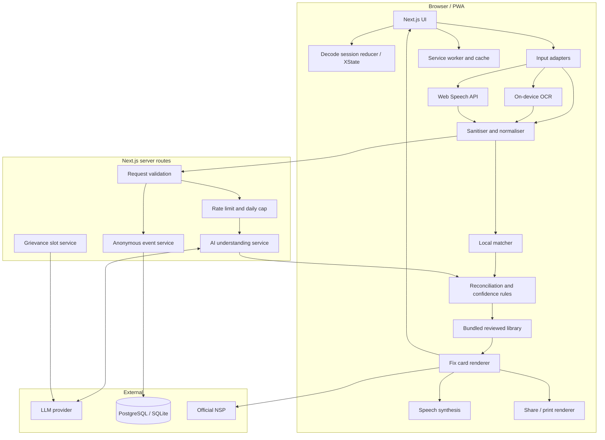

###### 5.1 Module responsibilities

  -----------------------------------------------------------------------
  Module            Input             Output            Must not do
  ----------------- ----------------- ----------------- -----------------
  Capture adapters  User action,      Text or selected  Persist raw input
                    text, audio       library ID        
                    transcript or                       
                    image                               

  OCR adapter       User-selected     Editable          Upload/store
                    image             extracted text    image by default

  Voice adapter     Microphone        Editable          Store or upload
                    permission and    transcript        audio through
                    speech                              Wajah

  Sanitiser         Untrusted text    Masked, bounded   Log or forward
                                      text + detection  detected secrets
                                      metadata          

  Normaliser        Sanitised text    Canonical         Change the user's
                                      text/tokens       original display
                                                        text

  Local matcher     Normalised text + Ranked candidate  Generate
                    library index     IDs and evidence  explanations

  AI understanding  Sanitised text +  Schema-valid      Generate advice
  service           allowed IDs       structured        or arbitrary card
                                      interpretation    text

  Reconciler        Local and AI      Confident result, Silently choose
                    results           candidate list,   when results
                                      or no-match       disagree

  Library           Entry ID + locale Reviewed content  Return unverified
  repository                          entry             content as
                                                        verified

  Card renderer     Library entry +   Fix card          Generate policy
                    match metadata                      or next steps

  Grievance service User facts +      Draft slots       Invent facts or
                    fixed template                      submit the
                                                        grievance

  Event service     Minimal event     Aggregate         Store raw message
                    metadata          counters          text
  -----------------------------------------------------------------------

### Source: `architecture__1_.md`

##### 5. Repository and module layout

```
wajah/
├─ content/
│  ├─ library/                 # one JSON per entry (nsp_*.json)
│  ├─ lint/                    # forbidden.json, allowed-domains.json
│  ├─ glossary/glossary.json
│  └─ chat/templates.json
├─ public/
│  ├─ mock-events.json         # generated, "mock": true
│  └─ audio/                   # optional pre-generated TTS fallback
├─ scripts/
│  ├─ lint-library.ts          # exits non-zero on any rule failure
│  ├─ build-library.ts         # merge → library.json, library-index.json, library-version.json
│  ├─ gen-mock-events.ts       # seeded, 12 weeks
│  ├─ translate-build.ts       # build-time MT → flagged machine_translated
│  └─ gen-audio.ts
├─ src/
│  ├─ app/                     # routes (see §6.1)
│  │  ├─ page.tsx              # S01
│  │  ├─ decode/{pick,paste,scan,choose}/
│  │  ├─ card/[entryId]/{page,grievance,share}
│  │  ├─ no-match/  report/  about/  dashboard/  chat/
│  │  └─ api/{match-ai,understand,grievance-draft,ocr,chat-intent,
│  │          cluster,events,feedback,miss,dashboard}/route.ts
│  ├─ components/              # RibbonBanner, FaultChip, StepList, SourceBox, SayThis,
│  │                           # PiiWarning, LanguageSwitch, ListenButton, ShareImage, ...
│  ├─ lib/
│  │  ├─ sanitise/             # patterns.ts, mask.ts
│  │  ├─ matcher/              # normalise.ts, score.ts, decide.ts, decode.ts, variants.json
│  │  ├─ ai/                   # client.ts, reconcile.ts, why.ts, situation.json, why-templates.json
│  │  ├─ chat/                 # intents.json, intentRules.ts, compose.ts
│  │  ├─ library/              # load.ts, types.ts, viewModel.ts
│  │  ├─ grievance/ audio/ share/ dashboard/ i18n/
│  │  └─ server/               # ratelimit.ts, aiGateway.ts, validate.ts, db.ts, dashboard.ts
│  ├─ mock/                    # unmatched.json, clusters.json ("mock": true)
│  └─ state/decodeMachine.ts
└─ tests/ {matcher, sanitise, lint, e2e, a11y}
```

---

### Source: `WAJAH_MASTER_SOFTWARE_ARCHITECTURE_SPECIFICATION__1_.md`

##### 5. Project Structure

#### Project Structure

```text
WAJAH/
├── README.md / GLOSSARY.md / DOCUMENTATION_AUDIT.md
├── content/library/              # One JSON file per entry
├── content/lint/                 # forbidden phrases and official domains
├── content/locales/              # reviewed en/hi copy
├── public/                       # library index/version, mock-events.json
├── src/app/                      # Next routes and API handlers
├── src/components/               # Ribbon, FixCard, FaultChip, StepList...
├── src/lib/matcher/              # normalise, score, decode, variants
├── src/lib/sanitise/             # patterns and masking
├── src/lib/library/              # types, validation, loader
├── src/lib/ai/                   # provider, schema, reconciliation
├── src/lib/chat/                 # fixed intents/templates (optional)
├── src/lib/grievance/            # templates and slot validation
├── src/state/                    # decode reducer
├── scripts/                      # library build/lint/mock generator
├── tests/{unit,integration,e2e,a11y,ai}/
├── docs/
└── diagrams/
```
Components render props and contain no policy advice. Library JSON is sole advice source. Matcher returns identifiers and diagnostics only. AI module validates IDs/enums. API handlers delegate to services. Tests mirror module names and requirement IDs.

---

---

## Part 5 — Client / Frontend Architecture

### Source: `architecture__1_.md`

##### 6. Client architecture

###### 6.1 Routes and rendering strategy

| Route | Screen | Render | Offline | Notes |
|---|---|---|---|---|
| `/` | S01 Home (+ S02 first-run sheet) | Static | ✅ | Ribbon in root layout |
| `/decode/pick` | S03 Tap list | Static + client | ✅ | Loads `library-index.json` only |
| `/decode/paste` | S04 Paste (+ mic) | Client | ✅ (local match) | AI skipped offline |
| `/decode/scan` | S05 Scan (flag) | Client | ✅ after OCR data cached | OCR data lazy-loaded |
| `/decode/choose` | S07 Candidates | Client | ✅ | Redirects to S03 if no session candidates |
| `/card/[entryId]` | S08 Fix card | **SSG per entry & locale** | ✅ | Deep link shows no user text |
| `/card/[entryId]/grievance` | S10 | Client | ✅ (template) | AI slot-fill needs network |
| `/card/[entryId]/share` | S11 | Client | ✅ | Canvas from library text |
| `/no-match` | S09 | Static | ✅ | |
| `/report` | S12 | Client | ✗ (send needs network) | |
| `/about` | S13 | Static | ✅ | Lists all sources + checked dates |
| `/dashboard` | S14 | Client + API | ✗ | Mock banner enforced |
| `/chat` | S15 | Client | ✅ (quick replies) | Flag `FEATURE_CHAT` |

###### 6.2 Component model

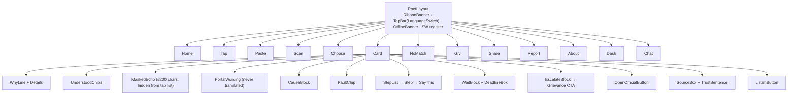

`FixCard` is a **pure function of `(libraryEntry, locale, optional echo, optional matchMeta)`**. No component contains advice text; strings come from `entry.*` or locale files.

###### 6.3 Decode state machine

Single source of truth for navigation after capture. Implemented as an XState machine (or reducer) in `state/decodeMachine.ts`, held in memory (React context) — never persisted.

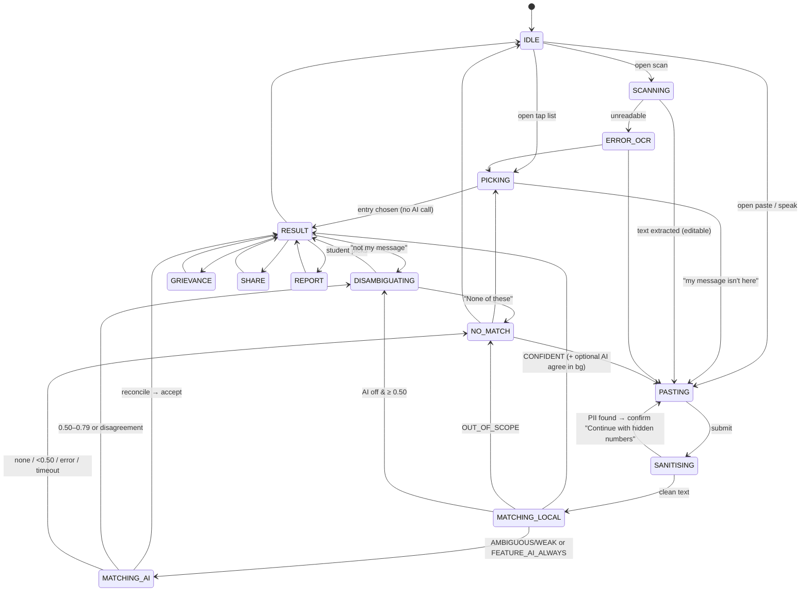

**Machine context (memory only):** `{ rawMasked, norm, scored[], aiResult?, situation?, candidates[], entryId?, inputChannel, matchMeta, lang, chat? }`.

###### 6.4 Client persistence (exhaustive)

| Key | Store | Purpose |
|---|---|---|
| `wajah.lang` | localStorage | Language |
| `wajah.notice.v1` | localStorage | First-run seen |
| `wajah.consent.stats` | localStorage | Anonymous stats consent |
| Library + static assets | Cache Storage (service worker) | Offline |
| OCR language data | Cache Storage (lazy) | Offline scan after first load |
| *Everything else* (typed text, OCR text/image, transcript, grievance fields, chat) | **JS memory only** | Cleared on reset/leave/tab close |

If localStorage is blocked: notice shows each visit, consent stays off, language defaults from the browser.

###### 6.5 Language and rendering
- `lang` attribute on `<html>` and on mixed-language spans.
- Missing string → English fallback + dev-time console warning + small “Not yet translated” note.
- Devanagari font subset (≤ 120 KB) loaded **only** when Hindi is active.
- Share image drawn at runtime from translated strings (no text baked into images).

---

### Source: `WAJAH_MASTER_SOFTWARE_ARCHITECTURE_SPECIFICATION__1_.md`

##### 3. Frontend Engineering Specification

#### Frontend Engineering Specification

##### Routes
`/`, `/decode/pick`, `/decode/paste`, `/decode/scan` (flag), `/decode/choose`, `/card/[entryId]`, `/card/[entryId]/grievance`, `/card/[entryId]/share`, `/no-match`, `/report`, `/about`, `/dashboard`, `/chat` (Could).

##### Components
Root layout → independence ribbon, header/language switch, route content and footer. Fix card composes portal message, cause, why-line, fault chip, steps, deadline, escalation, official action and source box.

##### State
Reducer owns transient route, capture type, sanitised input, PII type flags, candidates, selected ID, local score, AI result, match path, locale and optional chat state. Never persist input/transcript in localStorage, IndexedDB or cookies. Persist only locale/first-run notice/consent as described in source. Clear transient data on reset/leave.

##### Processing
Capture plain text → scan PII before normalisation → mask → ask confirmation if found → normalise → local score → optional AIU → reconcile → render library entry. Confident local result is not blocked by AI. No-match is an expected state.

##### Validation
Paste 3–1000 chars after trim. Grievance optional fields remain local. Report note ≤300 chars and PII scanned. Never ask for password, OTP, Aadhaar, bank details or application ID in decode.

##### Responsive/accessibility
360px first; desktop reading column max 640px; base 18px/1.5; headings 22–28px; targets ≥48px. Semantic headings, keyboard focus, ARIA tabs, live progress and role=alert warnings. Hindi uses Devanagari font.

##### Errors
Friendly messages only. AI errors silently fall back. Unknown ID redirects to tap list. OCR failure offers paste/tap. Never echo unsafe input or raw exceptions.

---

---

## Part 6 — Decode Pipeline, Matching and Core Engine

### Source: `architecture.md`

##### 6. Decode pipeline

###### 6.1 End-to-end sequence

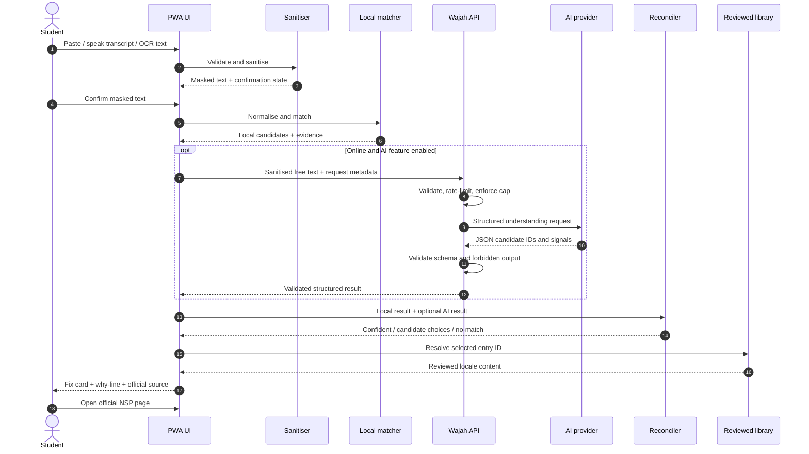

###### 6.2 Capture paths

**Tap list** - User selects a status/category and a specific message. -
Resolve directly to a library entry ID. - No AI request and no network
dependency.

**Paste** - Accept 3--1000 characters. - Detect and mask sensitive
patterns. - Ask for confirmation if masking occurred. - Run local
matching first. - Send sanitised text to AI on every free-text decode
when online and enabled, as specified by the AI-layer build
specification.

**Voice** - Request microphone permission through the browser. - Use
browser speech recognition where supported. - Display transcript for
review and editing. - Send only the confirmed transcript through the
common sanitisation and decode pipeline. - If speech recognition is
unavailable, offer paste and tap-list routes.

**Screenshot** - Load OCR on demand. - Prefer local OCR using
Tesseract.js with selected English/Hindi language data. - Display
extracted text for crop, review and editing. - Run sanitisation after
OCR and before any AI call. - Discard the source image after
extraction. - If optional server/vision OCR is ever enabled, require a
clear notice and separate feature flag; it is not the default
architecture.

###### 6.3 Sanitisation sequence

1.  Validate input type and length.
2.  Detect password-like values, OTPs, Aadhaar-like patterns, phone-like
    patterns, bank/account-like patterns, and configured secrets.
3.  Replace detected values with safe placeholders.
4.  Display the masked version and require confirmation if any masking
    occurred.
5.  Normalise case, whitespace and common punctuation for matching.
6.  Keep original portal wording only in transient UI state if needed;
    never send unsanitised original text to AI or logs.
7.  Clear transient text when the decode session is reset or the user
    leaves the flow.

The sanitiser must be applied to typed text, pasted text, speech
transcripts, OCR text, grievance notes, and any optional cluster input
before AI processing.

##### 7. Matching and reconciliation architecture

###### 7.1 Local matcher

A plain TypeScript module performs deterministic matching against the
bundled library.

Responsibilities:

-   Normalise case, whitespace, punctuation and common variants.
-   Match configured exact phrases and keywords.
-   Apply exclusions to reduce false positives.
-   Produce candidate entry IDs, score/evidence and matched terms.
-   Return no-match when no candidate crosses the configured threshold.
-   Keep the matcher testable independently from the UI.

The matcher does not produce user-facing advice or invent a new entry.

###### 7.2 AI understanding contract

AI is called for free-text decoding when online and enabled. It returns
structured fields only, such as:

-   Situation/status category from a fixed vocabulary.
-   Verification level/stage from a fixed vocabulary.
-   Likely responsible party from an enumerated list.
-   Detected language.
-   Candidate `entry_id` from the allowed library ID set.
-   Confidence score and up to two alternative IDs.
-   Short evidence codes or matched concepts used by the why-line.

The model must not return scholarship instructions, deadlines, source
URLs, or free-form explanation text for direct display.

###### 7.3 Reconciliation

The client reconciles local and AI candidates using fixed, tested rules.

  -----------------------------------------------------------------------
  Local result            AI result               Decision
  ----------------------- ----------------------- -----------------------
  Strong candidate        Same candidate, valid   May auto-open the card
                          schema                  if the configured
                                                  agreement and
                                                  confidence thresholds
                                                  pass

  Strong candidate        Different candidate     Show candidate
                                                  selection; do not
                                                  silently pick

  Weak candidate          Strong AI candidate     Apply the documented
                                                  threshold and evidence
                                                  checks; otherwise show
                                                  choices

  No candidate            Valid AI candidate      Show candidate
                                                  selection unless the
                                                  strict acceptance
                                                  threshold is met

  Any result              Invalid, timeout,       Ignore AI result and
                          unavailable or          use local result
                          rate-limited            

  No reliable candidates  No reliable candidates  Show no-match and
                                                  tap-list alternative
  -----------------------------------------------------------------------

Exact numerical thresholds must be taken from the
matching/reconciliation section of the build specification and tuned
against a labelled test set. Do not invent or adjust thresholds in UI
code.

###### 7.4 User-visible decision states

-   **Confident match:** show the matching fix card.
-   **Ambiguous:** show up to three candidate messages and ask the
    student to choose.
-   **Weak/no match:** show "Not sure yet" / no-match, with a route to
    the tap list.
-   **AI unavailable:** continue with local matching; do not block the
    user.
-   **Unverified content:** show a visible Draft/unverified label and do
    not imply the advice is confirmed.

###### 7.5 "Why this match"

The why-line must be grounded in actual match evidence, such as matched
phrase, status category, or agreement between local and AI candidate
IDs. It must not be a model-generated guess. Keep it short and
distinguish the user's original wording from Wajah's interpretation.

### Source: `architecture__1_.md`

##### 7. Core engine (browser-side)

All modules are **pure TypeScript**, framework-free, and runnable in Node for tests and CI.

###### 7.1 Pipeline

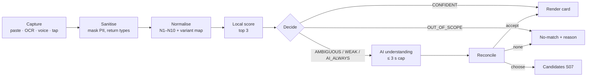

> **Order matters:** the sanitiser runs **before** the normaliser (which strips digits), otherwise numbers vanish without the student being warned.

###### 7.2 Sanitiser (`lib/sanitise`)
- Ordered regex table (Aadhaar-like, mobile, OTP phrase, password phrase, email, bank-like 9–18 digits, IFSC, PAN, long mixed ID) → masks like `[number hidden]`.
- Returns `{ text, found: Type[] }` — **types, never values**.
- **Over-masks on purpose**; negative tests ensure ordinary remarks (“document not clear”) are untouched.
- Also used for: OCR output, voice transcript, grievance notes, feedback notes, cluster inputs, chat messages.

###### 7.3 Normaliser (`lib/matcher/normalise.ts`)
Implements N1–N10 from PRD §11.2 (NFC, strip HTML/control chars, lowercase Latin, drop digit runs/mask tokens, punctuation→space, variant map, stop-words, light suffix strip, tokenise). **Variant map and stop-words are data files** (`variants.json`). N5 (drop numbers) is parameterised behind a flag because OQ7 may change it after real NSP screens are captured.

###### 7.4 Scorer and decider (`score.ts`, `decide.ts`)
```
phraseScore(trigger, tokens) = 1.0×w if adjacent & ordered ; 0.7×w if all tokens present ; else 0
entryScore = clamp( max(phraseScore) + min(0.10×(extra distinct triggers), 0.20) − 0.50×[negative hit], 0, 1 )
```

| Result | Condition | Next |
|---|---|---|
| CONFIDENT | top ≥ 0.85 **and** top − second ≥ 0.20 | open card |
| AMBIGUOUS | 0.50 ≤ top < 0.85 **or** lead < 0.20 | AI → else top-three |
| WEAK | top < 0.50 | AI → else no-match |
| OUT_OF_SCOPE | any entry `scope_markers` / state-portal marker | no-match with reason |

**Index structure.** On app start, build once: `Map<entryId, CompiledTrigger[]>` where each trigger is pre-tokenised and pre-normalised. Matching the whole library (~15 entries) is O(entries × triggers) → comfortably ≤ 50 ms on low-end phones.

###### 7.5 Reconciler (`lib/ai/reconcile.ts`)
Pure function over `(localDecision, aiResult | null)` → `Decision & agreement`. Implements the table in PRD §12.4 exactly:

| Local | AI | Outcome | `agreement` |
|---|---|---|---|
| CONFIDENT X | X ≥ 0.80 | open X | `agree` |
| CONFIDENT X | Y ≥ 0.80 (Y≠X) | **choose [X, Y]** (never silent) | `disagree` |
| CONFIDENT X | none/error | open X | `local_only` |
| AMBIG/WEAK | Y ≥ 0.80 | open Y | `ai_only` |
| AMBIG/WEAK | Y 0.50–0.79 | choose [Y, alts…] ≤ 3 | `ai_only` |
| AMBIG/WEAK | none/<0.50/error | local ≥ 0.50 else no-match | `local_only` |
| any | situation extracted, no entry | no-match “We understood …” | — |

###### 7.6 Why-line composer (`lib/ai/why.ts`)
Selects a **template key** from `{agreement, inputChannel, matchPath}` and fills ≤ 2 `matched_terms` (bold) from fixed strings in `why-templates.json`. A unit test asserts no string outside the template list can render in that slot. Never includes user numbers.

###### 7.7 Chat intent engine (`lib/chat`)
Local rule table (`intents.json`) → intent ID; AI intent fallback optional (`/api/chat-intent`, accept ≥ 0.80). Replies = `template + entry fields + quick replies` composed by `compose.ts`; **no generated prose**.

###### 7.8 Media adapters
| Adapter | Implementation | Constraints |
|---|---|---|
| Listen | speechSynthesis; pre-recorded fallback; script built from cause + who-acts + steps | Never reads user text; no autoplay; play/pause/stop |
| Voice input | SpeechRecognition (hi-IN / en-IN) | Hidden if unsupported; 8 s silence stop; 30 s hard cap; transcript → text box, never auto-submit; first-use browser-service notice |
| OCR | Tesseract.js worker, lazy; resize ≤ 1280 px; crop + manual mask boxes | Image in memory only; revoke object URLs; output through sanitiser; editable result |
| Share image | Canvas/html-to-image, 1080×1350 | Library text only |
| Print | `@media print` stylesheet | A4, B/W-safe, fault label as words + border style |
| Grievance | Template renderer; optional AI slot-fill | Fields in memory; review checkbox gates Copy/Share/Print |

---

---

## Part 7 — Content Pipeline and Reviewed Library

### Source: `architecture.md`

##### 8. Reviewed content architecture

###### 8.1 Library design

The library is versioned data bundled with the frontend. A library entry
should contain:

``` ts
type VerificationStatus = "VERIFIED" | "DRAFT" | "UNVERIFIED" | "NEEDS_REVIEW";

type SourceReference = {
  title: string;
  issuer: string;
  url: string;
  checkedAt: string; // ISO date
  verificationStatus: VerificationStatus;
};

type FixStep = {
  action: string;
  where?: string;
  carry?: string[];
  say?: string;
};

type LocalisedCopy = {
  originalPortalText: string[];
  whatItMeans: string;
  faultLabel: string;
  responsibleParty: string;
  steps: FixStep[];
  sourceTrustText: string;
  translationStatus: "REVIEWED" | "NEEDS_REVIEW" | "MISSING";
};

type LibraryEntry = {
  id: string;
  category: "WAITING" | "RETURNED" | "REJECTED" | "PAYMENT";
  keywords: string[];
  variants: string[];
  exclusions: string[];
  source: SourceReference;
  locales: {
    en: LocalisedCopy;
    hi?: LocalisedCopy;
  };
};
```

The exact implementation schema may be extended, but the following rules
are mandatory:

-   Stable IDs must not change when copy is edited.
-   A verified entry requires an official source URL, checked date and
    human approval.
-   Hindi content requires fluent human review.
-   Missing translation falls back to English with a visible "Not yet
    translated" label.
-   A specific deadline appears only when an official source supports
    it.
-   The library linter must reject entries with missing required source
    fields or excessive steps.
-   Candidate IDs from AI must be checked against the currently bundled
    allowed-ID set.

###### 8.2 Candidate pilot entries

The initial content set may include:

-   `nsp_pending_institute`
-   `nsp_defective_returned`
-   `nsp_defective_document`
-   `nsp_rejected_institute`
-   `nsp_pending_district_state`
-   `nsp_rejected_district_state`
-   `nsp_wrong_institute`
-   `nsp_duplicate_application`
-   `nsp_institute_not_registered`
-   `nsp_verification_deadline_passed`
-   `nsp_correction_window_closed`
-   `nsp_approved_money_not_received`
-   `nsp_payment_released_not_credited`
-   `nsp_bank_validation_failed`

These are candidate IDs only. They must not be marked verified or
exposed as authoritative guidance until each entry passes the content
verification process.

### Source: `architecture__1_.md`

##### 8. Content pipeline and library

###### 8.1 Pipeline

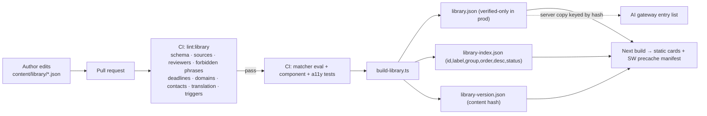

###### 8.2 Library lifecycle gates

| Status | Bundled in demo | Bundled in prod | Banner |
|---|---|---|---|
| unverified | ✗ | ✗ | — |
| draft / in_review | ✅ | ✗ | Draft banner |
| verified | ✅ | ✅ | none |
| retired | ✗ (card shows “withdrawn” if reached) | ✗ | — |

`DEMO_MODE` selects which statuses go into the bundle at **build time** — production simply doesn’t contain unverified text.

###### 8.3 Library lint rules (blocking in CI)
Required fields per status · verified entry has `kind: official` source + `checked_on` + `last_verified_on` · ≥ 2 reviewers (≥ 1 external) · ≤ 5 steps · any `deadline`/`typical_wait` value needs `source_ref` · forbidden-phrase scan on **all** entry strings and **all** UI/chat/why templates · `official_destination.url` ∈ `allowed-domains.json` · no phone/email in steps without official source · verified entries have no `machine_translated` and have Hindi · identical trigger phrases across entries rejected · reading-level warning > 25 words/sentence.

###### 8.4 Library delivery to the browser
- `library-index.json` (small) loads first → tap list renders immediately.
- Full entries are fetched **per card** (and prefetched by SW) so first-load stays inside budget.
- `library-version.json` is polled by the SW on online visits; a changed hash triggers background re-cache and activates on next navigation (OFF-02).
- Server AI gateway holds the **same library build** keyed by `library_version` (so the client never sends the entry list).

---

---

## Part 8 — Server, API and AI Integration

### Source: `architecture.md`

##### 9. API and service architecture

The browser communicates only with Wajah-owned API routes. The server
calls the AI provider. Provider credentials never reach the client.

###### 9.1 Logical endpoints

  ----------------------------------------------------------------------------------
  Endpoint                 Method            Purpose               Network
                                                                   dependency
  ------------------------ ----------------- --------------------- -----------------
  `/api/understand`        POST              AI understanding for  Yes
                                             sanitised free text   

  `/api/match-ai`          POST              Backward-compatible   Yes
                                             alias for             
                                             `/api/understand`     

  `/api/grievance-draft`   POST              Fill fixed grievance  Yes, when enabled
                                             template slots        

  `/api/events`            POST              Optional anonymous    Yes
                                             aggregate events      

  `/api/feedback`          POST              Report an             Yes
                                             incorrect/missing     
                                             match                 

  `/api/dashboard`         GET               Optional demo         Yes
                                             dashboard aggregates  
  ----------------------------------------------------------------------------------

The exact endpoint names and payloads must be aligned with `api.md`.
This document describes responsibilities rather than replacing the API
contract.

###### 9.2 API processing pipeline

1.  Enforce HTTPS and request-size limits.
2.  Validate method, content type and JSON schema.
3.  Reject unsupported fields and malformed requests.
4.  Apply per-IP rate limit and AI daily spend cap.
5.  Confirm feature flag and consent/notice requirements.
6.  Pass only sanitised text and allowed library IDs to the AI provider.
7.  Validate provider output against a strict schema and fixed
    vocabularies.
8.  Run forbidden-phrase and length checks.
9.  Return structured JSON only; never return raw model output.
10. Log status, latency, feature-flag state and counters only---never
    request bodies.

###### 9.3 Rate limiting and cost

-   Retain the specified limit of 20 requests per IP per 10 minutes for
    protected endpoints.
-   Enforce `AI_DAILY_CAP` server-side.
-   When the cap is reached, disable AI calls and continue local-only
    matching.
-   Use a hard AI request timeout. The AI layer specification targets
    under 3 seconds at the 90th percentile on 4G with a 3-second hard
    wait cap; the broader PRD allows an 8-second ceiling. Prefer the
    stricter 3-second AI wait cap for the user-facing decode flow.
-   Avoid retries that multiply cost; one controlled retry may be
    considered only for transient transport failures and must remain
    inside the overall timeout.

##### 10. Grievance drafting architecture

Grievance drafting is a constrained template workflow, not a free-form
chatbot.

1.  The user selects an appropriate draft action from a reviewed card.
2.  The UI collects only the non-secret facts required by the approved
    template.
3.  The sanitiser runs on all user-entered notes before AI processing.
4.  The server sends the fixed template structure and allowed slot
    definitions to the model.
5.  The model returns values for predefined slots only.
6.  The server validates schema, length, forbidden phrases and
    unsupported claims.
7.  The UI renders an editable draft and requires a review confirmation.
8.  The user copies/downloads the draft and submits it themselves
    through the appropriate official route.

The draft must display "Suggestion, not official wording" and "You
submit it yourself". No submit-to-government endpoint exists.

### Source: `architecture__1_.md`

##### 9. Server architecture

The server is deliberately small, stateless and replaceable (serverless functions are fine).

###### 9.1 Endpoints and responsibilities

| Endpoint | Purpose | Reads | Writes | Notes |
|---|---|---|---|---|
| `POST /api/match-ai` | Baseline AI fallback (alias of `/api/understand`) | server library copy | — | Kept for compatibility |
| `POST /api/understand` | Situation + entry ID + confidence | server library copy | — | Behind `FEATURE_AI_MATCH` |
| `POST /api/grievance-draft` | Fill slots from sanitised notes | entry template | — | Behind `FEATURE_AI_GRIEVANCE` |
| `POST /api/chat-intent` | Intent ID (optional) | intents list | — | Behind chat + AI flags |
| `POST /api/ocr` | Optional server OCR | — | — | Behind `FEATURE_OCR_SERVER`; body never logged |
| `POST /api/cluster` | Cluster mock unmatched msgs | `mock/unmatched.json` | — | Admin only in demo; `mock:true` |
| `POST /api/events` | Anonymous event | — | `match_events` | **204 always**; consent only |
| `POST /api/feedback` | Wrong-answer report | — | `feedback` | 204 |
| `POST /api/miss` | Opt-in masked miss | — | `miss_log` | 30-day expiry |
| `GET /api/dashboard` | Suppressed aggregates | `match_events` or mock | — | `mock:true` when `DEMO_MODE` |

###### 9.2 Request pipeline (every POST)

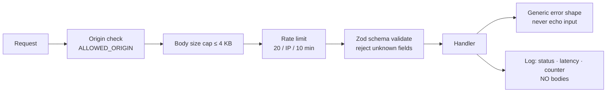

- IP is used **in memory** for rate limiting only (token bucket in memory/edge KV); never persisted or forwarded.
- Errors always `{ "error": { "code", "message" } }`; messages generic.
- `Retry-After` on 429. CORS: own origin only.

###### 9.3 Dashboard aggregation
1. Query `match_events` by week range/state (or load mock).
2. Group by `entry_id`, `fault_label`, `week_start`.
3. **Suppression:** any cell < **10** replaced with “fewer than 10”; also suppress combinations and related totals to prevent differencing across overlapping filters.
4. Attach `mock: true` when `DEMO_MODE`; UI refuses to render mock panels without the MOCK banner (test AIU-T8).
5. No free text, no raw export (cluster export = names + counts only).

---

##### 10. AI integration architecture

###### 10.1 AI gateway (server)

```mermaid
sequenceDiagram
  participant C as Client
  participant G as API route (/api/understand)
  participant L as Server library copy
  participant M as LLM provider
  C->>G: {text≤500 sanitised+normalised, input_kind_hint, lang_hint, library_version}
  G->>G: origin · size · rate-limit · AI_DAILY_CAP · schema
  G->>L: load entries by version → [{id, one_line_description}] (≤15)
  G->>M: system prompt + <entries> + <vocab> + <input>text</input><br/>temp 0 · max_tokens ~150 · timeout 8 s
  M-->>G: raw text
  G->>G: parse JSON → validate vs whitelist/vocab/ranges
  alt valid
    G-->>C: {entry_id, confidence, alternatives≤2, situation, rationale_code}
  else invalid / timeout / cap
    G-->>C: 502 / 504 / 503 (generic)
  end
  Note over G,C: Raw model text is never returned
```

###### 10.2 Output validation (hard gate)

| Field | Rule on failure |
|---|---|
| `entry_id` | Must be in the sent ID set or `"none"` → else discard whole result |
| `confidence` | Number in [0,1] → else discard whole result |
| `alternatives` | ≤ 2, valid, unique, ≠ `entry_id` → filter |
| `situation.status/level/input_kind/language/fault_hint` | In vocabulary (`situation.json`) → else `unknown`/`unrelated`/`other` |
| `rationale_code` | Maps to fixed why-template → else omitted |

###### 10.3 Prompt-injection defence (defence in depth)
1. Sanitiser strips secrets **before** the request leaves the browser.
2. User text wrapped in `<input>…</input>`, declared DATA in the system prompt.
3. Output restricted to JSON enum/ID/number schema; non-conforming output is dropped.
4. Server compares IDs against its **own** library copy (client can’t add entries).
5. The model’s words never reach the UI; only IDs/enums mapped to fixed text.
6. Forbidden-phrase linter runs on any AI-derived string that *could* be shown (grievance slots, cluster labels/suggestions); on hit → fallback to template/hidden.
7. Test suite includes injection strings in typed, OCR and grievance inputs (AIU-T5).

###### 10.4 Cost and abuse controls
- Per-IP 20 req / 10 min; global `AI_DAILY_CAP` (default 2000) → `503 ai_unavailable` → client silently degrades to local-only.
- `FEATURE_AI_ALWAYS` off in low-bandwidth mode (AI only for ambiguous/weak).
- AI never called for **tap-list** choices (A1) or when offline.
- Model chosen by evaluation: cheapest model that passes the matcher test set (OQ-A3).

###### 10.5 Timing budget (client-side)

| Local result | Max wait for AI | Behaviour on expiry |
|---|---|---|
| CONFIDENT | ≤ 1 s (or none; AI may finish in background for the why-line) | Open card from local |
| AMBIGUOUS / WEAK | ≤ 3 s | Continue with local candidates / no-match |

Server → model timeout stays 8 s (protects the provider call); the **client UX cap is 3 s** and the screen never freezes (S06 shows “Use the tap list instead”).

###### 10.6 Other AI jobs (all slot- or label-bound)

| Job | Input | Output (validated) | Fallback |
|---|---|---|---|
| Grievance slots | Entry ID, sanitised notes ≤ 400 chars, actions_done enum list, `days_since` number, language | `{situation, actions, request}` ≤ 40 words each, EN/HI | Fixed template sentences |
| Chat intent (optional) | Sanitised ≤ 300 chars, current entry, fixed intents | `{intent, entry_id, confidence}` accept ≥ 0.80 | Local intent rules / “not sure” |
| Cluster naming (mock) | ~150 synthetic masked messages | `{clusters:[{label ≤6 words, indexes[], plain_en, plain_hi}]}` | Hide panel |
| Server OCR (optional) | Resized image + notice shown | Text → client sanitiser | On-device OCR / paste / tap |

---

### Source: `WAJAH_MASTER_SOFTWARE_ARCHITECTURE_SPECIFICATION__1_.md`

##### 4. Backend Engineering Specification

#### Backend Engineering Specification

##### Scope
Backend protects model credentials, validates AI outputs, handles consented aggregate events/feedback/miss submissions and serves dashboard aggregates. It does not store student sessions or application history.

###### AI understanding
Input: sanitised bounded text, input kind and library version. Server loads own allowlist and fixed vocabulary; calls configured model; validates JSON, enums, IDs and confidence; returns fixed fields. Invalid output is discarded. Provider errors become local fallback.

###### Grievance slots
Input: template ID, named slots, sanitised rough notes and checklist facts. Output: slot strings only. Reject ID-like digit runs, forbidden phrases, threats, legal claims and unsupported facts. Failed slot falls back to fixed sentence. Never submit grievance.

###### Events
Allowlist fields; server computes `week_start`; reject extras; return 204 even if insert fails; log counter only.

###### Feedback/miss
Feedback: entry ID, category, optional masked note ≤300. Miss: consented, sanitised text ≤200, restricted and 30-day expiry; never dashboard.

###### Dashboard
Aggregate only, suppress cells <10 and complementary totals. `mock:true` must require visible MOCK DATA banner. Real dashboard requires admin authentication/authorisation, not specified for MVP.

###### Cross-cutting
HTTPS, JSON schema validation, generic errors, strict CORS, rate limit, bounded model timeout, no body logging, least-privilege DB and server-only secrets.

---

---

## Part 9 — OCR, Voice, Audio and Share

### Source: `architecture.md`

##### 11. OCR, voice, audio and share architecture

###### 11.1 OCR

-   Lazy-load Tesseract.js and language packs after Scan is selected.
-   Show language-pack download size before download.
-   Run OCR in the browser by default.
-   Let the user crop, review and edit extracted text.
-   Apply sanitisation to extracted text before matching or AI.
-   Discard the source image and do not store it.
-   If OCR fails, offer paste and tap-list alternatives.
-   Same-language OCR should be usable offline after its language pack
    has been downloaded.

###### 11.2 Voice

-   Use browser Web Speech API where supported.
-   Show a first-use notice that speech recognition may be provided by
    the browser/platform.
-   Wajah does not store or upload audio.
-   Always show a transcript review/edit step before decode.
-   Provide paste and tap-list alternatives when unsupported or denied.

###### 11.3 Audio playback

-   Use browser speech synthesis where suitable.
-   Provide play, pause and restart controls.
-   If Hindi voice quality is inadequate on a device, use reviewed
    pre-recorded audio where feasible.
-   Keep the text card available as the primary accessible alternative.

###### 11.4 Share and print

-   Render share images in the browser from library content only.
-   Never include pasted text, transcripts, screenshots, personal
    details or grievance drafts in share images.
-   Print uses a dedicated A4 stylesheet with black-and-white
    legibility.
-   Provide a clear source and independence notice on exported cards.

---

## Part 10 — Key Runtime Flows

### Source: `architecture__1_.md`

##### 11. Key runtime flows

###### 11.1 Tap-list flow (primary, fully offline)

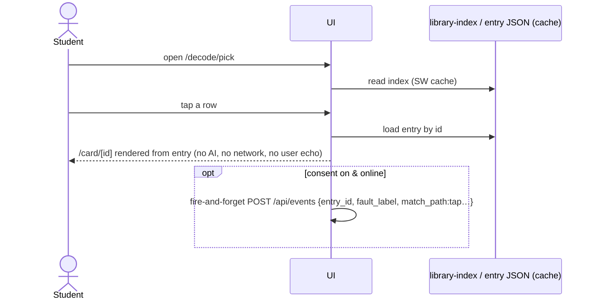

###### 11.2 Paste → local confident

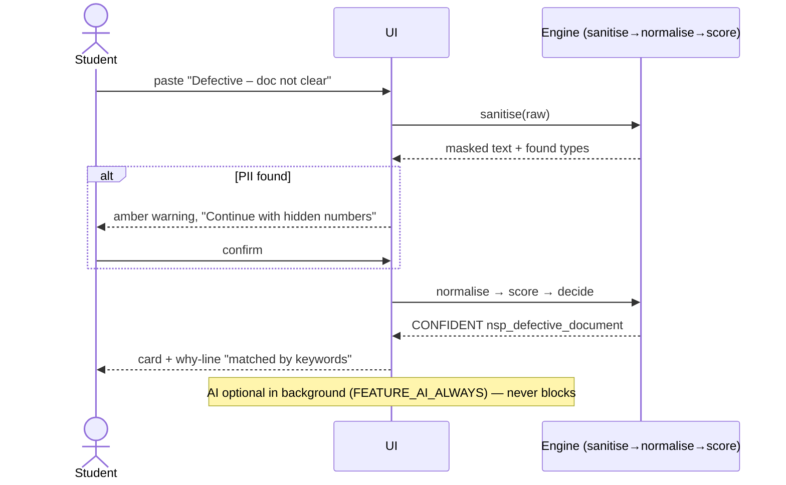

###### 11.3 Paste → ambiguous → AI → choose

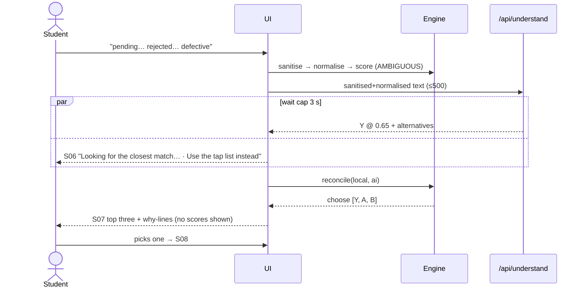

###### 11.4 Offline paste

`navigator.onLine === false` or request failure → AI step skipped; local `CONFIDENT` opens card; otherwise `choose` (≥ 0.50) or `no-match`. Offline banner is the only visible difference; no error screens.

###### 11.5 OCR flow

```mermaid
flowchart LR
  A[Choose / take photo<br/>JPEG/PNG ≤ 5 MB] --> B[Resize ≤ 1280 px on device]
  B --> C[Crop + manual black masks]
  C --> D[Tesseract.js worker<br/>EN+HI data lazy-loaded, size shown on mobile data]
  D --> E[Sanitise OCR text]
  E --> F[Editable box: "This is what we read"]
  F -->|"Decode this text"| G[Normal paste pipeline]
  D -. empty / low confidence .-> H[“We could not read that clearly” → paste / tap list]
  A -. release memory after read .-> Z[(discard image)]
```
Dates read from an image are surfaced only as **“You saw: <date>”** above the standard deadline box (P8).

###### 11.6 Grievance flow (with AI slot-fill)

```mermaid
sequenceDiagram
  actor S as Student
  participant UI as S10
  participant API as /api/grievance-draft
  S->>UI: tick steps done, add notes, days_since, language
  UI->>UI: sanitise notes (no app ID collected)
  UI->>API: {entry_id, notes, actions_done, days_since, language}
  API-->>UI: slots (each validated: plain text, ≤ cap, no ID-like digits, no forbidden phrases)
  UI->>UI: fill reviewed template; invalid slot → fixed sentence
  UI-->>S: editable draft + highlights + “Nothing has been filed”
  S->>UI: tick “I have read and checked this letter”
  UI-->>S: Copy / Download / Print enabled · “You submit it yourself” + Open official NSP page
```

###### 11.7 Anonymous event flow
```
consent == on AND online AND outcome known
  → POST /api/events { entry_id, fault_label, state?, match_path, outcome }
  → server computes week_start, rejects extra fields, INSERT, returns 204 even on failure
offline → event dropped (no queue, OFF-04)
```

---

---

## Part 11 — Data Architecture

### Source: `architecture.md`

##### 13. Data and persistence architecture

###### 13.1 Data placement

  -----------------------------------------------------------------------
  Data                    Location                Persistence
  ----------------------- ----------------------- -----------------------
  Reviewed library        Versioned frontend      App release lifetime
                          bundle                  

  Locale strings          Frontend locale files   App release lifetime

  Decode text/transcript  Browser memory          Current session only

  OCR image               Browser memory / local  Discard after
                          OCR worker              extraction

  AI provider key         Server environment      Secret configuration

  Anonymous events        Optional database       Aggregated,
                                                  retention-limited

  Error feedback          Optional database       Minimal category/entry
                                                  ID; optional note
                                                  reviewed for secrets

  Dashboard mock data     Static demo fixture or  Demo only
                          clearly labelled mock   
                          dataset                 

  Grievance draft         Browser memory; user    Not saved by Wajah
                          copy/download           
  -----------------------------------------------------------------------

###### 13.2 Minimal database

A database is not required for the core decode path. If server-backed
feedback and aggregate metrics are implemented, keep the schema small.

Potential tables:

-   `anonymous_events`: event type, entry ID, category/fault label,
    broad optional state, week bucket, created timestamp.
-   `feedback_reports`: entry ID, category, optional sanitised note,
    created timestamp, review status.
-   `content_audit` (optional internal): entry ID, reviewer,
    verification status, source checked date, content version.

Do not create user, application, scholarship-document, payment, or
decode-history tables.

###### 13.3 Retention

Set explicit retention periods before production. Aggregate data should
be retained only as long as needed for the pilot evaluation. Feedback
notes should be optional, sanitised and deleted on a documented
schedule. Never retain raw request bodies.

### Source: `architecture__1_.md`

##### 12. Data architecture

###### 12.1 Stores

| Data | Store | Identifiers | Retention |
|---|---|---|---|
| Library | Git → static JSON → SW cache | none | versioned |
| Session input/results | Browser memory | none | session |
| Preferences | localStorage (3 keys) | none | until cleared |
| `match_events` | PostgreSQL | random UUID only | weekly granularity; 12 mo (demo) |
| `feedback` | PostgreSQL | random UUID | 12 mo |
| `miss_log` | PostgreSQL | random UUID | 30 days, nightly delete |
| Mock data | `public/mock-events.json`, `src/mock/*` | n/a | static |

###### 12.2 Schema (changes from the source spec in **bold**)

```sql
create table match_events (
  event_id     uuid primary key default gen_random_uuid(),
  week_start   date  not null,                                  -- Monday; no finer time
  entry_id     text  not null,
  fault_label  text  not null check (fault_label in ('student','institute_officer','bank','unsure')),
  state_code   text  null check (state_code is null or length(state_code) <= 3),
  -- ADR-05: input channel and match path are separate dimensions
  input_channel text not null check (input_channel in ('tap','paste','voice','ocr','chat')),
  match_path   text  not null check (match_path in ('tap','local','ai','both','chosen')),
  outcome      text  not null check (outcome in ('matched','chosen','no_match'))
);
create index on match_events (week_start, entry_id);

create table feedback (
  id uuid primary key default gen_random_uuid(),
  created_on date not null default current_date,
  entry_id text not null,
  category text not null check (category in
    ('wrong_meaning','wrong_step','out_of_date','hard_to_understand','translation','other')),
  note text null check (note is null or length(note) <= 300)
);

create table miss_log (
  id uuid primary key default gen_random_uuid(),
  created_on date not null default current_date,
  expires_at date not null default (current_date + 30),
  text_masked text not null check (length(text_masked) <= 200)
);
-- nightly: delete from miss_log where expires_at < current_date;
```

**Hard rules:** no user ID, IP, device ID, cookie ID, user agent or exact timestamp in any table. Public role has **INSERT only**; reads happen through a server function that applies suppression. Server logs never contain bodies for `/api/events|feedback|miss|match-ai|understand`.

###### 12.3 Core domain types (shared TS)

```ts
type Group = "waiting" | "returned" | "not_approved_or_paid";
type WhoActs = "student" | "institute" | "district_state" | "bank" | "unsure";
type FaultLabel = "student" | "institute_officer" | "bank" | "unsure";
type EntryStatus = "unverified" | "draft" | "in_review" | "verified" | "retired";

interface LibraryEntry {
  id: `nsp_${string}`; version: number; scheme_scope: string;
  group: Group; display_order: number;
  label: I18n; one_line_description: string;
  what_the_screen_says: string;                 // never translated
  triggers: { phrase: string; lang: string; weight: number }[];
  negative_triggers?: string[]; scope_markers?: string[];
  situation_tags?: { status: Status; level: Level };
  cause: I18n; who_acts: [WhoActs] | [WhoActs, WhoActs];
  steps: Step[];                                // 1..5
  typical_wait: { type: "range"|"see_portal"; min_days?: number; max_days?: number; text: I18n };
  deadline: { type: "see_portal"|"verified"; value?: string; source_ref?: number };
  escalate_if: I18n; grievance_enabled: boolean; grievance_template?: GrievanceTemplate;
  official_destination: { label: string; url: string; source_ref: number };
  sources: Source[]; support: "official"|"third_party_only";
  status: EntryStatus; reviewed_by: Reviewer[]; machine_translated?: string[];
  last_verified_on: string | null; known_conflicts?: string; retired_reason?: string;
}

interface MatchMeta {                           // powers why-line + Details
  input_channel: "tap"|"paste"|"voice"|"ocr"|"chat";
  match_path: "tap"|"local"|"ai"|"both"|"chosen"|"none";
  matched_terms: string[];                      // ≤ 2
  local_score: number; ai_confidence: number | null;
  situation?: Situation; agreement: "agree"|"disagree"|"local_only"|"ai_only";
}
```

**Single mapping table** (shared module `lib/library/faultMap.ts`, ADR-08): `who_acts[0]` → `FaultLabel` → UI label/colour/icon/print style → AI `fault_hint` equivalence.

| `who_acts[0]` | FaultLabel | `fault_hint` (AI, hint only) |
|---|---|---|
| student | student | student_side |
| institute | institute_officer | institute_side |
| district_state | institute_officer | district_side / state_side |
| bank | bank | bank_side |
| unsure | unsure | unclear |

---

---

## Part 12 — Offline, PWA and Performance

### Source: `architecture.md`

##### 12. PWA and offline architecture

###### 12.1 Cache strategy

  -----------------------------------------------------------------------
  Resource                Strategy                Reason
  ----------------------- ----------------------- -----------------------
  App shell, fonts,       Pre-cache/versioned     App can reopen after
  icons, CSS/JS           cache                   first load

  Reviewed library bundle Pre-cache/versioned     Core content available
                          cache                   offline

  Tap-list and fix-card   Cache-first/static      Fast offline access
  routes                                          

  OCR language data       Cache after explicit    Avoid large initial
                          lazy download           bundle

  AI API requests         Network-only            No offline AI

  Feedback/events         Network-only; drop if   Do not queue user
                          offline                 content

  User input/session      Memory only             No saved history
  state                                           
  -----------------------------------------------------------------------

###### 12.2 Offline behaviour

-   Tap-list flow and bundled cards remain usable after first successful
    load.
-   Local matching works without a network connection.
-   AI is skipped offline.
-   Optional events are dropped rather than queued.
-   Official NSP links require connectivity and should be labelled as
    external.
-   Service worker updates must not leave the app with mismatched
    library and code versions.

##### 18. Performance budgets

  -----------------------------------------------------------------------
  Measure                                                          Target
  ------------------------------ ----------------------------------------
  First card from local               Under 1 second on a mid-range phone
  confident match                

  Local matching                                ≤ 50 ms for pilot library

  AI response                      Target under 3 seconds p90 on 4G; hard
                                                       wait cap 3 seconds

  Initial LCP                           ≤ 2.5 seconds on throttled mobile

  First-load JavaScript                               ≤ 150 KB compressed

  Reviewed library bundle                             ≤ 100 KB compressed

  Hindi font subset                                              ≤ 120 KB

  OCR                               Lazy-loaded; language pack size shown
                                                          before download

  Tap targets                                         At least 48 × 48 px

  Supported layout                                 320 px through desktop
  -----------------------------------------------------------------------

Measure these budgets on real mid-range Android devices and throttled
networks. If the AI response misses its cap, the UI must continue with
local results.

### Source: `architecture__1_.md`

##### 13. Offline, PWA and performance

###### 13.1 Service worker strategy

| Asset | Strategy |
|---|---|
| App shell, routes, CSS, core JS | Precache (Workbox) |
| `library-index.json`, entry JSONs | Precache + revalidate on `library-version.json` change |
| Hindi font subset | Cache on first Hindi use |
| OCR wasm + language data | Runtime cache, **only** after student taps Scan |
| Audio fallback files | Runtime cache on first Listen |
| `/api/*` | **Network only, never cached**; failures swallowed into fallbacks |

###### 13.2 Performance and size budgets (CI-enforced where measurable)

| Budget | Target |
|---|---|
| First-load JS | ≤ 150 KB compressed |
| Library JSON (all entries, 2 langs) | ≤ 100 KB compressed |
| Hindi font subset | ≤ 120 KB |
| LCP (throttled mobile) | ≤ 2.5 s |
| Local match latency | ≤ 50 ms |
| First card, local confident | < 1 s |
| AI path p90 on 4G | < 3 s |
| OCR/charts/audio/TTS fallback | lazy-loaded, never in first load |

Enforced with a bundle-size check (e.g. `size-limit`) and Lighthouse CI on the Slow-4G profile.

###### 13.3 Offline matrix

| Capability | Offline |
|---|---|
| Home, tap list, all cards, About, print | ✅ |
| Paste + local match | ✅ |
| Listen (device TTS) | ✅ if device voice exists; else cached audio |
| Share image / print | ✅ |
| Voice input | Device/browser dependent (often needs network) → graceful hide/notice |
| OCR | ✅ after first data download |
| AI understanding, AI grievance slots, chat intent AI | ✗ → local rules/templates |
| Events, feedback, miss, dashboard | ✗ (events dropped, not queued) |

---

### Source: `WAJAH_MASTER_SOFTWARE_ARCHITECTURE_SPECIFICATION__1_.md`

##### 6. Scalability and Performance

#### Scalability and Performance

No measured traffic forecast is supplied. All figures are design targets, not benchmarks. Core must work with backend unavailable.

- Confident local card <1 second on mid-range Android.
- First-load JS <150KB compressed; library <100KB compressed target.
- AIU wait ≤3s for ambiguous/weak and ≤1s or no wait for confident local.
- OCR models load only after Scan; display download size.
- Load compact library index first; lazy-load OCR, charts, audio and Devanagari font.
- Cache static content and immutable library version.
- Stateless API handlers can scale horizontally; model calls protected by rate limits, daily cap, timeout and circuit breaker.
- Dashboard aggregates server-side and suppresses cells below 10, including complementary totals.
- Test Slow 4G, airplane mode, low-memory Android, 360px viewport, 100 synthetic concurrent requests and model timeout. These are proposed test conditions, not capacity claims.

---

---

## Part 13 — Security and Privacy

### Source: `architecture.md`

##### 14. Security and privacy architecture

-   HTTPS for all network calls.
-   AI provider key stored in server environment variables.
-   No credentials or private keys in client bundles.
-   Request schema validation and strict allowlists.
-   Input and output length limits.
-   Rate limiting and daily AI spend cap.
-   Redacted logs; no request body logging.
-   Content Security Policy and standard security headers.
-   Dependency scanning and lockfile review.
-   Prompt-injection resistance: user text is untrusted data, never
    system instruction.
-   JSON-only model response, schema validation and forbidden-phrase
    linter on server and client.
-   No free-form AI text is rendered in an advice slot.
-   No raw secrets are sent to the model, stored or logged.
-   No accounts, no saved decode history and no third-party analytics.
-   Clear notices for browser speech services and any future optional
    server OCR.

### Source: `architecture__1_.md`

##### 14. Security and privacy architecture

###### 14.1 Trust boundaries and data classification

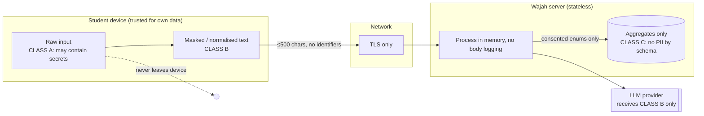

| Class | Example | Rule |
|---|---|---|
| A | Raw paste, screenshots, audio, grievance fields, application ID | Memory only; never logged/stored/sent unsanitised; images/audio never uploaded by Wajah |
| B | Sanitised normalised text, masked echo | May be sent to AI endpoint in a single unlogged request |
| C | Entry IDs, enums, week, optional state code | May be stored with consent |

###### 14.2 Controls summary

| Area | Control |
|---|---|
| Transport | HTTPS only, HSTS |
| Headers | Strict CSP (hashed inline only), `nosniff`, `Referrer-Policy: no-referrer`, `Permissions-Policy` limiting camera/mic to scan/voice screens |
| Input | Length caps; plain-text rendering; no `dangerouslySetInnerHTML`; escape on output |
| External links | Only domains in `allowed-domains.json`; `target=_blank rel="noopener noreferrer"` |
| Secrets | Server env only (`AI_PROVIDER_KEY`, `DATABASE_URL`); none in repo/bundle |
| Abuse | Per-IP rate limit, global AI cap, body size cap, origin check |
| AI safety | Delimited data input, strict JSON schema, ID whitelist, output never shown raw |
| Supply chain | Lockfile, vulnerability scan, no runtime third-party scripts |
| Logging | Status, latency, counters only; redacted errors |
| DB | Insert-only public role; no identifiers; suppression on read |

###### 14.3 Mandatory strings, each covered by an automated test
Independence ribbon · “Nothing has been filed.” · “You submit it yourself” statement · Draft banner (non-verified, demo) · MOCK DATA banner (dashboard/cluster panel) · “Suggestion, not official wording” · trust sentence with checked date · “Check the date on the portal.” (unless sourced).

###### 14.4 Legal note
Check obligations under India’s **Digital Personal Data Protection Act, 2023** with a qualified adviser before any real launch. The architecture avoids collecting personal data by design; this is not legal advice.

---

---

## Part 14 — Feature Flags, Deployment, Observability and Failure Handling

### Source: `architecture.md`

##### 15. Feature flags

Feature flags allow the team to ship the core app safely and enable
optional features independently.

  -------------------------------------------------------------------------------
  Flag                                              Default Effect when off
  ---------------------------- ---------------------------- ---------------------
  `FEATURE_AI_UNDERSTANDING`        On for online free-text Local matching only
                               pilot, subject to configured 
                                                        cap 

  `FEATURE_VOICE`                        On where supported Paste/tap
                                                            alternatives

  `FEATURE_OCR`                            Off until tested Hide Scan door

  `FEATURE_AI_GRIEVANCE`             Off until template and Fixed non-AI template
                                        validation reviewed or hide draft action

  `FEATURE_AI_DASHBOARD`                                Off Hide AI cluster panel

  `FEATURE_DASHBOARD`                      Off or demo-only No dashboard route

  `FEATURE_SERVER_OCR`                                  Off On-device OCR only

  `FEATURE_ANON_EVENTS`               Off until consent and No event requests
                                      retention are defined 
  -------------------------------------------------------------------------------

Flags must be enforced server-side for server features; client-side
hiding is not a security control.

##### 16. Deployment architecture

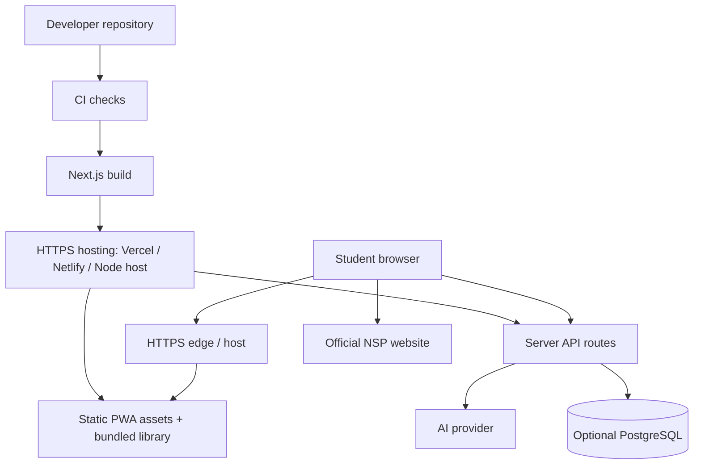

###### 16.1 Environments

-   **Local development:** local Next.js server; mock AI adapter
    available for deterministic tests.
-   **Preview/demo:** isolated provider key and capped AI budget; mock
    dashboard data labelled clearly.
-   **Production/pilot:** HTTPS domain, production secrets, verified
    library release, monitoring and documented rollback.

###### 16.2 CI/CD checks

Every pull request should run:

1.  TypeScript type-check.
2.  Lint and formatting checks.
3.  Library schema/content linter.
4.  Unit tests for sanitiser, normaliser, matcher and reconciler.
5.  API schema and forbidden-phrase tests.
6.  Playwright core journey tests.
7.  Accessibility checks with axe.
8.  Production build and bundle-size budget checks.

Deploy only after all required checks pass. Keep feature flags available
to disable AI and optional capabilities without redeploying the frontend
where possible.

##### 17. Observability and operational behaviour

Permitted operational signals:

-   Request status and latency.
-   AI provider error category.
-   Feature-flag state.
-   Rate-limit and daily-cap counters.
-   OCR success/failure counters without image or extracted text.
-   Voice feature availability/completion counters without transcript.
-   Aggregate entry ID and fault category only where optional consent is
    enabled.

Never log:

-   Raw request bodies.
-   Pasted remarks or transcripts.
-   OCR text or source images.
-   Audio.
-   Passwords, OTPs, Aadhaar, bank/account details.
-   Grievance drafts.

###### 17.1 Failure handling

  -----------------------------------------------------------------------
  Failure                             Required behaviour
  ----------------------------------- -----------------------------------
  No network                          Local matcher, tap list and bundled
                                      cards continue

  AI timeout/provider failure         Ignore AI response; use local
                                      result or no-match

  Daily cap reached                   Local-only mode with no blocking
                                      error

  Invalid AI JSON/schema              Reject response; local-only path

  Local/AI disagreement               Candidate selection; never silent
                                      auto-pick

  OCR unsupported/fails               Paste and tap alternatives

  Microphone denied/voice unsupported Paste and tap alternatives

  Translation missing                 English fallback and "Not yet
                                      translated"

  Library entry unverified            Draft/unverified label; never imply
                                      verified advice

  Database unavailable                Core decode unaffected; drop
                                      optional events

  Official NSP unavailable            Explain that the external site may
                                      be unavailable; do not claim Wajah
                                      can resolve it
  -----------------------------------------------------------------------

### Source: `architecture__1_.md`

##### 15. Deployment, environments and CI/CD

###### 15.1 Environments

| Env | `DEMO_MODE` | Library bundle | Dashboard | AI | DB |
|---|---|---|---|---|---|
| Local | true | draft+ | mock | stub/mocked provider | SQLite or local PG |
| Preview (per PR) | true | draft+ | mock | real, low cap | ephemeral |
| Demo | true | draft+ with Draft banner | mock, labelled | real, cap 2000/day | managed PG |
| Production (future) | **false** | **verified only** | disabled until real data + access control | per policy | managed PG, access-controlled |

###### 15.2 Configuration (env / flags)
`DEMO_MODE`, `FEATURE_AI_MATCH`, `FEATURE_AI_ALWAYS`, `FEATURE_OCR`, `FEATURE_OCR_SERVER`, `FEATURE_VOICE_INPUT`, `FEATURE_AI_GRIEVANCE`, `FEATURE_AI_DASHBOARD`, `FEATURE_WHY_LINE`, `FEATURE_CHAT`, `FEATURE_GRIEVANCE`, `FEATURE_DASHBOARD`, `AI_PROVIDER_KEY` (secret), `MATCH_MODEL`, `AI_DAILY_CAP`, `DATABASE_URL` (secret), `ALLOWED_ORIGIN`.
Public flags are baked at build; secrets are runtime server-only. **Every flag must be independently toggleable without breaking the rest** (e.g. OCR off removes the Scan button and nothing else).

###### 15.3 CI pipeline

```mermaid
flowchart LR
  PR[Pull request] --> A[Install + audit]
  A --> B[Typecheck + ESLint<br/>(layer/import rules)]
  B --> C[lint:library + forbidden-phrase lint<br/>on library, UI, chat, why templates]
  C --> D[Unit tests: sanitiser, normaliser, scorer, reconciler, why-line]
  D --> E[test:matcher<br/>FAIL if confident-and-wrong ↑]
  E --> F[Component + a11y (axe)]
  F --> G[Build + size-limit + Lighthouse (Slow 4G)]
  G --> H[Playwright: e2e A1–A12, offline, privacy (no body leaks)]
  H --> I[Deploy preview]
  I --> J[Merge → demo deploy]
```

**Release gates (blocking):** library lint · forbidden phrases · matcher confident-and-wrong rate · size budgets · axe critical issues · privacy e2e (typed marker string absent from any network call other than the AI endpoint, from share/print/audio output, and from logs) · mock-banner guard test.

###### 15.4 Content release
A library change is an ordinary PR (commit message names the entry ID). On merge, the library hash changes → new `library-version.json` → SW updates clients on next online visit → server AI gateway loads the matching library copy.

---

##### 16. Observability and operations

| Signal | How | Notes |
|---|---|---|
| API status/latency | Redacted request logs (status, route, latency) | **No bodies, no IPs persisted** |
| AI health | Counters: calls, timeouts, 5xx, validation rejections, cap hits | Alert when cap near/hit |
| Fallback rate | Counter: AI→local fallbacks, no-match rate | Library-gap indicator |
| Matcher quality | CI eval metrics: top-1 accuracy, confident-and-wrong, OOS rejection, % reaching AI | Tracked per PR |
| Content freshness | Library “last reviewed”, per-entry `last_verified_on` age report | Stale-entry warnings |
| Report rate | Feedback per 100 cards (from consented/anonymous tables) | Quality signal |
| Client errors | Optional redacted error beacon (error type + route only) | Off by default; no stack/user text |

**Operational runbook items:** rotate `AI_PROVIDER_KEY`; raise/lower `AI_DAILY_CAP`; flip `FEATURE_AI_*` off during provider outage; nightly `miss_log` purge job verification; library rollback = revert PR (hash changes, clients revert).

Do **not** track time on page, clicks or per-user paths; no session/user identifiers anywhere.

---

##### 18. Failure modes and degradation

| Failure | Detection | Behaviour | Student sees |
|---|---|---|---|
| Offline | `navigator.onLine`, fetch failure | Skip AI, drop events | Offline banner; tap list + local match work |
| AI timeout / 5xx / bad JSON | Abort at 3 s / validation reject | “No AI result” | Local candidates or no-match; no error jargon |
| AI cap reached | `503 ai_unavailable` | Local-only mode | Nothing different except no AI chips/why-line variant |
| Rate limited | `429` | No AI, no retry | Same as above |
| Local/AI disagree | Reconciler | Show S07 with both first | “Two checks gave different answers… Please choose.” |
| Unknown / retired entry | Library lookup | Redirect S03 / withdrawn message | “We could not find that card.” / “This guidance has been withdrawn” |
| Out-of-scope / state portal | `scope_markers`, AI “none” | No-match with reason | S09 |
| OCR failure | Empty/low-confidence text | Discard image | “We could not read this picture” → paste / tap |
| Speech unsupported / denied | Feature detect / error | Hide/notice | “Voice is not available here. You can type or tap the list.” |
| TTS voice missing (Hindi) | `getVoices()` | Pre-recorded audio from reviewed text | Listen still works |
| localStorage blocked | try/catch | Session-only prefs; consent off | Notice appears each visit |
| Library version mismatch | SW version check | Background refresh | Seamless on next navigation |
| DB down | Insert error | Swallow; 204 | Nothing (events best-effort) |
| Linter hit on AI slot | Server/client lint | Replace with template sentence | Plain template text |
| Mock data without banner | Render guard | Block render; CI test fails | — (build-time catch) |

**Degradation order (never skip a level):** AI result → local candidates → no-match → tap list.

---

---

## Part 15 — Testing Architecture

### Source: `architecture__1_.md`

##### 19. Testing architecture

| Layer | Scope | Tooling | Gate |
|---|---|---|---|
| Unit | sanitiser patterns (pos/neg), normaliser, variant map, scorer, decider, reconciler, why-line, grievance template, lint rules, faultMap | Vitest | CI |
| Matcher evaluation | Labelled set (≥ 60 rows; starter in PRD Appendix B): exact, Hinglish/typos, level pairs, noise, multi-status, PII, injection, out-of-scope | Vitest script (`npm run test:matcher`) | **Fail if confident-and-wrong ↑**; track top-1 ≥ 90%, OOS reject ≥ 90% |
| Contract | API schemas (Zod), malformed AI outputs, validation fallbacks | Vitest + mocked provider | CI |
| Component | FixCard × entries × locales; FaultChip; StepList limits (≤ 5); source box | Testing Library | CI |
| E2E | All flows A1–A12; chat set; AIU-T1…T10 | Playwright | CI |
| Offline | Load once → network off: tap list, cards, About, print, local paste | Playwright | CI |
| Privacy | Typed marker never appears in: share image, print, audio script, any request except AI endpoints; logs contain no bodies | Playwright + log scan | **Blocking** |
| Accessibility | axe on all routes + manual keyboard + NVDA/TalkBack; contrast of fault colours | axe, manual | axe critical = blocking |
| Performance | Bundle size, Lighthouse Slow 4G, mid-range Android check | size-limit, Lighthouse CI | Budget breaches block |
| Content QA | Library lint, source check, reviewer sign-off, Hindi review | scripts + checklist | Blocking for `verified` |
| Usability / comprehension | 5–8 students on real phones; 10–20 student two-arm comprehension test | Moderated | Pre-demo |

Mock AI provider in tests is deterministic (fixture map from normalised text → response) so CI never calls a real model; a separate nightly job runs the matcher set against the real model to measure accuracy and cost.

---

---

## Part 16 — Architecture Decision Records

### Source: `architecture.md`

##### 19. Architecture decision records

  -----------------------------------------------------------------------
  ID                Decision          Rationale         Status
  ----------------- ----------------- ----------------- -----------------
  ADR-01            PWA rather than   One responsive    Proposed
                    native mobile app codebase and      
                                      installable       
                                      mobile experience 

  ADR-02            Local-first       Offline support,  Proposed
                    matching          speed and         
                                      predictable       
                                      behaviour         

  ADR-03            Reviewed library  Prevents          Mandatory
                    is sole advice    AI-generated      
                    source            scholarship       
                                      guidance          

  ADR-04            AI returns        Constrains output Mandatory
                    structured        and preserves     
                    IDs/signals only  traceability      

  ADR-05            On-device OCR by  Avoids uploading  Proposed
                    default           screenshots       

  ADR-06            No accounts or    Data minimisation Mandatory
                    decode history                      

  ADR-07            Optional small    Core product does Proposed
                    database          not depend on     
                                      persistence       

  ADR-08            No third-party    Privacy by        Mandatory
                    analytics         default           

  ADR-09            Feature flags for Safe rollout and  Proposed
                    optional AI       graceful fallback 
                    features                            

  ADR-10            Student performs  Wajah does not    Mandatory
                    official hand-off access or submit  
                                      to NSP            
  -----------------------------------------------------------------------

### Source: `architecture__1_.md`

##### 17. Architecture decision records

> Items marked **Resolves PRD §29** settle a contradiction in the source spec. The team lead may overrule.

| ADR | Decision | Rationale | Consequences |
|---|---|---|---|
| **01** | **Client-heavy PWA, thin stateless API** | Offline, low-bandwidth, privacy; no server state needed for core value | Matching/rendering logic must be portable pure TS; server limited to AI gateway + counters |
| **02** | **Library JSON is the only advice source; components carry no advice strings** | P5; trust; content changes without code | CI scans components for advice literals; all text in entries or locale/template files |
| **03** | **Deterministic local matcher first; AI second opinion** | Offline, speed, safety; AI can’t override a confident local match silently | Reconciler never auto-resolves disagreement → shows S07 |
| **04** *(Resolves #1)* | **`FEATURE_AI_ALWAYS` selects AI trigger mode.** On: AI on every free-text decode (AIU-01). Off: baseline “ambiguous/weak only” | Demo shows AI value; low-bandwidth mode saves cost/latency | Both code paths maintained behind one flag; tests cover both |
| **05** *(Resolves #5)* | **Separate `input_channel` (tap/paste/voice/ocr/chat) from `match_path` (tap/local/ai/both/chosen).** DB and `/api/events` updated | The spec’s single `match_path` enum can’t express both dimensions | Schema in §12.2; dashboard can answer “Is voice used?” and “Is AI needed?” independently |
| **06** *(Resolves #6)* | **Server→model timeout 8 s; client wait cap 3 s (1 s if local confident)** | UX never freezes; provider call still allowed to finish/cancel cleanly | Abort controller on client; S06 shows “Use the tap list instead” |
| **07** *(Resolves #7)* | **Canonical ID is `nsp_rejected_institute`** | Matches library §8.3; AI-layer example used a different ID | Fix examples in `/api/understand` docs/tests |
| **08** *(Resolves #8)* | **One shared `faultMap.ts`** maps `who_acts[0]` → FaultLabel → AI `fault_hint` | Three enums drift otherwise | Single import used by UI, events, dashboard, AI validation |
| **09** *(Resolves #3)* | **Tap list remains the primary Home action for MVP**; Scan/Speak are secondary doors until proven on real NSP screens; reorder via flag/config, not code change | Tap list needs no OCR/AI and is the most reliable route | Home door order driven by config |
| **10** *(Resolves #2, #4)* | **OCR is on-device by default, flagged, lazy-loaded.** Single image policy: JPEG/PNG/WebP, ≤ 5 MB, long edge ≤ 1280 px. Treated as **Should**, cut first if schedule slips | Largest schedule risk (≈ 2 days); privacy requires on-device | Server OCR only behind `FEATURE_OCR_SERVER` with notice |
| **11** | **Public DB role is insert-only; reads only via suppression function** | Prevent re-identification and accidental data exposure | Dashboard endpoint is the only reader |
| **12** | **No accounts, no persistent user text, no queue for offline events** | P10; reduces DPDP burden | Events dropped offline (OFF-04); no IndexedDB queue |
| **13** | **AI never produces user-visible prose except template slots (grievance) and cluster labels, both linted with fallback** | P2/P5 safety | Any linter hit silently swaps to fixed text |
| **14** | **Build-time bundle selection by `DEMO_MODE`** (prod bundle physically lacks unverified entries) | “Not loaded at all” is stronger than “hidden” | Separate demo/prod builds; server library copy keyed by hash |
| **15** | **Server owns the AI entry list, keyed by `library_version`** | Client can’t tamper with prompt or inject entries | Server must retain recent library versions (e.g. last N hashes) |
| **16** | **XState (or reducer) for decode flow; chat as a sub-state** | Every failure has a defined next screen | Machine definition is the spec for e2e tests |
| **17** | **No third-party analytics; consented first-party events only** | P10 | Dashboard is the only analytics surface |

---

### Source: `WAJAH_MASTER_SOFTWARE_ARCHITECTURE_SPECIFICATION__1_.md`

##### 2. Architecture Decision Records

#### Architecture Decision Records

###### ADR-001 Client-first PWA — Accepted
Offline core and fast first card require browser matching/rendering. Trade-off: bundle and browser compatibility need budgets.

###### ADR-002 Library-only advice — Non-negotiable
AI may classify/select IDs but never author policy. Less flexible, safer and testable.

###### ADR-003 No accounts/history — Accepted
Avoids privacy burden and shared-device leakage. No cross-device continuity.

###### ADR-004 Plain TypeScript matcher — Accepted
Small library does not justify heavy NLP dependencies. Needs curated variants and tests.

###### ADR-005 Provider-neutral AI adapter — Design accepted, provider unresolved
Evaluate structured-output reliability, Hindi performance, latency, retention and cost before selection.

###### ADR-006 PostgreSQL optional — Proposed
Pure static demo can omit DB. If enabled, only aggregate/feedback records.

###### ADR-007 On-device OCR — Accepted direction
Remote vision requires separate flag and explicit notice. OCR output must be reviewed.

###### ADR-008 Eligibility excluded — Accepted
Current product scope explicitly excludes eligibility rulings.

---

---

## Part 17 — Build Sequencing, Risks, Open Decisions, Invariants and Document Notes

### Source: `architecture.md`

##### 20. Build order and architecture dependencies

1.  **Content foundation:** verify official NSP sources, build the
    reviewed library and labelled matcher test set.
2.  **Core client:** app shell, independence notice, tap list, library
    renderer and local matcher.
3.  **Safety layer:** sanitiser, session state machine, no-match and
    ambiguity states.
4.  **AI understanding:** server route, strict schema, provider adapter,
    reconciliation and why-line.
5.  **PWA:** service worker, offline cache and versioned content.
6.  **Voice:** browser speech recognition and transcript review.
7.  **Grievance draft:** fixed template, AI slot filling, linter and
    mandatory user review.
8.  **OCR:** lazy-loaded on-device OCR, crop/review/edit and offline
    language packs.
9.  **Optional extras:** audio, share/print, feedback and demo
    dashboard.
10. **Release validation:** privacy, security, accessibility, device,
    performance and comprehension tests.

Do not build AI features before the library contains reviewed,
source-backed entries. If time is constrained, prioritise the why-line,
AI understanding/reconciliation and Hindi voice input; then grievance
drafting; then OCR. Keep the mock dashboard last.

##### 21. Open technical decisions

-   Final AI provider/model and structured-output support.
-   Exact local/AI confidence and reconciliation thresholds from the
    source specification and labelled test set.
-   Final hosting provider and production domain.
-   Whether optional database-backed feedback is needed for the
    hackathon demo.
-   Final browser/device matrix for Hindi speech recognition.
-   OCR model/language-pack sizes on target devices.
-   Whether the optional server/vision OCR path is excluded entirely
    from the pilot.
-   Retention periods and operational owner for anonymous feedback.
-   Exact feature-flag management mechanism.

##### 22. Architecture invariants

The following must remain true across every implementation and refactor:

1.  The reviewed library is the only source of scholarship advice.
2.  AI never decides eligibility, approval, rejection or payment.
3.  No raw secrets are sent to AI, stored or logged.
4.  The local tap-list/card path works without AI and after first load
    works offline.
5.  Disagreement between local and AI results is visible to the student.
6.  Weak or out-of-scope input can return no-match.
7.  Every verified card includes an official source and checked date.
8.  No deadline is invented or inferred by AI.
9.  The student opens the official NSP destination and submits anything
    themselves.
10. Wajah remains clearly labelled as an independent prototype, not a
    government service.

------------------------------------------------------------------------

##### 23. Document notes

This architecture consolidates the technical architecture in the
supplied Wajah build specification and aligns it with PRD v1.1. It is a
proposed implementation blueprint, not evidence of a deployed system.

Detailed screen transitions belong in `appflow.md`; UI styling and
layouts in `design.md`; exact persistence structures in `database.md`;
request/response schemas in `api.md`; component contracts in
`components.md`; and dependency installation/run instructions in
`setup.md`.

All scholarship content, official source URLs, dates, and procedural
advice must be verified before a public-facing pilot.

### Source: `architecture__1_.md`

##### 20. Build sequencing and risks

###### 20.1 Dependency-ordered build

```mermaid
flowchart LR
  P0["P0 Capture real NSP screens<br/>OQ1–OQ5"] --> P1["P1 Shell + schema + lint"]
  P1 --> P2["P2 Library + sanitiser + matcher + eval"]
  P2 --> P3["P3 Core screens + state machine<br/>(tap, paste, choose, card, no-match)"]
  P3 --> P4["P4 AI gateway + reconcile + why-line"]
  P3 --> P5["P5 Audio · share/print · grievance · events/feedback · mock dashboard"]
  P4 --> V["Voice → AI grievance → OCR → AI dashboard"]
  P5 --> P6["P6 Harden: a11y, offline, perf, review"]
  V --> P6
  P6 --> P7["P7 Comprehension test + demo"]
  P3 -. only after core loop is real .-> CHAT["Chat (Could)"]
```

###### 20.2 Architectural risks

| Risk | Impact | Mitigation in this architecture |
|---|---|---|
| Wrong confident match | Student follows wrong steps | Conservative thresholds, CI gate on confident-and-wrong, reconciler never silent on disagreement |
| Library empty/unverified | Everything looks weak or misleading | Phase 0 first; demo Draft banner; prod bundle excludes unverified |
| AI cost/latency/outage | Slow or broken fallback | Local-first, 3 s cap, daily cap, flags, full non-AI path |
| OCR schedule risk | Slips whole plan | Flagged and lazy; cut first |
| Bundle bloat (OCR/Hindi font/charts) | Fails low-end budgets | Lazy-load; size-limit CI gate |
| Hindi speech/TTS variance | Inconsistent Listen/Voice | Pre-recorded fallback; hide mic when unsupported |
| Privacy leak via logs/analytics | Trust failure | No-body logging, insert-only DB, privacy e2e gate, no third-party scripts |
| Content drift / stale advice | Harmful guidance | Checked dates on every card, report flow, freshness report, re-check before demo |
| Misread as “official” or “decider” | Reputation/safety | Ribbon in root layout, forbidden phrases, why-line, visible uncertainty |
| Mock data mistaken for real | Honesty | Mandatory banner + render guard test |
| Flag combinatorics | Hidden bugs | Flag matrix in e2e (each flag off independently) |

###### 20.3 Definition of architecturally done
- Every capture route terminates in **entry ID, candidate list, or no-match** (CAP-07) — proven by state-machine tests.
- With `/api/*` blocked, the product remains fully usable (OFF-03).
- No advice string exists outside `content/` (CI scan).
- No PII, typed text, image or audio is observable in storage, logs, DB or network (beyond the sanitised AI request) — privacy e2e passes.
- Budgets (JS, library, font, LCP, match latency) met on a Slow-4G profile and a mid-range Android phone.

---
*Independent prototype · Not a government service · NSP facts to be re-verified against live NSP pages before any real use.*

### Source: `WAJAH_MASTER_SOFTWARE_ARCHITECTURE_SPECIFICATION__1_.md`

##### Consolidation notes and unresolved items

- The six source documents share the same project name, version, update date, and engineering-draft status.
- The original source order has been arranged from system-level design through decisions, frontend, backend, repository structure, and performance.
- API route names are preserved as written in the source documents, including both `/api/match-ai` and `/api/understand`; the source files do not explain whether these are separate endpoints or overlapping names.
- The AI provider is not selected. The architecture decision record explicitly leaves provider selection unresolved pending evaluation.
- PostgreSQL remains optional/proposed, not a mandatory dependency for a static demo.
- Real admin dashboard authentication/authorisation is not specified for the MVP and remains a pre-launch requirement for a real dashboard.
- No traffic forecast or measured performance benchmark is supplied. All stated performance figures are design targets, not proven results.
- Ownership remains “Relevant team role; assignment pending”; no owner has been invented.

---

## Consolidation record

- Every section of each of the three architecture Markdown files is included above exactly once, in its original internal order.
- Exact-duplicate check: the only block identical across files was the heading line `## 14. Security and privacy architecture`, present in both `architecture.md` and `architecture__1_.md`; both are retained because each heads different content under its own source label. No other content was removed.
