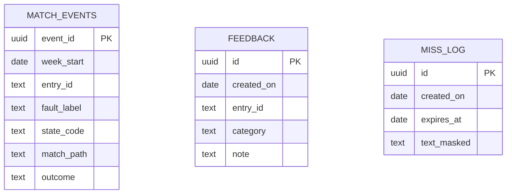
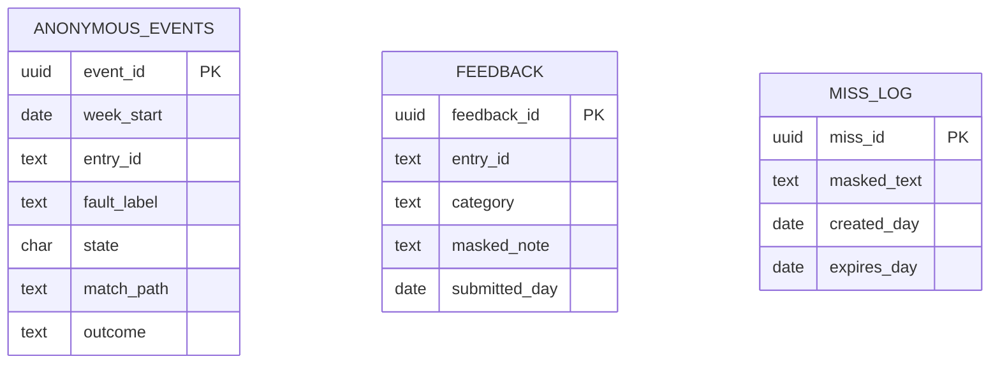

# Wajah — Database (Consolidated)

> Consolidated from the database files supplied for Wajah — Rejection Decoder. Source content is reproduced verbatim; only heading levels were deepened so each source section nests under the part and source label shown below.

## Source key

| Source file | Where reproduced |
|---|---|
| `database.md` | Parts 1, 2, 3, 5, 6, 7, 8, 9, 10 |
| `DATA_LIFECYCLE.md` | Part 2 |
| `DATABASE_SCHEMA.md` | Part 3 |
| `DATABASE_SQL.md` | Part 3 |
| `DATA_DICTIONARY.md` | Part 4 |

Section numbers and section references inside each reproduced source refer to that source file's own numbering. Where the sources differ on a point, each version is kept under its own source label and none has been resolved.

## Parts

1. Overview, Purpose and Database Principles
2. Data Placement, Scope, Retention and Lifecycle
3. Entity Relationships and PostgreSQL Schema
4. Data Dictionary
5. Content Library Data Model
6. Data That Stays in the Browser
7. Access Control, Security and Database/API Boundary
8. Dashboard Aggregation Rules
9. Migration, Backup and Testing
10. Open Decisions, Implementation Checklist and Source Alignment

---

## Part 1 — Overview, Purpose and Database Principles

### Source: `database.md`

#### Wajah --- Database and Data Model (`database.md`)

**Product:** Wajah --- Rejection Decoder\
**Document version:** 1.0\
**Aligned documents:** PRD v1.1 · Architecture v1.0 · App Flow v1.0 ·
Design v1.0 · Rules v1.0 · Tech Stack v1.0\
**Source:** *Wajah App Build Specification with Chat v1.1 AI layer*,
Section 13 and related dashboard/API requirements\
**Status:** Proposed database design; not a deployed schema\
**Classification:** Independent prototype; not a government service

> **Data principle:** Wajah stores as little as possible. The reviewed
> scholarship library is static, versioned application content---not a
> database of student records. A database is optional and must never be
> required for local decoding.

------------------------------------------------------------------------

##### 1. Purpose

This document defines: - Where each category of data lives. - The
minimal PostgreSQL schema for optional anonymous events, feedback, and
no-match review. - Data validation and retention requirements. -
Access-control and dashboard aggregation rules. - The static
content-library layout and versioning strategy. - Migration, backup, and
operational expectations.

The schema is based on the uploaded build specification. It is
compatible with PostgreSQL hosted through Supabase or Neon. SQLite may
be used for a local demonstration, but PostgreSQL is the reference
schema.

##### 2. Database principles

1.  **No student accounts:** Wajah does not need user registration or
    login.
2.  **No personal history:** Do not store a student's decode history or
    profile.
3.  **No raw input:** Never store raw pasted messages, OCR text,
    transcripts, grievance notes, screenshots, or audio.
4.  **Consent first:** Optional match events and feedback are sent only
    when the user has opted in where required.
5.  **Minimal fields:** Store only the category and operational metadata
    needed for the stated purpose.
6.  **No identity tracking:** Do not store user ID, IP address, device
    ID, cookie ID, user agent, application ID, name, or institute name.
7.  **Local-first:** The matcher, library lookup, tap list, and fix-card
    rendering must work without a database.
8.  **Short retention:** Every optional server-side record has a
    documented deletion period.
9.  **Restricted reads:** Public clients may submit permitted records
    but must not read database tables directly.
10. **No third-party analytics:** Do not add analytics SDKs or tracking
    pixels.

---

## Part 2 — Data Placement, Scope, Retention and Lifecycle

### Source: `database.md`

##### 3. Data placement and retention

  ------------------------------------------------------------------------------------
  Data               Storage location     Retention /          Rules
                                          lifecycle            
  ------------------ -------------------- -------------------- -----------------------
  Reviewed library   JSON files in        Versioned in Git;    Only verified entries
  entries            repository, bundled  shipped with app     in production builds
                     at build time        release              

  Library            Generated static     App release          Used for quick tap-list
  index/version      JSON                 lifecycle            loading and cache
                                                               compatibility

  Locale             Versioned frontend   App release          English/Hindi;
  strings/glossary   files                lifecycle            translation review
                                                               state maintained

  Typed or pasted    Browser memory       Cleared on reset or  Never sent to logs,
  message                                 leaving the flow     analytics, or database

  Grievance          Browser memory       Cleared on leaving   Never autosaved
  fields/draft                            the grievance screen 

  Voice audio        Browser/platform     Not stored by Wajah  Transcript requires
                     speech service only,                      user review
                     where supported                           

  Voice transcript   Browser memory       Current session only Sanitise before AI;
                                                               never persist

  Screenshot/OCR     Browser memory       Discard immediately  No image storage; OCR
  image                                   after extraction     runs on-device by
                                                               default

  OCR text           Browser memory       Current session only Sanitise before
                                                               display/AI; never
                                                               persist

  AI provider key    Server environment   Until                Server only; never
                     configuration        rotated/revoked      browser-visible

  Language           `localStorage`       Until user clears it Key: `wajah.lang`
  preference                                                   

  Notice-seen flag   `localStorage`       Until user clears it Key: `wajah.notice.v1`

  Analytics consent  `localStorage`       Until user clears or Key:
                                          changes it           `wajah.consent.stats`

  Match events       `match_events` table Weekly granularity;  Consent required; no
                                          12 months in demo    free text or
                                                               identifiers

  Feedback reports   `feedback` table     12 months            Entry ID, category,
                                                               optional masked note up
                                                               to 300 chars

  Optional no-match  `miss_log` table     30 days              Explicit action only;
  samples                                                      masked text up to 200
                                                               chars; not shown on
                                                               dashboard

  Demo dashboard     Static               Version-controlled   Always labelled
  data               `mock-events.json`   demo fixture         `MOCK DATA`
                     fixture                                   
  ------------------------------------------------------------------------------------

**Important:** Browser storage keys above are preferences/notice state
only. Do not put typed messages, transcripts, grievance drafts, or other
sensitive content in `localStorage`, IndexedDB, cookies, or
service-worker caches.

##### 4. Database scope

The optional operational database has three tables:

-   `match_events` --- minimal anonymous aggregate-event inputs.
-   `feedback` --- reports about a library entry.
-   `miss_log` --- optional, explicitly submitted, masked no-match
    samples for content review.

No other student-facing tables are required by the MVP.

Do not create: - `users`, `profiles`, or `sessions`. - `applications` or
`scholarship_documents`. - `payments` or `eligibility_checks`. -
`decode_history` or `message_history`. - `uploaded_files`,
`screenshots`, `audio_recordings`, or `transcripts`. -
`grievance_submissions`.

The content library is static and bundled; it is not stored in these
operational tables.

##### 10. Retention and deletion

  --------------------------------------------------------------------------------
  Table/data                               Retention Required operation
  --------------------- ---------------------------- -----------------------------
  `match_events`                   12 months in demo Delete rows older than the
                                                     approved retention window

  `feedback`                               12 months Delete old feedback on a
                                                     scheduled job

  `miss_log`                                 30 days Nightly delete where
                                                     `expires_at < current_date`

  Browser input/drafts          Current session only Clear on reset/exit from flow

  Screenshots                             No storage Discard immediately after OCR

  Library                  Git/app-release lifecycle Update through reviewed
                                                     content release

  Consent/preferences      Until user clears/changes User-controlled local
                                                     preference
  --------------------------------------------------------------------------------

Example maintenance queries:

``` sql
delete from match_events
where week_start < current_date - interval '12 months';

delete from feedback
where created_on < current_date - interval '12 months';

delete from miss_log
where expires_at < current_date;
```

Retention jobs must be monitored. A retention period written in
documentation is not sufficient unless the scheduled deletion actually
runs.

### Source: `DATA_LIFECYCLE.md`

#### Data Lifecycle

> **Project:** Wajah — Rejection Decoder  
> **Version:** 1.0 · **Updated:** 1 November 2026  
> **Status:** Engineering draft derived from the uploaded Wajah App Build Specification v1.1 with AI Layer.  
> **Owner:** Relevant team role; assignment pending.

###### Library
Content team captures official source → records URL/issuer/version/date/exact wording → second-person review → versioned JSON → lint/tests → ship only verified entries. Changed/stale sources cause entry retirement from production index.

###### Student input
Browser memory → PII scan → masking → local match → optional sanitised AI request → discard on reset/leave. Never persist raw text, transcript or image.

###### Analytics
Only after opt-in: entry ID, fault label, optional state, match path and outcome. Server buckets to week. Retention must be approved. No identity or exact time.

###### Feedback/miss
Feedback stores entry/category and optional masked note. Miss is consented, restricted, ≤200 chars and expires in 30 days. Disable if governance not approved.

###### Recovery
Static content is version-controlled. Back up only approved aggregate data; encrypt backups and test restore. Static-only demo may omit DB.

---

## Part 3 — Entity Relationships and PostgreSQL Schema

### Source: `database.md`

##### 5. Entity relationship overview

The tables are intentionally independent. They do not link to a person,
device, or application.



There are no foreign keys to user or application entities because those
entities must not exist in Wajah. `entry_id` refers to a stable ID in
the versioned content library. The application validates it against the
current library before accepting a record.

##### 6. PostgreSQL schema

The following is a reference migration. Run it only if optional
server-side persistence is actually needed.

###### 6.1 Extensions and `match_events`

``` sql
-- gen_random_uuid() is available in supported modern PostgreSQL versions.
-- Enable pgcrypto only if required by the selected PostgreSQL deployment.
create extension if not exists pgcrypto;

create table if not exists match_events (
    event_id uuid primary key default gen_random_uuid(),
    week_start date not null,
    entry_id text not null,
    fault_label text not null
        check (fault_label in (
            'student',
            'institute_officer',
            'bank',
            'unsure'
        )),
    state_code text null
        check (
            state_code is null
            or length(state_code) <= 3
        ),
    match_path text not null
        check (match_path in (
            'tap',
            'local',
            'ai',
            'chosen'
        )),
    outcome text not null
        check (outcome in (
            'matched',
            'chosen',
            'no_match'
        ))
);

create index if not exists idx_match_events_week_entry
    on match_events (week_start, entry_id);
```

Field definitions:

  ------------------------------------------------------------------------------
  Field            Type                          Required Meaning
  ---------------- ---------------- --------------------- ----------------------
  `event_id`       UUID                               Yes Random row identifier;
                                                          not linked to a
                                                          user/device

  `week_start`     DATE                               Yes Monday of the event's
                                                          week; no finer time is
                                                          stored

  `entry_id`       TEXT                               Yes Stable library entry
                                                          ID shown or selected

  `fault_label`    TEXT / enum-like                   Yes `student`,
                   check                                  `institute_officer`,
                                                          `bank`, or `unsure`

  `state_code`     TEXT                                No Optional ISO state
                                                          code, only if the
                                                          student chooses to
                                                          share it; max 3 chars

  `match_path`     TEXT / enum-like                   Yes `tap`, `local`, `ai`,
                   check                                  or `chosen`

  `outcome`        TEXT / enum-like                   Yes `matched`, `chosen`,
                   check                                  or `no_match`
  ------------------------------------------------------------------------------

Rules: - Create an event only when the relevant consent is enabled. -
Calculate `week_start` server-side as the Monday date; do not accept
arbitrary client timestamps. - Do not add an exact timestamp, IP
address, user agent, device identifier, or session identifier. -
Validate `entry_id` against the current library before insert. For a
no-match event, use the explicitly agreed sentinel/representation in the
API contract rather than inventing a library entry. - Do not use this
table to reconstruct individual user journeys.

###### 6.2 `feedback`

``` sql
create table if not exists feedback (
    id uuid primary key default gen_random_uuid(),
    created_on date not null default current_date,
    entry_id text not null,
    category text not null
        check (category in (
            'wrong_meaning',
            'wrong_step',
            'out_of_date',
            'hard_to_understand',
            'translation',
            'other'
        )),
    note text null
        check (note is null or length(note) <= 300)
);
```

Field definitions:

  ------------------------------------------------------------------------
  Field            Type                          Required Meaning
  ---------------- ---------------- --------------------- ----------------
  `id`             UUID                               Yes Random feedback
                                                          row ID

  `created_on`     DATE                               Yes Date feedback
                                                          was received

  `entry_id`       TEXT                               Yes Stable library
                                                          entry ID being
                                                          reported

  `category`       TEXT / enum-like                   Yes Controlled
                   check                                  feedback
                                                          category

  `note`           TEXT                                No Optional masked
                                                          note, maximum
                                                          300 characters
  ------------------------------------------------------------------------

Allowed categories: - `wrong_meaning` - `wrong_step` - `out_of_date` -
`hard_to_understand` - `translation` - `other`

Rules: - The note is optional; feedback must work without free text. -
Mask sensitive values before the note reaches the API. - Enforce the
300-character limit on both client and server. - Do not ask users to
include application IDs, phone numbers, Aadhaar numbers, bank details,
passwords, or OTPs. - Do not echo the submitted note in a success
message or log. - Feedback is for content review, not a grievance
channel.

###### 6.3 `miss_log` (optional)

``` sql
create table if not exists miss_log (
    id uuid primary key default gen_random_uuid(),
    created_on date not null default current_date,
    expires_at date not null default (current_date + 30),
    text_masked text not null
        check (length(text_masked) <= 200)
);

create index if not exists idx_miss_log_expires_at
    on miss_log (expires_at);
```

Field definitions:

  --------------------------------------------------------------------------
  Field            Type                          Required Meaning
  ---------------- ---------------- --------------------- ------------------
  `id`             UUID                               Yes Random row ID

  `created_on`     DATE                               Yes Submission date

  `expires_at`     DATE                               Yes Default deletion
                                                          date, 30 days
                                                          after creation

  `text_masked`    TEXT                               Yes Sanitised/masked
                                                          no-match sample,
                                                          max 200 characters
  --------------------------------------------------------------------------

Rules: - This table is optional and should be omitted from the MVP
unless the team has a real content-review need. - Submit only after an
explicit user action explaining that the masked sample will be sent for
review. - Do not submit automatically when a match fails. - Do not
include the miss log in the dashboard. - Run a nightly deletion job for
expired rows. - The server must re-sanitise and validate the text;
client-side masking alone is not sufficient.

Deletion job:

``` sql
delete from miss_log
where expires_at < current_date;
```

Schedule this query daily through the selected host's scheduled-job
facility or a trusted server-side maintenance task.

### Source: `DATABASE_SCHEMA.md`

#### Database Schema


##### Persistence boundary
Library is static JSON; demo can run without DB. If enabled, PostgreSQL stores only minimal anonymous events, feedback and optional consented misses.

###### `anonymous_events`
`event_id UUID PK`; `week_start DATE`; `entry_id TEXT`; `fault_label ENUM(student,institute_officer,bank,unsure)`; `state CHAR(2) NULL`; `match_path ENUM(tap,local,ai,chosen,voice,ocr,both,chat)`; `outcome ENUM(matched,chosen,no_match)`. No user ID, IP, device ID, cookie ID, user agent or exact timestamp.

###### `feedback`
`feedback_id UUID PK`; `entry_id TEXT`; `category ENUM(wrong_meaning,wrong_next_step,out_of_date,hard_to_understand,translation,other)`; `masked_note VARCHAR(300) NULL`; `submitted_day DATE`.

###### `miss_log`
Optional restricted table: `miss_id UUID PK`, `masked_text VARCHAR(200)`, `created_day`, `expires_day`. Consent required; 30-day expiry; not used in dashboard.

Indexes: `(week_start)`, `(entry_id,week_start)`, `(fault_label,week_start)`. Enforce enums and length constraints. Public client insert-only; dashboard reads through server aggregation and suppression.



### Source: `DATABASE_SQL.md`

#### Database SQL


```sql
CREATE TYPE fault_label AS ENUM ('student','institute_officer','bank','unsure');
CREATE TYPE match_path AS ENUM ('tap','local','ai','chosen','voice','ocr','both','chat');
CREATE TYPE match_outcome AS ENUM ('matched','chosen','no_match');
CREATE TABLE anonymous_events (
 event_id UUID PRIMARY KEY DEFAULT gen_random_uuid(),
 week_start DATE NOT NULL, entry_id TEXT NOT NULL,
 fault_label fault_label NOT NULL, state CHAR(2),
 match_path match_path NOT NULL, outcome match_outcome NOT NULL
);
CREATE INDEX idx_events_week ON anonymous_events(week_start);
CREATE INDEX idx_events_entry_week ON anonymous_events(entry_id,week_start);
CREATE INDEX idx_events_fault_week ON anonymous_events(fault_label,week_start);
CREATE TABLE feedback (
 feedback_id UUID PRIMARY KEY DEFAULT gen_random_uuid(),
 entry_id TEXT NOT NULL,
 category TEXT NOT NULL CHECK (category IN
 ('wrong_meaning','wrong_next_step','out_of_date','hard_to_understand','translation','other')),
 masked_note VARCHAR(300),
 submitted_day DATE NOT NULL DEFAULT CURRENT_DATE
);
-- Optional; enable only after consent and retention controls are approved.
CREATE TABLE miss_log (
 miss_id UUID PRIMARY KEY DEFAULT gen_random_uuid(),
 masked_text VARCHAR(200) NOT NULL,
 created_day DATE NOT NULL DEFAULT CURRENT_DATE,
 expires_day DATE NOT NULL
);
```
Production requires RLS, least-privilege roles, expiry job and complementary suppression. Do not seed real student data.

---

## Part 4 — Data Dictionary

### Source: `DATA_DICTIONARY.md`

#### Data Dictionary


| Field | Meaning | Rule |
|---|---|---|
| entry_id | Stable library record identifier | Must exist in active library |
| status / level | Fixed situation categories | Enum only; values provisional pending Phase 0 |
| input_kind | typed/voice/ocr/chat | Enum |
| language | en/hi/hinglish/other/unknown | Enum |
| confidence | Internal match score | 0–1; never shown as student percentage |
| match_path | tap/local/ai/both/voice/ocr/chat | Aggregate only |
| fault_label | student/institute_officer/bank/unsure | Controlled vocabulary |
| week_start | Week bucket | Server-derived; no exact time |
| checked_on | Date source checked | Required for verified source |
| last_verified_on | Date entry reviewed | Required for Verified status |
| masked_note | Optional feedback note | ≤300; scanner applied |
| masked_text | Optional unmatched text | consent, ≤200, 30-day expiry |
| mock | Synthetic-data marker | true for demo data |

---

## Part 5 — Content Library Data Model

### Source: `database.md`

##### 7. Content library data model (static, not relational database)

The reviewed library is stored in version-controlled JSON files in the
repository and bundled with the app.

Suggested layout:

``` text
content/
├── library/
│   ├── nsp_pending_institute.json
│   ├── nsp_defective_returned.json
│   └── ...
├── lint/
│   ├── forbidden.json
│   └── allowed-domains.json
└── glossary/
    └── glossary.json

src/
└── lib/
    └── matcher/
        └── variants.json
```

One file per library entry is the recommended starting layout. Each
entry uses a stable `entry_id` that does not change when its display
name or file path changes.

###### 7.1 Build-time generated files

A build step merges the entry files into:

-   `library.json` --- full bundled library data.
-   `library-index.json` --- compact index for the tap list.
-   `library-version.json` --- content hash used to identify the exact
    library build.

The compact index should contain only the fields needed to display and
navigate the tap list, such as: - `id` - `label` - `group` -
`display_order` - `one_line_description` - `status`

Do not put unverified advice into a production library bundle. Only
entries with the required official source and checked date may be marked
`VERIFIED`.

###### 7.2 Library entry conceptual shape

The following is a conceptual example only; replace placeholder content
with reviewed, source-backed data before production.

``` json
{
  "entry_id": "nsp_example_status",
  "status": "DRAFT",
  "group": "waiting",
  "display_order": 1,
  "labels": {
    "en": "Example status",
    "hi": "उदाहरण स्थिति"
  },
  "portal_wording": {
    "en": [],
    "hi": []
  },
  "match": {
    "phrases": [],
    "keywords": [],
    "variants": [],
    "exclusions": []
  },
  "explanation": {
    "en": "",
    "hi": ""
  },
  "fault_label": "unsure",
  "steps": {
    "en": [],
    "hi": []
  },
  "source": {
    "title": "",
    "issuer": "",
    "url": "",
    "checked_date": null
  },
  "translation_review": {
    "en": "reviewed",
    "hi": "needs_review"
  }
}
```

The final schema must be defined in the content-validation module and
kept consistent with `api.md`, `components.md`, and the matcher
implementation. Do not treat this illustrative JSON as a verified NSP
entry.

---

## Part 6 — Data That Stays in the Browser

### Source: `database.md`

##### 8. Data that stays in the browser

###### 8.1 Session memory only

Keep these values in transient component/session state: - Original typed
or pasted message. - Sanitised/normalised working copy. - Voice
transcript. - OCR-extracted text. - Grievance form fields and generated
draft. - Temporary candidate results. - Temporary screenshot/image
object before OCR completes.

Clear them: - When the user resets the journey. - When the user leaves
the relevant capture/draft flow. - After successful completion where the
data is no longer needed. - On explicit clear/cancel actions.

Do not autosave grievance fields or drafts.

###### 8.2 Local storage

Only use these specified preference/notice keys:

  -----------------------------------------------------------------------
  Key                                 Purpose
  ----------------------------------- -----------------------------------
  `wajah.lang`                        Selected language

  `wajah.notice.v1`                   Whether the independence notice has
                                      been acknowledged/seen

  `wajah.consent.stats`               Optional aggregate-statistics
                                      consent state
  -----------------------------------------------------------------------

Do not store personal content in these keys or add a general-purpose
local history.

---

## Part 7 — Access Control, Security and Database/API Boundary

### Source: `database.md`

##### 9. Access control and database security

###### 9.1 Public-client permissions

-   Enable row-level security (RLS) on all exposed tables.
-   The public client may insert only the permitted row shapes.
-   The public client must not select/read rows from `match_events`,
    `feedback`, or `miss_log`.
-   Do not expose a service-role key or database administrator
    credential in browser code.
-   Dashboard aggregation and moderation must run through a trusted
    server function.
-   Keep CORS restricted to the Wajah app origin.

Example starting point (adapt to the selected Supabase/Neon
architecture):

``` sql
alter table match_events enable row level security;
alter table feedback enable row level security;
alter table miss_log enable row level security;

-- Public insert policies must be narrow and paired with server validation.
-- Do not create public SELECT policies.
```

Do not copy a broad `USING (true)` read policy into production. If
direct anonymous inserts are enabled, use explicit `WITH CHECK`
conditions and still validate through the API. Prefer server-mediated
writes when the host's security model supports it.

###### 9.2 Server-side validation

Before inserting: 1. Validate the request body against a strict schema.
2. Enforce allowed keys; reject unexpected fields. 3. Check consent for
optional events. 4. Validate enum values and string lengths. 5. Validate
`entry_id` against the current library. 6. Mask sensitive patterns in
optional notes/text. 7. Reject payloads containing forbidden identifiers
or unexpected content. 8. Insert only the permitted fields. 9. Return a
generic success/error response that does not echo submitted content.

###### 9.3 Logging

Never log: - Request bodies. - Raw or masked message text. - OCR text or
screenshots. - Voice transcripts or audio. - Grievance notes or
drafts. - Passwords, OTPs, Aadhaar-like values, phone numbers, or bank
identifiers. - Model prompts containing user input.

Permitted operational logging is limited to non-content metadata needed
for reliability, such as endpoint status, latency, and aggregate
counters. Do not attach IP addresses or device identifiers to database
rows.

##### 12. Database/API boundary

The browser should not query database tables directly for dashboard
data.

  -----------------------------------------------------------------------
  API route               Database responsibility Notes
  ----------------------- ----------------------- -----------------------
  `POST /api/events`      Insert one consented    No text payload
                          `match_events` row      

  `POST /api/feedback`    Insert one validated    Optional masked note ≤
                          `feedback` row          300 chars

  `POST /api/miss`        Insert one explicitly   Optional feature; ≤ 200
                          submitted masked        chars
                          `miss_log` row          

  `GET /api/dashboard`    Read and aggregate      Apply minimum group
                          permitted records or    size and suppression
                          return mock fixture     

  `POST /api/match-ai`    No persistence of user  Must not log or store
                          text                    request body
  -----------------------------------------------------------------------

All endpoints use HTTPS and JSON. Rate limits and generic error
responses are defined in `api.md`. The database is not involved in local
matching.

---

## Part 8 — Dashboard Aggregation Rules

### Source: `database.md`

##### 11. Dashboard aggregation rules

The dashboard is a demo/aggregate view. It must never show individual
students or raw events.

###### 11.1 Demo mode

-   Use a static fixture named `mock-events.json`.
-   Generate synthetic data with a fixed seed for reproducible demos.
-   Show the exact `MOCK DATA` banner whenever the dashboard reads
    synthetic data.
-   Do not present synthetic counts as real NSP statistics.
-   Do not mix mock and real events in the same chart without an
    unmistakable distinction.

###### 11.2 Permitted aggregate panels

The build specification describes: - Top five confusing messages: counts
by `entry_id` for selected weeks. - Fault split: share by `fault_label`,
with student-side versus system-side grouping. - Weekly trend: counts by
`week_start`. - Suggested fix per message: static, team-authored
illustrative text mapped to `entry_id`.

###### 11.3 Minimum group size and suppression

The minimum group size is **10 events** as a starting design choice, not
a legal or statistical guarantee.

-   Hide any cell with fewer than 10 events and display "fewer than 10".
-   Suppress combinations such as state plus entry when they fall below
    the threshold.
-   Suppress related totals where necessary to prevent users deriving a
    hidden value by subtraction (differencing attacks).
-   Do not expose free text or raw-event exports.
-   Apply suppression on the server before returning dashboard data; do
    not rely on frontend hiding.

---

## Part 9 — Migration, Backup and Testing

### Source: `database.md`

##### 13. Migration and environment setup

Recommended migration layout:

``` text
supabase/
└── migrations/
    ├── 001_create_match_events.sql
    ├── 002_create_feedback.sql
    ├── 003_create_miss_log.sql
    └── 004_enable_rls.sql
```

If using another PostgreSQL host, keep equivalent numbered SQL
migrations in a `db/migrations/` directory.

Environment variables (names are illustrative; align with `setup.md`):

``` dotenv
DATABASE_URL=""
```

If using Supabase, keep the server-side service-role key in a
server-only environment variable. Never prefix it with `NEXT_PUBLIC_`.

Do not provision a database for local development until the team has
decided to implement events or feedback persistence. A local
in-memory/mock implementation is sufficient for the core app.

##### 14. Backup and operational handling

-   Back up the operational database only if real user-consented data is
    collected.
-   Restrict backup access to authorised maintainers.
-   Apply the same retention and deletion expectations to backups;
    define backup expiry with the chosen provider.
-   Do not export raw event rows for a presentation or hackathon demo.
-   For demo analytics, use the static mock fixture instead.
-   Document who can access the database and how credentials are
    rotated.
-   Test restore and deletion procedures before any real pilot.

##### 15. Testing requirements

###### Schema tests

-   Valid match event inserts successfully.
-   Invalid `fault_label`, `match_path`, and `outcome` are rejected.
-   `state_code` longer than three characters is rejected.
-   Feedback category outside the allowlist is rejected.
-   Feedback note longer than 300 characters is rejected.
-   Miss-log text longer than 200 characters is rejected.
-   Expired miss-log rows are deleted.
-   Old event and feedback rows are deleted according to retention.

###### Privacy tests

-   No table contains a user ID, IP address, device ID, cookie ID, exact
    timestamp, application ID, name, or institute name.
-   Public client cannot read operational tables.
-   No request body is written to logs.
-   Raw text, screenshots, transcripts, and grievance drafts never reach
    database writes.
-   Optional event insertion is blocked when consent is off.
-   Optional miss-log insertion requires an explicit user action.
-   Dashboard responses suppress cells below 10 and prevent differencing
    through overlapping filters.

###### Library tests

-   Every production library entry is `VERIFIED`.
-   Every verified entry has an official source URL and checked date.
-   Stable IDs are unique.
-   Generated index and full library are built from the same source
    revision.
-   `library-version.json` changes when library content changes.
-   The service worker does not mix incompatible app and library
    versions.

---

## Part 10 — Open Decisions, Implementation Checklist and Source Alignment

### Source: `database.md`

##### 16. Open decisions

  -----------------------------------------------------------------------
  Decision                Current position        Required before
  ----------------------- ----------------------- -----------------------
  Whether to provision    Optional; not needed    Events/feedback
  PostgreSQL              for core decode         implementation

  Supabase vs Neon        Both acceptable         Backend setup
                          PostgreSQL options      

  Whether to include      Optional stretch        No-match review feature
  `miss_log`              feature; omit initially 
                          unless needed           

  Real-data dashboard     Not part of basic demo; Any real pilot
                          mock data first         

  Minimum group size      10 as initial design    Dashboard release
                          choice; higher may be   
                          safer                   

  Retention in a real     Demo periods are        Real user-data
  pilot                   specified; reassess     collection
                          purpose and consent     
                          before pilot            

  Direct public inserts   Prefer server-mediated  RLS/API implementation
  vs server-mediated      validation; final       
  writes                  host-dependent choice   
  -----------------------------------------------------------------------

##### 17. Implementation checklist

-   [ ] Keep the reviewed library in version-controlled JSON/TypeScript
    files.
-   [ ] Generate `library.json`, `library-index.json`, and
    `library-version.json` at build time.
-   [ ] Confirm production builds include only verified entries.
-   [ ] Do not create user, application, payment, document, or
    decode-history tables.
-   [ ] Add `match_events` only if consent-based aggregate metrics are
    implemented.
-   [ ] Add `feedback` only if a feedback workflow is implemented.
-   [ ] Keep `miss_log` disabled unless there is an explicit review use
    case.
-   [ ] Enable RLS and deny public reads.
-   [ ] Validate and sanitise every write on the server.
-   [ ] Configure retention deletion jobs and test them.
-   [ ] Implement dashboard suppression server-side.
-   [ ] Keep mock data visibly labelled.
-   [ ] Verify that no raw content is logged or persisted.
-   [ ] Confirm offline decode works with the database unavailable.

##### 18. Source alignment

This document is based on: - *Wajah App Build Specification with Chat
v1.1 AI layer*, Section 13 (Data model and storage), Section 12 (mock
dashboard and privacy suppression), and Section 14 (API endpoints). -
`architecture.md` --- local-first data placement, minimal persistence,
and privacy boundaries. - `rules.md` --- no accounts, no raw input
storage/logging, consent, and retention constraints. - `tech-stack.md`
--- PostgreSQL via Supabase/Neon as optional infrastructure. - `prd.md`
--- product non-goals and privacy-by-default requirements.

**Status reminder:** This is a proposed schema and storage policy. It
does not mean a database has been provisioned or that real student data
is being collected. The database is optional; the local decode
experience must work without it.

---

## Consolidation record

- Every section of `database.md` and the whole of `DATA_LIFECYCLE.md`, `DATABASE_SCHEMA.md`, `DATABASE_SQL.md` and `DATA_DICTIONARY.md` is included once, in original internal order.
- Exact duplicates removed: the identical 4-line metadata blockquote (Project, Version, Status, Owner) that opens each of the four short files is kept once, at the start of `DATA_LIFECYCLE.md` above, and omitted from the other three. Nothing else was removed.
