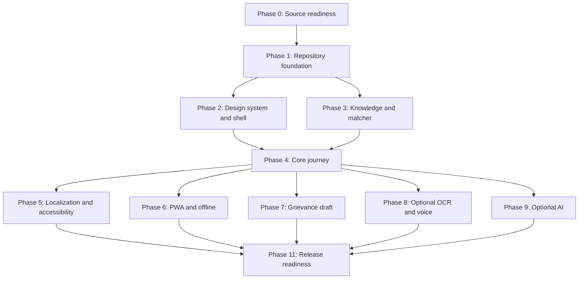

# Wajah — Tasks (Consolidated)

> Consolidated from the task files supplied for Wajah — Rejection Decoder. Source content is reproduced verbatim, including task IDs, checkboxes, priorities and estimates; only heading levels were deepened so each source section nests under the part and source label shown below.

## Source key

| Source file | Notes |
|---|---|
| `task_2.md` | Reproduced under “Source: `task_2.md`” in each part |
| `tasks.md` | Reproduced under “Source: `tasks.md`” in each part |
| `WAJAH_TASK.md` | Reproduced under “Source: `WAJAH_TASK.md`” in each part |
| `wajah_development_tasks_sprint_breakdown.md` | Reproduced under “Source: `wajah_development_tasks_sprint_breakdown.md`” in each part |

Task IDs (for example `T0.1`, `P1`, `Phase 0`) are used by more than one source with their own meanings; each ID belongs to the source file under whose label it appears. Section numbers and cross-references inside each reproduced source refer to that source file's own numbering. Where sources differ, each version is kept under its own source label and none has been resolved.

## Parts

1. Overview, How to Use, Conventions and Constraints
2. Pre-build Decisions, Verification and Capture
3. Foundation and Infrastructure
4. Library, Sanitiser and Local Matcher
5. Core Screens, State Machine, Localization, Accessibility and PWA
6. AI Fallback
7. Grievance, Voice, OCR, Share/Print, Events, Feedback and Dashboard
8. Hardening, Security, Testing and Release
9. Comprehension Test and Demo Preparation
10. Optional Modules and Scope Cut Line
11. Definition of Done, Release Gates, Checklists, Dependencies, Risks and Planning

---

## Part 1 — Overview, How to Use, Conventions and Constraints

### Source: `task_2.md`

#### Wajah — Build Tasks

> Independent prototype. Not a government service. Not affiliated with NSP or any ministry.

| | |
|---|---|
| **Document** | Phased, checkable build task list for Wajah (Rejection Decoder) |
| **Version** | 1.0 (draft for build) |
| **Date** | 2 November 2026 |
| **Derived from** | `PRD.md`, `architecture.md`, `app-flow.md`, `rules.md`, `tech-stack.md`, *Wajah App Build Specification v1.1* |

**How to use this file.** Tick tasks as they finish (`- [x]`). Each task has an ID (`T-<phase>-<nn>`), a priority tag, the requirement/rule IDs it satisfies, and a short acceptance check. **Phase order matters more than day counts** (R-PROC-01). A task is not done until it meets the Definition of Done in §11.

**Priority tags:** **[M]** Must · **[S]** Should · **[C]** Could · **[W]** Won't in MVP.
**Effort** figures are planning guesses from the PRD build plan, not measurements.

---

##### 0. Phase overview

| Phase | Goal | Days | Depends on | Exit gate |
|---|---|---|---|---|
| **P0** Verify & capture | Replace assumptions with real NSP facts | 2–3 | — | OQ1–OQ5 answered; masked screens captured; sources listed |
| **P1** Foundation | Running, deployable skeleton with CI | 2 | P0 (schema questions) | Shell deploys; lint/build scripts run in CI |
| **P2** Library & matcher | Core logic + content | 3 | P0, P1 | Matcher passes labelled test set; ≥ 12 entries drafted |
| **P3** Core screens | Main flow works end to end (EN + HI) | 3 | P2 | Tap / paste / choose / card / no-match all terminate correctly |
| **P4** AI layer | Safe AI fallback + why-line | 1–2 | P3 | Reliable fallback; injection + failure tests green |
| **P5** High-priority features | Audio, share/print, grievance, events, mock dashboard | 3 | P3 | Each feature works offline where required |
| **P6** Harden & test | a11y, offline, perf, reviews | 2 | P3–P5 | All blocking release gates green |
| **P7** Comprehension test & demo | Evidence and story | 2 | P6 | Demo-ready build; honest test report |
| **Later** | Voice → AI grievance → OCR → AI dashboard → Chat | — | Core loop real | Built only after the core loop and library are real |

> **Do not build chat or the AI layer first** (R-PRI-01). Capture real NSP screens and write sourced entries before anything else.

**Cut line if time slips (in this order):** screenshot OCR → second extra language → AI fallback (keep local matcher) → share image (keep print) → dashboard (keep static mock). Chat is cut before the grievance draft and Hindi text. AI-layer cut order: AIU-06 → AIU-01 → AIU-02 → AIU-04 → AIU-03 → AIU-05.

---

### Source: `tasks.md`

#### Wajah --- Implementation Task Board (`tasks.md`)

**Product:** Wajah --- Rejection Decoder\
**Document version:** 1.0\
**Aligned documents:** PRD v1.1 · Architecture v1.0 · App Flow v1.0 ·
Design v1.0 · Rules v1.0 · Tech Stack v1.0 · Database v1.0 · API v1.0 ·
Components v1.0\
**Source:** *Wajah App Build Specification with Chat v1.1 AI layer*\
**Status:** Proposed implementation plan; tasks are not evidence of
completed work\
**Classification:** Independent prototype. Not a government service.

> **Purpose:** Turn the Wajah specification into an actionable,
> prioritised build checklist. Work through the phases in order where
> dependencies require it. Tick a task only after its completion
> criteria have been checked.

------------------------------------------------------------------------

##### 1. How to use this task board

###### Priority definitions

  -----------------------------------------------------------------------
  Priority                Meaning                 Planning guidance
  ----------------------- ----------------------- -----------------------
  **M --- Must**          Required for a safe,    Do not cut
                          useful MVP              

  **S --- Should**        High-value feature or   Build after the core
                          quality requirement     journey

  **C --- Could**         Optional enhancement /  Build only when time
                          stretch feature         allows

  **W --- Won't for MVP** Explicitly outside the  Do not implement as
                          MVP                     part of this release
  -----------------------------------------------------------------------

###### Task status

-   `[ ]` Not started
-   `[x]` Completed and verified
-   `[ ]` In progress --- add the owner and current status in the task
    notes or project tracker

This file is a checklist, not a live project tracker. If the team needs
assignees, dates, estimates, or status reporting, copy the tasks into
the separate Project Tracker.

###### Suggested roles

  -----------------------------------------------------------------------
  Role                                Main responsibility
  ----------------------------------- -----------------------------------
  Product / team lead                 Scope, decisions, coordination,
                                      demo and release

  Frontend developer                  Next.js app, screens, state, local
                                      matching, PWA

  Backend / AI developer              API routes, AI integration, rate
                                      limits, optional data services

  Content and sources lead            Library entries, source evidence,
                                      review status

  Hindi reviewer                      Hindi translation, glossary and
                                      language quality

  UI/UX designer                      Layout, visual system, responsive
                                      and accessible interaction

  QA / tester                         Test cases, regression, usability
                                      and acceptance

  External reviewer                   Independent review of scholarship
                                      explanations and sources
  -----------------------------------------------------------------------

One person may hold multiple roles in a small hackathon team. Assign a
named owner before starting a task; do not assume that a role is already
staffed.

------------------------------------------------------------------------

##### 2. MVP delivery phases

The source build plan estimates approximately **16--18 build days** for
a small team working in parallel. These are relative planning estimates,
not a guaranteed schedule. The order and dependencies matter more than
the exact duration.

  ---------------------------------------------------------------------------
  Phase            Goal                          Estimate Exit deliverable
  ---------------- ---------------- --------------------- -------------------
  P0 --- Verify    Replace                      2--3 days Masked research
  and capture      assumptions with                       notes, source list
                   current,                               and entry drafts
                   evidenced NSP                          
                   information                            

  P1 ---           Create a                        2 days Next.js shell,
  Foundation       deployable                             routes, CI and
                   application                            library build
                   shell                                  

  P2 --- Library   Build reviewed                  3 days Library plus
  and matcher      content and                            matcher passing its
                   deterministic                          test set
                   decoding                               

  P3 --- Core      Complete the                    3 days English/Hindi
  screens          main user                              tap-list and paste
                   journey                                flow

  P4 --- AI        Add optional,                1--2 days Safe AI fallback
  fallback         constrained AI                         that cannot block
                   interpretation                         local results

  P5 ---           Add useful                      3 days Grievance,
  High-priority    secondary                              audio/share/print
  features         capabilities                           and demo dashboard

  P6 --- Harden    Validate                        2 days Release candidate
  and test         privacy,                               
                   accessibility,                         
                   offline and                            
                   content                                

  P7 ---           Test                            2 days Demo-ready build
  Comprehension    understanding                          and test evidence
  and demo         and prepare an                         
                   honest                                 
                   demonstration                          
  ---------------------------------------------------------------------------

------------------------------------------------------------------------

### Source: `WAJAH_TASK.md`

#### WAJAH — Implementation Task Plan

**Version:** 1.0  
**Status:** Draft backlog — unchecked tasks are not complete  
**Based on:** PRD.md, APP_FLOW.md, RULE.md, TECH_STACK.md, and the approved master specification

> This document is an implementation plan, not evidence that the application has been built. Mark a task complete only after implementation and relevant verification.

##### 1. Objective

Build Wajah as an independent, mobile-first web/PWA that helps NSP students understand supported application statuses and remarks through a reviewed knowledge library. The first working version must use deterministic local matching and remain useful without AI or network access after its core assets have been cached.

##### 2. Mandatory constraints

- Wajah explains; it does not decide or act on behalf of the student.
- The reviewed knowledge library is the sole source of scholarship-specific advice.
- AI may classify input and select a known library entry ID; it must not author advice.
- Do not add eligibility decisions, approval/payment predictions, NSP login, application editing/submission, document upload/verification, or direct grievance filing.
- Never invent policy meanings, deadlines, correction windows, responsible officers, official links, or grievance routes.
- Draft/unverified knowledge entries must not appear as confirmed guidance.
- Core matching must work without AI.
- Do not request credentials, OTPs, full Aadhaar numbers, bank details, or unnecessary personal data.
- Do not store raw pasted text, OCR images, or grievance drafts by default.
- Do not claim a mock, placeholder, untested, or undeployed feature is complete.

##### 3. Task conventions

- **P0 Critical:** safety, correctness, or core-MVP blocker.
- **P1 High:** required for a complete MVP.
- **P2 Optional:** enhancement; must not delay the deterministic core.
- `[ ]` Pending; `[x]` verified complete.
- Each completed task must record owner, changed files, test evidence, and known limitations.

---

### Source: `wajah_development_tasks_sprint_breakdown.md`

#### Wajah (वजह): Rejection Decoder — Development Tasks & Sprint Breakdown

| Version | 1.1 | 
| ----- | ----- | 
| Date | 1 November 2026 | 
| Project | Wajah — Build For Bharat 2026 Pan-India Hackathon, KIET Deemed to be University, Ghaziabad | 

##### 1. Overview & Sprint Philosophy

This document outlines the actionable engineering, content authoring, and testing tasks required to build the Wajah prototype. Tasks are organized into sequential phases matching the build plan in the PRD, designed to ensure rapid delivery without compromising privacy, safety invariants, or source verification rules.

---

##### 2. Phase-by-Phase Task Breakdown

---

## Part 2 — Pre-build Decisions, Verification and Capture

### Source: `task_2.md`

##### 1. Pre-build decisions (team lead)

- [ ] **T-DEC-01 [M]** Confirm the PRD §29 resolutions as adopted in `architecture.md` ADR-04 to ADR-10 (or overrule any) — *acceptance: decisions recorded; engineers not guessing.*
- [ ] **T-DEC-02 [M]** Fill roles: team lead/product, designer, frontend dev, backend/AI dev, content & sources lead, **external reviewer** (outside the team, e.g. college scholarship clerk), **Hindi reviewer** (R-PROC-04).
- [ ] **T-DEC-03 [M]** Decide whether unverified entries appear in the demo with a Draft banner (OQ8).
- [ ] **T-DEC-04 [S]** Decide which language leads the demo, Hindi or English (OQ-A1) — decides whether voice input is Must or Should.
- [ ] **T-DEC-05 [S]** Decide on-device OCR only vs optional server/vision path (OQ-A2).
- [ ] **T-DEC-06 [S]** Pick the model/provider and daily cap for `/api/understand` (OQ-A3); must pass the matcher test set first.
- [ ] **T-DEC-07 [S]** Decide whether the dashboard is shown in the demo (OQ-A4) — if not, AI dashboard stays design-only.
- [ ] **T-DEC-08 [S]** Choose hosting and the DB region (OQ9).
- [ ] **T-DEC-09 [S]** Choose which second extra language will be tested (OQ6).
- [ ] **T-DEC-10 [M]** Decide XState vs plain reducer against the 150 KB first-load JS budget.
- [ ] **T-DEC-11 [S]** Ask whether permission/review is needed before using NSP wording or screens (OQ10); keep the independent label regardless.

---

##### 2. Phase 0 — Verify & capture (2–3 days)

*Goal: replace every spec assumption with something checked on a live NSP screen or official page. None of the 14 candidate entries is verified yet.*

- [ ] **T-P0-01 [M]** Get consent from a student volunteer to walk their **own** NSP application journey (R-CAP-01).
- [ ] **T-P0-02 [M]** Screenshot each status/remark screen; **mask names, application IDs, bank and Aadhaar details before saving** (R-CAP-02).
- [ ] **T-P0-03 [M]** Type exact on-screen wording into `what_the_screen_says`; record date and page (R-CAP-03) — answers **OQ1**.
- [ ] **T-P0-04 [M]** Re-check the official NSP help pages for any new status-explanation tool or fuller remark guide; update positioning if one exists (OQ5, R-PROC-06).
- [ ] **T-P0-05 [M]** Find current correction-window rules from official sources (OQ2) — needed for entries 2, 3, 11 and deadline lines.
- [ ] **T-P0-06 [M]** Find the current official grievance route (OQ3) — needed for the S10 link label.
- [ ] **T-P0-07 [M]** Find which official helpline/contact details may be shown (OQ4); **never invent phone numbers**.
- [ ] **T-P0-08 [M]** Find which official payment page NSP links to (PFMS or other) for entries 12–14.
- [ ] **T-P0-09 [M]** Determine whether real messages contain meaningful numbers (OQ7 / OQ-A6) — decides normaliser rule N5.
- [ ] **T-P0-10 [M]** Build the source list per the hierarchy: live NSP screens/official pages → ministry notification → official institute/state circulars → third-party (leads only) (R-SRC-01). **Capture URLs from live official sites; do not copy URLs from the spec** (R-SRC-02).
- [ ] **T-P0-11 [M]** For every source store: title + issuer, canonical URL, document year, checked date, exact on-screen wording, known conflicts, current/older/uncertain (R-SRC-03).
- [ ] **T-P0-12 [M]** Fill the "Must verify" column for each of the 14 candidate entries.
- [ ] **T-P0-13 [S]** Start the labelled matcher test set from real captured messages (target ≥ 60 rows before threshold tuning).

**Phase 0 questions OQ1–OQ5 MUST be answered before any entry is marked `verified`** (R-PROC-07).

---

### Source: `tasks.md`

##### 3. P0 --- Verify and capture

**Goal:** Validate the assumptions and source material before encoding
scholarship advice.

###### Research and product validation

-   [ ] **P0-01 (M)** Assign product, frontend, backend, content, design
    and QA owners.
-   [ ] **P0-02 (M)** Define the pilot scholarship category and the
    exact in-scope message/status set.
-   [ ] **P0-03 (M)** Walk through the real NSP student journey with a
    consenting participant where feasible.
-   [ ] **P0-04 (M)** Capture only masked/redacted reference screens; do
    not retain passwords, OTPs, Aadhaar numbers, bank details or other
    unnecessary identifiers.
-   [ ] **P0-05 (M)** Re-check relevant official NSP help pages and FAQs
    for current status explanations and available official guidance.
-   [ ] **P0-06 (M)** Create a source register with source title/issuer,
    official URL, checked date, reviewer and supported claims.
-   [ ] **P0-07 (M)** Complete the "must verify" checklist for every
    planned library entry.
-   [ ] **P0-08 (M)** Resolve or document the open questions OQ1--OQ5
    from the source specification.
-   [ ] **P0-09 (S)** Identify a content reviewer who is not the
    original author.
-   [ ] **P0-10 (S)** Identify a Hindi reviewer for terminology and
    translation review.
-   [ ] **P0-11 (S)** Record user-research observations as anonymised
    themes, not identifiable student histories.

**Exit criteria** - The pilot scope is written down. - Every proposed
advice entry has an official source to verify against or is clearly
marked as draft/unverified. - Research artefacts are masked. -
Unresolved questions are visible rather than silently assumed.

------------------------------------------------------------------------

### Source: `WAJAH_TASK.md`

##### 4. Phase 0 — Source and product readiness

<badge>Gate 0</badge> Do not release scholarship explanations as verified guidance until source review is complete.

###### T0.1 Documentation and repository audit — P0
- [ ] Read `README.md` and `docs/INDEX.md`.
- [ ] Read `PRD.md`, `APP_FLOW.md`, `RULE.md`, and `TECH_STACK.md`.
- [ ] Review architecture, frontend/backend, API/database, AI guardrails, UI/UX, and testing specifications.
- [ ] Inspect the existing repository before creating or replacing files.
- [ ] List conflicts, missing requirements, and unresolved decisions.
- [ ] Record decisions in the architecture decision log; do not silently reconcile conflicts.

**Acceptance:** A written implementation plan exists; existing working code/docs are preserved; unresolved decisions have owners.

###### T0.2 Knowledge-library verification — P0
- [ ] Inventory candidate entries.
- [ ] Verify every released explanation against current official sources.
- [ ] Verify next steps, document/checklist claims, responsible level, official URL, and grievance route where applicable.
- [ ] Record source title, URL, verification date, reviewer, and review state.
- [ ] Mark unsupported claims as unverified.
- [ ] Exclude unverified entries from student-facing confirmed guidance.
- [ ] Define a content review/update process.

**Acceptance:** Every released entry has traceable review evidence; unsupported claims are omitted rather than guessed.

###### T0.3 Resolve release-blocking choices — P0
- [ ] Confirm supported browser/device targets.
- [ ] Resolve conflicting OCR priority/configuration details or defer OCR.
- [ ] Define intended data flows for privacy review.
- [ ] Identify product/content approver and release owner.
- [ ] Keep AI provider/model, AI cap, hosting, database, and monitoring choices unresolved until approved.

**Acceptance:** No unresolved choice is represented as a finalized product decision.

---

### Source: `wajah_development_tasks_sprint_breakdown.md`

###### Phase 0: Verification & Screen Capture
* **[ ] T0.1:** Walk through the live National Scholarship Portal (NSP) student journey for Post Matric scholarships with a consenting student volunteer.
* **[ ] T0.2:** Capture masked screenshots of key status and remark screens (Pending, Defective, Rejected, Approved/Unpaid).
* **[ ] T0.3:** Re-verify official NSP FAQ documents and help pages on `scholarships.gov.in` to confirm current correction windows and grievance routes.
* **[ ] T0.4:** Finalize canonical wording for `what_the_screen_says` across initial target status entries.

---

## Part 3 — Foundation and Infrastructure

### Source: `task_2.md`

##### 3. Phase 1 — Foundation (2 days)

- [ ] **T-P1-01 [M]** Create repo with Next.js (App Router) + TypeScript + Tailwind; commit lockfile.
- [ ] **T-P1-02 [M]** Set up the repository layout (`content/`, `scripts/`, `src/app`, `src/components`, `src/lib/*`, `src/state`, `tests/`).
- [ ] **T-P1-03 [M]** ESLint import-boundary rules enforcing the layering table (components / state / matcher+sanitise / library / api) (R-ARCH layering).
- [ ] **T-P1-04 [M]** next-intl with `en.json` + `hi.json`; per-string English fallback; `<html lang>` follows active language (R-LNG-05/07).
- [ ] **T-P1-05 [M]** Root layout with **RibbonBanner** (not dismissable), top bar with `LanguageSwitch`, `OfflineBanner` placeholder (P1, R-UI-02).
- [ ] **T-P1-06 [M]** Routes scaffolded per route map: `/`, `/decode/{pick,paste,scan,choose}`, `/card/[entryId]` (+ `grievance`, `share`), `/no-match`, `/report`, `/about`, `/dashboard`, `/chat`.
- [ ] **T-P1-07 [M]** Home (S01) and About (S13) static pages; safety line "Never type your password, OTP, Aadhaar or bank number here." on Home (R-UI-09).
- [ ] **T-P1-08 [M]** Library schema types (`lib/library/types.ts`) and Zod/Ajv schema for entries.
- [ ] **T-P1-09 [M]** `scripts/lint-library.ts` (`npm run lint:library`) exits non-zero on any rule failure.
- [ ] **T-P1-10 [M]** `scripts/build-library.ts` → `library.json`, `library-index.json`, `library-version.json`; `DEMO_MODE` selects bundled statuses at **build time** (R-ARCH-04, ADR-14).
- [ ] **T-P1-11 [M]** Create data files: `forbidden.json` (EN + HI), `allowed-domains.json`, `glossary.json`, `variants.json`, `situation.json`, `why-templates.json`.
- [ ] **T-P1-12 [M]** Feature flags and env var handling (public flags baked at build; secrets server-only) (R-CFG-01).
- [ ] **T-P1-13 [M]** PWA shell: Workbox service worker, precache shell + library; `/api/*` network-only (R-API-08).
- [ ] **T-P1-14 [M]** CI pipeline: install + audit → typecheck + ESLint → `lint:library` → unit tests → build → deploy preview.
- [ ] **T-P1-15 [M]** Deploy the skeleton to Vercel/Netlify (HTTPS, HSTS); set security headers: strict CSP, `nosniff`, `Referrer-Policy: no-referrer`, `Permissions-Policy` (camera/mic only on scan/voice screens).
- [ ] **T-P1-16 [S]** Add `size-limit` and Lighthouse CI configs (budgets: first-load JS ≤ 150 KB, library ≤ 100 KB, Hindi font ≤ 120 KB, LCP ≤ 2.5 s).

---

### Source: `tasks.md`

##### 4. P1 --- Foundation

**Goal:** Create a working application skeleton that can be deployed and
extended.

###### Repository and development environment

-   [ ] **P1-01 (M)** Create the Git repository and agree on the branch
    / pull-request workflow.
-   [ ] **P1-02 (M)** Initialise Next.js with App Router and TypeScript.
-   [ ] **P1-03 (M)** Configure Tailwind CSS and the shared design-token
    entry point.
-   [ ] **P1-04 (M)** Enable strict TypeScript settings and a consistent
    lint / formatting command.
-   [ ] **P1-05 (M)** Add the production build command and verify it
    runs in a clean environment.
-   [ ] **P1-06 (M)** Add basic CI checks for install, lint, type-check
    and build.
-   [ ] **P1-07 (M)** Create the initial folder structure for routes,
    components, features, domain logic, content and tests.
-   [ ] **P1-08 (M)** Add `.env.example`; ensure real secrets are
    excluded from Git.
-   [ ] **P1-09 (S)** Add a short README with prerequisites and the
    local development command.

###### App shell and navigation

-   [ ] **P1-10 (M)** Implement the shared `AppShell`, header and
    footer/navigation.
-   [ ] **P1-11 (M)** Display the exact independence notice on every
    screen: **"Independent prototype. Not a government service."**
-   [ ] **P1-12 (M)** Implement English/Hindi language selection and
    locale message files.
-   [ ] **P1-13 (M)** Implement Home and About / independence
    information screens.
-   [ ] **P1-14 (M)** Add the initial route structure for the main
    journey.
-   [ ] **P1-15 (M)** Ensure the UI does not use government seals, NSP
    logos, national emblems or official-looking portal styling.
-   [ ] **P1-16 (S)** Add basic responsive layout and keyboard
    navigation to the shell.

###### Content build foundation

-   [ ] **P1-17 (M)** Define TypeScript types for library entries,
    source metadata, fault labels and content status.
-   [ ] **P1-18 (M)** Create the static library source directory and
    sample entry fixture.
-   [ ] **P1-19 (M)** Add a build/validation script that generates the
    bundled `library.json`.
-   [ ] **P1-20 (M)** Make the build fail when a `VERIFIED` entry lacks
    required source title/issuer, URL, checked date or review evidence.
-   [ ] **P1-21 (S)** Add a library version identifier for cache
    compatibility.

**Exit criteria** - The app starts locally and produces a production
build. - CI checks pass. - Home/About, language switch and permanent
independence notice work. - Library types and a validated library build
exist.

------------------------------------------------------------------------

### Source: `WAJAH_TASK.md`

##### 5. Phase 1 — Repository foundation

###### T1.1 Application setup — P0
- [ ] Set up Next.js App Router.
- [ ] Configure TypeScript strict mode.
- [ ] Configure Tailwind CSS.
- [ ] Configure ESLint and Prettier.
- [ ] Commit one package-manager lockfile.
- [ ] Add `.gitignore` rules for secrets, build output, and private data.
- [ ] Add `.env.example` with placeholders only.
- [ ] Add environment-variable validation.
- [ ] Document install, development, test, and build commands.

**Acceptance:** Clean install, dev server, type check, lint, and production build succeed; no real secrets are committed.

###### T1.2 Test and CI setup — P0
- [ ] Configure Vitest.
- [ ] Configure React Testing Library.
- [ ] Configure Playwright.
- [ ] Configure axe-core accessibility checks.
- [ ] Add CI checks for lint, type-check, unit tests, and build.
- [ ] Document test commands.

**Acceptance:** Sample unit, component, and browser tests run; CI fails on required-check failures.

###### T1.3 Project structure — P0
- [ ] Align folders with `PROJECT_STRUCTURE.md`.
- [ ] Separate UI, domain logic, knowledge content, server code, and tests.
- [ ] Keep server-only modules out of client bundles.
- [ ] Define shared typed contracts.
- [ ] Avoid duplicate knowledge-library locations.

**Acceptance:** Domain logic can be tested without rendering UI; structure matches approved architecture.

---

##### 6. Phase 2 — Design system and app shell

###### T2.1 Design tokens — P1
- [ ] Define semantic colors, typography, spacing, radius, elevation, focus, and breakpoints.
- [ ] Define status presentation that does not rely on color alone.
- [ ] Document token usage.

###### T2.2 Accessible shared components — P1
- [ ] Build buttons, links, inputs, textareas, cards, and feedback components.
- [ ] Build loading, empty, error, offline, and no-match states.
- [ ] Add dialogs/menus only where needed.
- [ ] Verify keyboard operation, focus, labels, and screen-reader names.

###### T2.3 Responsive app shell — P1
- [ ] Implement layout and navigation.
- [ ] Add Wajah identity and concise independent-service disclaimer.
- [ ] Add language selection.
- [ ] Add privacy/help/source access points required by UX specs.
- [ ] Verify narrow mobile, tablet, desktop, and zoom layouts.

**Acceptance for Phase 2:** Primary task is obvious; components use shared tokens; core shell is keyboard-usable and responsive.

---

### Source: `wajah_development_tasks_sprint_breakdown.md`

###### Phase 1: Foundation & Infrastructure (`P1`)
* **[ ] T1.1:** Initialize Next.js 15 project repository with TypeScript, Tailwind CSS, and strict linting rules.
* **[ ] T1.2:** Configure `next-intl` localization scaffolding with English (`en.json`) and Hindi (`hi.json`) locale files.
* **[ ] T1.3:** Build global `RibbonBanner.tsx` enforcing Principle $\mathbf{P1}$ (*Independent prototype. Not a government service.*) on every route.
* **[ ] T1.4:** Implement `content/lint/forbidden.json` linter script (`npm run lint:library`) to block unauthorized phrasing at build time.
* **[ ] T1.5:** Configure Workbox service worker for PWA asset caching and offline tap-list support.

---

## Part 4 — Library, Sanitiser and Local Matcher

### Source: `task_2.md`

##### 4. Phase 2 — Library & matcher (3 days)

###### 4.1 Sanitiser

- [ ] **T-P2-01 [M]** `lib/sanitise/patterns.ts` + `mask.ts`: Aadhaar-like, Indian mobile, OTP phrase, password phrase, email, bank-account-like, IFSC, PAN, long mixed ID → masks (R-SAN-*).
- [ ] **T-P2-02 [M]** Return **types found, never values**; runs **before** the normaliser (R-SAN-02/03).
- [ ] **T-P2-03 [M]** Unit tests per pattern with positive **and** negative samples (synthetic strings only), including "document not clear" is never masked (R-SAN-04/06).

###### 4.2 Normaliser and matcher

- [ ] **T-P2-04 [M]** `normalise.ts` implementing N1–N10; N5 (drop digit runs) behind a flag (R-NORM, OQ7).
- [ ] **T-P2-05 [M]** Variant map (Hinglish, typos, Devanagari → canonical tokens) as a **data file** + minimal EN/Hinglish stop-word list (R-NORM-01).
- [ ] **T-P2-06 [M]** `score.ts`: phrase score (1.0×w adjacent / 0.7×w all present), +0.10 per extra trigger (max +0.20), −0.50 negative trigger, clamp 0–1, top three.
- [ ] **T-P2-07 [M]** `decide.ts`: CONFIDENT (top ≥ 0.85 and lead ≥ 0.20), AMBIGUOUS, WEAK, OUT_OF_SCOPE via `scope_markers`.
- [ ] **T-P2-08 [M]** Precompiled trigger index built once at start; whole-library match ≤ 50 ms.
- [ ] **T-P2-09 [M]** Level words (institute / district / state) are high-weight triggers on the right entry; level-pair tests never swap (R-LIB-24).
- [ ] **T-P2-10 [M]** `faultMap.ts` — the **single** mapping `who_acts[0]` → FaultLabel → UI → AI `fault_hint` (ADR-08).
- [ ] **T-P2-11 [M]** Matcher evaluation script `npm run test:matcher`: top-1 accuracy, **confident-and-wrong rate**, out-of-scope rejection; fails build if confident-and-wrong rises (R-TEST-MAT-03).
- [ ] **T-P2-12 [M]** Labelled test set ≥ 60 rows covering exact, Hinglish/typos, level pairs, noise, multiple statuses, PII, prompt injection, out-of-scope (R-TEST-MAT-02). **Build before tuning thresholds.**
- [ ] **T-P2-13 [M]** Tune thresholds on the test set — prefer lowering confident-threshold *error* over raising accuracy (R-MAT-11). Targets: top-1 ≥ 90%, confident-and-wrong ≤ 2%, OOS ≥ 90%.

###### 4.3 Library content

- [ ] **T-P2-14 [M]** Author **12–15** entries as `content/library/nsp_*.json` in English with real captured wording (target: fewer, better entries beats 25 loosely sourced).
- [ ] **T-P2-15 [M]** For each entry: `label` ≤ 6 words, `one_line_description` 15–25 words, `cause` ≤ 25 words with "likely/usually", `steps` 1–5 verb-first, `typical_wait`/`deadline` default `see_portal`, `official_destination` on allowed domain, `sources[]` complete (R-LIB-10 to R-LIB-25).
- [ ] **T-P2-16 [M]** Unique trigger phrases across entries; at least one trigger per entry (R-LIB-23).
- [ ] **T-P2-17 [M]** Payment-stage entries (12–14) state **"Wajah does not track money"** and hand off to the official payment page and bank (R-CRD-13).
- [ ] **T-P2-18 [M]** Hindi text for every entry string; mark `[NEEDS REVIEW]` until reviewed; confirm "Wajah" transliteration ("वजह") with the Hindi reviewer (R-LNG-10).
- [ ] **T-P2-19 [M]** Implement all `lint:library` rules (required fields, source + date, reviewers, step count, deadlines need `source_ref`, forbidden phrases, official link, contact details, translation, reading level, triggers) — see rules §3.6.
- [ ] **T-P2-20 [M]** Forbidden-phrase list with Hindi equivalents; linter is case-insensitive over library **and** UI strings (rules §5).
- [ ] **T-P2-21 [M]** Entry review workflow: author (draft) → peer (in_review) → **external review** → Hindi review → lead sets `verified`, records `reviewed_by` and `last_verified_on`; commit message names the entry ID (R-LIFE-03).

###### 4.4 Entry candidate checklist (14 candidates — none verified yet)

| # | Entry ID | Group | Drafted | Wording captured | Sourced | Peer | External | Hindi | Verified |
|---|---|---|---|---|---|---|---|---|---|
| 1 | `nsp_pending_institute` | Waiting | [ ] | [ ] | [ ] | [ ] | [ ] | [ ] | [ ] |
| 2 | `nsp_defective_returned` | Returned | [ ] | [ ] | [ ] | [ ] | [ ] | [ ] | [ ] |
| 3 | `nsp_defective_document` | Returned | [ ] | [ ] | [ ] | [ ] | [ ] | [ ] | [ ] |
| 4 | `nsp_rejected_institute` | Not approved/paid | [ ] | [ ] | [ ] | [ ] | [ ] | [ ] | [ ] |
| 5 | `nsp_pending_district_state` | Waiting | [ ] | [ ] | [ ] | [ ] | [ ] | [ ] | [ ] |
| 6 | `nsp_rejected_district_state` | Not approved/paid | [ ] | [ ] | [ ] | [ ] | [ ] | [ ] | [ ] |
| 7 | `nsp_wrong_institute` | Returned | [ ] | [ ] | [ ] | [ ] | [ ] | [ ] | [ ] |
| 8 | `nsp_duplicate_application` | Not approved/paid | [ ] | [ ] | [ ] | [ ] | [ ] | [ ] | [ ] |
| 9 | `nsp_institute_not_registered` | Waiting | [ ] | [ ] | [ ] | [ ] | [ ] | [ ] | [ ] |
| 10 | `nsp_verification_deadline_passed` | Not approved/paid | [ ] | [ ] | [ ] | [ ] | [ ] | [ ] | [ ] |
| 11 | `nsp_correction_window_closed` | Returned | [ ] | [ ] | [ ] | [ ] | [ ] | [ ] | [ ] |
| 12 | `nsp_approved_money_not_received` | Not approved/paid | [ ] | [ ] | [ ] | [ ] | [ ] | [ ] | [ ] |
| 13 | `nsp_payment_released_not_credited` | Not approved/paid | [ ] | [ ] | [ ] | [ ] | [ ] | [ ] | [ ] |
| 14 | `nsp_bank_validation_failed` | Not approved/paid | [ ] | [ ] | [ ] | [ ] | [ ] | [ ] | [ ] |

*Notes:* only entry 2 has partial official support (an older-year FAQ). Do **not** show any date from the spec for entry 10. Treat 14 as a pool: ship only what clears verification; show the Draft banner for the rest in the demo.

---

### Source: `tasks.md`

##### 5. P2 --- Reviewed library and local matcher

**Goal:** Make the core interpretation path deterministic, testable and
independent of AI.

###### Reviewed content library

-   [ ] **P2-01 (M)** Define the library entry template and required
    fields.
-   [ ] **P2-02 (M)** Draft at least 12 in-scope entries in English, as
    planned in the source build plan.
-   [ ] **P2-03 (M)** Draft Hindi versions for the in-scope entries.
-   [ ] **P2-04 (M)** Add the original portal wording / variants
    supported by each entry.
-   [ ] **P2-05 (M)** Add a plain-language explanation,
    responsible-party label and ordered next steps to each entry.
-   [ ] **P2-06 (M)** Add source title/issuer, official URL, checked
    date and verification status.
-   [ ] **P2-07 (M)** Add a "say this" prompt only where supported by
    the reviewed entry.
-   [ ] **P2-08 (M)** Add deadline wording only where a current official
    source supports a specific date; otherwise instruct users to check
    the official portal.
-   [ ] **P2-09 (M)** Review every production entry with a second
    content reviewer.
-   [ ] **P2-10 (M)** Complete Hindi translation review before marking
    Hindi content ready.
-   [ ] **P2-11 (M)** Keep draft, unverified and translation-pending
    entries visibly labelled and out of verified-advice paths.
-   [ ] **P2-12 (S)** Add a glossary of recurring NSP terms in English
    and Hindi.

###### Sanitisation and normalisation

-   [ ] **P2-13 (M)** Implement input length and type validation.
-   [ ] **P2-14 (M)** Implement sensitive-pattern detection and masking
    for password-like values, OTPs, Aadhaar-like numbers, phone-like
    numbers and bank-like details.
-   [ ] **P2-15 (M)** Ensure warnings never echo the sensitive value
    that was detected.
-   [ ] **P2-16 (M)** Implement text normalisation: case, whitespace,
    punctuation and common formatting variations.
-   [ ] **P2-17 (M)** Implement a variant map for known portal wording
    and common spelling / language variants.
-   [ ] **P2-18 (M)** Keep sanitisation and normalisation as pure,
    independently tested functions.
-   [ ] **P2-19 (M)** Do not persist raw typed text, OCR output,
    transcript or grievance notes in localStorage, IndexedDB, cookies or
    service-worker caches.

###### Deterministic matcher and decision rules

-   [ ] **P2-20 (M)** Implement a plain TypeScript local keyword /
    phrase matcher.
-   [ ] **P2-21 (M)** Implement scoring and ranking against known
    library entry IDs.
-   [ ] **P2-22 (M)** Implement confident, ambiguous and weak/no-match
    outcomes.
-   [ ] **P2-23 (M)** Limit ambiguous candidate presentation to a
    maximum of three entries.
-   [ ] **P2-24 (M)** Ensure the matcher can return no-match; do not
    force a result.
-   [ ] **P2-25 (M)** Build a representative matcher test set from the
    starter inputs and reviewed variants.
-   [ ] **P2-26 (M)** Test exact, partial, noisy, misspelled, Hindi and
    unsupported inputs.
-   [ ] **P2-27 (M)** Tune thresholds against the test set and record
    them as design choices, not NSP facts.
-   [ ] **P2-28 (M)** Implement reconciliation so AI can never silently
    override a conflicting local result.
-   [ ] **P2-29 (S)** Add regression fixtures for every confirmed
    matcher bug.

**Exit criteria** - The library build validates source metadata and
content status. - Sanitiser, normaliser, matcher and reconciliation have
unit tests. - The local matcher passes the agreed test set. - No advice
is generated by the matcher or AI; advice comes from reviewed library
entries only.

------------------------------------------------------------------------

### Source: `WAJAH_TASK.md`

##### 7. Phase 3 — Knowledge model and deterministic matcher

<badge>Critical path</badge> The knowledge library and matcher power every explanation.

###### T3.1 Knowledge schema — P0
- [ ] Implement the canonical knowledge-entry schema from the project specification.
- [ ] Include stable ID, supported phrases/aliases, reviewed explanation, safe actions, source metadata, verification state, and review metadata as specified.
- [ ] Validate records on load/build.
- [ ] Reject duplicate IDs and malformed records.
- [ ] Prevent unverified entries from resolving to user-facing advice.

###### T3.2 Reviewed starter records — P0
- [ ] Add only Phase 0 verified records.
- [ ] Add approved aliases and exact phrases.
- [ ] Add source metadata and review dates.
- [ ] Keep unresolved records internal-only.
- [ ] Add tests preventing draft records from appearing as confirmed advice.

###### T3.3 Normalization — P0
- [ ] Normalize whitespace and case where language-appropriate.
- [ ] Normalize only approved punctuation/format variants.
- [ ] Preserve meaningful words and distinctions.
- [ ] Test empty, noisy, malformed, and multilingual input.

###### T3.4 Deterministic matcher — P0
- [ ] Match normalized input against approved phrases/aliases.
- [ ] Return known entry IDs only.
- [ ] Calculate candidate scores for internal decision-making.
- [ ] Enforce baseline threshold **≥ 0.85**.
- [ ] Enforce lead over runner-up **≥ 0.20**.
- [ ] Return ambiguity when candidates are too close.
- [ ] Return no-match when confidence is insufficient.
- [ ] Add fixtures and threshold-boundary tests.

###### T3.5 Ambiguity and no-match — P0
- [ ] Define candidate-choice contract.
- [ ] Show human-readable choices, not internal IDs.
- [ ] Provide safe no-match wording and edit/retry path.
- [ ] Offer official hand-off only through verified links.
- [ ] Avoid blame and implied certainty.

**Acceptance for Phase 3:** Same input and library version yield the same result; matcher never creates entries or advice; ambiguous/unsupported input is not forced into a match.

---

### Source: `wajah_development_tasks_sprint_breakdown.md`

###### Phase 2: Library Authoring & Matching Engine (`P2`)
* **[ ] T2.1:** Author initial structured JSON entries ($\ge 12$ entries) under `content/library/` adhering to the required schema (cause, who_acts, steps, sources, checked date).
* **[ ] T2.2:** Implement client-side text normalization (`normalise.ts`) and variant mapping (`variants.json`) for Hinglish typos and Devanagari tokens.
* **[ ] T2.3:** Build local adjacency-weighted token scorer (`score.ts`) and unit test suite in Vitest.
* **[ ] T2.4:** Implement secure server-side AI fallback endpoint (`POST /api/understand`) enforcing strict JSON schema validation and zero temperature ($0.0$).

---

## Part 5 — Core Screens, State Machine, Localization, Accessibility and PWA

### Source: `task_2.md`

##### 5. Phase 3 — Core screens and state machine (3 days)

###### 5.1 State machine

- [ ] **T-P3-01 [M]** `state/decodeMachine.ts` with states IDLE, PICKING, PASTING, SCANNING, ERROR_OCR, SANITISING, MATCHING_LOCAL, MATCHING_AI, DISAMBIGUATING, RESULT, NO_MATCH, GRIEVANCE, SHARE, REPORT; held in React context, **never persisted** (R-ARCH-03).
- [ ] **T-P3-02 [M]** State-machine tests proving **every capture route ends in an entry ID, a candidate list, or no-match** (CAP-07).
- [ ] **T-P3-03 [M]** Route guards: `/decode/choose` without candidates → `/decode/pick`; unknown `entryId` → `/decode/pick` + "We could not find that card."; retired → "This guidance has been withdrawn".

###### 5.2 Screens

- [ ] **T-P3-04 [M]** **S02 First-run notice** (bottom sheet): focus trapped, first focus on title, Escape closes only after "I understand"; writes `wajah.notice.v1`, `wajah.lang`, `wajah.consent.stats` (consent **OFF by default**); blocked-storage fallback (shows every visit).
- [ ] **T-P3-05 [M]** **S03 Tap list**: reads `library-index.json`; three ARIA tabs (Waiting · Returned (Defective) · Not approved or not paid); rows ≥ 64 px with label, untranslated on-screen wording, one-line gloss; fixed `display_order`; filter box with clear; empty state; "My message is not here" → paste (US-01).
- [ ] **T-P3-06 [M]** **S04 Paste**: 5-line textarea, maxlength 1000, live counter, 3–1000 chars, truncation message, disabled submit until ≥ 3 chars, **Clear** resets the machine, PII warning area (`role=alert`), "I would rather tap the message" link (US-02, CAP-03/04/08).
- [ ] **T-P3-07 [M]** PII flow: mask in place, amber warning, button becomes **"Continue with hidden numbers"**; masked text is what is processed (A4, US-08).
- [ ] **T-P3-08 [M]** Input handling: strip HTML/control chars, collapse whitespace, **never render as HTML** (`<script>alert(1)</script>` shows escaped) (R-IN-02).
- [ ] **T-P3-09 [M]** **S07 Choose closest**: ≤ 3 candidate cards (label, portal wording, gloss); stable order on refresh; **no scores shown**; "None of these" → S09 (US-07).
- [ ] **T-P3-10 [M]** **S08 Fix card** as a **pure function** of `(entry, locale, optional echo, optional matchMeta)`; SSG per entry × locale; block order per rules R-CRD-03 (title → why-line → chips → "What you chose" → portal wording → meaning → fault chip → steps → wait → deadline box → escalate → Open official NSP page → source box + trust sentence → report / not-my-message).
- [ ] **T-P3-11 [M]** Card parts: `FaultChip` (icon + words + colour + print border), `StepList`/`Step` (≤ 5, where/carry/say, empty fields omitted), `SayThis` with Copy announcing "Copied", `DeadlineBox` ("Check the date on the portal." unless sourced), `SourceBox` (title, issuer, link, year, "Checked on", status chip), trust sentence with checked date.
- [ ] **T-P3-12 [M]** **"Open the official NSP page"** primary button: new tab, `rel="noopener noreferrer"`, only allowed domains, with "You will leave Wajah. Wajah never logs in for you." (P3, R-CRD-08).
- [ ] **T-P3-13 [M]** Draft banner on non-verified entries (demo only); retired/unknown handling; per-string English fallback + "Not yet translated" note (A11, A12).
- [ ] **T-P3-14 [M]** Deep link to `/card/[entryId]` shows **no user-entered text**; echo ≤ 200 chars masked, hidden from tap list (R-CRD-04/16).
- [ ] **T-P3-15 [M]** "This is not my message" → S07 or S03, **not re-offering the same entry first** (A10); "Report a wrong answer" link on every card.
- [ ] **T-P3-16 [M]** **S09 No match**: "We could not match this message. We do not want to guess." with reason lines (state-specific / not NSP / understood-but-no-card), tap list and paste buttons, official help link, institute-desk advice; **no invented phone numbers**.
- [ ] **T-P3-17 [M]** Home door order config-driven: Tap list primary; Scan/Speak secondary and hidden by flag (ADR-09).
- [ ] **T-P3-18 [M]** About (S13): what Wajah is/isn't, 5-step "how an answer is made", **all sources with checked dates**, privacy with consent toggle, limitations, team/contact placeholders.
- [ ] **T-P3-19 [M]** Offline banner: "You are offline. The tap list still works." — the only visible difference when offline (R-OFF-03).
- [ ] **T-P3-20 [M]** Hindi + English for every UI string and every library string; portal wording always visible and never translated (R-LNG-01/02).
- [ ] **T-P3-21 [M]** Local-only matching wired in (no AI yet): CONFIDENT → card; AMBIGUOUS/WEAK with ≥ 0.50 candidates → S07; else → S09; OUT_OF_SCOPE → S09 with reason.

###### 5.3 Mandatory-strings tests (each covered by an automated test)

- [ ] **T-P3-22 [M]** Independence ribbon · "Nothing has been filed." · "You submit it yourself" statement · Draft banner · MOCK DATA banner · "Suggestion, not official wording" · trust sentence with checked date · "Check the date on the portal." (unless sourced).

---

### Source: `tasks.md`

##### 6. P3 --- Core user journey and screens

**Goal:** Deliver the useful product without relying on AI, a database
or optional browser APIs.

###### Guided tap-list journey

-   [ ] **P3-01 (M)** Implement status/category selection.
-   [ ] **P3-02 (M)** Implement message choices within each category.
-   [ ] **P3-03 (M)** Resolve selected choices to known library entry
    IDs.
-   [ ] **P3-04 (M)** Implement the decode state flow and prevent
    invalid route/state transitions.
-   [ ] **P3-05 (M)** Implement loading, empty, error and recovery
    states.
-   [ ] **P3-06 (M)** Ensure the tap-list journey works without a
    network after the first successful app load.

###### Paste and review journey

-   [ ] **P3-07 (M)** Implement the paste-message screen and text input.
-   [ ] **P3-08 (M)** Validate and sanitise pasted text before matching.
-   [ ] **P3-09 (M)** If sensitive patterns are detected, show the
    masked version and ask the user to confirm before continuing.
-   [ ] **P3-10 (M)** Allow the user to cancel or edit the masked input.
-   [ ] **P3-11 (M)** Run the local matcher first for all supported
    free-text input.
-   [ ] **P3-12 (M)** Implement the candidate-selection screen for
    ambiguous matches.
-   [ ] **P3-13 (M)** Implement the no-match screen with tap-list/manual
    alternatives.
-   [ ] **P3-14 (M)** Preserve the local result if an optional service
    fails.

###### Fix card

-   [ ] **P3-15 (M)** Implement the fix-card page using a library entry
    ID.
-   [ ] **P3-16 (M)** Display the original portal wording separately
    from Wajah's interpretation.
-   [ ] **P3-17 (M)** Display the fault label and responsible-party
    label with text/icon cues, not colour alone.
-   [ ] **P3-18 (M)** Display no more than five ordered action steps.
-   [ ] **P3-19 (M)** Display source title, official source link,
    checked date and content status.
-   [ ] **P3-20 (M)** Display uncertainty and draft/unverified labels
    accurately.
-   [ ] **P3-21 (M)** Keep official actions user-initiated; clearly
    label links that leave Wajah.
-   [ ] **P3-22 (M)** Include the independence notice on every route and
    overlay.

###### Bilingual and responsive experience

-   [ ] **P3-23 (M)** Complete English UI strings for all core screens.
-   [ ] **P3-24 (M)** Complete reviewed Hindi UI strings for all core
    screens.
-   [ ] **P3-25 (M)** Check Devanagari rendering, line wrapping and
    readable text size.
-   [ ] **P3-26 (M)** Test the core journey at narrow mobile widths and
    desktop widths.
-   [ ] **P3-27 (S)** Add browser back / return-to-home behaviour for
    interrupted flows.

**Exit criteria** - A student can complete tap-list and paste flows in
English and Hindi. - Confident, ambiguous and no-match states are all
reachable. - Every fix card is library-backed and includes source
metadata. - The core journey remains usable offline after first load.

------------------------------------------------------------------------

### Source: `WAJAH_TASK.md`

##### 8. Phase 4 — Core student journey

###### T4.1 Status selection — P1
- [ ] Build supported status/remark selection UI.
- [ ] Populate choices from approved content.
- [ ] Support keyboard and screen-reader use.
- [ ] Handle unavailable/empty options safely.

###### T4.2 Paste/type input — P0
- [ ] Build paste/type input.
- [ ] Validate input length and format.
- [ ] Explain privacy behavior before processing.
- [ ] Add clear/edit controls.
- [ ] Never request credentials or unrelated personal data.

###### T4.3 PII screening and masking — P0
- [ ] Define identifier patterns with privacy review.
- [ ] Mask likely identifiers before optional external processing.
- [ ] Let users inspect sanitized text where appropriate.
- [ ] State that masking may not detect every identifier.
- [ ] Test sensitive input, false positives, and false negatives.
- [ ] Do not persist raw input by default.

###### T4.4 Connect input to local matcher — P0
- [ ] Connect selection and text input to local matching.
- [ ] Render matched, ambiguous, and no-match states.
- [ ] Add retry/edit/back behavior.
- [ ] Keep matching independent of network and AI.
- [ ] Add component and end-to-end tests.

###### T4.5 Explanation and next-step cards — P1
- [ ] Render explanation from selected reviewed entry.
- [ ] Render safe next steps/checklist from that entry.
- [ ] Show responsible level only when verified.
- [ ] Show official source and review context as specified.
- [ ] Distinguish Wajah explanation from official information.
- [ ] Omit unsupported fields rather than guessing.

**Acceptance for Phase 4:** A student can complete the core journey; every scholarship-specific claim is library-backed; no outcome is guaranteed or predicted.

---

##### 9. Phase 5 — Localization and accessibility

###### T5.1 Localization — P1
- [ ] Configure `next-intl`.
- [ ] Add English UI catalog.
- [ ] Add Hindi UI catalog only after human review.
- [ ] Implement locale switching and fallback.
- [ ] Keep UI strings separate from scholarship knowledge content.

###### T5.2 Hindi review — P1
- [ ] Human-review Hindi UI strings.
- [ ] Separately review Hindi knowledge explanations and policy terminology.
- [ ] Record reviewer and date.
- [ ] Exclude unreviewed translations from release.

###### T5.3 Accessibility verification — P1
- [ ] Verify semantic structure and heading order.
- [ ] Verify keyboard navigation and visible focus.
- [ ] Verify screen-reader labels/announcements.
- [ ] Verify contrast, non-color status cues, touch targets, and zoom.
- [ ] Run axe-core and manual checks.

**Acceptance:** Locale fallback is clear; policy-critical Hindi is human-reviewed; no unresolved critical accessibility issue remains in the core journey.

---

##### 10. Phase 6 — PWA and offline support

###### T6.1 PWA manifest — P1
- [ ] Add valid web app manifest, icons, name, and display metadata.
- [ ] Test installability on supported browsers.

###### T6.2 Service worker and caching — P1
- [ ] Cache app shell assets.
- [ ] Cache approved knowledge content.
- [ ] Define cache versioning/update behavior.
- [ ] Do not cache raw input or grievance drafts by default.
- [ ] Add visible offline state.
- [ ] Avoid presenting stale time-sensitive information as current.

###### T6.3 Offline/recovery tests — P1
- [ ] Test first-load offline behavior.
- [ ] Test returning offline after successful load.
- [ ] Test cache updates and stale content.
- [ ] Test network recovery.
- [ ] Verify AI unavailability never blocks local matching.

**Acceptance:** Cached core UI/content and local matching work offline where supported; personal input is not accidentally persisted.

---

### Source: `wajah_development_tasks_sprint_breakdown.md`

###### Phase 3: Core Interactive Screens (`P3`)
* **[ ] T3.1:** Build Home Screen (`S01`, `/`) with primary capture call-to-actions (Tap List, Paste Text, Screenshot Scan).
* **[ ] T3.2:** Build Tap List Screen (`S03`, `/decode/pick`) grouped by status tabs (*Waiting*, *Returned*, *Not Approved*) with offline fallbacks.
* **[ ] T3.3:** Build Paste Text Screen (`S04`, `/decode/paste`) with real-time character counters and live client-side PII regex sanitization (`patterns.ts`).
* **[ ] T3.4:** Build Fix Card Component (`S08`, `/card/[entryId]`) rendering cause, fault chip, ordered steps, and official deep-links.
* **[ ] T3.5:** Build Disambiguation Picker (`S07`, `/decode/choose`) for ambiguous match confidence levels ($0.50 \le \text{score} < 0.85$).
* **[ ] T3.6:** Build No Match / Honest Uncertainty Screen (`S09`, `/no-match`).

---

## Part 6 — AI Fallback

### Source: `task_2.md`

##### 6. Phase 4 — AI fallback and why-line (1–2 days)

*Only after the core loop and library are real (R-PROC-02).*

- [ ] **T-P4-01 [M]** `POST /api/understand` (+ `/api/match-ai` alias): origin check → body ≤ 4 KB → rate limit 20 req/IP/10 min → Zod validate (reject unknown fields) → handler (R-API-02).
- [ ] **T-P4-02 [M]** Server-owned entry list (`id` + `one_line_description`, ≤ 15) keyed by `library_version`; retain recent library hashes (ADR-15).
- [ ] **T-P4-03 [M]** System prompt per spec: `<input>…</input>` declared DATA; JSON-only output; temp 0; `max_tokens` ≈ 150; model via `MATCH_MODEL`; server → model timeout 8 s.
- [ ] **T-P4-04 [M]** Output validation hard gate: `entry_id` in sent set or `"none"`, `confidence` in [0,1], `alternatives` ≤ 2 unique, `situation.*` in vocabulary, `rationale_code` maps to a template; any failure = "no AI result".
- [ ] **T-P4-05 [M]** `AI_DAILY_CAP` (default 2000) → `503 ai_unavailable`; API key in server env only (R-AI-24).
- [ ] **T-P4-06 [M]** Redacted logging: status, route, latency, counters; **no request bodies** (R-API-06).
- [ ] **T-P4-07 [M]** Client AI wrapper: `AbortController`; wait cap ≤ 3 s (AMBIGUOUS/WEAK), ≤ 1 s or background (CONFIDENT); every error treated as "no AI result"; no auto-retry on timeout, one retry only on clear 5xx.
- [ ] **T-P4-08 [M]** `lib/ai/reconcile.ts` implementing the exact reconciliation table; **never auto-resolve disagreement** — show S07 with both first (R-AI-03).
- [ ] **T-P4-09 [M]** **S06 overlay**: shown only when an AI call is actually made; `aria-live=polite`; focus on Cancel; "Use the tap list instead"; Cancel returns to paste with text kept (R-UI-11).
- [ ] **T-P4-10 [M]** `FEATURE_AI_ALWAYS` both code paths maintained and tested (ADR-04); AI never called for tap-list choices or offline.
- [ ] **T-P4-11 [M]** **Why-line** (AIU-06): fixed templates + ≤ 2 matched words (bold), never user numbers; unit test fails if any string outside the template list renders; EN + HI templates (HI `[NEEDS REVIEW]`).
- [ ] **T-P4-12 [S]** "What we understood" chips (words + icon, never colour alone; unknown fields hidden) and collapsed **Details** disclosure (scores, input kind) (AIU-01.5, AIU-06.3).
- [ ] **T-P4-13 [M]** Mock AI provider: deterministic fixture map for CI; separate **nightly** job runs the matcher set against the real model for accuracy and cost.
- [ ] **T-P4-14 [M]** Injection and failure tests: prompt injection in typed text, timeout, 5xx, bad JSON, cap reached, rate limited, local/AI disagreement (AIU-T4, T5).

---

### Source: `tasks.md`

##### 7. P4 --- Optional AI fallback

**Goal:** Add constrained AI interpretation without making it a
dependency or source of advice.

-   [ ] **P4-01 (S)** Confirm an AI provider and model suitable for
    structured output, cost and latency.
-   [ ] **P4-02 (M, if AI is enabled)** Keep provider credentials in
    server-only environment variables.
-   [ ] **P4-03 (M, if AI is enabled)** Implement the AI understanding
    route using the API contract.
-   [ ] **P4-04 (M, if AI is enabled)** Validate request size, allowed
    fields, input length and library IDs.
-   [ ] **P4-05 (M, if AI is enabled)** Send only sanitised text and the
    minimum required context.
-   [ ] **P4-06 (M, if AI is enabled)** Instruct the model to return
    structured candidate IDs and allowed signals only.
-   [ ] **P4-07 (M, if AI is enabled)** Reject malformed output, unknown
    IDs and free-form advice.
-   [ ] **P4-08 (M, if AI is enabled)** Apply prompt-injection
    resistance and treat user text as untrusted data.
-   [ ] **P4-09 (M, if AI is enabled)** Enforce the 20 requests/IP/10
    minutes rate limit and configured daily AI cap.
-   [ ] **P4-10 (M, if AI is enabled)** Enforce the agreed strict
    timeout; use the 3-second target/cap documented in the aligned
    architecture/API plan unless the team records a revised decision
    consistently across documents.
-   [ ] **P4-11 (M, if AI is enabled)** Integrate AI only after the
    local matcher has run.
-   [ ] **P4-12 (M, if AI is enabled)** Reconcile local and AI results;
    disagreement must not silently select a candidate.
-   [ ] **P4-13 (M, if AI is enabled)** Treat timeout, rate limit,
    malformed output, provider failure and disabled AI as "no AI
    result".
-   [ ] **P4-14 (M, if AI is enabled)** Confirm the app still decodes
    correctly with AI disabled and with the network disconnected.
-   [ ] **P4-15 (S)** Add prompt-injection, schema-validation, timeout
    and provider-failure tests.
-   [ ] **P4-16 (C)** Add the guided chat surface only after the core
    decode journey is stable; chat answers must be grounded in selected
    reviewed entries.

**Exit criteria** - AI can be switched off without breaking the core
journey. - AI cannot create or alter user-facing scholarship advice. -
No raw user input or secrets are logged or persisted. - All AI responses
are schema-validated and reconciled with local results.

------------------------------------------------------------------------

### Source: `WAJAH_TASK.md`

##### 13. Phase 9 — Optional AI understanding layer

<badge>Optional</badge> Do not delay the deterministic MVP for AI.

###### T9.1 Provider and usage approval — P2
- [ ] Select provider/model explicitly.
- [ ] Review provider data processing/retention.
- [ ] Approve cost ceiling, rate limits, and daily cap.
- [ ] Approve server-side secret management.
- [ ] Record decision and fallback plan.

###### T9.2 Strict AI schema — P1 if AI is approved
- [ ] Define classification/known-entry-ID schema.
- [ ] Supply only minimum necessary input and allowed candidate IDs.
- [ ] Validate all fields and confidence.
- [ ] Reject unknown IDs and malformed responses.
- [ ] Do not accept/render free-form scholarship advice.

###### T9.3 Provider adapter — P2
- [ ] Implement provider-neutral server-only adapter.
- [ ] Keep credentials out of client code.
- [ ] Enforce **8-second** server-side timeout.
- [ ] Normalize provider, timeout, quota, and schema errors.
- [ ] Add approved rate limits.
- [ ] Exclude raw student text from routine logs.

###### T9.4 Decision bands and fallback — P2
- [ ] Valid known ID with confidence **≥ 0.80** may resolve to that reviewed entry after validation.
- [ ] Confidence **0.50–0.79** must lead to disambiguation.
- [ ] `none`, confidence **< 0.50**, unknown ID, invalid output, timeout, or provider error must fall back to local candidates/no-match.
- [ ] Add boundary/adversarial tests.
- [ ] Render the reviewed library entry, never model-generated advice.

###### T9.5 AI privacy and abuse tests — P2
- [ ] Test PII masking before external processing.
- [ ] Test prompt injection and unsupported-advice requests.
- [ ] Test malformed/overlong input.
- [ ] Test quota and rate-limit failures.
- [ ] Verify logs exclude raw student content.

**Acceptance:** AI can only select valid known entries; local matching remains available during every AI failure.

---

---

## Part 7 — Grievance, Voice, OCR, Share/Print, Events, Feedback and Dashboard

### Source: `task_2.md`

##### 7. Phase 5 — High-priority features (3 days)

###### 7.1 Listen, share, print

- [ ] **T-P5-01 [S]** **Listen**: `speechSynthesis` in the selected language; fallback to pre-recorded audio built from reviewed text (`gen-audio.ts`); script = cause + who acts + steps; **never reads user text**; no autoplay; play/pause/stop (AUD-01 to 04).
- [ ] **T-P5-02 [S]** **S11 Share image**: 1080×1350 PNG drawn in the browser from library text (fault label in words + colour, cause, steps, source + checked date, independence footer); **never includes typed text** (SHR-01/02/03).
- [ ] **T-P5-03 [S]** Web Share API with image; else download PNG (SHR-05).
- [ ] **T-P5-04 [S]** **Print stylesheet**: A4, black on white, B/W-legible, fault label as words + distinct border style (SHR-04).

###### 7.2 Grievance draft (S10)

- [ ] **T-P5-05 [S]** Fixed reviewed template (EN) with named slots; Hindi template `[NEEDS REVIEW]` (gendered verb printed in both forms unless chosen) (GRV-01).
- [ ] **T-P5-06 [S]** Builder UI: steps-tried checklist (soft gate with "Try the steps first" note), optional fields (name, institute, state, contact), scheme prefilled/editable, auto date, language EN/HI/both; empty optional fields skipped (no blanks).
- [ ] **T-P5-07 [S]** Persistent banner **"Nothing has been filed. Copy this draft and submit it through the official NSP route, or give it to your institute's nodal officer."**; **no "Send" button** (GRV-04, R-GRV-01).
- [ ] **T-P5-08 [S]** Body ≲ 150 words; no added facts, legal claims, threats, named blame, eligibility claims, payment demands, or invented dates; application ID placeholder only (R-GRV-02/03/06).
- [ ] **T-P5-09 [S]** Copy, Download `.txt`, Print; route link label "Find the grievance route on the official NSP site" (no invented phone/email; lint digits in link labels).
- [ ] **T-P5-10 [S]** Fields in browser memory only, **no autosave**, cleared on leaving the screen (GRV-05).
- [ ] **T-P5-11 [S]** **AI slot-fill** (`POST /api/grievance-draft`, `FEATURE_AI_GRIEVANCE`): sanitised notes ≤ 400 chars; slots ≤ 40 words; each slot validated (plain text, length cap, no ID-like digits, no forbidden phrases) else replaced by fixed template sentence.
- [ ] **T-P5-12 [S]** **Review step cannot be skipped**: "Read this carefully. You are the author. Change anything that is not true."; checkbox "I have read and checked this letter" gates Copy/Share/Print; permanent "Wajah does not submit this for you. You submit it yourself on the official portal."; "Show what the helper changed" toggle; mandatory closing block (R-GRV-10/12).

###### 7.3 Events, feedback, dashboard

- [ ] **T-P5-13 [S]** PostgreSQL (Supabase/Neon; SQLite for demo): create `match_events` (with `input_channel` + `match_path`), `feedback`, `miss_log`; **insert-only** public role; nightly `miss_log` purge (ADR-05, ADR-11).
- [ ] **T-P5-14 [S]** `POST /api/events`: server adds `week_start` (Monday), rejects extra fields, **204 always** even if insert fails; client sends only if consent ON, online, outcome known; dropped (not queued) offline.
- [ ] **T-P5-15 [S]** **S12 Report a wrong answer** (`/report?entry=<id>`): six categories, optional masked note ≤ 300 chars, `POST /api/feedback`, no IP/device ID (FBK-01/03).
- [ ] **T-P5-16 [C]** `POST /api/miss`: stored only after explicit send, masked, ≤ 200 chars, 30-day expiry, never on the dashboard (FBK-02).
- [ ] **T-P5-17 [S]** `scripts/gen-mock-events.ts`: seeded, 12 weeks, 14 entries, a few dominant, a few deliberately small groups; output `public/mock-events.json` with `"mock": true`.
- [ ] **T-P5-18 [S]** `GET /api/dashboard` with **minimum group size 10** suppression of cells, combinations and related totals (R-DSH-05); reads only through the suppression function.
- [ ] **T-P5-19 [S]** **S14 Dashboard**: MOCK DATA banner on every screen; filters; panels (top five confusing messages, fault split, weekly trend, suggested fix); **every chart has a "Show as table"**; **UI refuses to render when `mock` is true and banner is missing** (AIU-T8).

---

### Source: `tasks.md`

##### 8. P5 --- High-priority and optional features

Build these only after the tap-list, paste, local matcher and fix-card
experience is reliable.

###### Grievance draft builder

-   [ ] **P5-01 (S)** Implement the grievance draft form using the
    fixed, reviewed template.
-   [ ] **P5-02 (S)** Validate and sanitise all fields before any
    optional AI request.
-   [ ] **P5-03 (S)** Use AI only to fill permitted template slots; do
    not invent procedure, facts, deadlines or recipients.
-   [ ] **P5-04 (S)** Clearly label output as an editable draft.
-   [ ] **P5-05 (S)** Display the notice **"Nothing has been filed."**
-   [ ] **P5-06 (S)** Let the user review, edit, copy or download the
    draft.
-   [ ] **P5-07 (M)** Do not submit the grievance or contact an officer
    on the user's behalf.

###### Voice input and audio output

-   [ ] **P5-08 (S)** Add voice input using the browser Web Speech API
    where supported.
-   [ ] **P5-09 (S)** Require transcript review and editing before
    decoding.
-   [ ] **P5-10 (S)** Show a clear unsupported-browser /
    permission-denied fallback.
-   [ ] **P5-11 (C)** Add speech synthesis to read reviewed fix-card
    content aloud.
-   [ ] **P5-12 (C)** Confirm audio playback uses reviewed library text,
    not generated advice.

###### Screenshot and OCR

-   [ ] **P5-13 (C)** Add screenshot selection/capture behind a feature
    flag.
-   [ ] **P5-14 (C)** Lazy-load Tesseract.js and English/Hindi language
    data.
-   [ ] **P5-15 (C)** Run OCR on-device by default.
-   [ ] **P5-16 (C)** Let the user crop, review and edit extracted text
    before processing.
-   [ ] **P5-17 (M, if OCR is enabled)** Discard the image after
    extraction; do not upload or persist it by default.
-   [ ] **P5-18 (M, if OCR is enabled)** Sanitise OCR text and require
    confirmation when sensitive patterns are found.

###### Share and print

-   [ ] **P5-19 (C)** Implement print-friendly fix-card output with A4
    print CSS.
-   [ ] **P5-20 (C)** Implement client-side share-image export if time
    and device support permit.
-   [ ] **P5-21 (M, if sharing is enabled)** Exclude user input,
    personal details and hidden metadata from exported cards.
-   [ ] **P5-22 (S)** Provide a text-copy fallback if image export is
    unavailable.

###### Feedback, events and demo dashboard

-   [ ] **P5-23 (S)** Implement optional feedback about a library entry.
-   [ ] **P5-24 (M, if event collection is enabled)** Ask for consent
    before optional match-event collection.
-   [ ] **P5-25 (M, if event collection is enabled)** Send only
    permitted minimal, non-identifying event metadata.
-   [ ] **P5-26 (M, if event collection is enabled)** Do not log or
    store raw messages, transcripts, OCR text, grievance notes or
    secrets.
-   [ ] **P5-27 (S)** Add the optional database tables and server routes
    only if the team needs operational feedback.
-   [ ] **P5-28 (S)** Build the demo dashboard using aggregate data or a
    static fixture.
-   [ ] **P5-29 (M, if dashboard is enabled)** Label all fixture data
    **"MOCK DATA"**.
-   [ ] **P5-30 (M, if dashboard is enabled)** Hide small groups and
    avoid exposing student-level records.
-   [ ] **P5-31 (S)** Add retention/deletion jobs for optional
    server-side records according to `database.md`.

**Exit criteria** - Each enabled optional feature has a clear
fallback. - Grievance output remains an unsubmitted draft. - OCR is
on-device by default and images are discarded after extraction. -
Optional data collection is minimal, consent-based and non-identifying.

------------------------------------------------------------------------

### Source: `WAJAH_TASK.md`

##### 11. Phase 7 — Grievance draft assistance

###### T7.1 Verify templates and routes — P0
- [ ] Verify applicable official grievance routes.
- [ ] Review fixed draft templates and allowed fields.
- [ ] Remove unsupported legal/policy claims.
- [ ] Mark unverified routes/templates unavailable.

###### T7.2 Fixed-template draft builder — P1
- [ ] Populate only approved template slots.
- [ ] Mark missing information/placeholders clearly.
- [ ] Never invent dates, IDs, officials, or events.
- [ ] Let the student review and edit the full draft.
- [ ] Add copy/print/download only where specified and tested.

###### T7.3 Manual official hand-off — P1
- [ ] Show verified official route.
- [ ] State clearly that Wajah does not submit grievances.
- [ ] Open external links only after user action.
- [ ] Never show a false “submitted” state.

**Acceptance:** Student controls the draft and independently submits through the official channel.

---

##### 12. Phase 8 — Optional OCR and voice

###### T8.1 OCR feasibility — P2
- [ ] Confirm OCR is approved for the scope.
- [ ] Evaluate Tesseract.js quality, language support, bundle size, and mobile performance.
- [ ] Confirm local processing and image disposal behavior.
- [ ] Defer OCR if quality/privacy/performance is insufficient.

###### T8.2 OCR implementation, if approved — P2
- [ ] Add image selection/capture.
- [ ] Run OCR on-device.
- [ ] Show progress and errors.
- [ ] Preview and allow editing of extracted text.
- [ ] Send text through the same privacy screening and matcher.
- [ ] Test poor/empty OCR output.

###### T8.3 Voice input, if approved — P2
- [ ] Feature-detect Web Speech API.
- [ ] Explain microphone permission.
- [ ] Keep manual text input available.
- [ ] Show recognized text for review before matching.
- [ ] Test browser support.
- [ ] Do not claim offline/local processing without verification.

**Acceptance:** OCR/voice remain optional enhancements; failure never blocks manual input.

---

##### 14. Phase 10 — Optional analytics/dashboard

###### T10.1 Privacy-reviewed events — P2
- [ ] Define minimum event schema.
- [ ] Exclude raw remarks, identifiers, credentials, and grievance text.
- [ ] Define retention and access controls.
- [ ] Approve any analytics vendor and third-party processing.
- [ ] Ensure analytics can be disabled.

###### T10.2 Mock dashboard safeguards — P2
- [ ] Mark synthetic data with `mock: true`.
- [ ] Display visible **MOCK DATA** label.
- [ ] Suppress groups smaller than **10**.
- [ ] Suppress complementary totals/breakdowns that could reveal small groups.
- [ ] Test suppression behavior.

**Acceptance:** Mock data cannot be mistaken for real government/student data.

---

### Source: `wajah_development_tasks_sprint_breakdown.md`

###### Phase 4: Secondary Modules & Enhancements (`P4`)
* **[ ] T4.1:** Build Grievance Draft Builder (`S10`, `/card/[entryId]/grievance`) incorporating template slots and the mandatory *"Nothing has been filed"* notice.
* **[ ] T4.2:** Build Share & Print Canvas (`S11`, `/card/[entryId]/share`) generating 1080×1350 PNG images and A4 greyscale print stylesheets.
* **[ ] T4.3:** Build Error Reporting Flow (`S12`, `/report`) with anonymous category submission.
* **[ ] T4.4:** Build Government Dashboard (`S14`, `/dashboard`) rendering mock telemetry panels with minimum group size suppression (`min_group_size = 10`).

---

## Part 8 — Hardening, Security, Testing and Release

### Source: `task_2.md`

##### 8. Phase 6 — Harden and test (2 days)

- [ ] **T-P6-01 [M]** **Offline pass**: load once → network off → Home, tap list, cards, About, print, paste + local match, share, Listen all work (OFF-01/02, R-OFF-02).
- [ ] **T-P6-02 [M]** **Block `/api/*`** entirely — the whole product stays usable (OFF-03, R-OFF-06).
- [ ] **T-P6-03 [M]** **Flag matrix e2e**: each flag off independently breaks nothing else (R-FLAG-01).
- [ ] **T-P6-04 [M]** **Privacy e2e (blocking)**: a typed marker string never appears in share image, print, audio script, storage, logs, or any network call other than the AI endpoints (R-PRIV-13); server logs contain no bodies; no table has identifiers.
- [ ] **T-P6-05 [M]** **Accessibility**: axe on all routes (critical = blocking); manual keyboard pass; NVDA/TalkBack; contrast ≥ 4.5:1 on all four fault colours; greyscale screenshot readable; zoom to 200% with no horizontal scroll.
- [ ] **T-P6-06 [M]** **Performance**: `size-limit` + Lighthouse CI on Slow 4G; test on a mid-range Android phone (R-BW-05); budgets met; OCR/charts/audio/Devanagari font not in first load.
- [ ] **T-P6-07 [M]** Run `test:matcher` and confirm confident-and-wrong rate has not risen; re-tune if the library changed.
- [ ] **T-P6-08 [M]** Forbidden-phrase lint over library, UI, chat, why-line and AI templates — zero hits (EN **and** HI) (AIU-T10).
- [ ] **T-P6-09 [M]** Two-reviewer + external reviewer + Hindi reviewer sign-off on demo entries; set `verified` only where criteria are met (R-LIFE-02).
- [ ] **T-P6-10 [S]** Usability sessions: 5–8 students on real phones.
- [ ] **T-P6-11 [M]** Security review: CSP, headers, no `dangerouslySetInnerHTML`, external links allow-listed, dependency audit, lockfile, no third-party runtime scripts.
- [ ] **T-P6-12 [M]** Verify rate limit and `AI_DAILY_CAP` behaviour with a load script; confirm silent degradation to local-only.
- [ ] **T-P6-13 [M]** Library freshness report (`last_verified_on` age) and re-check official NSP pages before demo.

---

### Source: `tasks.md`

##### 9. P6 --- Harden, review and test

**Goal:** Turn a working prototype into a safe release candidate.

###### Functional and integration testing

-   [ ] **P6-01 (M)** Run unit tests for sanitisation, normalisation,
    matcher, reconciliation and library validation.
-   [ ] **P6-02 (M)** Run Playwright tests for tap-list, paste,
    candidate selection, fix card and no-match.
-   [ ] **P6-03 (M)** Test AI disabled, offline, timeout, 429, 503,
    malformed response and provider failure states.
-   [ ] **P6-04 (M)** Test invalid route IDs and unknown library
    entries.
-   [ ] **P6-05 (M)** Test English and Hindi flows end to end.
-   [ ] **P6-06 (M)** Test that no raw input appears in browser storage,
    server logs, analytics or database records.
-   [ ] **P6-07 (M)** Test that all user-facing advice resolves to a
    reviewed library entry.
-   [ ] **P6-08 (M)** Test that no feature can log in to NSP, edit
    applications, upload documents or submit grievances.
-   [ ] **P6-09 (S)** Add regression tests for all defects discovered
    during QA.

###### Privacy and security review

-   [ ] **P6-10 (M)** Review all browser-to-server payloads for
    unnecessary fields.
-   [ ] **P6-11 (M)** Confirm AI and database secrets are server-only.
-   [ ] **P6-12 (M)** Confirm HTTPS is used outside local development.
-   [ ] **P6-13 (M)** Confirm request-body logging is disabled for
    sensitive routes.
-   [ ] **P6-14 (M)** Verify rate limits, body-size limits, schema
    validation and generic error messages.
-   [ ] **P6-15 (M)** Verify there are no third-party analytics SDKs,
    tracking pixels or identity-tracking cookies.
-   [ ] **P6-16 (M)** Review privacy notices and consent copy at the
    point of collection.

###### Accessibility, offline and performance

-   [ ] **P6-17 (M)** Run axe/axe-core checks on core screens.
-   [ ] **P6-18 (M)** Test keyboard-only operation and visible focus.
-   [ ] **P6-19 (M)** Check contrast, text resizing, labels, errors and
    screen-reader announcements.
-   [ ] **P6-20 (M)** Test narrow mobile layout and Hindi text
    expansion.
-   [ ] **P6-21 (M)** Verify tap list and bundled fix cards work offline
    after first load.
-   [ ] **P6-22 (M)** Verify service worker does not cache personal
    input or sensitive request responses.
-   [ ] **P6-23 (S)** Measure initial load, route changes and local
    decode time on a modest device/network.
-   [ ] **P6-24 (S)** Check bundle size and lazy-load OCR/optional
    modules.
-   [ ] **P6-25 (S)** Test installability and service-worker update
    behaviour.

###### Content and usability review

-   [ ] **P6-26 (M)** Obtain a second review for every verified library
    entry.
-   [ ] **P6-27 (M)** Complete Hindi review for all Hindi MVP content.
-   [ ] **P6-28 (M)** Re-check official links and checked dates before
    release.
-   [ ] **P6-29 (M)** Run usability sessions with representative users
    where feasible.
-   [ ] **P6-30 (S)** Record comprehension issues and prioritise fixes.
-   [ ] **P6-31 (M)** Remove or clearly label any content that cannot be
    verified.

**Exit criteria** - No unresolved critical privacy, safety or functional
defects. - Core E2E flows pass in both languages. - Offline core journey
passes. - Content verification and Hindi review are complete for shipped
advice. - Accessibility and performance issues have been reviewed and
prioritised.

------------------------------------------------------------------------

### Source: `WAJAH_TASK.md`

##### 15. Phase 11 — Security, privacy, QA, and release

###### T11.1 Security review — P0
- [ ] Review server endpoints and input validation.
- [ ] Verify secrets are server-only.
- [ ] Verify HTTPS and security headers in deployment.
- [ ] Review rate limits, abuse controls, and dependencies.
- [ ] Confirm no NSP credential or transaction endpoints exist.
- [ ] Fix or formally risk-accept findings.

###### T11.2 Privacy review — P0
- [ ] Map browser/device/server/provider data flows.
- [ ] Confirm raw text/image/draft retention behavior.
- [ ] Verify logs and analytics exclude personal content.
- [ ] Review third-party processing.
- [ ] Publish a privacy notice matching actual behavior.
- [ ] Verify deletion/retention claims.

###### T11.3 End-to-end and usability validation — P0
- [ ] Test status selection.
- [ ] Test paste/type input and privacy screening.
- [ ] Test successful match, ambiguity, and no-match.
- [ ] Test offline core journey.
- [ ] Test AI failure if AI is enabled.
- [ ] Test source hand-off.
- [ ] Test grievance draft review/manual hand-off.
- [ ] Conduct representative student usability sessions where feasible.
- [ ] Record findings separately from assumptions.

###### T11.4 Production release — P0
- [ ] Select and configure hosting provider.
- [ ] Configure production secrets.
- [ ] Run lint, type-check, unit, component, E2E, and build checks.
- [ ] Verify official links in production.
- [ ] Verify offline behavior in production.
- [ ] Document monitoring, incident owner, and rollback.
- [ ] Obtain release-owner approval.
- [ ] Describe Wajah accurately as an independent explanatory prototype.

**Acceptance:** Release checklist is signed off; core journey is tested; no unresolved critical security/privacy issue remains; public claims match actual capabilities.

---

### Source: `wajah_development_tasks_sprint_breakdown.md`

###### Phase 5: Hardening, Testing & Demo Prep (`P5`)
* **[ ] T5.1:** Execute automated E2E test suites via Playwright covering all core navigation flows and edge cases (`A1` to `A12`).
* **[ ] T5.2:** Conduct WCAG 2.1 Level AA accessibility audits using `axe-core` and manual keyboard navigation checks.
* **[ ] T5.3:** Run comprehension testing protocol with small participant groups comparing Wajah to official help pages.
* **[ ] T5.4:** Complete demo-readiness checklist and record backup video walkthrough for hackathon submission.

---

## Part 9 — Comprehension Test and Demo Preparation

### Source: `task_2.md`

##### 9. Phase 7 — Comprehension test and demo prep (2 days)

###### 9.1 Comprehension test

- [ ] **T-P7-01 [M]** Recruit ~10–20 students/recent applicants (some preferring Hindi); voluntary, informed consent; no real application IDs; masked screenshots only (R-COMP-01).
- [ ] **T-P7-02 [M]** Two arms: A uses NSP's own help pages only; B uses Wajah (or alternate halves per student) (R-COMP-02).
- [ ] **T-P7-03 [M]** Three masked status tasks (defective with remark; pending; approved-but-unpaid); student states (1) what it means, (2) who acts, (3) first step; score correct / partly / wrong vs the reviewed entry; record time + 1–5 confidence.
- [ ] **T-P7-04 [M]** Report both groups' results and sample size honestly; **if no gain over NSP's help, say so and simplify**. No numeric comprehension claim until run (R-HON-04).

###### 9.2 Demo prep

- [ ] **T-P7-05 [M]** Rehearse the 3-minute demo: problem (20 s) → tap/paste + PII mask with a fake number (20 s) → fix card + Hindi + Listen (60 s) → uncertainty: odd paste → choose → no-match (20 s) → grievance "Nothing has been filed." (30 s) → mock dashboard, say **"mock data"** aloud (30 s).
- [ ] **T-P7-06 [S]** Prepare the AI-layer variant (~45 s) and chat variant (~30 s) if those features are built.
- [ ] **T-P7-07 [M]** Record a **fallback demo video** in case of network failure.
- [ ] **T-P7-08 [M]** Fill team/demo placeholders; confirm **no claim of government affiliation or live NSP integration** anywhere (R-HON-01).
- [ ] **T-P7-09 [M]** Demo honesty: checked date visible on every card; unverified deadline/file rules show only "Check the date on the portal."

---

### Source: `tasks.md`

##### 10. P7 --- Comprehension test and demo preparation

**Goal:** Demonstrate that users understand the explanation and can
identify the next step without implying official outcomes.

-   [ ] **P7-01 (M)** Prepare a short comprehension-test script based on
    the product specification.
-   [ ] **P7-02 (M)** Ask participants to explain the message in their
    own words after using Wajah.
-   [ ] **P7-03 (M)** Ask participants to identify who may need to act
    next.
-   [ ] **P7-04 (M)** Ask participants to identify the next step and the
    supporting source.
-   [ ] **P7-05 (M)** Record anonymised comprehension results and
    limitations.
-   [ ] **P7-06 (M)** Do not claim the test proves scholarship outcomes
    or general population effectiveness.
-   [ ] **P7-07 (M)** Prepare the approximately three-minute demo flow:
    1.  Introduce the problem with a masked example.
    2.  Select or paste a message and show sensitive-data masking.
    3.  Show a fix card, source, checked date and Hindi switch.
    4.  Show ambiguous and no-match outcomes.
    5.  Show the grievance draft and "Nothing has been filed."
    6.  Show the mock dashboard and its limitations, if included.
-   [ ] **P7-08 (S)** Prepare a fallback demo recording in case network,
    AI or browser APIs fail.
-   [ ] **P7-09 (M)** Complete the release checklist in `acceptance.md`.
-   [ ] **P7-10 (M)** Fill team details and demo URL placeholders in
    presentation material.
-   [ ] **P7-11 (M)** Re-check official NSP help pages for any new
    status guide or explanation tool.
-   [ ] **P7-12 (M)** Review all product copy for claims of government
    affiliation or live NSP integration.

**Exit criteria** - Comprehension findings are documented honestly. -
Demo works with a reliable fallback. - All release checks pass. - The
team can clearly explain what Wajah does and does not do.

------------------------------------------------------------------------

---

## Part 10 — Optional Modules and Scope Cut Line

### Source: `task_2.md`

##### 10. Later / only after the core loop is real

*Build order: why-line (done in P4) → AI on every input → Hindi voice → AI grievance (done in P5) → OCR → AI dashboard. Chat last.*

###### 10.1 Hindi voice input (AIU-02) — [S] (Must if the demo leads in Hindi) · ~1 d

- [ ] **T-L-01** Mic button on S04 (and S15); `SpeechRecognition` (`hi-IN`/`en-IN`) with per-utterance override; hidden if unsupported.
- [ ] **T-L-02** States: idle, asking permission, listening (pulsing ring static under reduce-motion, live partial text, Stop, timer), result, denied, no speech; ~8 s silence stop, 30 s hard cap.
- [ ] **T-L-03** Transcript → sanitiser → text box for review; **never auto-submitted**; first-use notice "Your browser may send your voice to its speech service. Wajah does not store it."; why-line prefix "From your voice".
- [ ] **T-L-04** Test on Android Chrome with Hindi; denying permission leaves the app fully usable.

###### 10.2 Screenshot OCR (AIU-03 / S05) — [S], **largest schedule risk** · ~2 d

- [ ] **T-L-05** `/decode/scan` behind `FEATURE_OCR`: choose/take photo, JPEG/PNG/WebP ≤ 5 MB, resize on device to long edge ≤ 1280 px (ADR-10).
- [ ] **T-L-06** Crop + manual black masking boxes; Tesseract.js (EN + HI) **lazy-loaded only when Scan is tapped**; show data size on mobile data; progress % + Cancel.
- [ ] **T-L-07** OCR text → sanitiser → editable box "This is what we read. Fix anything that is wrong." → explicit **"Decode this text"**; why-line prefix "From your photo".
- [ ] **T-L-08** Image in memory only; revoke object URLs; never stored or uploaded unless `FEATURE_OCR_SERVER` (with visible notice); dates read appear only as "You saw: <date>" above the standard deadline box.
- [ ] **T-L-09** Failure path: "We could not read that clearly…" → paste / tap list; flag off removes Scan button and nothing else.
- [ ] **T-L-10** Test with 10 sample screenshots (clear/blurred/cropped) (AIU-T3).

###### 10.3 AI dashboard clusters (AIU-05) — [C] · ~1 d

- [ ] **T-L-11** `POST /api/cluster` (admin only in demo, `mock: true`): ~150 synthetic masked messages (`mock/unmatched.json`); labels ≤ 6 words; plainer-wording suggestion EN + HI labelled "Suggestion for the portal owner. Not official wording."
- [ ] **T-L-12** Panel: ≤ 8 clusters, ≤ 3 masked synthetic examples each, hide clusters < 10, export = names + counts only, permanent MOCK DATA banner, render guard.

###### 10.4 Guided chat (CHT) — [C], cut before grievance draft and Hindi · ~1–2 d

- [ ] **T-L-13** `/chat` behind `FEATURE_CHAT`: "Hello, I am Wajah, an independent helper…", "Nothing you type is saved.", `role=log`, quick replies ≥ 48 px, input ≤ 300 chars, Send disabled when empty.
- [ ] **T-L-14** Sanitise every message first; first free-text uses the existing matcher; follow-ups use local intent rules (13 fixed intents); optional AI intent fallback accepted only at ≥ 0.80.
- [ ] **T-L-15** Replies = fixed lead-in + current entry fields + quick replies; **no generated prose**; decision questions get the **fixed refusal**; "Last date?" → "Check the date on the portal. I cannot confirm it for you."
- [ ] **T-L-16** Memory only: current entry, language, last intent, ≤ 20 turns; cleared on leaving `/chat`, "Clear conversation", tab close.
- [ ] **T-L-17** Chat test set: decision questions, injection, OTP in message, "what do I do next" with no entry, Hindi switch, state-portal, network off with quick reply.

###### 10.5 Other later items

- [ ] **T-L-18 [S]** Second extra language: locale file + build-time `translate-build.ts` flagged `machine_translated`; human review required before any entry using it can be verified.
- [ ] **T-L-19 [W]** Deadline reminders — not in MVP; may only ever use a *verified* date.

---

### Source: `tasks.md`

##### 11. Optional modules and scope cut line

When time is limited, preserve the core experience in this order.

###### Keep first

1.  Tap list and fix cards backed by real, reviewed sources.
2.  Fault labels and honest uncertainty handling.
3.  Paste input with sanitisation and local matching.
4.  Hindi content for the core flow.
5.  Grievance draft, if it can be implemented safely.

###### Cut or simplify first

1.  Screenshot OCR.
2.  Any second extra language beyond English and Hindi.
3.  AI fallback --- keep the local matcher only.
4.  Shareable image export --- keep print output if feasible.
5.  Dashboard --- use a clearly labelled static mock page or omit it.

###### Optional guided chat

-   [ ] **CHAT-01 (C)** Add guided chat only after the core decode
    journey is stable.
-   [ ] **CHAT-02 (M, if chat is enabled)** Ground every answer in one
    or more reviewed library entry IDs.
-   [ ] **CHAT-03 (M, if chat is enabled)** Refuse unsupported questions
    and direct the user to the tap list or official source where
    appropriate.
-   [ ] **CHAT-04 (M, if chat is enabled)** Do not accept passwords,
    OTPs or unnecessary identifiers.
-   [ ] **CHAT-05 (M, if chat is enabled)** Do not invent deadlines,
    eligibility, payment dates, officer contacts or official procedures.
-   [ ] **CHAT-06 (M, if chat is enabled)** Apply the same sanitisation,
    timeout, rate-limit and privacy controls as the AI understanding
    route.

------------------------------------------------------------------------

---

## Part 11 — Definition of Done, Release Gates, Checklists, Dependencies, Risks and Planning

### Source: `task_2.md`

##### 11. Definition of Done

###### Per feature (all must hold)

- [ ] Matches its requirement IDs and acceptance checks.
- [ ] No forbidden phrases; independence ribbon present.
- [ ] Works in English **and** Hindi, and offline where required.
- [ ] Passes accessibility checks; works on a 360 px phone.
- [ ] No personal data in logs, storage or network (as checked).
- [ ] Tests written and passing in CI.

###### Architecturally done

- [ ] Every capture route terminates in an **entry ID, candidate list, or no-match** (proven by state-machine tests).
- [ ] With `/api/*` blocked, the product remains fully usable.
- [ ] **No advice string exists outside `content/`** (CI scan).
- [ ] No PII, typed text, image or audio is observable in storage, logs, DB or network (beyond the sanitised AI request).
- [ ] Budgets met on Slow 4G and a mid-range Android phone.

###### Blocking release gates

1. Library lint · 2. Forbidden-phrase lint · 3. Matcher confident-and-wrong rate must not rise · 4. Size budgets · 5. axe **critical** issues · 6. Privacy e2e · 7. Mock-banner guard test · 8. Mandatory-strings tests.

---

##### 12. Pre-merge checklist (reviewer confirms **none** is true)

- [ ] A component contains an advice string, deadline or wait time not read from an entry.
- [ ] A string contains a forbidden phrase (EN or HI).
- [ ] A card, chat reply, grievance or audio script implies approval, eligibility, payment, or that Wajah filed/submitted anything.
- [ ] A screen lacks the independence ribbon, or a card lacks source, checked date, trust sentence, "Check the date on the portal." or "Open the official NSP page".
- [ ] Any field asks for a password, OTP, Aadhaar, bank detail or application ID.
- [ ] Text input skips the sanitiser, or the sanitiser runs after the normaliser.
- [ ] Typed text, OCR text/image, audio, transcripts, grievance fields or chat appear in storage, logs, DB, share/print/audio output, or a non-AI request.
- [ ] The AI is called for a tap-list choice or offline; raw model text is shown; AI output is used unvalidated; the client sends the entry list.
- [ ] A local/AI disagreement is resolved silently, or a card opens on a guess.
- [ ] A verified entry lacks an official source, checked date, two reviewers (one external), reviewed Hindi, or has > 5 steps.
- [ ] An unverified entry is bundled into a production build.
- [ ] Fault state is shown by colour alone, or contrast < 4.5:1.
- [ ] A budget (JS, library, font, LCP, match latency) is breached, or OCR/charts/font/audio are in first load.
- [ ] A flag, when off, breaks another flow.
- [ ] Mock data renders without the MOCK DATA banner.
- [ ] Any user-facing or pitch text claims government affiliation, live NSP integration, or that NSP rules/dates are current.

---

##### 13. Demo-readiness checklist (R-PROC-09)

- [ ] Real NSP screens captured (masked) for each demo entry; wording in `what_the_screen_says`.
- [ ] ≥ 12 entries drafted; demo entries reviewed by two people, one outside the team.
- [ ] Every demo card shows source, issuer, link, checked date; non-verified cards show the Draft banner.
- [ ] Hindi text reviewed by a fluent reader.
- [ ] Tap list, paste and card flow work on a real phone, including offline.
- [ ] AI fallback tested with ≥ 5 tricky inputs; failure falls back cleanly.
- [ ] PII masking demonstrated with a fake number.
- [ ] Grievance draft shows "Nothing has been filed."
- [ ] Dashboard shows MOCK DATA and hides small groups.
- [ ] Official NSP help pages re-checked for any new status guide; positioning updated if found.
- [ ] Team details and demo link placeholders filled.
- [ ] **No claim of government affiliation or live NSP integration anywhere.**

---

##### 14. Risks to watch while executing

| Risk | Watch for | Response |
|---|---|---|
| Cannot verify entries in time | Few entries clear review by P6 | Prioritise demo entries; Draft banner honestly; fewer, better entries |
| Wrong confident match | Confident-and-wrong rate rising in CI | Lower thresholds; top-three choice; block merge |
| OCR schedule slip | OCR past 2 days | Cut first; keep paste + tap |
| Bundle bloat | First-load JS near 150 KB | Lazy-load; drop XState for a reducer; `size-limit` gate |
| AI cost / outage | Cap near or hit | `FEATURE_AI_*` off; local matcher + tap list carry the demo |
| Hindi quality | `[NEEDS REVIEW]` strings left | Block `verified`; get Hindi reviewer early |
| Mock data mistaken for real | Banner missing | Render guard + say "mock data" aloud |
| Flag combinatorics | Hidden cross-flag bugs | Flag matrix e2e |

---
*End of tasks. Independent prototype · Not a government service · NSP facts to be re-verified against live NSP pages before any real use.*

### Source: `tasks.md`

##### 12. Cross-project definition of done

A task is not complete merely because the screen or code exists. For
each task:

-   [ ] Implementation matches the relevant PRD, architecture, flow,
    design, rules, API and component contract.
-   [ ] Relevant tests are added or updated and pass.
-   [ ] Loading, empty, error and unsupported states are handled where
    applicable.
-   [ ] English and Hindi behaviour is checked where the feature is
    user-facing.
-   [ ] Keyboard and narrow-screen behaviour are checked for interactive
    UI.
-   [ ] No raw personal input is stored or logged.
-   [ ] The feature does not bypass the reviewed library or the user's
    control over official actions.
-   [ ] Documentation and `.env.example` are updated if configuration or
    behaviour changes.
-   [ ] A reviewer has checked the work before it is marked complete.

------------------------------------------------------------------------

##### 13. Release blockers --- never waive these

Do not ship if any of the following is true:

-   [ ] A screen omits the independence notice or implies Wajah is an
    official government service.
-   [ ] Wajah claims to decide eligibility, approval/rejection, or
    payment timing.
-   [ ] A user-facing explanation or action is not grounded in a
    reviewed library entry.
-   [ ] A `VERIFIED` entry lacks a relevant official source, source
    title/issuer, checked date or review evidence.
-   [ ] The app forces a match when evidence is weak or conflicting.
-   [ ] AI can write or override scholarship advice.
-   [ ] Passwords, OTPs, Aadhaar-like values, bank details or raw
    messages are stored or logged.
-   [ ] An optional feature failure prevents the local tap-list and
    fix-card journey from working.
-   [ ] Wajah performs an official action or submits a grievance for the
    student.
-   [ ] A dashboard presents mock data as real or exposes small groups /
    student-level information.

------------------------------------------------------------------------

##### 14. Document alignment and open decisions

Keep these documents updated together when implementation decisions
change:

  Concern                                Primary reference
  -------------------------------------- -------------------
  Product scope and non-goals            `prd.md`
  System boundaries and data flow        `architecture.md`
  Routes and user transitions            `appflow.md`
  Visual and interaction requirements    `design.md`
  Non-negotiable behaviour               `rules.md`
  Libraries, frameworks and tooling      `tech-stack.md`
  Tables, retention and data placement   `database.md`
  Request/response contracts             `api.md`
  UI component responsibilities          `components.md`
  Release test conditions                `acceptance.md`
  AI/OCR/voice processing stages         `ml-pipeline.md`
  Local installation and configuration   `setup.md`

The following choices must be recorded when the team makes them; this
task board does not assume they have already been decided:

-   [ ] **DEC-01** Select AI provider/model or explicitly ship without
    AI.
-   [ ] **DEC-02** Select PostgreSQL/Supabase, Neon, SQLite for a local
    demo, or no database for the MVP.
-   [ ] **DEC-03** Select hosting and confirm HTTPS / server-route
    support.
-   [ ] **DEC-04** Confirm whether guided chat is in the demo scope.
-   [ ] **DEC-05** Confirm whether voice, OCR, audio, share export and
    dashboard are enabled.
-   [ ] **DEC-06** Confirm final timeout, AI daily cap and confidence
    thresholds consistently across implementation and documentation.
-   [ ] **DEC-07** Confirm content reviewer and Hindi reviewer.
-   [ ] **DEC-08** Confirm pilot category and verified library entry
    set.

------------------------------------------------------------------------

##### 15. Suggested first sprint

If the team is unsure where to begin, complete this short sequence
before attempting AI or optional modules:

1.  [ ] Create the repository and Next.js + TypeScript app.
2.  [ ] Add Tailwind, lint, type-check and build scripts.
3.  [ ] Build the app shell with the permanent independence notice.
4.  [ ] Add English/Hindi locale structure.
5.  [ ] Define the library entry type and add two clearly marked sample
    entries.
6.  [ ] Implement library validation.
7.  [ ] Implement sanitisation and masking with unit tests.
8.  [ ] Implement the local matcher with a small test set.
9.  [ ] Build the tap-list screen and one complete fix-card journey.
10. [ ] Test the journey with AI disabled and the network disconnected
    after first load.

**First-sprint outcome:** one complete, trustworthy local decode
journey. Expand the library and input methods only after this vertical
slice works.

------------------------------------------------------------------------

*End of task board. All estimates and implementation assignments are
planning aids. Product safety, verified content and local-first
behaviour take precedence over feature count.*

### Source: `WAJAH_TASK.md`

##### 16. Dependency overview



OCR, voice, AI, and analytics are optional and must not block the deterministic core.

##### 17. First demonstrable MVP checklist

- [ ] Responsive application shell.
- [ ] Status selection and paste/type input.
- [ ] Privacy screening and safe input handling.
- [ ] Reviewed knowledge-library records only.
- [ ] Deterministic local matcher.
- [ ] Confidence threshold and ambiguity handling.
- [ ] Honest no-match path.
- [ ] Source-backed explanation and next-step cards.
- [ ] English UI; reviewed Hindi if included in release scope.
- [ ] Accessible keyboard/screen-reader behavior.
- [ ] Offline-capable core journey.
- [ ] Verified fixed-template grievance draft and manual official hand-off, if approved.
- [ ] Automated tests and release documentation.

AI, OCR, voice, dashboards, accounts, and student-history databases are not prerequisites.

##### 18. Suggested work blocks

| Block | Focus | Exit outcome |
|---|---|---|
| 0 | Source verification and decisions | Approved content and plan |
| 1 | Repository, CI, design system | Stable foundation |
| 2 | Knowledge schema and matcher | Tested deterministic matching |
| 3 | Input, privacy, results, no-match | Complete core journey |
| 4 | Localization, accessibility, offline | Reliable mobile-first core |
| 5 | Grievance draft and hand-off | Reviewed assistance flow |
| 6 | Optional AI/OCR/voice | Approved constrained enhancements |
| 7 | Security, privacy, E2E, deployment | Release candidate |

##### 19. Task completion report

Use this for each task or milestone:

```text
Task ID:
Task title:
Owner:
Status:
PR / commit:
Files created or changed:
Requirements addressed:
Implementation summary:
Tests/checks run and actual results:
Privacy/data-flow impact:
External services/dependencies added:
Known gaps:
Unresolved decisions:
Reviewer:
Completion date:
```

##### 20. Final execution rule

Build the deterministic, source-backed, privacy-preserving core before optional AI features. If a task depends on unverified NSP policy, missing approval, or an unresolved decision, stop at that boundary, document the blocker, and request review. Never fill the gap with an AI-generated assumption.

---

## Consolidation record
- Every section of each of the four task files is included once, in its original internal order.
- Exact-duplicate check: no identical task or line of substance was found across files, so nothing was removed.
