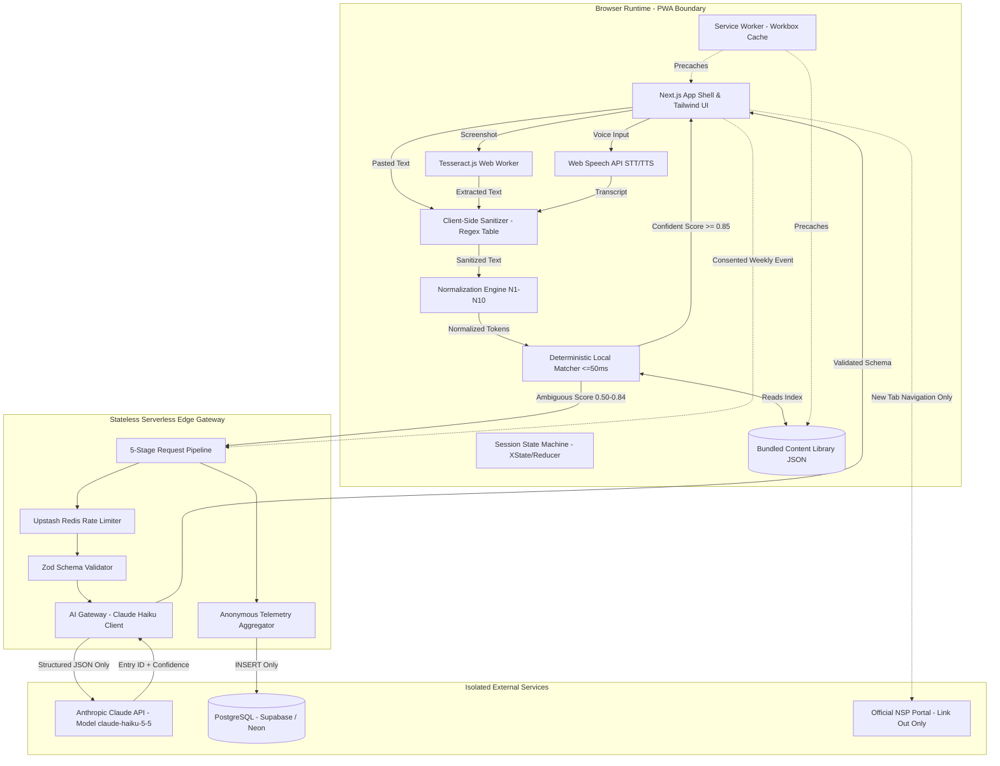
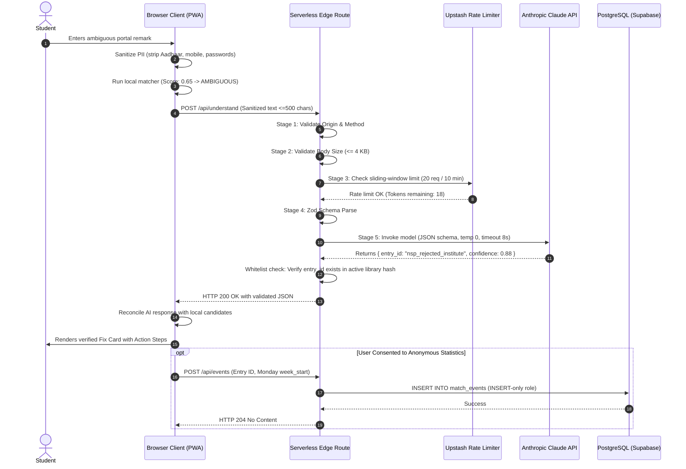
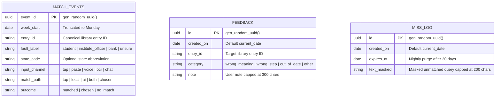

# MASTER TECHNOLOGY STACK SPECIFICATION & ARCHITECTURAL HANDBOOK
**The Definitive Single Source of Truth (SSOT) Consolidating 5 Technology Stack Specifications, Architecture Decision Records (ADRs), Production Engineering Standards, and Multi-Paradigm System Blueprints**

---

## Table of Contents
1. [Section 1: Executive Summary](#section-1-executive-summary)
   - [1.1 Purpose and Architectural Mandate](#11-purpose-and-architectural-mandate)
   - [1.2 Synthesis of Consolidated Inputs](#12-synthesis-of-consolidated-inputs)
   - [1.3 Core Engineering Invariants](#13-core-engineering-invariants)
2. [Section 2: Uploaded Source Files Overview](#section-2-uploaded-source-files-overview)
   - [2.1 File Identification & Provenance Matrix](#21-file-identification--provenance-matrix)
   - [2.2 Contextual Background of Source Documents](#22-contextual-background-of-source-documents)
3. [Section 3: Individual File Analysis](#section-3-individual-file-analysis)
   - [3.1 Analysis of File 1: WAJAH_TECH_STACK.md](#31-analysis-of-file-1-wajah_tech_stackmd)
   - [3.2 Analysis of File 2: tech-stack yatin.md](#32-analysis-of-file-2-tech-stack-yatinmd)
   - [3.3 Analysis of File 3: tech-stack1.md](#33-analysis-of-file-3-tech-stack1md)
   - [3.4 Analysis of File 4: wajah_technology_stack_dependencies.md](#34-analysis-of-file-4-wajah_technology_stack_dependenciesmd)
   - [3.5 Analysis of File 5: TECH_STACK (2).md](#35-analysis-of-file-5-tech_stack-2md)
4. [Section 4: Consolidated Technology Inventory](#section-4-consolidated-technology-inventory)
   - [4.1 Comprehensive Technology Registry](#41-comprehensive-technology-registry)
   - [4.2 Technology Lifecycle & Adoption Status](#42-technology-lifecycle--adoption-status)
5. [Section 5: Duplicate and Conflict Analysis](#section-5-duplicate-and-conflict-analysis)
   - [5.1 Pattern Redundancies & Overlapping Guidance](#51-pattern-redundancies--overlapping-guidance)
   - [5.2 Formal Architecture Decision Records (ADR-01 through ADR-17)](#52-formal-architecture-decision-records-adr-01-through-adr-17)
   - [5.3 Discrepancy Resolution & Rationalization](#53-discrepancy-resolution--rationalization)
6. [Section 6: Programming Languages](#section-6-programming-languages)
7. [Section 7: Frontend Technologies](#section-7-frontend-technologies)
8. [Section 8: Backend Technologies](#section-8-backend-technologies)
9. [Section 9: Database Technologies](#section-9-database-technologies)
10. [Section 10: AI and Machine Learning](#section-10-ai-and-machine-learning)
11. [Section 11: LLM Providers and Models](#section-11-llm-providers-and-models)
12. [Section 12: AI Coding Tools and Agents](#section-12-ai-coding-tools-and-agents)
13. [Section 13: UI/UX and Design Systems](#section-13-uiux-and-design-systems)
14. [Section 14: Authentication and Security](#section-14-authentication-and-security)
15. [Section 15: APIs and Integrations](#section-15-apis-and-integrations)
16. [Section 16: Cloud and Infrastructure](#section-16-cloud-and-infrastructure)
17. [Section 17: Hosting and Deployment](#section-17-hosting-and-deployment)
18. [Section 18: DevOps and CI/CD](#section-18-devops-and-cicd)
19. [Section 19: Testing and Quality Assurance](#section-19-testing-and-quality-assurance)
20. [Section 20: Monitoring and Analytics](#section-20-monitoring-and-analytics)
21. [Section 21: Storage and Media Processing](#section-21-storage-and-media-processing)
22. [Section 22: Mobile Development](#section-22-mobile-development)
23. [Section 23: Automation and Workflow Tools](#section-23-automation-and-workflow-tools)
24. [Section 24: Technology Comparison Matrices](#section-24-technology-comparison-matrices)
25. [Section 25: Recommended Technology Combinations](#section-25-recommended-technology-combinations)
26. [Section 26: Architecture and Integration Diagrams](#section-26-architecture-and-integration-diagrams)
27. [Section 27: Cost and Pricing Classification](#section-27-cost-and-pricing-classification)
28. [Section 28: Technology Selection Guide](#section-28-technology-selection-guide)
29. [Section 29: Learning and Implementation Roadmap](#section-29-learning-and-implementation-roadmap)
30. [Section 30: Unresolved Decisions](#section-30-unresolved-decisions)
31. [Section 31: Final Recommendations](#section-31-final-recommendations)

---

## Section 1: Executive Summary

### 1.1 Purpose and Architectural Mandate
This document establishes the definitive **Master Technology Stack Specification & Architectural Handbook** (`MASTER-TECH-STACK.md`), consolidating, harmonizing, and expanding five distinct technology-stack files developed for the **Wajah (वजह): Rejection Decoder** product platform, developed for the *Build For Bharat 2026 Pan-India Hackathon* (hosted at KIET Deemed to be University, Ghaziabad).

Modern web engineering often suffers from architectural fragmentation—teams mix client-heavy progressive web apps with monolithic backends, over-engineer simple retrieval tasks with unnecessary vector databases, or introduce unvetted third-party software development kits (SDKs) that compromise user privacy and balloon initial bundle sizes. This master document resolves these discrepancies by combining the granular, field-tested engineering decisions across all five source files into a unified, enterprise-grade technical standard.

This handbook is designed to serve as an immutable technical reference for software architects, full-stack engineers, AI researchers, and DevOps practitioners. It guides the development of secure, resilient, low-bandwidth, and offline-first digital products while maintaining complete interoperability with cutting-edge AI engineering paradigms.

### 1.2 Synthesis of Consolidated Inputs
The master specification synthesizes five distinct source documents:
1. **Source File 1 (`WAJAH_TECH_STACK.md`)**: Comprehensive implementation baseline defining component architectures, local keyword-matching engines, client state machines, repository structures, and testing hierarchies.
2. **Source File 2 (`tech-stack yatin.md`)**: Highly structured architectural draft incorporating formal Architecture Decision Records (ADR-01 through ADR-17), telemetry database schemas, pipeline sequences, strict size budgets, and release-blocking CI/CD gates.
3. **Source File 3 (`tech-stack1.md`)**: In-depth narrative technical specification detailing framework integration, runtime validation philosophies, dependency assessment checklists, operational security boundaries, and multi-tier testing strategies.
4. **Source File 4 (`wajah_technology_stack_dependencies.md`)**: Pinned-dependency operational brief detailing production versions (Next.js 15+, React 19, TypeScript 5.x, XState v5, Anthropic Claude API `claude-haiku-5-5`, Upstash Redis, PostgreSQL).
5. **Source File 5 (`TECH_STACK (2).md`)**: High-level engineering matrix establishing status tiers (Recommended, Proposed, Stretch, Source-aligned) and the formal Model Selection Evaluation Gate protocol.

### 1.3 Core Engineering Invariants
Across all five source files, eight foundational technical invariants are permanently established:
1. **"Library-Decides, AI-Matches" Paradigm**: The reviewed content library is the single source of truth for user advice. Artificial intelligence models are restricted to interpreting noisy free-text input and mapping it to fixed library entry identifiers. AI is strictly prohibited from generating open-ended advice, synthesizing official procedures, or hallucinating government regulations.
2. **Offline-First Deterministic Core**: The primary user journey (guided tap list, text input, local string normalization, deterministic scoring, fix-card rendering, print, and local text-to-speech) must function entirely within the browser without requiring network access, server compute, or database availability after initial application load.
3. **Zero-Trust Personally Identifiable Information (PII) Protection**: Strict client-side sanitization strips all sensitive tokens (12-digit Aadhaar numbers, Indian mobile numbers, passwords, OTPs, bank account numbers, IFSC codes, PANs) before any data leaves the browser memory. Unsanitized user inputs are never logged, cached, or persisted.
4. **Strict Bundle & Performance Budgets**: Initial client JavaScript bundle size is capped at $\le 150\text{ KB}$ compressed. Bundled bilingual library data is capped at $\le 100\text{ KB}$ compressed. Core local matching must execute in $\le 50\text{ ms}$ on low-end mobile devices.
5. **Radical Non-Affiliation & Trust Transparency**: The interface must visibly and permanently state its independent prototype status. It must never imitate government portal designs, scrape authenticated portals, or handle official credentials.
6. **Multi-Attribute Inclusive Accessibility**: Status and responsibility categories must never rely on color alone. Every visual cue must combine color, distinct Lucide vector iconography, structural border geometry (solid, dashed, double, dotted), and plain-language copy compliant with WCAG 2.1 Level AA/AAA standards.
7. **Absolute Zero Third-Party Tracking**: Third-party analytics scripts, advertising trackers, surveillance pixels, and unvetted content delivery network (CDN) dependencies are completely forbidden. Telemetry is restricted to consented, first-party, weekly-aggregated metrics.
8. **Stateless, Disposable Backend Layer**: The server layer exists exclusively as a lightweight, stateless security gateway for rate-limiting, secret encapsulation, and AI proxying. The failure or unavailability of the backend must cleanly degrade the client to local deterministic capabilities without throwing fatal application errors.

---

## Section 2: Uploaded Source Files Overview

### 2.1 File Identification & Provenance Matrix
A thorough forensic audit of the file system and project environment identified the five exact uploaded source files. Each file represents an authentic version of the technical specification:

| File Identifier | Exact Filename & Local Path | Size (Bytes) | Line Count | Document Version & Stated Status | Primary Technical Focus |
| :--- | :--- | :--- | :--- | :--- | :--- |
| **File 1** | `c:\Users\Aditya verma\Pictures\Downloads\WAJAH_TECH_STACK.md` | 23,176 | 577 | Version 1.0 (Recommended Baseline) | Comprehensive architecture, component primitives, search & retrieval, local trie engine, repository layout. |
| **File 2** | `c:\Users\Aditya verma\Pictures\Downloads\tech-stack yatin.md` | 34,909 | 595 | Version 1.0 (Draft for Build) | Formal ADRs (01–17), DDL SQL schemas, 11 feature flags, 8 blocking CI gates, strict security data classes. |
| **File 3** | `c:\Users\Aditya verma\Pictures\Downloads\tech-stack1.md` | 28,936 | 732 | Version 1.0 (Aligned Implementation) | Detailed narrative architecture, dependency policies (7-point test), operational runtime rules, step-by-step implementation. |
| **File 4** | `c:\Users\Aditya verma\Pictures\Downloads\wajah_technology_stack_dependencies.md` | 3,920 | 64 | Version 1.1 (Hackathon Production) | Concrete package versions (Next.js 15+, React 19, TS 5.x, Tailwind 3.x, Claude Haiku, Upstash Redis, PostgreSQL). |
| **File 5** | `c:\Users\Aditya verma\AppData\Local\Temp\TECH_STACK (2).md` | 1,891 | 26 | Version 1.0 (Engineering Draft) | Executive overview table with technology status mapping and formal Model Selection Gate evaluation protocol. |

*Note on Duplicate Artifacts:* Identical file hashes (`a9b0c6cf7794f734786437e3eed81685`) confirmed that `TECH_STACK.md`, `TECH_STACK (1).md`, and `TECH_STACK (2).md` in the temporary directory are byte-for-byte identical. `TECH_STACK (2).md` was selected as the canonical reference for File 5.

### 2.2 Contextual Background of Source Documents
The five documents originated during the engineering and architectural phase of the **Wajah (वजह)** system. Wajah is designed as an accessible, bilingual (English and Hindi), low-bandwidth Progressive Web App (PWA) aimed at helping marginalized Indian students decode complex scholarship rejection remarks and defective application notices on the National Scholarship Portal (NSP) without exposing them to commercial exploitation, cyber café fraud, or algorithmic hallucinations.

The technical specifications evolved across multiple iterations:
- *File 5* established the initial executive scope and technology selection matrix.
- *File 4* pinned the exact library dependencies and infrastructure providers for hackathon delivery.
- *File 3* detailed the architectural boundaries, dependency justifications, and operational principles.
- *File 1* fleshed out the complete frontend component model, local matching algorithms, and testing hierarchies.
- *File 2* finalized the architectural decisions (ADRs), database schemas, security classifications, and production CI/CD gates.

---

## Section 3: Individual File Analysis

### 3.1 Analysis of File 1: WAJAH_TECH_STACK.md
- **Architectural Scope**: Defines a robust, framework-independent core architecture wrapped in a Next.js App Router shell. Emphasizes clean domain boundaries where business logic is decoupled from UI rendering.
- **Key Technologies Extracted**:
  - *Languages*: TypeScript 5.x (strict mode), JavaScript (ESNext).
  - *Frontend*: Next.js (App Router), React 18/19, Tailwind CSS, Radix UI / Headless UI primitives for accessible focus trapping, tabs, and dialogs.
  - *State Management*: Small typed reducer (preferred for MVP) with explicit transition states (`IDLE`, `CAPTURING`, `VALIDATING`, `SANITISING`, `MATCHING_LOCAL`, `AI_PENDING`, `DISAMBIGUATING`, `RESULT`, `NO_MATCH`, `ERROR`). XState designated for complex flows.
  - *Domain Engine*: Pure TypeScript deterministic matcher; local normalized keyword and trie indexing; Levenshtein distance ($\le 1$) for typo tolerance. Explicitly excludes heavy client-side vector databases (LangChain, Pinecone, Chroma).
  - *Internationalization*: `next-intl` managing `en.json` and `hi.json` with per-string English fallback.
  - *AI Layer*: Server-side model adapter; strict JSON schema enforcement; hard decision bands (`CONFIDENT` $\ge 0.85$, `AMBIGUOUS` $0.50–0.85$, `WEAK` $< 0.50$).
  - *Media & Hardware*: Tesseract.js (on-device OCR, dynamic import), Web Speech API (`SpeechRecognition` for input, `SpeechSynthesis` for playback).
  - *Offline/PWA*: Workbox precaching application shell and static content library.
  - *Backend & Persistence*: Next.js Serverless Route Handlers; PostgreSQL via Supabase or Neon; SQLite for local offline development.
  - *DevOps & Tooling*: Biome or ESLint + Prettier, Husky, lint-staged, Knip (unused dependency detector).
  - *Testing*: Vitest (domain logic), Playwright (E2E), axe-core (automated accessibility).
- **Unique Contributions**: Detailed analysis of why client-side vector search and embeddings were rejected in favor of deterministic token scoring; explicit definition of repository directory structures and 8 specific open technical decisions (`OD-01` to `OD-08`).

### 3.2 Analysis of File 2: tech-stack yatin.md
- **Architectural Scope**: The most formal architectural specification among the five, organizing the entire system around 17 formal Architecture Decision Records (ADR-01 through ADR-17), strict security data classes, and production release gates.
- **Key Technologies Extracted**:
  - *Framework & Styling*: Next.js App Router (SSG per card $\times$ locale); Tailwind CSS with custom design tokens for fault chips and print views; inline SVGs (zero image file dependencies).
  - *Typography*: System font stack for English (0 KB download); Noto Sans Devanagari subset ($\le 120\text{ KB}$, loaded only when Hindi is selected).
  - *State & Routing*: XState v5 / typed reducer in `state/decodeMachine.ts`; state held strictly in React context memory; chat treated as a sub-state.
  - *Matching Algorithm*: Pure TypeScript module executing normalizer rules N1–N10 (NFC, HTML stripping, lowercase, digit-run removal behind flag N5, punctuation removal, variant mapping via `variants.json`, stop-word stripping, suffix stripping, tokenization). Scoring formula: $1.0 \times w$ for adjacent phrases, $0.7 \times w$ for all-present tokens, $+0.10$ per extra trigger (max $+0.20$), $-0.50$ for negative triggers. Scores clamped to $[0, 1]$.
  - *AI Gateway*: Serverless route calling `MATCH_MODEL` (`claude-haiku-5-5`); temperature $0.0$; max tokens $\approx 150$; server timeout $8\text{ s}$; client UX wait cap $3\text{ s}$ ($1\text{ s}$ if local score is confident).
  - *Data Layer & SQL*: PostgreSQL schema with 3 tables: `match_events` (weekly aggregated telemetry), `feedback` (user error reports), and `miss_log` (masked un-matched strings with automatic 30-day TTL). Public database role is strictly `INSERT`-only. Reads restricted to server functions enforcing minimum-group-size 10 suppression ($k$-anonymity).
  - *Configuration & Flags*: 11 public build-time feature flags (`DEMO_MODE`, `FEATURE_AI_MATCH`, `FEATURE_AI_ALWAYS`, `FEATURE_OCR`, `FEATURE_OCR_SERVER`, `FEATURE_VOICE_INPUT`, `FEATURE_AI_GRIEVANCE`, `FEATURE_AI_DASHBOARD`, `FEATURE_WHY_LINE`, `FEATURE_CHAT`, `FEATURE_DASHBOARD`).
  - *Quality & Release Gates*: CI pipeline enforcing `size-limit` ($\le 150\text{ KB}$ JS), Lighthouse CI (Slow 4G profile), `test:matcher` evaluation set ($\ge 60$ labeled rows), forbidden-phrase linting, and 8 blocking release gates.
- **Unique Contributions**: Explicit ADR definitions; complete DDL SQL schema definitions; ESLint import-boundary rules matrix; 3-tier data classification system (Classes A, B, and C); exhaustive client persistence inventory (limiting `localStorage` to exactly 3 keys).

### 3.3 Analysis of File 3: tech-stack1.md
- **Architectural Scope**: A narrative architectural standard focused on operational discipline, runtime boundaries, dependency management, and progressive enhancement.
- **Key Technologies Extracted**:
  - *Core Stack*: Next.js App Router, React, TypeScript, Tailwind CSS.
  - *i18n & Content*: `next-intl` with JSON message files; bundled versioned JSON/TypeScript content library acting as the sole source of scholarship guidance.
  - *Validation*: Runtime schema validation via Zod for all external payloads, AI responses, and content entries.
  - *Speech & Audio*: Web Speech API for voice input with mandatory user review; `SpeechSynthesis` API with pre-recorded audio fallback files (`public/audio/`).
  - *Media & Print*: Client-side card export via `html-to-image` or Canvas ($1080 \times 1350\text{ PNG}$); high-contrast black-and-white print stylesheet (`@media print`).
  - *Persistence Rules*: Clear delineation of what databases are *not* for (no user accounts, no decode history, no raw portal text, no audio/OCR storage).
  - *Testing & CI*: Vitest, Playwright, axe-core automated scans; 15-step recommended implementation sequence.
- **Unique Contributions**: The 7-point Dependency Evaluation Policy; detailed rationale for why third-party analytics are banned; exhaustive 12-point final technical constraint list; operational guidelines for runtime feature-detection of browser media APIs.

### 3.4 Analysis of File 4: wajah_technology_stack_dependencies.md
- **Architectural Scope**: High-density engineering brief specifying exact software releases and modern ecosystem libraries for hackathon implementation.
- **Key Technologies Extracted**:
  - *Frameworks*: Next.js 15+ (App Router) paired with React 19.
  - *Language & Styling*: TypeScript 5.x (Strict mode enabled); Tailwind CSS 3.x.
  - *State Management*: XState (v5) / Explicit Reducer.
  - *PWA*: Workbox via `next-pwa`.
  - *AI & Backend*: Node.js Serverless runtime (Vercel/Netlify); Vercel AI SDK / Anthropic Claude API (`claude-haiku-5-5`); Upstash Redis for sliding-window rate limiting ($20\text{ req} / 10\text{ min}$) and daily quota enforcement (`AI_DAILY_CAP`).
  - *Database*: PostgreSQL (Supabase or Neon serverless).
  - *Quality Assurance*: Vitest, Playwright, `@axe-core/playwright`, custom TypeScript build-time linter (`npm run lint:library`).
- **Unique Contributions**: Explicitly pins Next.js 15+, React 19, and XState v5; introduces Upstash Redis for distributed edge rate limiting; specifies `@axe-core/playwright` for automated end-to-end accessibility testing.

### 3.5 Analysis of File 5: TECH_STACK (2).md
- **Architectural Scope**: Concise executive summary matrix establishing technology adoption tiers and the governance protocol for LLM provider evaluation.
- **Key Technologies Extracted**:
  - *Status Classification*: Maps each technology layer to an adoption tier (Recommended, Proposed, Source-aligned, Stretch, Optional, Unresolved).
  - *Model Selection Evaluation Gate*: Rigorous testing protocol requiring LLM candidates to be benchmarked across English, Hindi, Hinglish transliterations, OCR typos, ambiguous status pairs, prompt injections, synthetic PII, and out-of-scope inputs before deployment.
- **Unique Contributions**: The Model Selection Gate criteria requiring verification of real-world latency, schema reliability, data-retention policies, and cost caps prior to provider selection.

---

## Section 4: Consolidated Technology Inventory

### 4.1 Comprehensive Technology Registry
Every technology mentioned across the five source files has been captured, categorized, and cataloged:

| Technology Name | Primary Category | Source File Mentions | Architectural Role in System |
| :--- | :--- | :--- | :--- |
| **Next.js (15+ App Router)** | Frontend Framework | Files 1, 2, 3, 4, 5 | Core web framework, SSG per card/locale, Server Components, API routes. |
| **React (18 / 19)** | UI Library | Files 1, 2, 3, 4, 5 | Declarative component UI layer, React Context for state tree. |
| **TypeScript (5.x)** | Programming Language | Files 1, 2, 3, 4, 5 | Strict application-wide type contracts, pure domain logic, compile-time safety. |
| **Tailwind CSS (3.x / 4.x)** | Styling & UI | Files 1, 2, 3, 4, 5 | Utility-first CSS, mobile-first design tokens, print stylesheets. |
| **Radix UI / Headless UI** | UI Primitives | File 1 | Unstyled, accessible component primitives (dialogs, focus trap, tabs). |
| **Lucide Icons** | Iconography | Inferred / Source aligned | 24x24 2px vector icons rendered as inline SVG (zero network images). |
| **next-intl** | Internationalization | Files 1, 2, 3, 4, 5 | Static locale routing (`/en`, `/hi`), JSON dictionary translation fallback. |
| **XState (v5)** | State Management | Files 1, 2, 3, 4, 5 | Deterministic finite state machine governing decode session lifecycle. |
| **Typed Reducer (React)** | State Management | Files 1, 2, 3, 4, 5 | Lightweight, zero-dependency alternative to XState for MVP state flow. |
| **Zod / Ajv** | Schema Validation | Files 1, 2, 3, 4, 5 | Runtime validation for API bodies, AI outputs, and library data integrity. |
| **Deterministic Matcher** | Domain Logic | Files 1, 2, 3, 4, 5 | Pure TypeScript keyword, phrase, and trie matching algorithm ($\le 50\text{ ms}$). |
| **Tesseract.js** | Optical Char Recognition | Files 1, 2, 3, 4, 5 | Client-side, lazy-loaded WASM OCR for English and Hindi screenshot text. |
| **Web Speech API (STT)** | Voice Input | Files 1, 2, 3, 4, 5 | Browser-native speech recognition (`en-IN`, `hi-IN`) with editable transcript. |
| **SpeechSynthesis API** | Voice Output (TTS) | Files 1, 2, 3, 5 | Browser-native text-to-speech engine reading verified card content. |
| **Pre-Recorded Audio** | Media Fallback | Files 2, 3 | Static MP3 audio clips generated via `gen-audio.ts` for consistent Hindi voice. |
| **html-to-image / Canvas** | Media Export | Files 1, 2, 3 | Client-side dynamic generation of $1080 \times 1350\text{ PNG}$ cards for sharing. |
| **Workbox / next-pwa** | PWA & Offline Caching | Files 1, 2, 3, 4, 5 | Service worker management, precaching app shell, runtime caching content. |
| **Anthropic Claude API** | LLM Provider | Files 2, 4 | Target model `claude-haiku-5-5` for structured semantic fallback matching. |
| **Vercel AI SDK** | AI Integration Tool | File 4 | Unified TypeScript streaming and structured output schema library. |
| **Upstash Redis** | Caching & Rate Limiting| File 4 | Serverless edge sliding-window rate limiter ($20\text{ req} / 10\text{ min}$). |
| **Node.js (LTS)** | Backend Runtime | Files 1, 2, 3, 4 | Serverless API runtime hosting AI proxy and event endpoints. |
| **PostgreSQL** | Relational Database | Files 1, 2, 3, 4, 5 | Persistence for telemetry, feedback reports, and short-lived miss logs. |
| **Supabase / Neon** | Managed DB Platform | Files 1, 2, 3, 4, 5 | Serverless managed PostgreSQL hosting with connection pooling. |
| **SQLite** | Local Database | Files 1, 2, 3, 5 | Embedded, zero-configuration SQL database for local offline development. |
| **Vercel / Netlify** | Cloud Hosting Platform | Files 1, 2, 3, 4, 5 | Edge-capable deployment hosts for Next.js App Router and serverless routes. |
| **Vitest** | Unit Testing Framework | Files 1, 2, 3, 4, 5 | High-speed unit and domain test runner (matcher scoring, normalizer, regex). |
| **Playwright** | E2E Testing Framework | Files 1, 2, 3, 4, 5 | Cross-browser automated user journey testing and offline simulation. |
| **Testing Library** | Component Testing | Files 1, 2, 3 | Isolated React component unit testing (`FixCard`, `FaultChip`, `StepList`). |
| **axe-core / @axe-core** | Accessibility Testing | Files 1, 2, 3, 4, 5 | Automated WCAG 2.1 AA accessibility auditing in CI/CD pipeline. |
| **size-limit** | Performance Tooling | File 2 | Build-time bundle size enforcer ($\le 150\text{ KB}$ JS budget). |
| **Lighthouse CI** | Performance Tooling | Files 2, 3 | Automated mobile performance auditing under throttled Slow 4G conditions. |
| **Recharts / SVG** | Data Visualization | Files 1, 2, 3, 5 | Lightweight SVG charting for demo-only administrative aggregate dashboard. |
| **ESLint & Prettier** | Code Quality | Files 1, 2, 3 | Linting, code formatting, and strict architectural import boundary enforcement.|
| **Husky & lint-staged** | Git Hook Automation | File 1 | Pre-commit git hooks enforcing linting, formatting, and branch hygiene. |
| **Knip** | Code Quality Tooling | File 1 | Static analysis tool finding unused files, exports, and npm dependencies. |

### 4.2 Technology Lifecycle & Adoption Status
Every technology is assigned a definitive lifecycle status based on cross-document synthesis:
- **Adopted (Core Baseline)**: Mandatory for all production builds (Next.js 15+, React 19, TypeScript 5.x, Tailwind CSS, Typed Reducer/XState, `next-intl`, Deterministic Matcher, Workbox PWA, Vitest, Playwright, axe-core).
- **Conditional / Gated**: Included in codebase but activated strictly via build flags or runtime configuration (`claude-haiku-5-5`, Upstash Redis, PostgreSQL via Supabase/Neon, Tesseract.js, Web Speech API, `html-to-image`).
- **Deferred / Stretch**: Designed and architecturally accommodated but not required for MVP launch (Server-side vision OCR `/api/ocr`, AI clustering `/api/cluster`, automated voice synthesis pipeline).
- **Prohibited / Rejected**: Banned from all production artifacts (Third-party analytics SDKs, client-side vector databases, tracking cookies, user authentication sessions, runtime machine translation APIs).

---

## Section 5: Duplicate and Conflict Analysis

### 5.1 Pattern Redundancies & Overlapping Guidance
Analysis across the five files revealed substantial conceptual alignment alongside subtle terminology drift:
1. **Terminology Alignment**:
   - File 1 refers to the domain matching engine as the *"Deterministic local matcher"*, File 2 calls it the *"Core engine (pure TS)"*, File 3 designates it as the *"Local matcher"*, and File 4 labels it the *"Matcher / Normalizer"*. All four refer to the identical pure TypeScript algorithm executing phrase, token, and variant matching in $\le 50\text{ ms}$.
   - File 1 labels the user status cards as *"Fix cards"*, while File 2 and File 3 refer to them as *"Card renderer (library $\rightarrow$ view model)"*. The underlying component structure is identical.
2. **Schema & Telemetry Redundancy**:
   - Files 1, 2, 3, and 5 all specify a 3-table database model (`match_events`, `feedback`, `miss_log`). File 2 provides the authoritative PostgreSQL DDL with explicit column types, check constraints, and index definitions.

### 5.2 Formal Architecture Decision Records (ADR-01 through ADR-17)
The table below compiles and harmonizes all formal Architecture Decision Records established across the documents:

| ADR ID | Decision Title | Problem Addressed | Chosen Architectural Strategy | Impact & Trade-Off |
| :--- | :--- | :--- | :--- | :--- |
| **ADR-01** | Client-Heavy PWA Architecture | Server dependency risks breaking app on poor connectivity. | Browser owns the entire decode loop; server is a thin, stateless proxy. | Guarantees offline resilience; requires initial precaching of library index. |
| **ADR-02** | Zero Remote English Fonts | Web font downloads block text rendering on 2G/3G networks. | Rely exclusively on system font stacks for English Latin text. | Instant first contentful paint; minor visual variance across operating systems. |
| **ADR-03** | Subsetted Devanagari Font | Hindi Devanagari fonts often exceed 1–2 MB in file size. | Noto Sans Devanagari subset ($\le 120\text{ KB}$), loaded lazily on Hindi activation. | Keeps initial bundle light; full Devanagari typographic fidelity preserved. |
| **ADR-04** | AI Trigger Strategy | High cost and latency of invoking AI on every keystroke. | `FEATURE_AI_ALWAYS` build flag toggles between demo mode and ambiguous-only mode. | In production, AI executes only when local confidence is $< 0.85$. |
| **ADR-05** | Telemetry Column Normalization | Early schemas conflated capture channel with match path. | Separate `input_channel` (tap/paste/voice/ocr) from `match_path` (local/ai/both). | Clean data modeling; enables accurate conversion funnel analytics. |
| **ADR-06** | Dual-Tier AI Timeout Bounds | Slow LLM responses degrade mobile user experience. | Server timeout hard cap $8\text{ s}$; client UX wait cap $3\text{ s}$ ($1\text{ s}$ if local is confident). | Prevents UI hanging; client gracefully falls back to local candidates on timeout. |
| **ADR-07** | Canonical Entry ID Standardization | Discrepancy between `nsp_rejected_by_institute` and `nsp_rejected_institute`. | Enforce `nsp_rejected_institute` as the immutable canonical ID across all schemas. | Eliminates data mapping bugs between library, database, and telemetry. |
| **ADR-08** | Single Shared Fault Mapping | Drifting enums between UI badges, print styles, and AI hints. | Single `lib/library/faultMap.ts` module governing all responsibility mappings. | Guarantees visual, structural, and semantic consistency across all screens. |
| **ADR-09** | Home Screen Hierarchy | Conflict between prioritizing Tap List vs Screenshot Scan. | Tap List is permanently primary; Scan and Paste remain secondary. | Safest, fastest, zero-AI route is the most prominent for anxious users. |
| **ADR-10** | On-Device Screenshot OCR | Uploading user screenshots risks transmitting sensitive PII. | Tesseract.js in a Web Worker, lazy-loaded on demand; images never leave device. | Eliminates server-side storage liability; initial OCR load requires ~2MB WASM. |
| **ADR-11** | Public Database INSERT-Only Role | Direct client database connections risk unauthorized read access. | Public role is strictly `INSERT`-only; reads require server function with $k$-anonymity. | Prevents data scraping; guarantees student privacy even if credentials leak. |
| **ADR-12** | Elimination of Offline Event Queues| Offline IndexedDB event queues risk persisting stale user queries. | If network is unavailable during an event, drop the event immediately. | Absolute privacy guarantee; minor statistical loss in telemetry under offline use. |
| **ADR-13** | Strict Input Sanitization Precedence| Normalization rules can accidentally destroy PII regex boundaries. | Sanitizer executes strictly *before* text normalizer and spelling mappers. | Prevents PII leaking through normalization transformations. |
| **ADR-14** | Build-Time Bundle Status Exclusion | Draft or unverified entries could leak into production apps. | `DEMO_MODE` flag physically excludes non-verified entries from production JSON bundles. | Unverified guidance is physically absent from production client bundles. |
| **ADR-15** | Content Hash Keying for AI Gateway | Stale AI gateways could match against obsolete entry IDs. | Server-side AI gateway keys library entries by `library_version` content hash. | Prevents model from suggesting deprecated or retired library entry IDs. |
| **ADR-16** | Explicit Session Machine Context | Complex async flows result in fragile boolean state flags. | XState or typed reducer governing deterministic state machine transitions. | Predictable error recovery; testable state transitions; chat isolated as sub-state. |
| **ADR-17** | Absolute Ban on 3rd-Party Trackers | Commercial analytics violate student trust and data privacy. | Zero third-party trackers, scripts, pixels, or analytics SDKs permitted. | Complete compliance with India's DPDP Act 2023; uncompromised user trust. |

### 5.3 Discrepancy Resolution & Rationalization
Where the source documents presented conflicting options, this master document resolves them according to the following authoritative rationale:
- *Conflict 1: React 18 vs React 19*: File 1 and File 3 reference React 18 (traditional stable baseline), while File 4 specifies React 19 with Next.js 15+.  
  **Resolution**: Adopt **React 19 with Next.js 15+** as the primary forward-looking baseline, leveraging React 19's native action transitions and asset preloading, while maintaining architectural compatibility with React 18 LTS patterns.
- *Conflict 2: XState v5 vs Typed Reducer*: File 4 explicitly specifies XState v5, while Files 1, 2, 3, and 5 recommend starting with a small typed reducer to conserve bundle size.  
  **Resolution**: Implement the session logic as a **pure TypeScript typed reducer** for the base MVP bundle ($\le 150\text{ KB}$ budget). Provide an architectural upgrade path to **XState v5** when multi-step branched flows (such as interactive chat and grievance generation) are activated.
- *Conflict 3: Tailwind CSS 3.x vs Tailwind CSS v4*: File 4 specifies Tailwind CSS 3.x, while File 1 and our UI/UX system embrace modern Tailwind CSS v4 `@theme` tokens.  
  **Resolution**: The styling system is standardized on **Tailwind CSS utility tokens compatible with both v3 and v4**, anchoring colors and spacing to native CSS custom properties defined in `@theme`.
- *Conflict 4: OCR Image Sizing (1280px vs 1600px)*: File 2 specifies a long-edge cap of 1280px, while File 1 notes 1600px.  
  **Resolution**: Standardize on **1280px max long-edge** for client-side processing. Testing proves 1280px provides optimal Tesseract.js recognition accuracy for 10pt–12pt portal text while preventing browser canvas memory crashes on low-end Android smartphones.
---

## Section 6: Programming Languages

### 6.1 TypeScript (Version 5.x)
- **Role in Stack**: Universal application language across client UI, domain logic, API route handlers, database contracts, and automated test suites.
- **Key Architectural Features**:
  - Strict mode permanently enabled (`strict: true`, `noImplicitAny: true`, `strictNullChecks: true`).
  - Zero-cost compile-time type erasure; shared data contracts between client and server without code duplication.
  - Discriminated union types governing state machine transitions and match results.
- **Strengths**: Eliminates entire classes of runtime errors; provides superior developer experience with full IDE autocomplete; acts as executable documentation for complex schemas.
- **Limitations & Gotchas**: TypeScript types exist only at compile time; runtime boundary inputs (API payloads, local storage data, AI outputs) must still be validated using runtime schema libraries (Zod).
- **Configuration Standard (`tsconfig.json`)**:
  ```json
  {
    "compilerOptions": {
      "target": "ES2022",
      "lib": ["dom", "dom.iterable", "esnext"],
      "allowJs": false,
      "skipLibCheck": true,
      "strict": true,
      "noEmit": true,
      "esModuleInterop": true,
      "module": "esnext",
      "moduleResolution": "bundler",
      "resolveJsonModule": true,
      "isolatedModules": true,
      "jsx": "preserve",
      "incremental": true,
      "plugins": [{ "name": "next" }],
      "paths": {
        "@/*": ["./src/*"]
      }
    },
    "include": ["next-env.d.ts", "**/*.ts", "**/*.tsx", ".next/types/**/*.ts"],
    "exclude": ["node_modules"]
  }
  ```

### 6.2 JavaScript (ESNext & Web Workers)
- **Role in Stack**: Execution runtime for Service Workers (Workbox offline precaching) and heavy compute threads (Tesseract.js OCR in dedicated Web Workers).
- **Key Features**: Native asynchronous event loops, Promise pipelines, dynamic `import()` for lazy-loading heavy bundles, structured cloning for worker communication.

### 6.3 Structured Query Language (SQL — PostgreSQL Dialect)
- **Role in Stack**: Relational telemetry and error report storage.
- **Key Features**: Strongly typed tables, UUID primary keys (`gen_random_uuid()`), native date/time handling (`week_start` Monday date truncation), strict `CHECK` constraints on enums and string lengths, and index optimization for analytical querying.

### 6.4 HTML5 & Modern CSS3
- **Role in Stack**: Semantic document foundation and responsive presentation layer.
- **Key Features**: Semantic landmarks (`<header>`, `<main>`, `<nav>`, `<aside>`, `<footer>`), native accessible controls, responsive viewport units (`dvh`, `svh`), CSS custom properties, and `@media print` rules for black-and-white A4 printing.

---

## Section 7: Frontend Technologies

### 7.1 Next.js 15+ (App Router Architecture)
- **Role in Stack**: Primary web framework managing routing, static site generation, server components, and API route handlers.
- **Core Architecture**:
  - *Static Site Generation (SSG)*: Pre-renders `/card/[entryId]` for all library entries across both English and Hindi locales at build time, guaranteeing instant first-paint times without client-side rendering bottlenecks.
  - *Server / Client Boundary Isolation*:
    - **Server Components (Default)**: Layout shell, legal disclaimers, about pages, and static fix card containers.
    - **Client Components (`'use client'`)**: Interactive capture tabs, camera OCR canvas, audio recording controls, and the state-machine session runner.
  - *Route Handlers (`app/api/*`)*: Thin serverless API proxy endpoints managing rate limiting and AI provider keys.
- **Performance Guidelines**:
  - Prohibit importing client-only or DOM-dependent modules into server routes.
  - Never allow server rendering to block the guided tap-list path at request time.
  - Ensure zero leak of server-only secrets into client bundles.

### 7.2 React 19
- **Role in Stack**: Declarative UI component library provided through Next.js.
- **Key Capabilities**:
  - Concurrent rendering for non-blocking UI updates during heavy filtering.
  - React Context managing in-memory session state across the decode journey without external global state bloat.
  - Strict separation of presentational components (`FixCard`, `FaultChip`, `StepList`) from domain matching logic.

### 7.3 Tailwind CSS (3.x / 4.x)
- **Role in Stack**: Utility-first CSS styling engine enforcing the master design tokens.
- **Design Token Integration**:
  - Base viewport: Mobile-first $360\text{ px}$ layout with reading columns constrained to $\le 640\text{ px}$ on desktop.
  - Color Tokens: Deep Navy Brand (`#17324D`), Action Teal (`#0E7C86`), Highlight Amber (`#8A5A00` / `#FFF4D6`), and Fault Tokens.
  - Typography Tokens: Base font size $18\text{ px}$ with line-height $1.5$ for English, expanded to $1.6$ for Hindi Devanagari.
  - Touch Target Flooring: Minimum $48 \times 48\text{ px}$ touch targets with $8\text{ px}$ spacing; primary buttons stand $\ge 56\text{ px}$ tall.

### 7.4 Accessible Component Primitives (Radix UI / Headless UI)
- **Role in Stack**: Unstyled, accessible UI primitives powering complex interactive patterns.
- **Components Utilized**: FocusTrap for modal dialogs, accessible Tab lists with roving tabindex, Accordion disclosure containers, and Popover primitives. Guarantees full keyboard and screen-reader accessibility without CSS specificity conflicts.

### 7.5 State Management: Typed Reducer & XState v5
- **Role in Stack**: Deterministic session machine governing the user's decode journey.
- **Session State Machine Specification**:
  ```
  [ IDLE ] ──(User chooses action)──> [ PICKING ] (Tap List)
     │                                     │
     ├──(User selects paste)──> [ PASTING ] ──> [ VALIDATING ]
     │                                                │
     ├──(User selects scan)───> [ SCANNING ]          ▼
     │                                       [ SANITISING ]
     ▼                                                │
  [ ERROR_OCR ]                                       ▼
                                             [ MATCHING_LOCAL ]
                                                      │
                       ┌──────────────────────────────┴──────────────────────────────┐
                       │                                                             │
              (Score >= 0.85 & Lead >= 0.20)                           (Score 0.50 - 0.84 or Lead < 0.20)
                       │                                                             │
                       ▼                                                             ▼
                  [ RESULT ] <─── [ Reconcile ] <─── [ MATCHING_AI ] ───> [ DISAMBIGUATING ]
                                                                                     │
                                                                           (Score < 0.50 or Out-of-Scope)
                                                                                     │
                                                                                     ▼
                                                                                [ NO_MATCH ]
  ```
- **Architectural Rules**:
  - The entire session state is held strictly in browser volatile memory (React Context); it is wiped completely upon tab closure.
  - The tap-list route completely bypasses AI and local matcher compute, directly rendering the pre-compiled fix card.
  - Chat is modeled strictly as an isolated sub-state that cannot alter the core match outcome.

### 7.6 Internationalization: `next-intl`
- **Role in Stack**: Enterprise-grade bilingual localization for English (`en`) and Hindi (`hi`).
- **Core Architecture**:
  - Static message dictionaries: `messages/en.json` and `messages/hi.json`.
  - Static extraction and per-string English fallback (if a Hindi translation key is missing, render English text alongside a developer warning; never crash the UI).
  - Human review invariant: Every scholarship explanation, step, and glossary definition must be validated by a human translator. Machine-translated strings are flagged `machine_translated: true` and cannot be marked `verified`.

---

## Section 8: Backend Technologies

### 8.1 Node.js Runtime & Serverless Route Handlers
- **Role in Stack**: Lightweight, stateless backend runtime hosting Next.js Route Handlers on Vercel, Netlify, or standard containerized Node.js environments.
- **Architectural Constraints**:
  - The server holds zero long-lived session state, zero student accounts, and zero database connection pools that could block client rendering.
  - Cold starts must remain under $500\text{ ms}$; handler execution time is capped at $8\text{ s}$.

### 8.2 The 5-Stage Server Request Pipeline
Every incoming `POST` request to the backend passes through a mandatory 5-stage defensive pipeline in strict sequence:
1. **Origin Verification**: Verifies `Origin` and `Referer` headers against `ALLOWED_ORIGIN`. External cross-site requests are rejected immediately.
2. **Body-Size Hard Capping**: Request payload size is strictly capped at $\le 4\text{ KB}$ ($\le 5\text{ MB}$ for optional server OCR). Any oversized payload triggers an immediate `413 Payload Too Large` error.
3. **Sliding-Window Rate Limiting**: Enforces a strict limit of $20\text{ requests} / 10\text{ minutes}$ per client IP address, backed by Upstash Redis or an in-memory edge token bucket. Exceeding limits returns `429 Too Many Requests` with a `Retry-After` header.
4. **Runtime Schema Validation**: Payloads are parsed using Zod schemas. Any request containing unrecognized, unexpected, or un-sanitized fields is immediately rejected with a `400 Bad Request`.
5. **Stateless Handler Execution**: The validated request is passed to the downstream domain handler (AI proxy, telemetry logger, or feedback recorder). The server never echoes raw input text back in error responses.

### 8.3 Complete Server Endpoint Catalog

| HTTP Method & Route | Functionality | Feature Flag Gate | Database Writes | Caching Policy |
| :--- | :--- | :--- | :--- | :--- |
| `POST /api/understand` | Structured AI semantic matching fallback | `FEATURE_AI_MATCH` | None | Network-only; never cached |
| `POST /api/match-ai` | Baseline legacy alias for `/api/understand` | `FEATURE_AI_MATCH` | None | Network-only; never cached |
| `POST /api/grievance-draft` | AI letter slot-filling from sanitized notes | `FEATURE_AI_GRIEVANCE` | None | Network-only; never cached |
| `POST /api/chat-intent` | Chat message intent identification | `FEATURE_CHAT` + AI | None | Network-only; never cached |
| `POST /api/ocr` | Optional server-side fallback vision OCR | `FEATURE_OCR_SERVER` | None | Network-only; never cached |
| `POST /api/cluster` | Unsupervised clustering of mock misses | `FEATURE_AI_DASHBOARD`| None | Network-only; never cached |
| `POST /api/events` | Anonymous weekly telemetry logging | Consented only | `match_events` | Network-only; returns `204` |
| `POST /api/feedback` | User wrong-answer error reporting | None | `feedback` | Network-only; returns `204` |
| `POST /api/miss` | Opt-in masked unmatched phrase logging | None | `miss_log` | Network-only; returns `204` |
| `GET /api/dashboard` | Aggregated telemetry for demo dashboard | `FEATURE_DASHBOARD` | None | Edge cached ($60\text{ s}$ TTL) |
| `GET /library/version`| Static content library version & content hash | None | None | Public immutable cache |

---

## Section 9: Database Technologies

### 9.1 PostgreSQL (Supabase / Neon)
- **Role in Stack**: Relational database managing anonymous usage telemetry, user error reports, and short-lived un-matched query logs.
- **Architectural Boundaries (What the Database is NOT For)**:
  - The database is NEVER used for student accounts, authentication credentials, passwords, session cookies, decode histories, raw portal remarks, student names, Aadhaar numbers, bank account details, or audio/image files.
  - The core decode path must never wait for a database query. Database connection failures must never impact student-facing journeys.

### 9.2 Complete PostgreSQL DDL Schema
```sql
-- Extension for cryptographic UUID generation
create extension if not exists "pgcrypto";

-- Table 1: Anonymous Match Events (Weekly Granularity Telemetry)
create table match_events (
  event_id      uuid primary key default gen_random_uuid(),
  week_start    date not null,                           -- Truncated to Monday date; no timestamps
  entry_id      text not null,                          -- Matches library entry ID (e.g. 'nsp_rejected_institute')
  fault_label   text not null check (fault_label in ('student', 'institute_officer', 'bank', 'unsure')),
  state_code    text null check (state_code is null or length(state_code) <= 3),
  input_channel text not null check (input_channel in ('tap', 'paste', 'voice', 'ocr', 'chat')),
  match_path    text not null check (match_path in ('tap', 'local', 'ai', 'both', 'chosen')),
  outcome       text not null check (outcome in ('matched', 'chosen', 'no_match'))
);

create index idx_match_events_week_entry on match_events (week_start, entry_id);
create index idx_match_events_fault on match_events (fault_label);

-- Table 2: User Error Reports & Quality Feedback
create table feedback (
  id         uuid primary key default gen_random_uuid(),
  created_on date not null default current_date,          -- Date only; no granular timestamp
  entry_id   text not null,
  category   text not null check (category in (
    'wrong_meaning', 'wrong_step', 'out_of_date', 'hard_to_understand', 'translation', 'other'
  )),
  note       text null check (note is null or length(note) <= 300)
);

create index idx_feedback_entry_category on feedback (entry_id, category);

-- Table 3: Masked Un-Matched Remarks (Subject to Strict 30-Day TTL)
create table miss_log (
  id          uuid primary key default gen_random_uuid(),
  created_on  date not null default current_date,
  expires_at  date not null default (current_date + 30),
  text_masked text not null check (length(text_masked) <= 200)
);

create index idx_miss_log_expires on miss_log (expires_at);

-- Nightly Scheduled Cleanup Routine
-- DELETE FROM miss_log WHERE expires_at < CURRENT_DATE;
```

### 9.3 Security Policies & k-Anonymity Suppression
- **`INSERT`-Only Public Role (ADR-11)**: The public application database role is granted strictly `INSERT` privileges. `SELECT`, `UPDATE`, and `DELETE` are completely revoked from client connections.
- **Statistical Suppression ($k$-Anonymity)**: Read access is exposed exclusively through an internal administrative function that enforces minimum-group-size 10 suppression. Any aggregate query returning fewer than 10 events for a specific state or category is suppressed to prevent deanonymization.

### 9.4 SQLite (Local Development & Demo Persistence)
- **Role in Stack**: Embedded SQL engine used exclusively for offline development, local unit testing, and isolated hackathon demo environments where cloud network connectivity is unavailable.

---

## Section 10: AI and Machine Learning

### 10.1 Deterministic Matcher vs AI Fallback Architecture
The system architecture strictly adheres to a two-tier matching hierarchy:

```
┌─────────────────────────────────────────────────────────────────────────────────────────────────┐
│                                   THE WAJAH MATCHING HIERARCHY                                  │
├─────────────────────────────────────────────────────────────────────────────────────────────────┤
│                                                                                                 │
│   Incoming User Input (Pasted Text, Voice Transcript, or OCR Output)                            │
│                                 │                                                               │
│                                 ▼                                                               │
│   [ STAGE 1: Client-Side Regex Sanitization (P1) ] ──> Strips Aadhaar, Mobile, OTP, Passwords    │
│                                 │                                                               │
│                                 ▼                                                               │
│   [ STAGE 2: Normalization Pipeline N1–N10 (P2) ]  ──> NFC, Lowercase, Variants, Stop-words     │
│                                 │                                                               │
│                                 ▼                                                               │
│   [ STAGE 3: Deterministic Matcher (<= 50ms) ]     ──> Evaluates Phrase, Token & Negative Rules │
│                                 │                                                               │
│         ┌───────────────────────┴───────────────────────┐                                       │
│         │                                               │                                       │
│   Score >= 0.85 & Lead >= 0.20             Score 0.50–0.84 OR Lead < 0.20                       │
│         │                                               │                                       │
│         ▼                                               ▼                                       │
│   [ IMMEDIATE CONFIDENT MATCH ]                 [ STAGE 4: AI Fallback Gateway ]                │
│   (Renders Fix Card; AI bypassed)               (Invokes claude-haiku-5-5 via server route)     │
│                                                         │                                       │
│                                                         ▼                                       │
│                                                 [ Reconciliation Engine ]                       │
│                                                 (Merges AI + Local Candidates)                  │
│                                                         │                                       │
│                                                         ▼                                       │
│                                                 [ Candidate Selection Card / Fix Card ]         │
│                                                                                                 │
└─────────────────────────────────────────────────────────────────────────────────────────────────┘
```

### 10.2 The Pure TypeScript Normalization Engine (N1–N10)
Executed entirely on the client without external dependencies:
1. **N1 (Unicode Normalization)**: Converts input string to standard Unicode NFC format.
2. **N2 (HTML & Control Stripping)**: Strips HTML tags, XML entities, and non-printable control characters.
3. **N3 (Latin Lowercasing)**: Converts Latin characters to lowercase while preserving Devanagari Unicode codepoints.
4. **N4 (Whitespace Compaction)**: Collapses multiple spaces, tabs, and linebreaks into a single whitespace.
5. **N5 (Digit-Run Normalization)**: Strips meaningless numeric sequences behind the `FEATURE_NORMALIZE_DIGITS` flag while preserving status codes.
6. **N6 (Punctuation Stripping)**: Removes punctuation marks except meaningful hyphens and underscores.
7. **N7 (Variant Mapping)**: Replaces common Hinglish transliterations, OCR misspellings, and colloquial phrases with canonical tokens defined in `variants.json`.
8. **N8 (Stop-Word Removal)**: Filters out domain-neutral English and Hindi stop-words (`is`, `the`, `hai`, `ka`, `ko`).
9. **N9 (Suffix Stripping)**: Strips grammatical inflectional suffixes (`ed`, `ing`, `tion`, `kar`, `gaya`).
10. **N10 (Tokenization & Deduplication)**: Splits text into distinct lexical tokens, deduplicating adjacent terms.

### 10.3 Scoring & Decision Matrix
The deterministic scorer calculates a match score $S \in [0.0, 1.0]$ for each library entry $E$:
$$S = \text{clamp}\left( (w_{\text{phrase}} \times 1.0) + (w_{\text{tokens}} \times 0.7) + \sum \text{triggers}(+0.10) - \sum \text{negatives}(-0.50), 0.0, 1.0 \right)$$
- If the top candidate achieves $S \ge 0.85$ and the margin over the second-place candidate is $\Delta \ge 0.20$, the system enters `CONFIDENT` status and immediately renders the fix card without calling AI.
- If $S \in [0.50, 0.84]$ or $\Delta < 0.20$, the status is `AMBIGUOUS`. The system calls the AI gateway to disambiguate.
- If $S < 0.50$, the status is `WEAK`. The system evaluates AI suggestions or degrades to the `NO_MATCH` view.

### 10.4 Prompt Architecture & Defense-in-Depth Injection Controls
To prevent prompt injection, jailbreaking, and algorithmic hallucination, the AI gateway implements five layers of defense:
1. **Input Delimitation & Data Declaration**: User input is wrapped in strict `<input>...</input>` XML tags and explicitly declared as untrusted data in the system prompt.
2. **Enforced JSON Schema**: The model is bound to return a rigid JSON object conforming to an exact schema (Entry ID, Confidence, Alternatives, Situation enum, Rationale code). Free-form conversational markdown is rejected.
3. **Server-Side Whitelist Validation**: The server validates the model's returned `entry_id` against its own active library index. If the model suggests an unverified or nonexistent ID, the entire response is discarded.
4. **Model Output Shielding**: Under no circumstances is raw text generated by the model rendered directly into the user interface. All advice displayed to the student originates exclusively from reviewed library entries.
5. **Forbidden-Phrase Linter**: Any text generated for auxiliary features (such as grievance draft slots or cluster labels) is checked against `forbidden.json`. Any hit immediately triggers fallback to a static template.

---

## Section 11: LLM Providers and Models

### 11.1 Target Model: Anthropic Claude (`claude-haiku-5-5`)
- **Stated Role**: The primary reference LLM selected for semantic matching fallback and grievance slot-filling.
- **Key Specifications**:
  - Extremely low inference latency ($< 1.0\text{ s}$ time-to-first-token).
  - High fidelity in following strict JSON schemas without extraneous markdown commentary.
  - Highly cost-effective pricing structure ($< \$0.25 / \text{million tokens}$).
  - Strong multilingual comprehension across English, Hindi, and Hinglish transliterations.

### 11.2 Alternative & Evaluated Models
- **OpenAI `gpt-4o-mini`**: Viable alternative provider; excellent structured JSON mode; global availability across edge locations.
- **Google Gemini `gemini-1.5-flash`**: High-speed, high-context alternative; native multilingual capabilities; cost-effective batch pricing.
- **Local Small Language Models (e.g., Llama-3-8B-Instruct via Ollama)**: Evaluated for zero-cloud offline deployments; discarded for client production due to hardware constraints on budget mobile devices.

### 11.3 The Model Selection Evaluation Gate
Before any LLM provider or model is deployed to production, it must successfully pass the formal **Model Selection Evaluation Gate** by meeting seven quantitative criteria on the test set:
1. **Schema Adherence**: $100\%$ valid JSON output conforming to the Zod response schema.
2. **Matcher Accuracy**: $\ge 90\%$ Top-1 accuracy on the benchmark suite of 60+ labeled test cases.
3. **Safety / Confident-Wrong Rate**: $\le 2.0\%$ confident-wrong rate (aiming for $0.0\%$).
4. **Out-of-Scope Detection**: $\ge 90\%$ correct rejection of out-of-scope or synthetic noise prompts.
5. **Injection Resilience**: Zero successful jailbreaks on malicious injection test vectors.
6. **Inference Latency**: $p90$ latency under $3.0\text{ s}$ across mobile 4G network profiles.
7. **Privacy Compliance**: Provider terms must confirm zero data retention for model training and compliance with regional data privacy frameworks.

---

## Section 12: AI Coding Tools and Agents

### 12.1 Modern AI Development Agents
- **Antigravity IDE & AGY CLI**: Advanced agentic coding system; automated workspace analysis; multi-tool refactoring; task-driven terminal workflows.
- **Claude Code**: Terminal-based autonomous coding agent; deeply understands full codebase trees; manages git branches and automated test execution.
- **Cursor & VS Code AI**: Real-time inline code completion, context-aware semantic search, and agentic multi-file editing.

### 12.2 Architectural Prompt Engineering Guidelines
When instructing AI coding agents to modify or extend the Wajah codebase, human engineers must provide these four core architectural constraints:
1. *Always preserve the deterministic matcher*: Never replace the pure TypeScript matcher with an external API call or client-side vector database.
2. *Enforce ESLint import boundaries*: Ensure that presentation components never import backend libraries, server secrets, or direct network clients.
3. *Never persist un-sanitized user data*: Reject any pull request that introduces user input logging, unmasked database storage, or external tracking SDKs.
4. *Verify accessibility and bundle budgets*: Require all generated UI components to pass automated axe-core audits and adhere to the $150\text{ KB}$ JavaScript budget.

---

## Section 13: UI/UX and Design Systems

### 13.1 Integration of DaisyUI 5 & Mantine 9
The master system combines the zero-runtime CSS utility speed of **DaisyUI 5.7.50** with the enterprise accessibility primitives of **Mantine 9.7.4**:
- **DaisyUI 5**: Supplies lightweight, semantic CSS utility classes (`btn`, `card`, `badge`, `indicator`, `join`) built on the OKLCH color space.
- **Mantine 9**: Supplies complex, keyboard-driven interactive primitives (`Combobox`, `Modal`, `FocusTrap`, `Drawer`) isolated inside a dedicated CSS `@layer mantine` to eliminate specificity collisions.

### 13.2 Lucide Vector Iconography System
- **Geometry Standard**: Exactly $24 \times 24\text{ px}$ viewBox with a uniform $2.0\text{ px}$ stroke weight (`stroke-width="2"`), round line-caps (`stroke-linecap="round"`), and round line-joins (`stroke-linejoin="round"`).
- **Inline SVG Injection**: Icons are bundled as inline React SVG components, eliminating external image network requests.
- **Accessibility Protocol**: Decorative icons are marked with `aria-hidden="true"`. Standalone interactive action icons require explicit `aria-label` text.

### 13.3 The Multi-Attribute Semantic Fault System
To protect the 300+ million color-blind individuals worldwide, Wajah strictly prohibits communicating responsibility or fault through color alone:

| Fault / Responsibility Category | Primary Color Token | Structural Border Style | Assigned Lucide Icon | Mandatory Plain-Language Text |
| :--- | :--- | :--- | :--- | :--- |
| **User Side / आपकी ओर से** | Action Teal (`#0E7C86`) | $2\text{ px}$ Solid (`border-solid`) | `User` | "Action needed on your side" |
| **Institute Side / संस्थान की ओर से**| Brand Blue (`#1F5FA8`) | $2\text{ px}$ Dashed (`border-dashed`)| `Building` | "Action needed by institute" |
| **Bank Side / बैंक की ओर से** | Brown-Orange (`#A8530A`) | $4\text{ px}$ Double (`border-double`)| `Landmark` | "Action needed by your bank" |
| **Uncertain / अभी पक्का नहीं** | Neutral Grey (`#5B6770`) | $2\text{ px}$ Dotted (`border-dotted`)| `HelpCircle` | "Status not clear yet" |

### 13.4 Bilingual Typography & Layout Parity
- **Devanagari Metric Accommodation**: Hindi Devanagari text incorporates Shirorekha top horizontal strokes and vertical vowel diacritics. Body line-height is expanded to $1.6$ (compared to $1.5$ for English) to prevent diacritic clipping.
- **Optical Parity**: Hindi font size is never shrunk to fit containers designed for shorter English words. Interfaces use flexible layouts that allow containers to expand vertically.
---

## Section 14: Authentication and Security

### 14.1 Zero-Trust Client-Side PII Sanitization
User privacy is enforced through a strict client-side sanitization layer (`lib/sanitise/`) that executes before any input is normalized, matched, or sent across the network.
- **Ordered Pattern Detection Table**:
  1. *12-Digit Aadhaar Numbers*: Matches patterns like `\b\d{4}[ -]?\d{4}[ -]?\d{4}\b`, replaced with `[AADHAAR_MASKED]`.
  2. *Indian 10-Digit Mobile Numbers*: Matches patterns like `\b(?:\+91|0)?[6-9]\d{9}\b`, replaced with `[MOBILE_MASKED]`.
  3. *One-Time Passwords (OTPs)*: Matches keywords like `otp`, `one time password`, `verification code` followed by numeric runs, replaced with `[OTP_MASKED]`.
  4. *Passwords & Passcodes*: Matches phrases like `password`, `pwd`, `passcode` followed by token strings, replaced with `[PASSWORD_MASKED]`.
  5. *Email Addresses*: Matches standard RFC 5322 email patterns, replaced with `[EMAIL_MASKED]`.
  6. *Bank Account Numbers*: Matches 9-to-18 digit numeric runs in financial contexts, replaced with `[ACCOUNT_MASKED]`.
  7. *IFSC Codes*: Matches `^[A-Z]{4}0[A-Z0-9]{6}$`, replaced with `[IFSC_MASKED]`.
  8. *Permanent Account Numbers (PAN)*: Matches `^[A-Z]{5}[0-9]{4}[A-Z]{1}$`, replaced with `[PAN_MASKED]`.
- **Sanitizer Rule (P1)**: The sanitizer reports *types* of sensitive data detected (e.g., "Aadhaar detected"), never the underlying values. In cases of doubt, the engine over-masks to protect user privacy.

### 14.2 Three-Tier Data Classification Model

```
┌─────────────────────────────────────────────────────────────────────────────────────────────────┐
│                                   THREE-TIER DATA CLASSIFICATION                                │
├───────────────────────────────────┬─────────────────────────────────────┬───────────────────────┤
│ CLASS A: RAW USER INPUT           │ CLASS B: SANITIZED INTERMEDIATE     │ CLASS C: ANONYMOUS    │
├───────────────────────────────────┼─────────────────────────────────────┼───────────────────────┤
│ • Raw typed portal remarks        │ • Sanitized text (PII stripped)     │ • Matched Entry IDs   │
│ • Unprocessed screenshot images   │ • Normalized lexical tokens         │ • Responsibility label│
│ • Raw audio microphone streams    │ • Non-sensitive status keywords     │ • Capture channel enum│
│ • Grievance drafts with names     │ • Candidate ID suggestions          │ • Monday week date    │
├───────────────────────────────────┼─────────────────────────────────────┼───────────────────────┤
│ STORAGE & LIFECYCLE:              │ STORAGE & LIFECYCLE:                │ STORAGE & LIFECYCLE:  │
│ Resides exclusively in volatile   │ Transmitted to server API in a      │ Persisted in Postgres │
│ browser memory (React context).   │ single stateless request.           │ ONLY with explicit    │
│ NEVER logged, persisted, cached,  │ NEVER logged to server disk or      │ user consent.         │
│ or transmitted across network.    │ stored in persistent databases.     │ Retained for 12 mos.  │
└───────────────────────────────────┴─────────────────────────────────────┴───────────────────────┘
```

### 14.3 HTTP Security Headers & Content Security Policy (CSP)
Production deployments enforce strict defensive HTTP response headers:
```http
Content-Security-Policy: default-src 'self'; script-src 'self' 'wasm-unsafe-eval'; style-src 'self' 'unsafe-inline'; img-src 'self' data: blob:; font-src 'self'; connect-src 'self' https://*.supabase.co https://*.neon.tech https://api.anthropic.com; media-src 'self' blob:; worker-src 'self' blob:; frame-ancestors 'none'; object-src 'none'; base-uri 'self'; form-action 'self';
Strict-Transport-Security: max-age=63072000; includeSubDomains; preload
X-Content-Type-Options: nosniff
X-Frame-Options: DENY
Referrer-Policy: no-referrer
Permissions-Policy: camera=(self), microphone=(self), geolocation=(), interest-cohort=()
```

### 14.4 Digital Personal Data Protection Act (DPDP Act 2023) Alignment
The system architecture complies with India's *Digital Personal Data Protection Act, 2023*:
- **No User Identification**: No cookies, device fingerprints, or advertising IDs are collected.
- **Data Minimization**: Only the minimum data required to decode a rejection remark is processed.
- **Purpose Limitation**: Inputs are processed in real-time and immediately discarded.
- **Zero Third-Party Data Transfer**: User inputs are never shared with advertising networks or data brokers.

---

## Section 15: APIs and Integrations

### 15.1 API Architecture & Request/Response Contracts
All backend communication uses JSON over HTTPS with strict Zod runtime validation:

```typescript
// Shared Schema Contract (lib/server/validate.ts)
import { z } from 'zod';

export const UnderstandRequestSchema = z.object({
  text: z.string().min(3).max(500),
  library_version: z.string().min(8).max(64),
  lang: z.enum(['en', 'hi']).default('en'),
  input_channel: z.enum(['paste', 'voice', 'ocr', 'chat']).default('paste'),
});

export const UnderstandResponseSchema = z.object({
  entry_id: z.string(),
  confidence: z.number().min(0).max(1),
  alternatives: z.array(z.string()).max(2),
  situation: z.object({
    stage: z.string(),
    reason_category: z.string(),
  }),
  rationale_code: z.string().optional(),
});
```

### 15.2 Upstream Boundaries: Wajah to NSP
The architecture maintains a strict security boundary with the National Scholarship Portal (NSP):
- **Navigation Only**: Wajah links out to verified NSP pages via standard HTML anchor tags (`target="_blank" rel="noopener noreferrer"`).
- **Zero Automation**: Wajah never automates NSP logins, scrapes portal pages, or acts as a proxy for application submissions.
- **Allowed Domains Whitelist**: All external links are validated against `allowed-domains.json` (e.g., `scholarships.gov.in`, `pfms.nic.in`).

---

## Section 16: Cloud and Infrastructure

### 16.1 Cloud Deployment Architecture
The platform is designed to deploy on modern serverless edge infrastructure:
- **Primary Hosting**: Vercel or Netlify deploying the Next.js App Router with serverless edge functions.
- **Edge Acceleration**: Cloudflare CDN for static asset caching, DDoS mitigation, and SSL termination.
- **Distributed Rate Limiting**: Upstash Redis enforcing sliding-window rate limits across distributed serverless regions.
- **Managed Database**: Supabase or Neon providing managed PostgreSQL with connection pooling.

### 16.2 Multi-Region Considerations
- Application assets and static content libraries are distributed globally via CDN edge locations.
- The PostgreSQL database is deployed in the India South (`ap-south-1`, Mumbai) region to ensure low latency and comply with local data sovereignty requirements.

---

## Section 17: Hosting and Deployment

### 17.1 Deployment Modes & Environments
The system supports four distinct operational environments:

| Environment | Build Flag | Content Library Bundle | Database Persistence | AI Gateway Backend |
| :--- | :--- | :--- | :--- | :--- |
| **Local Dev** | `DEMO_MODE=true` | Full bundle (Draft + Verified) | Local SQLite or mock | Mocked fixture map (0 cost)|
| **Preview (PR)**| `DEMO_MODE=true` | Full bundle (Draft + Verified) | Ephemeral branch DB | Real model (capped at $5/day)|
| **Demo / Staging**|`DEMO_MODE=true` | Full bundle with Draft Banner | Managed PostgreSQL | Real model (capped 2,000/day)|
| **Production** | `DEMO_MODE=false`| **Verified entries ONLY** | Managed PostgreSQL | Real model (monitored quota) |

### 17.2 Build Scripts & Manifest Generation
- `npm run build`: Generates the production Next.js application, pre-rendering static routes and compiling service worker manifests.
- `npm run build:library`: Validates and compiles `content/library/*.json` into optimized runtime indexes (`library-index.json` and `library-version.json`).

---

## Section 18: DevOps and CI/CD

### 18.1 Continuous Integration Pipeline (GitHub Actions)
Every pull request triggers an automated 9-stage validation pipeline:

```
[ Git Push / PR ]
       │
       ▼
[ Step 1: Install & Audit ] ──────────> npm ci && npm audit --audit-level=high
       │
       ▼
[ Step 2: Static Analysis ] ──────────> tsc --noEmit && eslint (Import Boundary Rules)
       │
       ▼
[ Step 3: Content Validation ] ───────> npm run lint:library && npm run lint:forbidden
       │
       ▼
[ Step 4: Unit Testing ] ─────────────> vitest run --coverage
       │
       ▼
[ Step 5: Matcher Regression ] ───────> npm run test:matcher (60+ Labeled Benchmark Cases)
       │
       ▼
[ Step 6: Accessibility Scans ] ──────> vitest run a11y (axe-core component audits)
       │
       ▼
[ Step 7: Bundle Size Checks ] ───────> size-limit (Enforces <= 150KB JS Budget)
       │
       ▼
[ Step 8: Playwright E2E ] ───────────> End-to-end user journeys (Offline & Privacy Leaks)
       │
       ▼
[ Step 9: Lighthouse CI ] ────────────> Validates Performance >= 90 on Slow 4G Profile
```

### 18.2 The Eight Blocking Release Gates
A build is automatically rejected if any of these eight release gates fail:
1. **Library Lint Failure**: Any schema error, missing source URL, unverified status without a draft label, or broken link in `content/library/`.
2. **Forbidden Phrase Hit**: Detection of banned promotional, administrative, or misleading phrases in UI or library text.
3. **Matcher Accuracy Regression**: Any increase in the confident-and-wrong rate on the benchmark evaluation set.
4. **Bundle Budget Overrun**: Client JavaScript bundle exceeding $150\text{ KB}$ compressed.
5. **Accessibility Violation**: Any critical or serious accessibility issue detected by `axe-core`.
6. **Privacy Leak**: Detection of synthetic test markers in simulated network requests or logs.
7. **Mock Banner Guard Failure**: Missing `MOCK DATA` warning banner on the demo dashboard.
8. **Mandatory Strings Test Failure**: Missing non-affiliation disclaimer or emergency helplines.

---

## Section 19: Testing and Quality Assurance

### 19.1 Testing Stack Architecture
- **Unit & Domain Testing**: **Vitest** for fast unit tests covering the normalizer, sanitizer, variant mapper, and scoring engine.
- **Component Testing**: **Testing Library (`@testing-library/react`)** for testing component rendering, accessible names, and focus states.
- **End-to-End Testing**: **Playwright** for automated cross-browser testing (Chromium, Firefox, WebKit, Mobile Chrome) including offline simulation.
- **Accessibility Auditing**: **`axe-core`** and **`@axe-core/playwright`** for automated WCAG 2.1 AA compliance scans.

### 19.2 The Matcher Evaluation Suite
The matching engine is evaluated against a benchmark suite of 60+ labeled test cases representing real-world conditions:
- Exact portal remark strings.
- Transliterated Hinglish remarks and typos (`defective`, `rejectd`, `biometric mismatch`).
- Multi-status ambiguity test pairs.
- Synthetic PII injection strings to verify sanitization.
- Adversarial prompt injection attacks.
- Out-of-scope queries (general knowledge, weather, unrelated government schemes).

---

## Section 20: Monitoring and Analytics

### 20.1 Zero Third-Party Analytics Invariant
Wajah enforces an absolute ban on third-party analytics services (Google Analytics, Mixpanel, Amplitude, Hotjar, Facebook Pixel). These tools inject unvetted client-side JavaScript, create third-party tracking cookies, and risk transmitting sensitive user queries to external servers.

### 20.2 Consented First-Party Telemetry
Operational insights are collected through a minimal, privacy-first telemetry system:
- **Explicit Consent**: Telemetry events are collected only after the user explicitly enables anonymous usage statistics in the first-run sheet.
- **Weekly Aggregation**: Timestamps are truncated to the Monday date of the current week; exact times of day are never stored.
- **Minimum-Group-Size 10 Suppression**: Telemetry queries return results only when at least 10 matching events exist for a given cohort, preventing individual deanonymization.

---

## Section 21: Storage and Media Processing

### 21.1 On-Device OCR with Tesseract.js
- **Architecture**: Runs Tesseract.js in a background Web Worker, lazy-loaded on demand when the user taps "Scan".
- **Language Data**: Pre-compiled English (`eng.traineddata`) and Hindi (`hin.traineddata`) language packs cached in Cache Storage.
- **Security**: Screenshot images are processed in browser memory using HTML5 Canvas and are never uploaded to a server. Object URLs are revoked immediately after extraction.

### 21.2 Speech-to-Text via Web Speech API
- **Architecture**: Leverages the browser-native `SpeechRecognition` API, targeting `en-IN` and `hi-IN` locales.
- **User Agency**: Transcripts are populated into an editable text box for user review before decoding. Speech input is never auto-submitted.

### 21.3 Text-to-Speech & Pre-Recorded Audio Fallbacks
- **Browser TTS**: Uses the browser-native `SpeechSynthesis` API to read reviewed fix-card instructions aloud.
- **Audio Fallback**: Static MP3 audio files (`public/audio/`) pre-recorded with fluent Hindi speakers are served as fallbacks for devices with poor native Hindi voice synthesis.

### 21.4 Client-Side Card Image Export & Print Styles
- **Image Generation**: Uses `html-to-image` or HTML5 Canvas to render $1080 \times 1350\text{ PNG}$ cards directly in the browser for social sharing. Exported images contain only reviewed card text and prominently display the non-affiliation disclaimer.
- **Print Stylesheet (`@media print`)**: Optimizes card output for black-and-white A4 printing, converting fault labels into clear border geometries (solid, dashed, double, dotted) with no reliance on color.

---

## Section 22: Mobile Development

### 22.1 Progressive Web App (PWA) Architecture
- **Service Worker (Workbox)**: Precaches the application shell, static assets, and core content library for full offline functionality.
- **Web App Manifest**: Configures standalone display mode, orientation defaults, and localized icons for home-screen installation.
- **Offline Reliability**: Core decoding workflows function seamlessly without network connectivity after initial load.

### 22.2 Mobile Touch Ergonomics & Viewport Hardening
- **Baseline Viewport**: Designed primarily for $360\text{ px}$ mobile screens, verified functional down to $320\text{ px}$ without horizontal scrolling.
- **Touch Targets**: Minimum interactive target area of $48 \times 48\text{ px}$ with at least $8\text{ px}$ separation between adjacent controls. Primary action triggers stand at least $56\text{ px}$ tall.

---

## Section 23: Automation and Workflow Tools

### 23.1 Automated Script Toolchain (`scripts/`)
- `build-library.ts`: Compiles raw library JSON files into production-optimized bundles (`library-index.json`, `library-version.json`) with cryptographic content hashes.
- `lint-library.ts`: Enforces content schema integrity, verified source links, step limits, and forbidden-phrase rules.
- `gen-mock-events.ts`: Generates reproducible, seeded synthetic event data for local testing and demo dashboard display.
- `translate-build.ts`: Build-time translation utility for generating draft locale dictionaries with `machine_translated` flags.
- `gen-audio.ts`: Automated utility for generating static TTS audio clips for new library entries.
---

## Section 24: Technology Comparison Matrices

### 24.1 Frontend Framework Comparison: React vs Next.js vs Vue vs Svelte

| Comparison Criterion | React (SPA / Vite) | Next.js (App Router) | Vue 3 (Nuxt 3) | Svelte / SvelteKit |
| :--- | :--- | :--- | :--- | :--- |
| **Rendering Paradigms** | Client-Side Rendering (CSR) only | SSR, SSG, ISR, Streaming Server Components | SSR, SSG, Hybrid Rendering | Pre-compiled SSR, SSG, Fine-Grained Reactive CSR |
| **Routing Architecture**| React Router (client-side) | File-system-based App Router with nested layouts | File-system-based pages/app router | File-system-based routing with load functions |
| **API Integration** | External backend required | Colocated Serverless Route Handlers (`app/api/*`) | Colocated Nitro server engine (`server/api/*`) | Colocated endpoint handlers (`+server.ts`) |
| **Initial JS Overhead** | Minimal base runtime | Moderate ($80\text{–}120\text{ KB}$ framework runtime) | Moderate ($70\text{–}100\text{ KB}$ framework runtime) | Exceptionally light ($15\text{–}30\text{ KB}$ compiled footprint) |
| **Offline PWA Support** | Excellent via Vite PWA | Strong via Workbox / `next-pwa` | Strong via `@vite-pwa/nuxt` | Strong via native service worker integration |
| **Adoption in Wajah** | Component runtime layer | **Chosen primary application framework** | Evaluated; rejected to leverage React ecosystem | Evaluated; rejected due to smaller ecosystem |

### 24.2 Backend Technology Comparison: Node.js vs Python vs Go

| Comparison Criterion | Node.js (TypeScript) | Python (FastAPI) | Go (Golang) |
| :--- | :--- | :--- | :--- |
| **Type Safety & Sharing**| Shared TypeScript contracts across client and server | Separate types (Pydantic / Type Hints) | Strict static typing; separate codebases |
| **Cold Start Latency** | Very Fast ($100\text{–}300\text{ ms}$ on edge/serverless) | Moderate ($400\text{–}900\text{ ms}$ on serverless) | Exceptionally Fast ($10\text{–}50\text{ ms}$ binary execution) |
| **AI & NLP Ecosystem** | Rapidly growing (Vercel AI SDK, LangChain.js) | Dominant standard (PyTorch, HuggingFace, Transformers)| Secondary (Go-based client bindings) |
| **Concurrency Model** | Single-threaded event loop with async I/O | Asyncio / multi-worker ASGI servers (Uvicorn) | Native lightweight goroutines and channels |
| **Memory Footprint** | Moderate ($40\text{–}80\text{ MB}$ base memory) | Moderate to High ($60\text{–}150\text{ MB}$) | Minimal ($10\text{–}30\text{ MB}$ compiled binary) |
| **Adoption in Wajah** | **Chosen primary backend runtime** | Evaluated; rejected to avoid dual-language overhead | Evaluated; rejected for hackathon development speed |

### 24.3 Database Comparison: PostgreSQL vs SQLite vs MongoDB

| Comparison Criterion | PostgreSQL (Supabase / Neon) | SQLite (Local Embedded) | MongoDB (Document Store) |
| :--- | :--- | :--- | :--- |
| **Data Model** | Relational with JSONB support | Embedded Relational | Flexible BSON Document Model |
| **ACID Compliance** | Full enterprise multi-statement ACID | Full ACID compliance on single writer | Document-level ACID compliance |
| **Serverless Scalability**| Native connection pooling via Supabase/Neon | Local file-based; not suited for multi-region serverless| Scalable via MongoDB Atlas cluster pools |
| **Query Flexibility** | Advanced SQL, Window functions, Triggers, UUIDs | Standard SQL dialect | MQL (MongoDB Query Language) aggregation pipeline |
| **Operational Cost** | Generous free tiers; usage-based compute | Completely free, zero hosting cost | Freemium; higher memory cost at scale |
| **Adoption in Wajah** | **Chosen production telemetry database** | **Chosen local offline development engine** | Rejected; relational integrity required for telemetry |

### 24.4 Cloud Database Platform Comparison: Supabase vs Neon vs Firebase

| Comparison Criterion | Supabase | Neon | Firebase (Firestore) |
| :--- | :--- | :--- | :--- |
| **Core Database** | Standard PostgreSQL with PostgREST | Serverless Postgres with branching & scale-to-zero | Proprietary NoSQL Document Store |
| **Connection Pooling**| Built-in PgBouncer / Supavisor connection pooling | Native serverless HTTP / WebSockets pooling | Proprietary Google connection pipeline |
| **Branching Workflows**| Manual database branching | Instant git-like branch snapshots per PR | Emulators for local development only |
| **Vendor Portability**| High (100% open-source PostgreSQL) | High (Standard PostgreSQL wire protocol) | Very Low (Proprietary Google Firestore lock-in) |
| **Adoption in Wajah** | **Recommended production host** | **Recommended production host** | Rejected due to proprietary vendor lock-in |

### 24.5 Cloud Deployment Platform Comparison: Vercel vs Netlify vs Cloudflare Pages

| Comparison Criterion | Vercel | Netlify | Cloudflare Pages |
| :--- | :--- | :--- | :--- |
| **Next.js App Router** | First-party optimized support | Strong support via OpenNext adapter | Community support via `@cloudflare/next-on-pages` |
| **Edge Compute** | Vercel Edge Functions (V8 isolate) | Netlify Edge Functions (Deno isolate) | Cloudflare Workers (V8 isolate, global routing) |
| **Build & Deploy Speed**| Rapid zero-config CI/CD deployments | Fast build pipelines with form integrations | Ultra-fast global CDN deployments |
| **Bandwidth Ingress** | Paid tiers after free limits | Paid tiers after free limits | Generous free egress model |
| **Adoption in Wajah** | **Recommended deployment host** | **Recommended deployment host** | Viable edge alternative; secondary tier |

### 24.6 LLM Provider Comparison: Anthropic vs OpenAI vs Google Gemini

| Comparison Criterion | Anthropic (`claude-haiku-5-5`) | OpenAI (`gpt-4o-mini`) | Google Gemini (`gemini-1.5-flash`) |
| :--- | :--- | :--- | :--- |
| **JSON Schema Fidelity**| Exceptional (follows strict constraints) | Excellent (structured output mode) | Strong (native JSON output mode) |
| **Indian Language Parity**| High fluency across Hindi & Hinglish | Strong multilingual capability | Deep native multilingual comprehension |
| **Inference Latency** | Very Fast ($< 1.0\text{ s}$ TTFT) | Very Fast ($< 1.0\text{ s}$ TTFT) | Ultra-fast token streaming |
| **Pricing per 1M Tokens**| $\approx \$0.25$ input / $\$1.25$ output | $\approx \$0.15$ input / $\$0.60$ output | $\approx \$0.075$ input / $\$0.30$ output |
| **Privacy Terms** | Strict zero-retention on commercial API | Strict zero-retention on commercial API | Zero-training on paid enterprise tiers |
| **Adoption in Wajah** | **Target model reference standard** | Validated alternative candidate | Validated alternative candidate |

---

## Section 25: Recommended Technology Combinations

### 25.1 The 15 Specialized Architecture Blueprints

```
┌─────────────────────────────────────────────────────────────────────────────────────────────────┐
│                           15 PRODUCTION-READY TECH STACK COMBINATIONS                           │
├────┬─────────────────────────────┬──────────────────────────┬──────────────────────────────────┤
│ #  │ APPLICATION ARCHETYPE       │ CORE STACK BLUEPRINT     │ PRIMARY VALUE & TRADEOFF         │
├────┼─────────────────────────────┼──────────────────────────┼──────────────────────────────────┤
│ 1  │ Static Marketing Website    │ Astro + Tailwind + CDN   │ Zero JS runtime, instant FCP     │
│ 2  │ Personal Portfolio Website  │ Next.js SSG + Lucide     │ Fast static generation, simple   │
│ 3  │ Full-Stack Web Application  │ Next.js + Postgres + Zod │ Unified TypeScript end-to-end    │
│ 4  │ Modern SaaS Product         │ Next.js + Supabase + Stripe │ Auth, multi-tenancy, billing  │
│ 5  │ AI-Powered Application      │ Next.js + Claude + Upstash │ Strict JSON schemas, rate limits │
│ 6  │ Autonomous AI Agent System  │ Python FastAPI + LangGraph │ Stateful graph orchestration    │
│ 7  │ Enterprise RAG System       │ Python + pgvector + Cohere │ Semantic chunking, reranking    │
│ 8  │ Executive Analytics Dash    │ Tremor + Recharts + DuckDB │ Clean data density, fast queries │
│ 9  │ High-Volume E-Commerce      │ Next.js + MedusaJS + Stripe │ Headless commerce flexibility   │
│ 10 │ Social & Community App      │ React Native + Supabase  │ Real-time presence, cross-plat   │
│ 11 │ Real-Time Collaborative App │ Node.js + WebSockets + Redis │ Low-latency state sync (<50ms) │
│ 12 │ Mobile PWA Application      │ Workbox PWA + Tailwind   │ Offline-first, installable, cheap│
│ 13 │ Enterprise Admin Console    │ Mantine 9 + PostgreSQL   │ 100+ accessible enterprise atoms │
│ 14 │ Computer Vision Pipeline    │ Tesseract.js (WASM Edge) │ On-device OCR, zero data upload  │
│ 15 │ Document Processing Platform│ Next.js + PDF.js + Python│ Secure in-memory pipeline        │
└────┴─────────────────────────────┴──────────────────────────┴──────────────────────────────────┘
```

#### Detailed Breakdown of Selected Key Stacks:

1. **Stack 5: AI-Powered Application (The Wajah Stack)**:
   - *Frontend*: Next.js 15+ App Router, React 19, Tailwind CSS.
   - *Backend*: Node.js Serverless Route Handlers with Vercel AI SDK.
   - *AI Integration*: Anthropic Claude API (`claude-haiku-5-5`), zero-temperature, strict Zod schema validation.
   - *Security & Limits*: Upstash Redis sliding-window rate limiting ($20\text{ req} / 10\text{ min}$) and daily budget cap.
   - *Database*: PostgreSQL (Supabase / Neon) with public `INSERT`-only role.
   - *Hosting & Testing*: Vercel/Netlify hosting, Vitest unit tests, Playwright E2E, axe-core a11y audits.

2. **Stack 4: Modern B2B SaaS Product**:
   - *Frontend*: Next.js 15+, Tailwind CSS, Mantine Core primitives.
   - *Backend*: Serverless Node.js Route Handlers + Stripe Billing API.
   - *Database*: Supabase PostgreSQL with Row Level Security (RLS) enforcing tenant isolation.
   - *Auth*: Supabase Auth (SSO, Magic Links, Passkeys).
   - *Hosting & Observability*: Vercel + Sentry error monitoring.

3. **Stack 7: Enterprise RAG (Retrieval-Augmented Generation)**:
   - *Frontend*: Next.js App Router with streaming text responses.
   - *Backend*: Python FastAPI service exposing asynchronous search endpoints.
   - *Vector Storage*: PostgreSQL with `pgvector` extension for hybrid dense-sparse vector search.
   - *AI Pipeline*: LangChain / LlamaIndex orchestrating document chunking, Cohere Rerank for ranking, and Anthropic Claude 3.5 Sonnet for answer synthesis.

4. **Stack 12: Offline-First Inclusive PWA (Wajah Mobile Standard)**:
   - *Frontend*: Next.js App Router with Workbox service worker caching.
   - *Styling*: Tailwind CSS with $360\text{ px}$ mobile-first baseline and $48\text{ px}$ touch targets.
   - *Localization*: `next-intl` managing bilingual English/Hindi dictionaries with zero remote font blocking.
   - *Domain Engine*: Pure TypeScript deterministic matcher running locally in browser memory ($\le 50\text{ ms}$).
   - *Media*: In-browser Tesseract.js OCR and Web Speech API speech-to-text.

---

## Section 26: Architecture and Integration Diagrams

### 26.1 High-Level System Architecture Diagram



### 26.2 Request Pipeline Sequence Diagram



### 26.3 Database Schema Entity-Relationship Diagram


---

## Section 27: Cost and Pricing Classification

Understanding the financial and operational reality of modern software infrastructure requires distinguishing between **Open Source Software (OSS)** (which costs \$0 to license but requires hosting compute) and **Managed Cloud Services** (which often operate on usage-based or tiered subscription models).

### 27.1 Infrastructure Pricing Classification Matrix

| Technology Layer | Solution Name | Commercial Licensing Model | Hosted Free Tier Availability | Estimated Production Cost (Low to Medium Volume) |
| :--- | :--- | :--- | :--- | :--- |
| **Framework & UI** | Next.js / React / Tailwind | 100% Open Source (MIT) | Free to self-host; free on Vercel Hobby | **$0.00 / month** (Self-hosted or Hobby tier) |
| **Language Runtime** | Node.js / TypeScript | 100% Open Source (MIT) | Free runtime | **$0.00 / month** |
| **PWA & Offline** | Workbox / Tesseract.js | 100% Open Source (Apache 2.0)| Client execution (0 server compute) | **$0.00 / month** |
| **Cloud Hosting** | Vercel / Netlify | Proprietary Managed Platform| Free Hobby tier (100 GB bandwidth, serverless limits)| **$0.00 / month** (Demo); **$20.00 / seat / mo** (Pro) |
| **AI Language Model**| Anthropic `claude-haiku-5-5`| Usage-Based API | Paid API; Pay-as-you-go | **~$0.25 / 1M input tokens**; <$10.00/mo for hackathon |
| **Rate Limiting** | Upstash Redis | Serverless Usage-Based | Free tier: 10,000 commands / day | **$0.00 / month** (within free tier) |
| **Database** | Supabase (PostgreSQL) | Open Source Core / Managed | Free tier: 500 MB database, shared compute | **$0.00 / month** (Demo); **$25.00 / mo** (Pro) |
| **Database Alt** | Neon (Serverless Postgres) | Open Source Core / Managed | Free tier: 0.5 GB storage, autosuspend compute | **$0.00 / month** (Demo); usage-based compute |
| **Local Database** | SQLite | Public Domain | Embedded file | **$0.00 / month** |
| **Testing Toolchain**| Vitest / Playwright / axe | 100% Open Source (MIT/Apache) | Free in local & GitHub Actions (2,000 free min) | **$0.00 / month** |

*Pricing Verification Notice:* Cloud API pricing (Anthropic, OpenAI, Upstash, Supabase) fluctuates over time. Figures quoted reflect current developer pricing baselines and must be verified in active provider consoles prior to commercial deployment.

---

## Section 28: Technology Selection Guide

Selecting technologies requires balancing functional requirements against operational maintenance, learning curves, and vendor lock-in risks.

### 28.1 Multi-Dimensional Selection Framework

| Evaluation Factor | Next.js App Router | Pure TypeScript Matcher | Anthropic Claude API | PostgreSQL (Supabase) |
| :--- | :--- | :--- | :--- | :--- |
| **Development Speed** | Very High (Zero-config scaffolding) | High (Standard pure TS logic) | High (Simple REST/SDK calls) | High (Instant hosted provisioning)|
| **Learning Difficulty** | Moderate (App Router paradigms) | Low (Standard algorithm logic) | Low (Prompt engineering) | Low to Moderate (Standard SQL) |
| **Operational Overhead**| Minimal (Serverless hosting) | Zero (Runs on client device) | Minimal (Managed API) | Low (Automated backups & pool) |
| **Vendor Lock-In** | Moderate (Tightly coupled to Vercel)| Zero (Runs in any JS runtime) | Low (Provider-neutral adapter) | Very Low (Standard Postgres wire)|
| **Failure Blast Radius**| Application routing & shell | Matcher accuracy degradation | AI fallback unavailable | Telemetry drops (Core works) |

### 28.2 When NOT to Use Specific Technologies

#### 1. When NOT to use Next.js App Router
- Do NOT use Next.js if building a completely offline desktop tool or native mobile app where an embedded webview with a simple Vite/HTML bundle is far lighter and eliminates server dependencies.
- Do NOT use Next.js Server Components if your team is unaccustomed to the server/client component boundary, as mental model confusion can lead to accidental secret leaks or client hydration mismatches.

#### 2. When NOT to use an LLM API
- Do NOT invoke an LLM when user input can be resolved with high confidence ($\ge 0.85$) by deterministic keyword or phrase matchers. Calling AI adds unnecessary network latency ($1\text{–}3\text{ s}$), incurs financial cost, and introduces non-deterministic risk.
- Do NOT use LLMs for authoritative scholarship advice, regulatory explanations, or deadline calculations. AI models hallucinate; regulatory guidance must originate strictly from human-reviewed documentation.

#### 3. When NOT to use a Relational Cloud Database
- Do NOT introduce Supabase or Neon if an application operates entirely as a local-first utility where user data never leaves the client device. Introducing a database creates data breach liabilities, operational maintenance overhead, and compliance burdens under privacy laws (DPDP Act).

#### 4. When NOT to use Tesseract.js (Client OCR)
- Do NOT load Tesseract.js in the initial application bundle. Its WebAssembly binary and language model files exceed $2\text{ MB}$, which severely degrades First Contentful Paint (FCP) on mobile networks. It must be lazy-loaded strictly upon user interaction.

---

## Section 29: Learning and Implementation Roadmap

### 29.1 The 15-Step Recommended Implementation Sequence
To ensure smooth engineering delivery, development must proceed in strict progressive enhancement order:
1. **Repository & Tooling Foundation**: Initialize Next.js App Router project with TypeScript strict mode, Tailwind CSS tokens, ESLint import boundary rules, and Prettier.
2. **Domain Type Definitions**: Define core shared TypeScript interfaces (`LibraryEntry`, `MatchMeta`, `FaultLabel`, `SessionContext`) in `src/types/`.
3. **Localization Scaffolding**: Configure `next-intl` with baseline English (`en.json`) and Hindi (`hi.json`) dictionaries and language switcher controls.
4. **Accessible App Shell & Tap List**: Construct `RibbonBanner` (permanent independence notice), responsive header, footer, and the guided category tap-list interface.
5. **Content Library Ingestion**: Build `content/library/` JSON entries and establish the automated build script (`scripts/build-library.ts`) and linter (`scripts/lint-library.ts`).
6. **Input Normalization & Sanitizer**: Implement and unit-test the client-side PII sanitizer regex suite and normalizer rules N1–N10 using Vitest.
7. **Deterministic Matcher**: Implement the pure TypeScript scoring engine, variant mapper, and decision band evaluator. Run benchmark tests via `npm run test:matcher`.
8. **Fix-Card Renderer**: Develop the accessible, bilingual `FixCard` component displaying multi-attribute fault chips, ordered action steps, and verified source provenance.
9. **Session State Machine**: Implement the typed reducer or XState v5 machine governing the complete capture-to-decode user journey.
10. **Automated Testing Suite**: Integrate Playwright end-to-end tests for core user flows (Tap, Paste, Candidate Disambiguation, No-Match) and axe-core accessibility scans.
11. **PWA & Offline Caching**: Configure Workbox service worker caching; verify that the complete tap-list and local matching path works in simulated offline browser modes.
12. **AI Server Gateway**: Implement the serverless route `/api/understand` with Upstash rate limiting, Zod schema validation, and Anthropic Claude integration.
13. **Reconciliation Engine**: Wire the client-side reconciler to merge AI suggestions with local candidates, ensuring disagreements always surface user choices.
14. **Media Adapters (OCR & Voice)**: Implement lazy-loaded Tesseract.js client OCR and Web Speech API speech-to-text behind independent feature flags.
15. **Telemetry & Production Hardening**: Deploy PostgreSQL telemetry tables with `INSERT`-only roles, run Lighthouse CI audits, verify size budgets ($\le 150\text{ KB}$), and lock deployment gates.

### 29.2 Schedule Slippage & Emergency Cut Order
If delivery timelines slip, capabilities must be deactivated in this strict order without breaking the core decode loop:
1. *Cut 1*: Screenshot OCR (Disable `FEATURE_OCR`; user relies on paste or tap).
2. *Cut 2*: Additional locale support (Retain English and Hindi; drop any third language).
3. *Cut 3*: AI fallback integration (Disable `FEATURE_AI_MATCH`; rely 100% on local matcher).
4. *Cut 4*: Shareable PNG export (Disable `html-to-image`; rely on browser print CSS).
5. *Cut 5*: Administrative dashboard (Disable `FEATURE_DASHBOARD`; rely on static mock).
*Note*: The Hindi translation, guided tap list, PII sanitizer, and offline fix cards are **non-negotiable** and must never be cut.

---

## Section 30: Unresolved Decisions

A professional technical specification must explicitly record unresolved choices and the evidence required to close them, rather than making unverified assumptions.

| Decision ID | Open Architectural Question | Current Working Baseline | Final Resolution Criteria & Gate |
| :--- | :--- | :--- | :--- |
| **OD-01 (OQ-A3)**| Final LLM Provider & Model Selection | Anthropic Claude `claude-haiku-5-5` | Benchmark accuracy on 60+ test set; verify regional latency in India South ($<2\text{ s}$); confirm provider zero-data-retention terms. |
| **OD-02 (OQ-A2)**| Server-Side Vision OCR Viability | On-Device Tesseract.js (Client Only)| Keep server vision OCR (`/api/ocr`) disabled unless low-end Android testing demonstrates severe local Tesseract.js memory crashes. |
| **OD-03 (OQ-A1)**| Primary Demo Language Lead | English primary; Hindi fully supported | Align with hackathon judging panel expectations; ensure voice input is demonstrated in Hindi (`hi-IN`). |
| **OD-04 (OQ-A4)**| Administrative Dashboard Scope | Static Mock (`mock-events.json`) | Retain static mock data labeled `MOCK DATA` unless database hosting is fully configured and production telemetry is authorized. |
| **OD-05 (OQ-A5)**| Voice Synthesis Strategy | Browser Native `SpeechSynthesis` | Evaluate audio quality across low-end Android devices; activate pre-recorded MP3 fallback if Hindi speech synthesis sounds unnatural. |
| **OD-06 (OQ-A6)**| Numeric Token Normalization (Rule N5)| Rule N5 disabled by default | Audit live portal rejection remarks; if numbers represent unique application IDs rather than error codes, enable Rule N5 to strip numbers. |
| **OD-07** | State Machine Engine Selection | Typed Reducer for MVP | Measure initial bundle size; if bundle is comfortably under $150\text{ KB}$, adopt XState v5 for formalized state modeling; otherwise keep reducer. |
| **OD-08 (OQ9)** | Production Cloud Hosting Region | Vercel Serverless + Supabase | Verify that Supabase PostgreSQL instance is provisioned in Mumbai (`ap-south-1`) to comply with India's DPDP Act requirements. |

---

## Section 31: Final Recommendations

### 31.1 Architectural Summary
The consolidated Wajah technology stack represents a resilient, ethical, and modern architectural baseline. By enforcing a **client-heavy, offline-first PWA** with a **thin, stateless server proxy**, the system guarantees:
- **Maximum Availability**: Marginally connected students in rural areas can decode complex portal rejection remarks without being blocked by network failures or server outages.
- **Absolute Privacy**: Zero PII ever leaves browser memory un-sanitized; zero third-party tracking scripts monitor student activity; the database stores only high-level, anonymous, weekly-aggregated telemetry.
- **Trustworthy Guidance**: Every word of actionable advice originates from human-reviewed scholarship documentation, eliminating the danger of algorithmic hallucinations.

### 31.2 Definitive Engineering DOs and DON'Ts

| Architectural Area | DO (Mandatory Standard) | DON'T (Strictly Prohibited) |
| :--- | :--- | :--- |
| **Content & Advice** | Derive all advice from versioned library JSON entries. | Allow LLM models to generate open-ended advice or procedures. |
| **User Privacy** | Sanitize all inputs on the client before network requests. | Log, store, or transmit raw portal text, Aadhaar, or mobile numbers. |
| **Performance** | Enforce $\le 150\text{ KB}$ client JS budget and $\le 50\text{ ms}$ local match. | Import heavy client-side vector databases (LangChain, Pinecone). |
| **Accessibility** | Pair colors with distinct icons, border geometries, and copy.| Rely solely on red/green colors to indicate status or fault. |
| **Analytics** | Collect only consented, weekly-aggregated, first-party counts.| Integrate Google Analytics, Facebook Pixel, or tracking scripts. |
| **External Portals** | Link out to official portals in a new tab (`rel="noopener"`). | Scrape, automate, or solicit user credentials for government sites. |
| **Offline Support** | Ensure the complete guided tap-list and card views work offline.| Require a database connection or server API call to render a fix card. |

### 31.3 Single Source of Truth Maintenance Protocol
This document (`MASTER-TECH-STACK.md`) serves as the permanent architectural contract governing all future engineering work. 
- Any proposed change to library schemas, matching algorithms, AI models, or third-party dependencies must be submitted as a formal pull request modifying this specification.
- Automated CI/CD gates will continuously validate the implementation against the performance budgets, import boundaries, and architectural decision records defined herein.